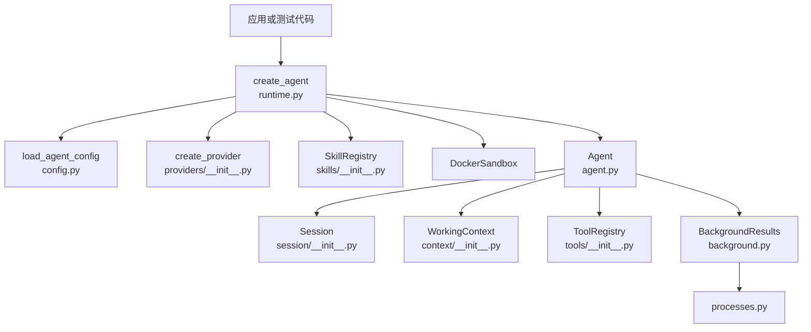
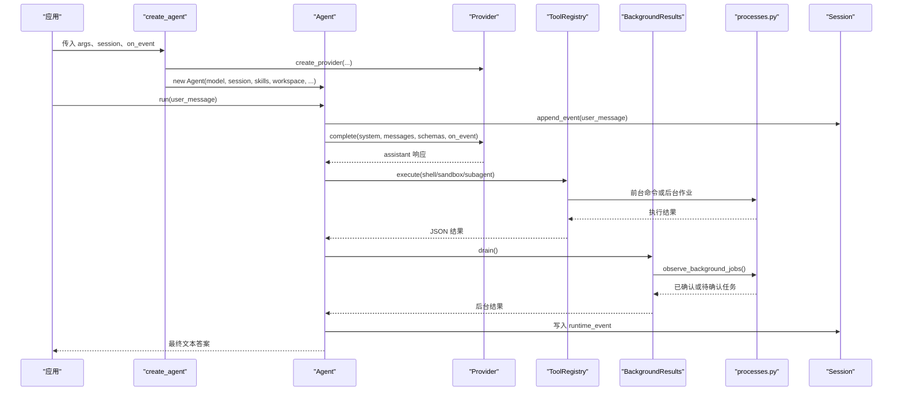
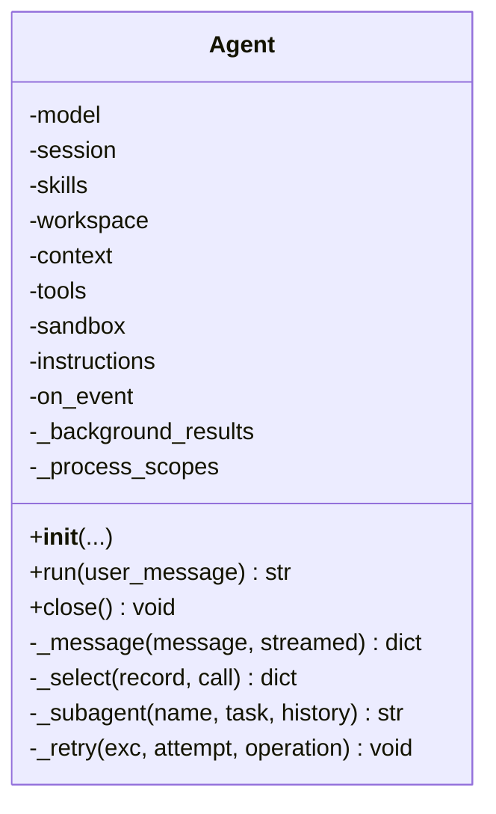
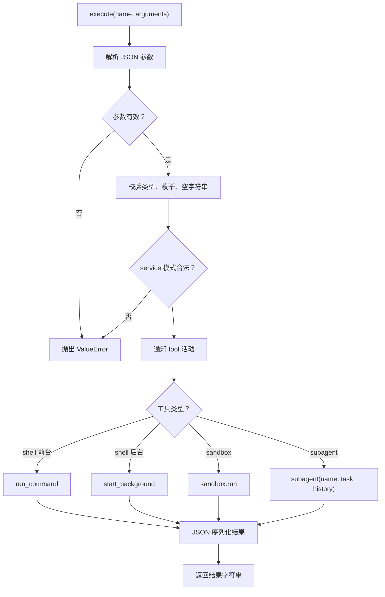
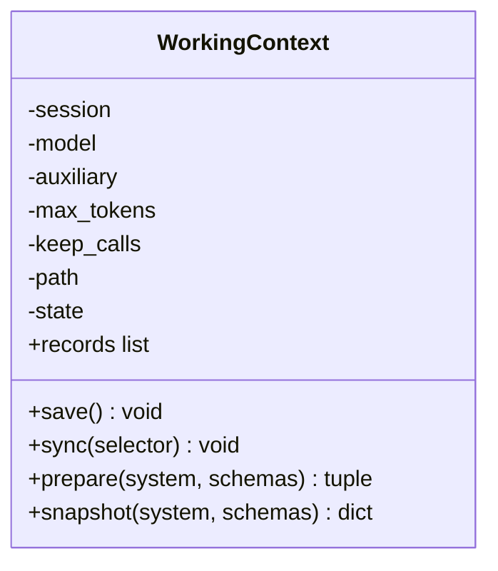
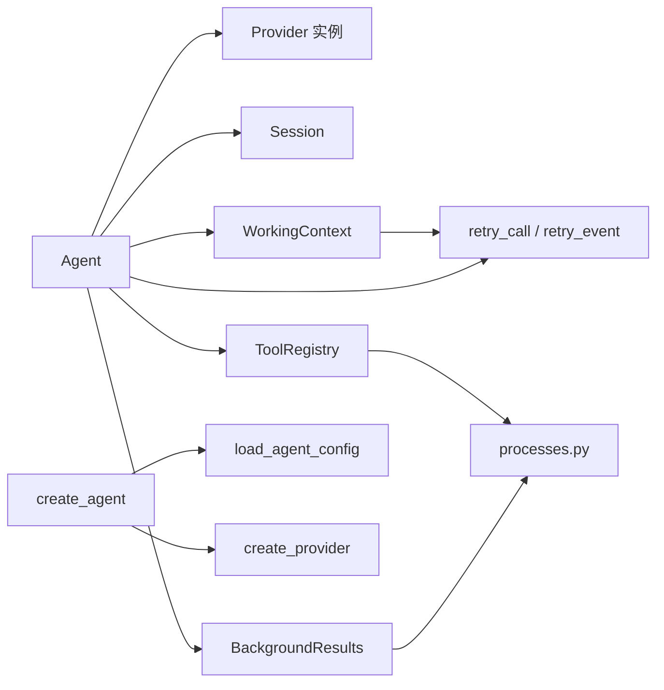

# API 参考

<cite>
**本文引用的文件**   
- [skills_agent/agent.py](file://skills_agent/agent.py)
- [skills_agent/runtime.py](file://skills_agent/runtime.py)
- [skills_agent/providers/base.py](file://skills_agent/providers/base.py)
- [skills_agent/providers/__init__.py](file://skills_agent/providers/__init__.py)
- [skills_agent/providers/retry.py](file://skills_agent/providers/retry.py)
- [skills_agent/tools/__init__.py](file://skills_agent/tools/__init__.py)
- [skills_agent/background.py](file://skills_agent/background.py)
- [skills_agent/session/__init__.py](file://skills_agent/session/__init__.py)
- [skills_agent/config.py](file://skills_agent/config.py)
- [skills_agent/context/__init__.py](file://skills_agent/context/__init__.py)
- [skills_agent/processes.py](file://skills_agent/processes.py)
- [skills_agent/skills/__init__.py](file://skills_agent/skills/__init__.py)
</cite>

## 目录
1. [简介](#简介)
2. [项目结构与公开接口](#项目结构与公开接口)
3. [核心组件总览](#核心组件总览)
4. [架构概览](#架构概览)
5. [详细组件参考](#详细组件参考)
6. [依赖关系分析](#依赖关系分析)
7. [配置、错误与重试契约](#配置错误与重试契约)
8. [性能与可扩展性](#性能与可扩展性)
9. [常见问题与故障排查](#常见问题与故障排查)
10. [向后兼容性与废弃计划](#向后兼容性与废弃计划)
11. [结论](#结论)

## 简介
本 API 参考面向使用 skills-agent 编程接口的开发者，重点说明以下公开类型和公共方法：`Agent`、`Runtime`（由 `create_agent` 暴露）、Provider 基类及 Provider 错误体系、`ToolRegistry`、`BackgroundJobError`、`WorkingContext`、`Session`。文档包含职责说明、构造参数、关键方法、返回值、异常类型、调用关系、Python 集成示例、配置对象、错误分类、重试策略、事件契约、常见集成错误和扩展 Provider 的指导。

该实现采用“会话 + 工作上下文 + 工具注册表 + 后台任务观察”的分层结构：`Session` 负责不可变追加式日志；`WorkingContext` 维护可压缩的工作记忆；`ToolRegistry` 提供 shell、sandbox 和 subagent 三类工具边界；`Agent` 协调模型请求、工具执行、后台结果投递和子代理；`BackgroundResults` 与进程管理模块共同保证后台任务的生命周期和所有权语义。

## 项目结构与公开接口
| 路径 | 主要职责 | 对外可见内容 |
|---|---|---|
| `skills_agent/agent.py` | Agent 主循环、系统提示、子代理、工具选择、后台结果投递 | `Agent` |
| `skills_agent/runtime.py` | 从命令行参数加载配置并创建 Agent | `add_agent_arguments`、`create_agent` |
| `skills_agent/providers/base.py` | Provider 抽象、错误分类、重试属性 | `ProviderError`、`ProviderConnectionError`、`ProviderOutputLimitError`、`DEFAULT_MAX_OUTPUT_TOKENS` |
| `skills_agent/providers/__init__.py` | Provider 工厂 | `create_provider`、`OpenAIProvider`、`AnthropicProvider` |
| `skills_agent/providers/retry.py` | 单次模型操作的重试封装 | `retry_call`、`retry_event` |
| `skills_agent/tools/__init__.py` | 工具定义与执行边界 | `ToolRegistry` |
| `skills_agent/background.py` | 后台完成结果投递与不确定性记录 | `BackgroundResults`、`RUNTIME_EVENT`、`UNCERTAINTY_EVENT` |
| `skills_agent/session/__init__.py` | 追加式会话日志与附件保存 | `Session` |
| `skills_agent/config.py` | TOML + 环境变量 + CLI 配置合并 | `load_agent_config` |
| `skills_agent/context/__init__.py` | 可持久化工作上下文与压缩辅助 | `WorkingContext`、`ContextBudgetError` |
| `skills_agent/processes.py` | 后台作业范围、校验与观察 | `BackgroundJobError`、`ProcessScope`、`observe_background_jobs` |
| `skills_agent/skills/__init__.py` | 技能元数据发现 | `SkillRegistry`、`Skill` |



**图表来源**
- [skills_agent/runtime.py:1-58](file://skills_agent/runtime.py#L1-L58)
- [skills_agent/config.py:1-74](file://skills_agent/config.py#L1-L74)
- [skills_agent/providers/__init__.py:1-20](file://skills_agent/providers/__init__.py#L1-L20)
- [skills_agent/agent.py:1-200](file://skills_agent/agent.py#L1-L200)
- [skills_agent/session/__init__.py:1-113](file://skills_agent/session/__init__.py#L1-L113)
- [skills_agent/context/__init__.py:1-200](file://skills_agent/context/__init__.py#L1-L200)
- [skills_agent/tools/__init__.py:1-191](file://skills_agent/tools/__init__.py#L1-L191)
- [skills_agent/background.py:1-200](file://skills_agent/background.py#L1-L200)
- [skills_agent/processes.py:1-200](file://skills_agent/processes.py#L1-L200)

**章节来源**
- [skills_agent/runtime.py:1-58](file://skills_agent/runtime.py#L1-L58)
- [skills_agent/agent.py:1-200](file://skills_agent/agent.py#L1-L200)

## 核心组件总览
| 组件 | 职责 | 主要输入 | 主要输出 / 副作用 | 典型异常 |
|---|---|---|---|---|
| `Agent` | 编排模型对话、工具调用、后台结果、子代理和系统提示 | 模型、会话、技能注册表、工作区、可选沙箱 | 文本回答、事件回调、工具执行、后台任务生命周期 | `RuntimeError`、`BackgroundJobError`、`KeyboardInterrupt` |
| `create_agent` | 根据运行时参数加载配置、创建 Provider、技能、沙箱和 Agent | 解析后的命令行参数、会话、可选事件回调 | `Agent` | `ValueError`、`FileNotFoundError` |
| `ProviderError` 族 | 统一 Provider 传输、协议和输出限制错误 | HTTP 状态、结构化错误体、诊断信息 | 分类、是否可重试、延迟建议 | 无（本身为异常） |
| `ToolRegistry` | 声明 shell、sandbox、subagent 工具 Schema，并安全执行 | 工具名、JSON 参数字符串 | JSON 序列化结果字符串 | `ValueError`、`ToolCleanupError` |
| `BackgroundResults` | 从会话历史恢复启动回执，观察已注册后台任务并投递终端结果 | 会话、进程范围路径 | 新完成的后台结果、待确认任务 | `BackgroundJobError` |
| `Session` | 追加式事件日志、消息构造、附件保存 | 根路径、会话 ID、消息字典 | 追加后事件、消息、附件元数据 | `ValueError` |
| `WorkingContext` | 维护可持久化的工作上下文、消息分组、压缩预算 | 会话、模型、辅助对象、token 预算 | 同步后的上下文、压缩记录 | `ValueError`、`ContextBudgetError` |
| `SkillRegistry` | 扫描 SKILL.md 并生成模型可用的技能目录 | 多个技能根路径 | 技能目录字符串 | `ValueError` |

**章节来源**
- [skills_agent/agent.py:1-200](file://skills_agent/agent.py#L1-L200)
- [skills_agent/runtime.py:1-58](file://skills_agent/runtime.py#L1-L58)
- [skills_agent/providers/base.py:1-200](file://skills_agent/providers/base.py#L1-L200)
- [skills_agent/tools/__init__.py:1-191](file://skills_agent/tools/__init__.py#L1-L191)
- [skills_agent/background.py:1-200](file://skills_agent/background.py#L1-L200)
- [skills_agent/session/__init__.py:1-113](file://skills_agent/session/__init__.py#L1-L113)
- [skills_agent/context/__init__.py:1-200](file://skills_agent/context/__init__.py#L1-L200)
- [skills_agent/skills/__init__.py:1-54](file://skills_agent/skills/__init__.py#L1-L54)

## 架构概览
Agent 是用户直接调用的顶层对象。它不直接实现模型通信，而是通过 Provider 实例调用 `complete`、`count_text` 等方法；工具执行通过 `ToolRegistry` 进入宿主 shell、沙箱或子代理；后台任务通过 `BackgroundResults` 与 `processes.py` 的进程范围进行所有权校验和结果投递；所有交互写入 `Session`，可压缩摘要写入 `WorkingContext`。



**图表来源**
- [skills_agent/runtime.py:23-58](file://skills_agent/runtime.py#L23-L58)
- [skills_agent/agent.py:201-481](file://skills_agent/agent.py#L201-L481)
- [skills_agent/tools/__init__.py:110-191](file://skills_agent/tools/__init__.py#L110-L191)
- [skills_agent/background.py:1-200](file://skills_agent/background.py#L1-L200)
- [skills_agent/processes.py:1-200](file://skills_agent/processes.py#L1-L200)
- [skills_agent/session/__init__.py:20-113](file://skills_agent/session/__init__.py#L20-L113)

## 详细组件参考

### Agent
`Agent` 是 skills-agent 的主要编程入口。它组合模型、会话、技能、工作上下文、工具注册表和后台结果管理器，并在 `run` 中驱动多轮对话。

#### 构造参数
| 参数 | 类型 | 默认值 | 含义 |
|---|---|---:|---|
| `model` | Provider 实例 | 无 | 模型提供方，负责 `complete`、`count_text` 等能力 |
| `session` | `Session` | 无 | 追加式会话日志 |
| `skills` | `SkillRegistry` | 无 | 可用技能目录 |
| `workspace` | `Path` 或字符串 | 无 | 工作区绝对路径 |
| `context_tokens` | `int` | `DEFAULT_CONTEXT_TOKENS` | 工作上下文 token 预算 |
| `summary_output_tokens` | `int` | `8192` | 辅助摘要的输出上限 |
| `sandbox` | `DockerSandbox` 或 `None` | `None` | 可选容器沙箱 |
| `on_event` | 可调用对象或 `None` | 空回调 | 接收事件字典 |
| `allow_subagent` | `bool` | `True` | 是否允许注册 subagent 工具 |
| `instructions` | `str` | `""` | 附加给模型的指令 |
| `process_scope` | `ProcessScope` 或 `None` | `None` | 继承的后台进程范围 |
| `allow_persistent_processes` | `bool` | `False` | 是否允许在成功时保留持久进程 |

#### 关键方法
| 方法 | 参数 | 返回值 | 行为 |
|---|---|---|---|
| `run(user_message)` | 用户消息字典 | 非空文本答案 | 初始化或复用进程范围，发送消息，循环处理模型回复、工具调用、后台结果，直到得到最终答案 |
| `close()` | 无 | `None` | 关闭当前 Agent 持有的进程范围，清理后台任务；失败会聚合错误并抛出 `RuntimeError` |
| `_subagent(name, task, *, history=False)` | 子任务名称、任务描述、history 标志 | 子代理报告 | 创建子 `Session` 和子 `Agent`，必要时注入历史技能和工作上下文快照 |

#### 重要内部流程
- `run` 会为未继承 `process_scope` 的调用创建新的 `ProcessScope`，并在成功时标记完成，失败时关闭范围。
- 模型调用通过 `retry_call` 包装，遇到 `ProviderError` 且可重试时会触发 `_retry`，并通过 `on_event` 发出重试事件。
- 工具执行前设置 `tool_call_id`，执行后将结果写回会话并同步到 `WorkingContext`。
- 后台结果通过 `BackgroundResults.drain` 获取；若仍有等待任务，则阻塞等待后再继续。

#### 异常
- `KeyboardInterrupt`：子代理捕获中断后转为 `interrupted` 摘要并重新抛出。
- `RuntimeError`：模型返回空答案、后台清理失败或 `close` 聚合清理失败。
- `BackgroundJobError`：继承进程范围清理失败时包装为结构化后台作业错误。



**图表来源**
- [skills_agent/agent.py:1-200](file://skills_agent/agent.py#L1-L200)
- [skills_agent/agent.py:201-481](file://skills_agent/agent.py#L201-L481)

**章节来源**
- [skills_agent/agent.py:1-200](file://skills_agent/agent.py#L1-L200)
- [skills_agent/agent.py:201-481](file://skills_agent/agent.py#L201-L481)

### Runtime：create_agent 与 add_agent_arguments
`create_agent` 不是类，而是构建 Agent 的工厂函数。它负责：
1. 调用 `load_agent_config` 合并 CLI、TOML、环境变量和默认值。
2. 校验工作目录和 model 配置。
3. 通过 `create_provider` 创建模型 Provider。
4. 构建 `SkillRegistry`，包含内置技能、工作区技能和额外技能目录。
5. 可选构建 `DockerSandbox`。
6. 返回 `Agent`。

`add_agent_arguments` 向 argparse 添加常用选项，包括 provider、model、base_url、skill_dir、context_tokens、max_output_tokens、summary_output_tokens、api_format、token_counter、model_context_window、sandbox_image。

#### Python 调用示例
```python
from pathlib import Path
from skills_agent.runtime import add_agent_arguments, create_agent
from skills_agent.session import Session

args = add_agent_arguments.__self__ if hasattr(add_agent_arguments, "__self__") else None
parser = __import__("argparse").ArgumentParser()
add_agent_arguments(parser)
parsed = parser.parse_args([
    "--provider", "openai",
    "--model", "gpt-4o",
    "--skill-dir", "skills",
])
session = Session(Path("."), "demo-session")
agent = create_agent(parsed, session, allow_persistent_processes=False)
answer = agent.run({"role": "user", "content": [{"type": "text", "text": "列出工作区"}]})
agent.close()
```

**章节来源**
- [skills_agent/runtime.py:1-58](file://skills_agent/runtime.py#L1-L58)

### Provider 基类与错误体系
Provider 实现通过 `providers/__init__.py` 的 `create_provider` 暴露。当前支持 `openai` 和 `anthropic`。Provider 实例需要支持：
- `complete(system, messages, schemas, on_event)`
- `count_text(text)`
- 可选 `token_counter` 属性

`ProviderError` 是所有 Provider 异常的基类，继承自 `RuntimeError`。其关键属性如下：

| 属性 | 类型 | 含义 |
|---|---|---|
| `raw` | `dict` 或 `None` | 原始错误载荷 |
| `partial_content` | `list[dict]` | 流式或部分响应片段 |
| `diagnostics` | `dict` 或 `None` | 诊断信息，可能包含 response、body、kind、retry |
| `http_status` | `int` 或 `None` | 从诊断响应中提取的 HTTP 状态码 |
| `provider_code` | `str` 或 `int` 或 `None` | 结构化错误中的 code |
| `provider_type` | `str` 或 `None` | 结构化错误中的 type |
| `finish_reason` | `str` 或 `None` | 终止原因 |
| `category` | `str` | 错误分类，如 `invalid_request`、`authentication`、`rate_limited`、`server_error`、`connection`、`output_limit`、`content_filter`、`protocol`、`provider_error` 等 |
| `retryable` | `bool` | 仅当 `category` 属于可重试集合时为真 |
| `retry_after_seconds` | `float` 或 `None` | 服务器 Retry-After 头换算后的秒数 |

子类：
- `ProviderConnectionError`：传输失败或流提前结束。
- `ProviderOutputLimitError`：因输出或上下文限制停止生成。
- `ProviderImageError`：本地图片无法包含在 Provider 请求中。

#### 错误分类约定
- HTTP 4xx/5xx 映射到 `invalid_request`、`authentication`、`insufficient_balance`、`permission`、`not_found`、`rate_limited`、`server_error`、`bad_gateway`、`service_unavailable`、`gateway_timeout`。
- 结构化 `code`/`type` 映射覆盖常见供应商字段。
- 可重试类别包括连接、限流、服务端错误、网关错误、服务不可用和网关超时。
- 人类可读消息不应将原本永久性的失败转换为可重试错误。

**章节来源**
- [skills_agent/providers/base.py:1-200](file://skills_agent/providers/base.py#L1-L200)
- [skills_agent/providers/__init__.py:1-20](file://skills_agent/providers/__init__.py#L1-L20)

### ToolRegistry
`ToolRegistry` 声明并执行三类工具：shell、sandbox、subagent。它不负责业务逻辑，只负责参数校验、Schema 生成、活动回调和结果序列化。

#### 构造参数
| 参数 | 类型 | 含义 |
|---|---|---|
| `workspace` | `Path` | 宿主命令工作目录 |
| `sandbox` | 可选沙箱对象 | 若存在则注册 sandbox 工具 |
| `subagent` | 可选可调用对象 | 若存在则注册 subagent 工具 |
| `on_activity` | 可调用对象 | 工具开始和结束时通知 |
| `log_dir` | 可选路径 | 前台命令日志目录 |

#### 关键属性与方法
| 成员 | 类型 | 说明 |
|---|---|---|
| `schemas` | `list[dict]` | 工具 JSON Schema，供模型工具选择 |
| `execute(name, arguments)` | 方法 | 解析工具名和 JSON 参数，校验类型、枚举、必填项，然后执行并返回 JSON 字符串 |
| `process_scope` | `ProcessScope` 或 `None` | 后台 shell 执行所需的进程范围 |
| `process_context` | 任意上下文 | 传递给后台作业的执行上下文标识 |
| `tool_call_id` | `str` 或 `None` | 当前工具调用 ID，用于调试和关联 |

#### 参数校验规则
- 工具参数必须是合法 JSON 对象。
- 必须包含 required 字段，不能包含额外字段。
- `timeout_seconds` 使用 `validate_timeout`，后台 shell 要求正有限浮点数。
- `images` 通过 `validate_images` 校验。
- `background_lifecycle=service` 必须配合 `run_in_background=true`。
- 未知工具名会抛出 `ValueError`。

#### 执行结果
- 成功时返回包含执行结果的 JSON 字符串。
- 工具执行期间通过 `on_activity` 通知 `kind="tool"`。
- 前台 shell 可附带图片列表；后台 shell 通过 `process_scope.start_background` 启动。
- 其他异常被包装为 `{"error": ...}`；尚未执行的异常还会标记 `executed=false`。



**图表来源**
- [skills_agent/tools/__init__.py:1-191](file://skills_agent/tools/__init__.py#L1-L191)

**章节来源**
- [skills_agent/tools/__init__.py:1-191](file://skills_agent/tools/__init__.py#L1-L191)

### BackgroundResults 与后台任务
`BackgroundResults` 的核心职责是把“已注册的后台完成记录”作为出站队列，而不是把会话历史当作唯一事实源。它会：
- 从会话事件中恢复 shell 启动回执。
- 识别 `RUNTIME_EVENT` 和 `UNCERTAINTY_EVENT`，区分已投递、待确认和不确定性任务。
- 通过 `observe_background_jobs` 验证进程范围中的后台作业。
- 对拥有权不匹配但 `wait_on_exit=True` 的任务，可选择以“未确认”形式呈现。
- 支持子代理会话的结果移交。

#### 常量
| 常量 | 值 | 含义 |
|---|---|---|
| `TERMINAL_STATES` | `{"exited","failed","stopped","timed_out"}` | 后台任务的终态集合 |
| `RUNTIME_EVENT` | `"background_job_result"` | 后台结果运行时事件 |
| `UNCERTAINTY_EVENT` | `"background_job_uncertainty"` | 后台不确定性事件 |

#### 关键方法
| 方法 | 参数 | 返回值 | 行为 |
|---|---|---|---|
| `drain(append)` | 追加回调 | `(delivered_count, active_jobs)` | 扫描会话和进程范围，追加新完成的后台结果，返回活跃任务 |
| `wait(append)` | 追加回调 | `None` | 等待未确认后台任务完成 |

#### 与 Agent 的关系
Agent 在每轮模型调用前后都调用 `drain`，如果仍有等待任务则调用 `wait`，确保后台结果在最终交付前被消费。

**章节来源**
- [skills_agent/background.py:1-200](file://skills_agent/background.py#L1-L200)
- [skills_agent/agent.py:201-481](file://skills_agent/agent.py#L201-L481)
- [skills_agent/processes.py:1-200](file://skills_agent/processes.py#L1-L200)

### WorkingContext
`WorkingContext` 维护可持久化的工作上下文，包括：
- 会话引用、模型引用、辅助对象。
- 最大 token 预算和保留的工具调用数量。
- 可复用的 `context.json` 状态。
- 消息分组、图像投影、恢复中断调用、压缩和保存。

#### 构造参数
| 参数 | 类型 | 默认值 | 含义 |
|---|---|---:|---|
| `session` | `Session` | 无 | 会话日志 |
| `model` | Provider | 无 | 用于计数和辅助生成 |
| `auxiliary` | `Auxiliary` | 无 | 摘要和工具报告辅助对象 |
| `max_tokens` | `int` | `DEFAULT_CONTEXT_TOKENS` | 上下文 token 预算 |
| `keep_calls` | `int` | `10` | 保留最近多少组工具调用 |
| `on_activity` | 可调用对象 | 空回调 | 压缩等活动回调 |
| `on_retry` | 可调用对象 | 会话追加事件 | 重试事件回调 |

#### 关键行为
- 构造函数校验 `max_tokens > 0` 且 `keep_calls >= 1`。
- 不支持的版本会抛出 `ValueError`。
- 当模型 token 计数器为 `usage` 时，会记录上报用量并保存上下文。
- 消息分组不允许孤儿工具结果、重复工具调用 ID 或未完成的工具组。



**图表来源**
- [skills_agent/context/__init__.py:1-200](file://skills_agent/context/__init__.py#L1-L200)

**章节来源**
- [skills_agent/context/__init__.py:1-200](file://skills_agent/context/__init__.py#L1-L200)

### Session
`Session` 是追加式的交互历史存储，每个会话对应一个目录和一个 `events.jsonl` 文件。

#### 构造参数
| 参数 | 类型 | 含义 |
|---|---|---|
| `root` | `Path` | 会话根目录 |
| `session_id` | `str` | 会话 ID，必须匹配 `[A-Za-z0-9][A-Za-z0-9_.-]{0,127}` |

#### 关键方法
| 方法 | 参数 | 返回值 | 行为 |
|---|---|---|---|
| `append(message)` | 消息字典 | 追加事件 | 包装为 `type=message` 的事件 |
| `append_event(event)` | 事件字典 | 追加事件 | 写入带时间戳和 event_id 的行 |
| `iter_events(after=0)` | 偏移量 | 迭代器 | 从指定字节偏移读取追加事件 |
| `events()` | 无 | `list[dict]` | 读取全部事件 |
| `messages()` | 无 | `list[dict]` | 读取全部消息 |
| `save_attachment(supplied_path, data=None)` | 文件或字节 | 附件元数据 | 复制并生成 URL、MIME 类型 |
| `make_user_message(text, paths)` | 文本和图片路径 | 用户消息 | 最多支持固定数量的图片，否则抛出 `ValueError` |

**章节来源**
- [skills_agent/session/__init__.py:1-113](file://skills_agent/session/__init__.py#L1-L113)

### 后台作业错误：BackgroundJobError
`BackgroundJobError` 继承自 `ToolCleanupError`，表示已注册后台作业的结果或所有权无法安全建立。它出现在：
- 后台作业注册文件校验失败。
- 进程范围或监督者身份无法确认。
- 清理未确认。
- 观察后台作业时遇到损坏或不一致记录。

**章节来源**
- [skills_agent/processes.py:1-200](file://skills_agent/processes.py#L1-L200)

### 技能注册表：SkillRegistry
`SkillRegistry` 扫描多个根路径下的 `SKILL.md`，解析 YAML frontmatter，生成 `Skill` 数据类，并提供目录字符串。

#### 校验规则
- 缺少 YAML frontmatter 头。
- frontmatter 未闭合。
- frontmatter 不是字典。
- name 或 description 为空或非字符串。
- 重复 skill 名称指向不同路径。

**章节来源**
- [skills_agent/skills/__init__.py:1-54](file://skills_agent/skills/__init__.py#L1-L54)

## 依赖关系分析


**图表来源**
- [skills_agent/agent.py:1-200](file://skills_agent/agent.py#L1-L200)
- [skills_agent/runtime.py:1-58](file://skills_agent/runtime.py#L1-L58)
- [skills_agent/tools/__init__.py:1-191](file://skills_agent/tools/__init__.py#L1-L191)
- [skills_agent/background.py:1-200](file://skills_agent/background.py#L1-L200)
- [skills_agent/context/__init__.py:1-200](file://skills_agent/context/__init__.py#L1-L200)
- [skills_agent/providers/retry.py:1-86](file://skills_agent/providers/retry.py#L1-L86)

**章节来源**
- [skills_agent/agent.py:1-200](file://skills_agent/agent.py#L1-L200)
- [skills_agent/tools/__init__.py:1-191](file://skills_agent/tools/__init__.py#L1-L191)
- [skills_agent/background.py:1-200](file://skills_agent/background.py#L1-L200)

## 配置、错误与重试契约

### 配置对象
`load_agent_config` 支持的键包括：
| 键 | 类型 | 默认值 | 约束 |
|---|---|---|---|
| `provider` | `str` | `"openai"` | 必须在 `{"openai","anthropic"}` 中 |
| `model` | `str` 或 `None` | `None` | 非空字符串 |
| `base_url` | `str` 或 `None` | `None` | 非空字符串 |
| `context_tokens` | `int` | `DEFAULT_CONTEXT_TOKENS` | 正整数 |
| `model_context_window` | `int` 或 `None` | `None` | 正整数 |
| `max_output_tokens` | `int` | `DEFAULT_MAX_OUTPUT_TOKENS` | 正整数 |
| `summary_output_tokens` | `int` | `8192` | 正整数 |
| `api_format` | `str` | `"auto"` | 必须在 `{"auto","responses","chat"}` 中 |
| `token_counter` | `str` | `"auto"` | 必须在 `{"auto","official","usage"}` 中 |
| `skill_dirs` | `list[str]` | `[]` | 非空字符串数组 |
| `sandbox_image` | `str` 或 `None` | `None` | 非空字符串 |

优先级：显式 CLI 参数 > TOML > 环境变量 > 内置默认值。环境变量包括：
- `{PROVIDER}_MODEL`、`{PROVIDER}_BASE_URL`
- `SKILLS_AGENT_API_FORMAT`
- `SKILLS_AGENT_TOKEN_COUNTER`

**章节来源**
- [skills_agent/config.py:1-74](file://skills_agent/config.py#L1-L74)

### 错误分类
Provider 错误按以下顺序判断 `category`：
1. HTTP 状态码映射。
2. `ProviderConnectionError` 子类映射为 `connection`。
3. `ProviderOutputLimitError` 子类映射为 `output_limit`。
4. `finish_reason` 映射到 `output_limit`、`content_filter` 或 `aborted`。
5. 结构化错误 `code`/`type` 映射。
6. 协议诊断标记为 `protocol`。
7. 否则为 `provider_error`。

`retryable` 为真当且仅当 `category` 属于连接、限流、服务端错误、网关错误、服务不可用或网关超时。

**章节来源**
- [skills_agent/providers/base.py:1-200](file://skills_agent/providers/base.py#L1-L200)

### 重试策略
`retry_call` 的行为：
- 默认基础延迟为固定常数。
- 可配置最大尝试次数和最大耗时。
- 环境变量 `SKILLS_AGENT_PROVIDER_MAX_ATTEMPTS` 和 `SKILLS_AGENT_PROVIDER_RETRY_BUDGET_SECONDS` 可控制重试预算。
- 仅对 `retryable=True` 的 `ProviderError` 重试。
- 每次重试都会更新 `exc.diagnostics["retry"]`，包含尝试次数、已耗时、是否耗尽、下次延迟等信息。
- 通过 `on_retry` 回调上报重试事件，但不重放已完成的工具调用。
- `KeyboardInterrupt` 和 `SystemExit` 不会被打断，取消总是传播。

重试事件格式由 `retry_event` 生成，包含：
- `type="retry"`
- `operation`
- `attempt`
- `retry_in_seconds`
- `category`
- `http_status`
- `provider_code`
- `provider_type`
- 可选 `diagnostics`、`_raw`、`partial_content`

**章节来源**
- [skills_agent/providers/retry.py:1-86](file://skills_agent/providers/retry.py#L1-L86)

### 事件类型契约
| 事件类型 | 来源 | 关键字段 |
|---|---|---|
| `activity` | Agent 活动回调 | `activity.kind` |
| `retry` | Provider 重试 | `operation`、`attempt`、`category`、`http_status`、`provider_code`、`provider_type` |
| `background_job_result` | 后台任务完成 | `background_job_id`、`background_result_id`、`resolved_uncertainty_ids` |
| `background_job_uncertainty` | 后台任务不确定性 | `background_uncertainty_id`、`background_uncertainty_job` |
| `subagent_summary` | 子代理生命周期 | `name`、`status`、`child_session_id`、`child_session_path`、`background_owner_session_id` |
| `error` | 清理或诊断失败 | `message` |

**章节来源**
- [skills_agent/background.py:1-200](file://skills_agent/background.py#L1-L200)
- [skills_agent/providers/retry.py:1-86](file://skills_agent/providers/retry.py#L1-L86)
- [skills_agent/agent.py:201-481](file://skills_agent/agent.py#L201-L481)

## 性能与可扩展性
- 工作上下文 token 预算默认非常大，适合长对话；实际压缩阈值与工作上下文和模型窗口的较小值的 80% 相关。
- 工具结果在 `result_mode="report"` 或超过 8192 token 时生成摘要，避免把完整命令输出反复塞入上下文。
- 后台任务通过独立进程范围和观察器解耦，避免主对话阻塞于长时间任务。
- 扩展 Provider 时应保持 `ProviderError.category` 和 `retryable` 语义正确，不要基于人类可读消息放宽重试条件。
- 扩展 ToolRegistry 应遵循现有 Schema 设计：明确 required、enum、类型校验和空值处理。

## 常见问题与故障排查

### 直接创建 Agent 失败
**现象**：传入的 workspace 不是目录，或 model 未配置。  
**原因**：`create_agent` 在工作目录不存在或缺少 model 时抛出 `ValueError`。  
**修复**：确保工作目录存在，并通过 CLI、TOML、环境变量或构造参数提供 model。

**章节来源**
- [skills_agent/runtime.py:23-58](file://skills_agent/runtime.py#L23-L58)

### 参数校验失败
**现象**：工具调用报错“参数必须是...”。  
**原因**：`ToolRegistry.execute` 对 JSON、类型、枚举、空字符串、required 字段和 service 模式进行了严格校验。  
**修复**：确保工具参数是合法 JSON 对象，必填字段齐全，`timeout_seconds` 为正数，`background_lifecycle=service` 时必须设置 `run_in_background=true`。

**章节来源**
- [skills_agent/tools/__init__.py:1-191](file://skills_agent/tools/__init__.py#L1-L191)

### 异步回调异常
**现象**：后台任务回调或事件监听出现异常。  
**原因**：`on_event`、`on_activity`、`on_retry` 都是用户提供的可调用对象；实现中通常把它们作为回调调用，但未对回调内部异常做全面捕获。  
**修复**：在外部包装 `on_event`，记录异常堆栈，避免吞掉底层错误；对长时间运行的回调考虑异步隔离或线程隔离。

**章节来源**
- [skills_agent/agent.py:1-200](file://skills_agent/agent.py#L1-L200)
- [skills_agent/providers/retry.py:1-86](file://skills_agent/providers/retry.py#L1-L86)

### 后台任务所有权不一致
**现象**：后台任务显示为“未确认”，或清理失败。  
**原因**：进程范围损坏、监督者身份无法确认、清理未确认、子代理结果移交不完整。  
**修复**：检查 `process-scopes` 下记录是否完整；查看 `BackgroundJobError` 的原因；对于跨子代理移交的场景，确保子代理已完成并报告。

**章节来源**
- [skills_agent/processes.py:1-200](file://skills_agent/processes.py#L1-L200)
- [skills_agent/background.py:1-200](file://skills_agent/background.py#L1-L200)

### 扩展 Provider 示例
推荐实现步骤：
1. 新建 Provider 类，实现 `complete`、`count_text` 等方法。
2. 将网络异常包装为 `ProviderError`，并尽量填充 `diagnostics`、`raw`、`provider_code`、`provider_type`。
3. 对连接中断或流提前结束使用 `ProviderConnectionError`。
4. 对输出或上下文限制使用 `ProviderOutputLimitError`。
5. 在 `providers/__init__.py` 的 `create_provider` 中注册新 provider。
6. 编写测试覆盖 `category`、`retryable`、`retry_after_seconds` 和 `http_status`。

**章节来源**
- [skills_agent/providers/base.py:1-200](file://skills_agent/providers/base.py#L1-L200)
- [skills_agent/providers/__init__.py:1-20](file://skills_agent/providers/__init__.py#L1-L20)

## 向后兼容性与废弃计划
- 会话事件采用追加式 JSONL，旧日志通过稳定偏移和 event_id 兼容读取。
- `Session.iter_events` 支持 legacy logs 的稳定引用，不因压缩改写旧记录。
- 后台任务同时支持正式记录和“未确认”不确定性状态，以便在元数据缺失或崩溃恢复时逐步收敛。
- `BackgroundResults` 对 legacy registration 没有 owner 字段的作业，仅在根会话范围接受，防止子会话误认领。
- 当前公开契约中，`Agent`、`ToolRegistry`、`Session`、`WorkingContext`、`BackgroundResults`、`ProviderError` 族和 `create_agent` 是最稳定的扩展点。内部私有方法和内部模块（如 `_arguments`、`_system`、`_select`）不应视为稳定 API。
- 未来新增 Provider 或工具时，应保持错误分类、事件结构和 JSON 序列化行为一致，避免破坏现有观察者。

**章节来源**
- [skills_agent/session/__init__.py:1-113](file://skills_agent/session/__init__.py#L1-L113)
- [skills_agent/background.py:1-200](file://skills_agent/background.py#L1-L200)
- [skills_agent/tools/__init__.py:1-191](file://skills_agent/tools/__init__.py#L1-L191)

## 结论
skills-agent 的编程接口围绕 `Agent` 展开，通过 Provider、工具注册表、会话、工作上下文和后台任务观察器协作完成多轮智能体执行。开发者应优先使用 `create_agent` 或手动构造 `Agent`，并通过 `on_event` 订阅 activity、retry、后台任务和子代理事件。扩展 Provider 时，务必正确实现错误分类和重试语义；扩展工具时，应遵循 `ToolRegistry` 的参数校验和 Schema 契约。后台任务的所有权和生命周期是该系统的复杂点，建议在集成中显式处理未确认状态、清理失败和子代理结果移交。