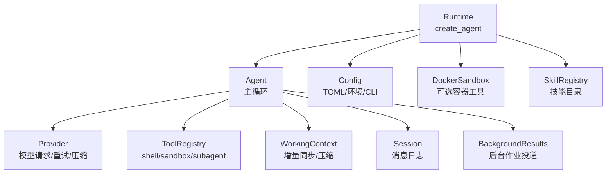
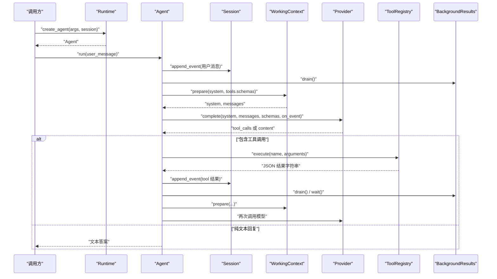
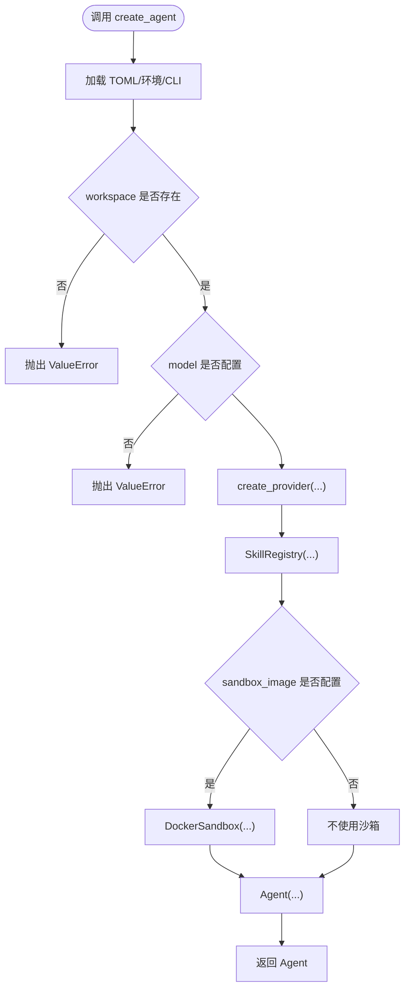
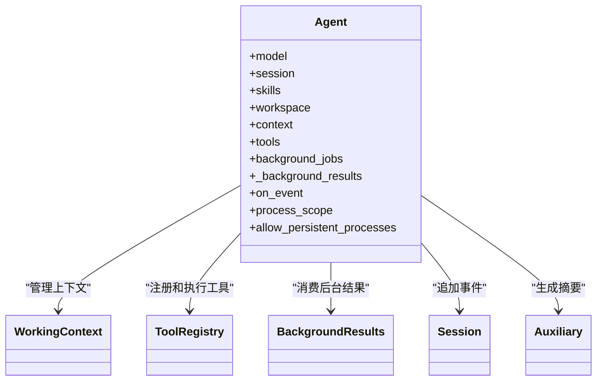
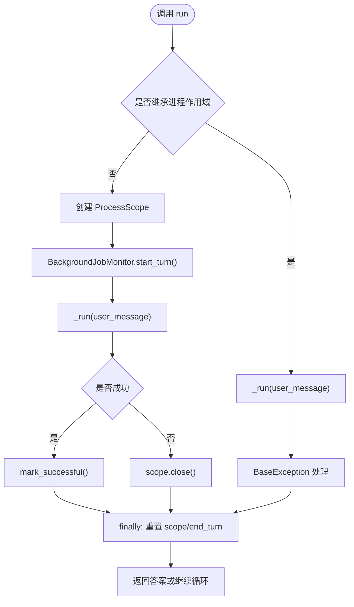
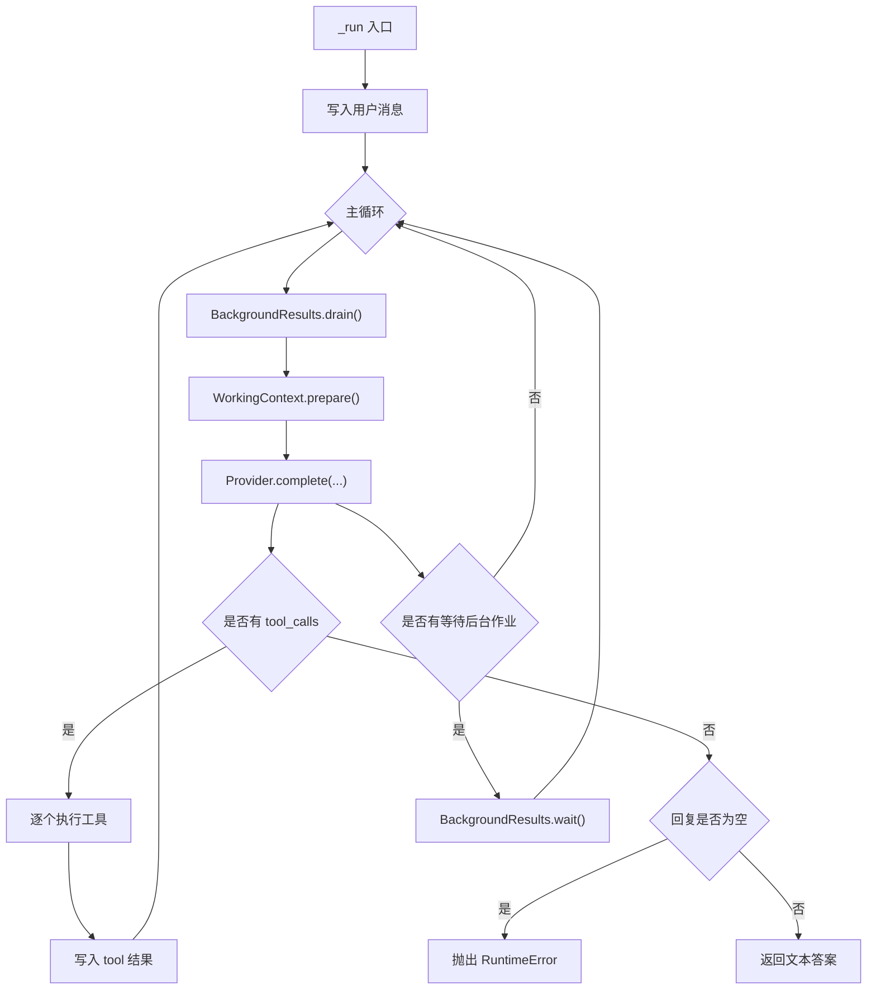
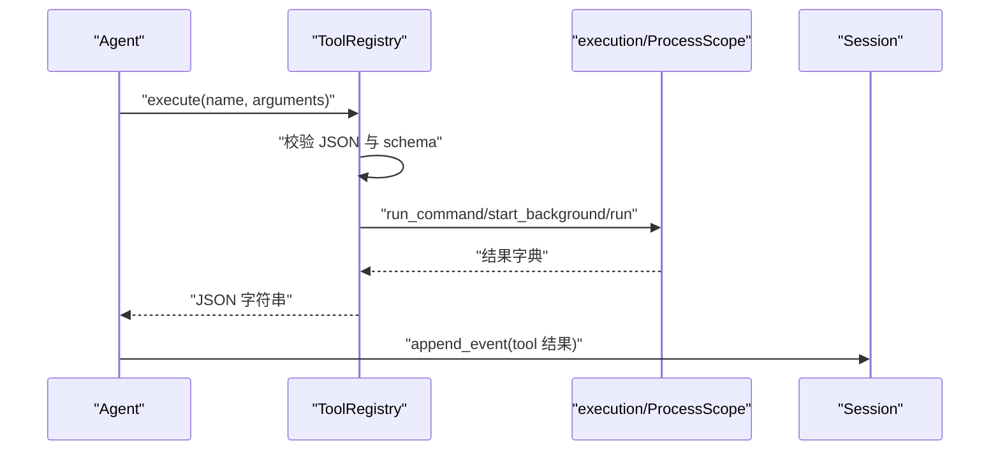
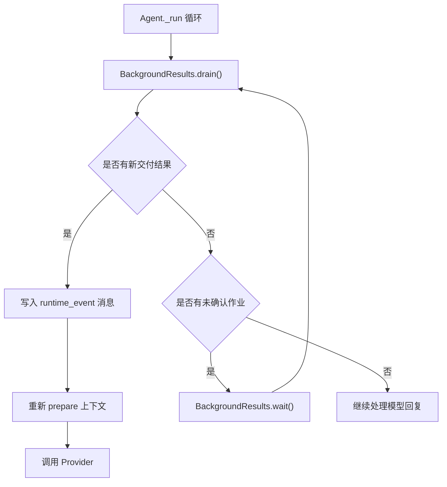
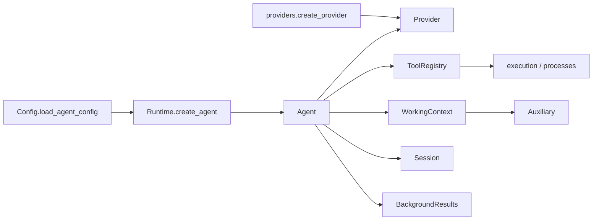

# Agent 与 Runtime

<cite>
**本文引用的文件**
- [runtime.py](file://skills_agent/runtime.py)
- [agent.py](file://skills_agent/agent.py)
- [providers/base.py](file://skills_agent/providers/base.py)
- [providers/__init__.py](file://skills_agent/providers/__init__.py)
- [session/__init__.py](file://skills_agent/session/__init__.py)
- [background.py](file://skills_agent/background.py)
- [config.py](file://skills_agent/config.py)
- [tools/__init__.py](file://skills_agent/tools/__init__.py)
- [context/__init__.py](file://skills_agent/context/__init__.py)
</cite>

## 目录
1. [简介](#简介)
2. [项目结构](#项目结构)
3. [核心组件](#核心组件)
4. [架构总览](#架构总览)
5. [详细接口参考](#详细接口参考)
6. [依赖关系分析](#依赖关系分析)
7. [性能注意事项](#性能注意事项)
8. [故障排查指南](#故障排查指南)
9. [结论](#结论)
10. [附录：Python 使用示例](#附录python-使用示例)

## 简介
本文面向直接调用 `Runtime.create_agent`、`Agent.__init__`、`Agent.run` 的开发者，提供 Agent 与 Runtime 编程接口的 API 参考。重点说明以下职责边界：
- Runtime：从命令行或配置构建 Agent，创建 Provider、SkillRegistry、DockerSandbox 和 Workspace。
- Agent：维护工作上下文、工具注册表、后台任务结果队列、子代理执行以及多轮对话主循环。
- Provider：封装模型请求、重试分类、流式事件、上下文压缩能力。
- ToolRegistry：校验工具参数、执行 shell/sandbox/subagent 等工具。
- WorkingContext：增量同步 Session、控制上下文 token 预算、触发摘要压缩。
- Session：追加不可变消息事件，保存附件。
- BackgroundResults：将已完成的后台作业投递到会话历史，并在等待未完成作业时协调下一轮请求。

## 项目结构
与本次文档相关的核心代码位于 `skills_agent` 包中：
- `runtime.py`：对外暴露 `create_agent`。
- `agent.py`：实现 `Agent` 主循环、中断恢复、工具调用处理、后台作业观察。
- `providers/`：Provider 抽象、错误分类、OpenAI 与 Anthropic 实现。
- `tools/__init__.py`：ToolRegistry，定义并执行工具。
- `context/__init__.py`：WorkingContext，负责增量同步、token 计数、上下文压缩。
- `session/__init__.py`：Session，追加消息事件和附件。
- `background.py`：BackgroundResults，消费后台作业结果。
- `config.py`：TOML 配置、环境变量与 CLI 参数合并。



**图表来源**
- [runtime.py:24-58](file://skills_agent/runtime.py#L24-L58)
- [agent.py:28-100](file://skills_agent/agent.py#L28-L100)
- [providers/__init__.py:1-20](file://skills_agent/providers/__init__.py#L1-L20)
- [tools/__init__.py:10-191](file://skills_agent/tools/__init__.py#L10-L191)
- [context/__init__.py:170-446](file://skills_agent/context/__init__.py#L170-L446)
- [session/__init__.py:12-113](file://skills_agent/session/__init__.py#L12-L113)
- [background.py:23-200](file://skills_agent/background.py#L23-L200)

**章节来源**
- [runtime.py:1-58](file://skills_agent/runtime.py#L1-L58)
- [agent.py:1-100](file://skills_agent/agent.py#L1-L100)
- [config.py:1-74](file://skills_agent/config.py#L1-L74)

## 核心组件
| 组件 | 主要职责 | 关键方法/属性 | 典型交互对象 |
|---|---|---|---|
| Runtime | 解析配置、创建 Provider、SkillRegistry、Sandbox，返回 Agent | `add_agent_arguments`、`create_agent` | Config、Provider、Agent |
| Agent | 对话主循环、工具调用、后台作业、子代理、中断恢复 | `__init__`、`run`、`close`、内部 `_run` | Provider、ToolRegistry、WorkingContext、Session、BackgroundResults |
| Provider | 发送模型请求、流式回调、错误分类、token 计数、上下文压缩 | `complete`、`count_tokens`、`compact_messages`（可选） | Agent、WorkingContext |
| ToolRegistry | 校验 JSON 参数、执行 shell/sandbox/subagent | `execute`、`schemas` | Agent、ProcessScope、execution |
| WorkingContext | 增量同步 Session、token 预算、压缩保护最近消息和用户消息 | `sync`、`prepare`、`records` | Session、Provider、Auxiliary |
| Session | 追加不可变事件、保存附件、构造用户消息 | `append_event`、`make_user_message` | Agent、WorkingContext |
| BackgroundResults | 扫描已完成后台作业、投递结果、维持不确定性状态 | `drain`、`wait` | Agent、Session、processes |

**章节来源**
- [runtime.py:24-58](file://skills_agent/runtime.py#L24-L58)
- [agent.py:28-520](file://skills_agent/agent.py#L28-L520)
- [providers/base.py:47-186](file://skills_agent/providers/base.py#L47-L186)
- [tools/__init__.py:10-191](file://skills_agent/tools/__init__.py#L10-L191)
- [context/__init__.py:170-446](file://skills_agent/context/__init__.py#L170-L446)
- [session/__init__.py:12-113](file://skills_agent/session/__init__.py#L12-L113)
- [background.py:23-200](file://skills_agent/background.py#L23-L200)

## 架构总览
Agent 的运行流程围绕一次 `run(user_message)` 展开：先写入用户消息，再进入循环；每次循环会消费后台作业、准备上下文、调用 Provider、处理工具调用或文本回复。



**图表来源**
- [runtime.py:24-58](file://skills_agent/runtime.py#L24-L58)
- [agent.py:318-520](file://skills_agent/agent.py#L318-L520)
- [context/__init__.py:330-446](file://skills_agent/context/__init__.py#L330-L446)
- [tools/__init__.py:130-191](file://skills_agent/tools/__init__.py#L130-L191)
- [background.py:160-200](file://skills_agent/background.py#L160-L200)

## 详细接口参考

### Runtime.create_agent
- **职责**
  - 加载 TOML 配置、CLI 参数与环境变量。
  - 校验 workspace 存在且 model 已配置。
  - 通过 `create_provider` 实例化 Provider。
  - 组装 SkillRegistry、可选 DockerSandbox。
  - 返回 `Agent`。
- **位置**
  - 函数定义位于 `skills_agent/runtime.py`。
- **参数**
  - `args`：包含 CLI 参数及 workspace 的对象，会被 `load_agent_config` 覆盖。
  - `session`：`Session` 实例，用于保存事件、附件、进程作用域。
  - `on_event`：可选回调，接收事件字典；默认空回调。
  - `allow_persistent_processes`：是否允许持久化进程作用域。
- **关键字参数**
  - `on_event=None`
  - `allow_persistent_processes=False`
- **返回值**
  - `Agent` 实例。
- **抛出异常**
  - `ValueError`：workspace 不存在；model 未配置；Provider 类型未知；配置项无效。
- **与其他组件的关系**
  - 调用 `load_agent_config` 读取 `skills-agent.toml` 及环境变量。
  - 调用 `create_provider` 选择 OpenAI 或 Anthropic。
  - 创建 `SkillRegistry`，路径包括内置 skills、workspace/skills 和额外 skill_dirs。
  - 可选创建 `DockerSandbox`，注入沙箱工具 schema。
  - 最终构造 `Agent(model, session, skills, workspace, ...)`。



**图表来源**
- [runtime.py:24-58](file://skills_agent/runtime.py#L24-L58)
- [config.py:35-74](file://skills_agent/config.py#L35-L74)
- [providers/__init__.py:12-20](file://skills_agent/providers/__init__.py#L12-L20)

**章节来源**
- [runtime.py:24-58](file://skills_agent/runtime.py#L24-L58)
- [config.py:1-74](file://skills_agent/config.py#L1-L74)
- [providers/__init__.py:1-20](file://skills_agent/providers/__init__.py#L1-L20)

### Agent.__init__
- **职责**
  - 初始化模型、会话、技能目录、工作空间、环境信息。
  - 创建辅助摘要器 `Auxiliary` 和工作上下文 `WorkingContext`。
  - 初始化工具注册表 `ToolRegistry`。
  - 初始化后台结果收集器 `BackgroundResults`。
  - 加载或附加进程作用域，连接后台作业监控。
- **构造参数**
  - `model`：Provider 实例。
  - `session`：Session 实例。
  - `skills`：SkillRegistry 实例。
  - `workspace`：Path 或可转为 Path 的工作空间。
- **关键字参数**
  - `context_tokens=DEFAULT_CONTEXT_TOKENS`：工作上下文 token 预算。
  - `summary_output_tokens=8192`：辅助摘要生成输出上限。
  - `sandbox=None`：可选 DockerSandbox。
  - `on_event=None`：全局事件回调。
  - `allow_subagent=True`：是否允许 subagent 工具。
  - `instructions=""`：附加给模型的指令。
  - `process_scope=None`：继承外部进程作用域时使用。
  - `allow_persistent_processes=False`：是否允许持久化进程。
- **返回值**
  - 无显式返回值；内部完成所有资源初始化。
- **抛出异常**
  - 可能由底层组件抛出，例如 `BackgroundJobError`（附加已有 scope 失败时会被捕获但保留诊断）。
- **重要内部行为**
  - `self.tools.process_context = self._background_results.owner`，使工具知道后台任务归属。
  - 若未继承 process_scope，则扫描 `session.path/process-scopes/*`。
  - 非继承模式下启动 `BackgroundJobMonitor`，并把事件转发到 `on_event`。



**图表来源**
- [agent.py:28-100](file://skills_agent/agent.py#L28-L100)

**章节来源**
- [agent.py:28-100](file://skills_agent/agent.py#L28-L100)

### Agent.run
- **职责**
  - 入口方法，包装进程作用域生命周期。
  - 在继承 scope 模式下委托 `_run`，并在异常时尝试关闭 owner。
  - 在非继承模式下创建临时 `ProcessScope`，标记成功或清理。
  - 调用 `_run` 执行完整多轮对话。
- **参数**
  - `user_message`：由 `Session.make_user_message` 生成的用户消息字典。
- **返回值**
  - 模型最终文本答案。
- **抛出异常**
  - `KeyboardInterrupt`、`SystemExit`、其他业务异常。
  - 当模型既没有返回文本也没有工具调用时，抛出 `RuntimeError("Model returned neither an answer nor a tool call")`。
  - 继承 scope 模式下若后台清理失败，可能抛出 `BackgroundJobError`。
- **状态变化**
  - 设置 `self.process_scope` 与 `self.tools.process_scope`。
  - 开始 `BackgroundJobMonitor.start_turn()`。
  - 成功后标记 `scope.mark_successful()`。
  - finally 中重置 `process_scope` 并结束 turn。



**图表来源**
- [agent.py:318-370](file://skills_agent/agent.py#L318-L370)

**章节来源**
- [agent.py:318-370](file://skills_agent/agent.py#L318-L370)

### Agent._run
- **职责**
  - 写入用户消息。
  - 循环消费后台作业、准备上下文、调用 Provider。
  - 处理工具调用、工具结果、thinking 预览、中断恢复。
- **关键逻辑**
  - 使用 `receive(event)` 回调记录流式事件，并通过 `self._event` 写入 Session。
  - 每次 Provider 调用被 `retry_call` 包裹，支持重试事件。
  - 若模型返回 `tool_calls`，逐个执行 `tools.execute`。
  - 若模型返回文本，检查是否为空；为空则抛错。
  - 若存在未交付的后台作业，调用 `BackgroundResults.wait` 等待。
  - 异常分支会补录中断的工具结果，并记录带分类信息的 error 事件。
- **思考预览**
  - thinking 内容来自 Provider 流事件或 raw response 中的 reasoning_content。
  - WorkingContext.sync 会把推理内容写入 assistant 消息，供后续压缩和上下文使用。
- **turn 计时**
  - `BackgroundJobMonitor.start_turn()/end_turn` 管理当前 turn 的生命周期。
  - 工具执行本身由 `ToolRegistry.execute` 和底层 execution 模块控制超时。



**图表来源**
- [agent.py:370-520](file://skills_agent/agent.py#L370-L520)
- [context/__init__.py:201-250](file://skills_agent/context/__init__.py#L201-L250)

**章节来源**
- [agent.py:370-520](file://skills_agent/agent.py#L370-L520)
- [context/__init__.py:201-250](file://skills_agent/context/__init__.py#L201-L250)

### Agent._call_provider
仓库中没有名为 `_call_provider` 的方法。模型请求的核心逻辑集中在：
- `Agent._run` 中的 `retry_call(complete, ...)`。
- `complete()` 闭包内调用 `self.model.complete(...)`。
- 流式回调 `receive(event)` 通过 `self._event` 写入 Session。
- 重试逻辑通过 `providers.retry.retry_call` 和 `retry_event` 实现。

因此，应把“调用 Provider”的职责理解为 `Agent._run` 内部的 complete 闭包，而不是独立公开方法。

**章节来源**
- [agent.py:401-520](file://skills_agent/agent.py#L401-L520)
- [providers/base.py:47-186](file://skills_agent/providers/base.py#L47-L186)

### Agent._execute_tool_call
仓库中没有名为 `_execute_tool_call` 的方法。工具执行的核心逻辑集中在 `ToolRegistry.execute`，并由 `Agent._run` 调用：



**图表来源**
- [agent.py:430-520](file://skills_agent/agent.py#L430-L520)
- [tools/__init__.py:130-191](file://skills_agent/tools/__init__.py#L130-L191)

**章节来源**
- [agent.py:430-520](file://skills_agent/agent.py#L430-L520)
- [tools/__init__.py:10-191](file://skills_agent/tools/__init__.py#L10-L191)

### Agent._handle_background_job
仓库中没有名为 `_handle_background_job` 的方法。后台作业的处理由以下组件协作完成：
- `BackgroundResults.drain`：扫描已观察到的后台作业，按 ownership 过滤，投递 terminal 结果。
- `BackgroundResults.wait`：当有未完成但未确认的作业时，阻塞等待。
- `Agent._run`：每轮调用 `drain`，若无文本答案但有 waiting jobs，则调用 `wait`。
- `BackgroundResults._receipts`：从 Session 事件重建 launch receipt、不确定性事件和子代理交接状态。



**图表来源**
- [agent.py:401-520](file://skills_agent/agent.py#L401-L520)
- [background.py:23-200](file://skills_agent/background.py#L23-L200)

**章节来源**
- [agent.py:401-520](file://skills_agent/agent.py#L401-L520)
- [background.py:23-200](file://skills_agent/background.py#L23-L200)

### Provider 与错误类型
- `ProviderError`：Provider 层通用错误基类。
- `ProviderConnectionError`：传输失败或流提前结束。
- `ProviderOutputLimitError`：输出或上下文限制导致终止。
- 关键属性：
  - `category`：错误分类，如 `connection`、`rate_limited`、`invalid_request`、`output_limit` 等。
  - `retryable`：是否可重试。
  - `http_status`：HTTP 状态码。
  - `provider_code`、`provider_type`：上游错误码和类型。
  - `finish_reason`：终止原因。
  - `diagnostics`：诊断信息。

**章节来源**
- [providers/base.py:47-186](file://skills_agent/providers/base.py#L47-L186)

### WorkingContext 与上下文压缩
- `sync`：增量读取 Session 事件，更新图片引用，选择 tool 结果，保存 cursor。
- `prepare`：
  - 恢复中断调用。
  - 校验消息分组。
  - 根据 token 计数决定是否压缩。
  - 使用 `auxiliary.compress` 生成历史摘要。
  - 返回 system prompt 和可发送给模型的 message 列表。
- 压缩阈值：
  - 默认使用 `min(context_window * 0.8, limit)` 触发压缩。
  - usage 模式使用 `count * 5 >= window * 4` 触发压缩。
- 保护机制：
  - 保留最近 `keep_calls` 次助手响应及其工具结果。
  - 保留最新用户消息。
  - 压缩后必须能配对 compacted 消息，否则抛出 `ContextBudgetError`。

**章节来源**
- [context/__init__.py:170-446](file://skills_agent/context/__init__.py#L170-L446)

### ToolRegistry 与参数校验
- `execute(name, arguments)`：
  - 查找工具 schema。
  - 解析 JSON 参数。
  - 校验必填字段、类型、枚举值、空字符串。
  - 对 `timeout_seconds`、`images`、`background_lifecycle` 做特殊校验。
  - 执行 shell、sandbox 或 subagent。
  - 返回 JSON 字符串。
- 常见校验失败：
  - 未知工具名。
  - 参数不是合法 JSON。
  - 缺少必填字段。
  - 字段类型不匹配。
  - `background_lifecycle=service` 但 `run_in_background=false`。
  - background timeout 不是正有限数。

**章节来源**
- [tools/__init__.py:10-191](file://skills_agent/tools/__init__.py#L10-L191)

### Session 与会话初始化
- `Session(root, session_id)`：
  - 校验 session_id 格式。
  - 创建 `root/session_id` 目录。
  - 追加事件到 `events.jsonl`。
- `make_user_message(text, paths)`：
  - 校验图片和附件数量。
  - 最多支持固定数量的图片。
  - 若只有附件没有文本，仍会构造可读描述。
  - 若内容为空，抛出 `ValueError`。

**章节来源**
- [session/__init__.py:12-113](file://skills_agent/session/__init__.py#L12-L113)

## 依赖关系分析



**图表来源**
- [runtime.py:24-58](file://skills_agent/runtime.py#L24-L58)
- [agent.py:28-520](file://skills_agent/agent.py#L28-L520)
- [providers/__init__.py:12-20](file://skills_agent/providers/__init__.py#L12-L20)
- [tools/__init__.py:10-191](file://skills_agent/tools/__init__.py#L10-L191)
- [context/__init__.py:170-446](file://skills_agent/context/__init__.py#L170-L446)

### 耦合与内聚
- Agent 是高内聚的控制中枢，但耦合了多个子系统：Provider、ToolRegistry、WorkingContext、Session、BackgroundResults。
- ToolRegistry 与 execution/processes 解耦较好，仅通过结果字典交换数据。
- WorkingContext 依赖 Provider 的 token 计数和压缩能力，但不直接访问 Session 原始事件之外的状态。
- BackgroundResults 通过 Session 事件和文件系统恢复后台作业所有权，避免强依赖运行期状态。

### 潜在循环依赖
- 代码中未见明显循环 import；Agent 引用 Provider、ToolRegistry、WorkingContext、Session、BackgroundResults，而这些组件通常不反向持有 Agent。
- BackgroundResults 持有 Session，但不持有 Agent。
- WorkingContext 持有 Session 和 Provider，不持有 Agent。

**章节来源**
- [agent.py:28-520](file://skills_agent/agent.py#L28-L520)
- [tools/__init__.py:10-191](file://skills_agent/tools/__init__.py#L10-L191)
- [context/__init__.py:170-446](file://skills_agent/context/__init__.py#L170-L446)
- [background.py:23-200](file://skills_agent/background.py#L23-L200)

## 性能注意事项
- 避免在 `on_event` 回调中执行阻塞 IO。
  - `on_event` 会在流式事件中频繁调用，适合轻量分发、日志或 UI 更新。
  - 重型任务应放入异步任务队列或后台线程。
- 控制上下文压缩频率。
  - WorkingContext 已经根据 token 预算和模型窗口自动触发压缩。
  - 不要频繁调用 `prepare` 或手动压缩；让 Agent 主循环自然触发。
- 减少重复工具调用。
  - ToolRegistry 不会缓存上一次工具结果；重复调用相同命令会产生额外进程、磁盘 IO 和网络开销。
  - 大输出应优先使用 `result_mode=report` 或 `direct`，避免把大量原始结果塞进上下文。
- 谨慎使用 sandbox。
  - DockerSandbox 每次执行都可能涉及容器启动或镜像挂载成本。
- 注意 Provider 重试。
  - ProviderError 的可重试分类包括 connection、rate_limited、server_error、bad_gateway、service_unavailable、gateway_timeout。
  - 不应在应用层对不可重试错误进行无限重试。
- 控制图片数量与大小。
  - Session 和 tools 中对图片数量和大小有限制，过多图片会增加请求体积和 token 消耗。
- 后台作业避免长时间占用 turn。
  - 长任务应使用 `run_in_background=true`，并通过 BackgroundResults 观察结果，而不是在工具中同步等待。

[本节为通用性能建议，不直接分析具体源码行]

## 故障排查指南

### 模型返回空响应
- 现象：`Agent._run` 在收到纯文本回复时发现内容为空。
- 抛出异常：`RuntimeError("Model returned neither an answer nor a tool call")`。
- 排查步骤：
  - 检查 Provider 是否返回空的 `content`。
  - 查看 `on_event` 中的流式事件，确认是否只收到 thinking 但没有 final text。
  - 检查 WorkingContext 是否过度压缩，导致模型失去必要上下文。
  - 增加 `context_tokens` 或降低 `max_output_tokens` 影响后的上下文窗口计算。

**章节来源**
- [agent.py:450-520](file://skills_agent/agent.py#L450-L520)
- [context/__init__.py:330-446](file://skills_agent/context/__init__.py#L330-L446)

### 工具调用参数校验失败
- 现象：ToolRegistry.execute 抛出 `ValueError`。
- 常见原因：
  - 参数不是合法 JSON。
  - 缺少必填字段。
  - 字段类型不匹配。
  - `background_lifecycle=service` 但 `run_in_background=false`。
  - timeout 不是正有限数。
- 排查步骤：
  - 打印模型返回的 `tool_calls[i].arguments`。
  - 对照 ToolRegistry.schema 中 required 字段。
  - 区分“未执行工具”的错误和“执行后返回 error”的结果。
  - 对于后台工具，检查 `run_in_background` 与 `background_lifecycle` 的组合。

**章节来源**
- [tools/__init__.py:130-191](file://skills_agent/tools/__init__.py#L130-L191)

### 会话未初始化
- 现象：传入的 Session 尚未写入任何事件，或 workspace 未就绪。
- 相关检查：
  - `Session.__init__` 会创建目录，但若 `session_id` 非法会抛 `ValueError`。
  - `Runtime.create_agent` 要求 workspace 存在。
  - `Session.make_user_message` 要求至少包含文本或附件。
- 排查步骤：
  - 确保 session_id 符合 `[A-Za-z0-9][A-Za-z0-9_.-]{0,127}`。
  - 确保 workspace 是真实存在的目录。
  - 确保用户消息包含文本或有效附件。

**章节来源**
- [session/__init__.py:12-113](file://skills_agent/session/__init__.py#L12-L113)
- [runtime.py:24-58](file://skills_agent/runtime.py#L24-L58)

### Provider 连接异常
- 现象：网络错误、认证失败、限流、网关超时等。
- 分类依据：
  - HTTP 状态码。
  - Provider 返回的 `code` 或 `type`。
  - finish_reason。
  - `retry-after` 头。
- 处理方式：
  - 对 `retryable=True` 的错误使用 Provider 层重试。
  - 对 `invalid_request`、`authentication`、`permission`、`output_limit` 等错误应快速失败或提示用户。
  - 在 `Agent._run` 的异常分支中，错误事件会携带 `category`、`http_status`、`provider_code`、`provider_type`、`finish_reason`、`retryable`。

**章节来源**
- [providers/base.py:47-186](file://skills_agent/providers/base.py#L47-L186)
- [agent.py:470-520](file://skills_agent/agent.py#L470-L520)

## 结论
- `Runtime.create_agent` 是面向配置的 Agent 工厂，适合集成现有 CLI 或配置文件。
- `Agent.__init__` 负责装配 Provider、ToolRegistry、WorkingContext、Session 和 BackgroundResults。
- `Agent.run` 是单一对话轮次的入口，内部通过 `_run` 管理多轮工具调用、后台作业和中断恢复。
- 仓库中没有 `_call_provider`、`_execute_tool_call`、`_handle_background_job` 这三个命名方法；其职责分别由 `Agent._run`、`ToolRegistry.execute` 和 `BackgroundResults` 承担。
- 正确理解各组件边界，有助于避免在回调中阻塞事件循环、避免重复工具调用、避免过度压缩上下文，并提升整体稳定性和可观测性。

[本节为总结性内容，不直接分析具体源码行]

## 附录：Python 使用示例

以下示例展示如何直接实例化 Runtime、传入配置、注入 Provider、执行单次对话轮次并处理工具调用结果。为避免泄露实现细节，示例以伪代码形式呈现，关键路径指向实际源码。

```python
from pathlib import Path
from skills_agent.runtime import create_agent
from skills_agent.session import Session
from skills_agent.providers import create_provider
from skills_agent.config import load_agent_config

# 1. 准备 Session
session = Session(Path("./sessions"), "example-session-001")

# 2. 准备 Provider
provider = create_provider(
    provider="openai",
    model="gpt-4o",
    api_key="your-api-key",
    base_url=None,
    max_output_tokens=32768,
    api_format="auto",
    token_counter="auto",
    model_context_window=None,
    deepseek_effort=None,
)

# 3. 构造最小化 args，供 Runtime.create_agent 使用
class FakeArgs:
    workspace = Path("./workspace")
    provider = "openai"
    model = "gpt-4o"
    base_url = None
    skill_dirs = []
    context_tokens = 1_000_000
    max_output_tokens = 32768
    summary_output_tokens = 8192
    api_format = "auto"
    token_counter = "auto"
    model_context_window = None
    sandbox_image = None

args = FakeArgs()

# 4. 创建 Agent
agent = create_agent(args, session, on_event=lambda event: print(event))

# 5. 构造用户消息
user_message = session.make_user_message(
    text="请列出当前工作区下的 Python 文件。",
    paths=[],
)

# 6. 执行对话轮次
try:
    answer = agent.run(user_message)
    print("最终答案:", answer)
except Exception as exc:
    # 可检查 exc.category、exc.http_status、exc.provider_code 等
    print("运行异常:", exc)
finally:
    agent.close()
```

### 示例说明
- `create_provider` 对应 providers 模块的工厂函数。
- `Session.make_user_message` 生成模型可接受的 user 消息。
- `create_agent` 会根据 args 和 environment 构造 Agent。
- `agent.run` 会执行一轮或多轮工具调用，直到模型返回文本答案。
- `agent.close` 会关闭进程作用域和后台作业监控。

**章节来源**
- [runtime.py:24-58](file://skills_agent/runtime.py#L24-L58)
- [providers/__init__.py:12-20](file://skills_agent/providers/__init__.py#L12-L20)
- [session/__init__.py:60-113](file://skills_agent/session/__init__.py#L60-L113)
- [agent.py:318-520](file://skills_agent/agent.py#L318-L520)