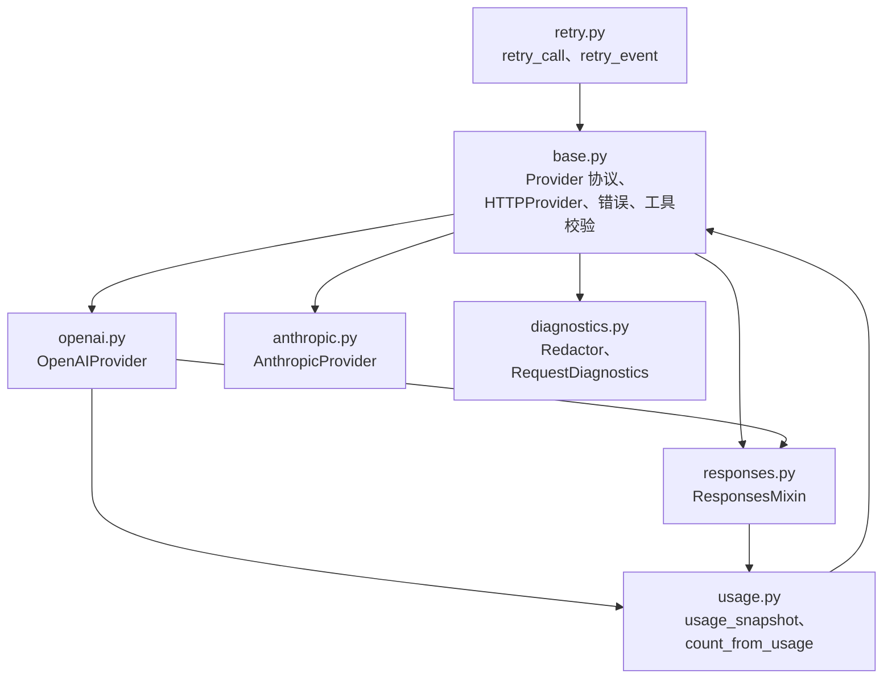
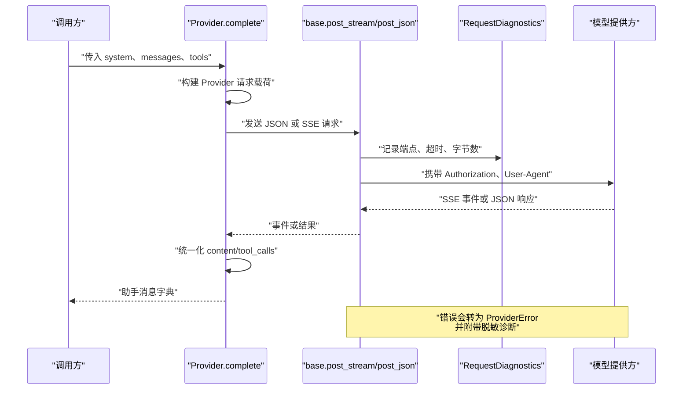
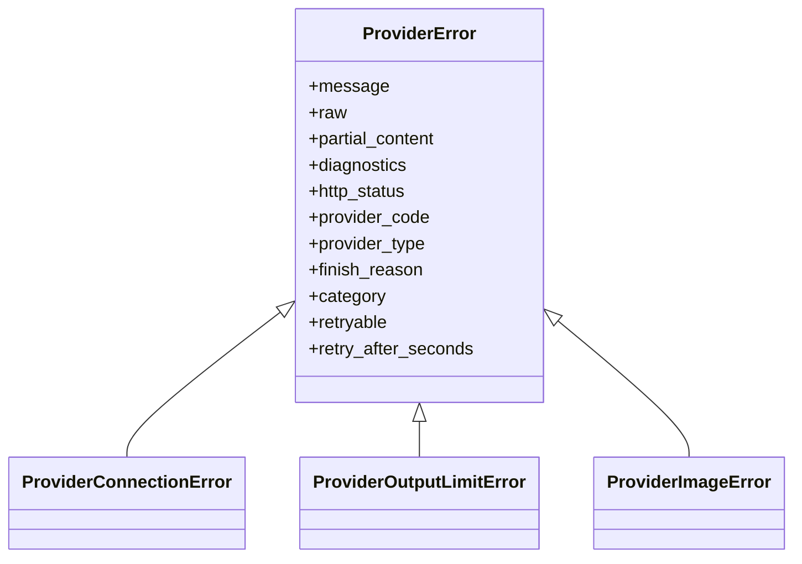
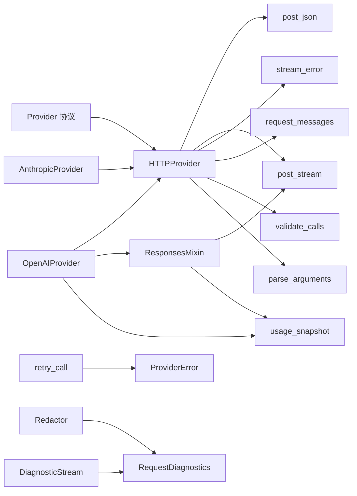

# Provider 接口

<cite>
**本文引用的文件**   
- [skills_agent/providers/base.py](file://skills_agent/providers/base.py)
- [skills_agent/providers/openai.py](file://skills_agent/providers/openai.py)
- [skills_agent/providers/anthropic.py](file://skills_agent/providers/anthropic.py)
- [skills_agent/providers/responses.py](file://skills_agent/providers/responses.py)
- [skills_agent/providers/retry.py](file://skills_agent/providers/retry.py)
- [skills_agent/providers/usage.py](file://skills_agent/providers/usage.py)
- [skills_agent/providers/diagnostics.py](file://skills_agent/providers/diagnostics.py)
</cite>

## 目录

1. [引言](#引言)
2. [项目结构](#项目结构)
3. [核心组件](#核心组件)
4. [架构总览](#架构总览)
5. [详细组件分析](#详细组件分析)
6. [依赖关系分析](#依赖关系分析)
7. [性能考虑](#性能考虑)
8. [故障排查指南](#故障排查指南)
9. [结论](#结论)
10. [附录：扩展与示例](#附录扩展与示例)

## 引言

本文件面向需要扩展或集成模型提供者的开发者，聚焦 `Provider` 抽象接口及其具体实现。文档说明以下内容：

- `Provider` 协议、`HTTPProvider` 基类的公开契约。
- `OpenAIProvider`、`AnthropicProvider`、`ResponsesMixin` + Responses 调用路径的构造参数、关键方法、返回结构。
- 统一消息格式、流式与非流式调用方式。
- 各 Provider 对 `tool_choice`、`top_p`、`temperature`、`max_tokens`、`stop` 等参数的映射策略。
- 错误分类、重试策略、用量统计和诊断采集的职责边界。
- 与 Agent 的集成约定、Provider 生命周期、请求头、用户代理、鉴权和速率限制行为。
- 常见错误的处理方案及性能优化建议。

## 项目结构

Provider 相关代码集中在 `skills_agent/providers` 包中，按职责划分：

| 模块 | 职责 |
|---|---|
| `base.py` | Provider 协议、通用 HTTP 客户端、SSE 流、错误分类、工具校验、消息投影、用户代理 |
| `openai.py` | OpenAI Chat / Responses 适配器 |
| `anthropic.py` | Anthropic Messages 适配器 |
| `responses.py` | OpenAI Responses 原生消息转换与混合类 |
| `retry.py` | 可重试调用包装器、重试事件 |
| `usage.py` | 基于上游用量字段的 token 快照和上下文长度复用 |
| `diagnostics.py` | 脱敏诊断、错误事件、请求跟踪、流诊断封装 |



**图表来源**
- [skills_agent/providers/base.py:201-515](file://skills_agent/providers/base.py#L201-L515)
- [skills_agent/providers/openai.py:1-305](file://skills_agent/providers/openai.py#L1-L305)
- [skills_agent/providers/anthropic.py:1-283](file://skills_agent/providers/anthropic.py#L1-L283)
- [skills_agent/providers/responses.py:1-191](file://skills_agent/providers/responses.py#L1-L191)
- [skills_agent/providers/retry.py:1-86](file://skills_agent/providers/retry.py#L1-L86)
- [skills_agent/providers/usage.py:1-29](file://skills_agent/providers/usage.py#L1-L29)
- [skills_agent/providers/diagnostics.py:1-261](file://skills_agent/providers/diagnostics.py#L1-L261)

**章节来源**
- [skills_agent/providers/base.py:201-515](file://skills_agent/providers/base.py#L201-L515)
- [skills_agent/providers/openai.py:1-305](file://skills_agent/providers/openai.py#L1-L305)
- [skills_agent/providers/anthropic.py:1-283](file://skills_agent/providers/anthropic.py#L1-L283)
- [skills_agent/providers/responses.py:1-191](file://skills_agent/providers/responses.py#L1-L191)
- [skills_agent/providers/retry.py:1-86](file://skills_agent/providers/retry.py#L1-L86)
- [skills_agent/providers/usage.py:1-29](file://skills_agent/providers/usage.py#L1-L29)
- [skills_agent/providers/diagnostics.py:1-261](file://skills_agent/providers/diagnostics.py#L1-L261)

## 核心组件

### Provider 协议

`Provider` 是 Python Protocol，定义模型调用的最小公共契约：

| 方法 | 输入 | 返回 | 语义 |
|---|---|---|---|
| `complete(system, messages, tools, *, on_event=None, max_output_tokens=None, disable_thinking=False)` | 系统提示、统一消息列表、工具定义、可选回调、可选输出上限、是否禁用推理思考 | 助手消息字典 | 发起生成；支持流式回调；返回统一结构的助手消息 |
| `count_tokens(system, messages, tools, *, disable_thinking=False)` | 同上 | 整数或 None | 估算或查询输入 token 数 |
| `count_text(text)` | 纯文本 | 整数或 None | 快速估算单条文本 token 数 |
| `compact_messages(messages)` | 消息列表 | 新消息列表 | 压缩消息，例如移除不可恢复的中间思考内容 |
| `can_compact(messages)` | 消息列表 | 布尔值 | 判断当前消息状态是否允许压缩 |

默认实现由 `HTTPProvider` 提供：它负责基础 URL、API Key、最大输出 token、模型上下文窗口等配置，并给出通用的 `count_text`、`compact_messages`、`can_compact` 行为。

**章节来源**
- [skills_agent/providers/base.py:201-253](file://skills_agent/providers/base.py#L201-L253)
- [skills_agent/providers/base.py:481-515](file://skills_agent/providers/base.py#L481-L515)

### HTTPProvider 与通用工具

`HTTPProvider` 暴露以下重要状态：

| 属性 | 类型 | 说明 |
|---|---|---|
| `model` | `str` | 模型名称 |
| `api_key` | `str` | 鉴权密钥 |
| `base_url` | `str` | 去斜杠后的 Provider 基础地址 |
| `max_output_tokens` | `int` | 默认输出 token 上限 |
| `model_context_window` | `int | None` | 可选上下文窗口大小 |

常用工具函数：

| 函数 | 用途 |
|---|---|
| `_user_agent()` | 生成 `skills-agent/...` 用户代理 |
| `post_json(url, payload, headers)` | 非流式 JSON POST，自动记录诊断 |
| `post_stream(url, payload, headers)` | SSE 流式 POST，终端事件返回 `None` |
| `stream_error(...)` | 将流式错误转换为带诊断的 `ProviderError` |
| `stream_ended(stream, message)` | 流提前结束，转为连接错误 |
| `blocks(content)` | 将字符串、列表或空值归一化为块列表 |
| `received_text(content)` | 从响应中提取可读文本，避免泄露工具输入 |
| `encoded_file(block)` | 读取图片文件或 PDF 并 base64 编码 |
| `parse_arguments(arguments)` | 解析工具参数为 JSON 对象 |
| `validate_calls(calls)` | 校验工具调用 ID、名称和唯一性 |
| `request_messages(messages)` | 投影图片、合并工具反馈，供计数与生成共用 |

**章节来源**
- [skills_agent/providers/base.py:255-515](file://skills_agent/providers/base.py#L255-L515)

### ErrorCategory、RetryStrategy、UsageCounter、DiagnosticsCollector 的职责

| 概念 | 对应实现 | 职责 | 扩展点 |
|---|---|---|---|
| 错误分类 | `ProviderError.category`、`_ERROR_CATEGORIES`、`_FINISH_CATEGORIES` | 根据 HTTP 状态、结构化错误码、finish reason 推断类别 | 新增错误码映射、自定义子类 |
| 重试策略 | `retry_call` | 基于 `retryable`、`retry_after_seconds`、尝试次数和时间预算重试 | 注入 `on_retry`、设置环境变量或参数 |
| 用量统计 | `usage_snapshot`、`count_from_usage` | 从上游 `input_tokens`/`output_tokens`/`total_tokens` 提取 token 快照 | 替换 Provider 的 token 计数方式 |
| 诊断采集 | `Redactor`、`RequestDiagnostics`、`DiagnosticStream`、`ErrorEvent` | 脱敏 URL、Header、Body、异常链，保留有限元数据 | 自定义敏感字段规则、日志上报格式 |

**章节来源**
- [skills_agent/providers/base.py:1-200](file://skills_agent/providers/base.py#L1-L200)
- [skills_agent/providers/retry.py:1-86](file://skills_agent/providers/retry.py#L1-L86)
- [skills_agent/providers/usage.py:1-29](file://skills_agent/providers/usage.py#L1-L29)
- [skills_agent/providers/diagnostics.py:1-261](file://skills_agent/providers/diagnostics.py#L1-L261)

## 架构总览



**图表来源**
- [skills_agent/providers/base.py:255-480](file://skills_agent/providers/base.py#L255-L480)
- [skills_agent/providers/openai.py:1-305](file://skills_agent/providers/openai.py#L1-L305)
- [skills_agent/providers/anthropic.py:1-283](file://skills_agent/providers/anthropic.py#L1-L283)
- [skills_agent/providers/responses.py:1-191](file://skills_agent/providers/responses.py#L1-L191)

## 详细组件分析

### Provider 基类与统一消息格式

#### 公开契约

| 接口 | 行为 |
|---|---|
| `complete` | 统一入口；通过 `on_event` 推送文本增量、思考增量、工具调用增量；最终返回统一的助手消息 |
| `count_tokens` | 返回模型输入 token 估计；某些实现可能返回 `None` |
| `count_text` | 对短文本做轻量估算；默认委托给 `count_tokens` |
| `compact_messages` | 压缩消息；默认深拷贝 |
| `can_compact` | 判断是否可压缩；默认允许 |

#### 统一消息结构

Provider 内部使用统一的消息块结构：

| 块类型 | 关键字段 | 用途 |
|---|---|---|
| `text` | `text` | 普通文本 |
| `image` | `mime_type`、`source_path` 等 | 图片附件 |
| `file` | `path`、`name`、`mime_type` | 文件附件，PDF 通常内联 |
| `thinking` | `thinking` | 模型推理思考 |
| `redacted_thinking` | `thinking`、可选签名 | 已脱敏或加密的思考片段 |

Assistant 返回的统一结构包含：

| 字段 | 类型 | 含义 |
|---|---|---|
| `role` | `str` | 固定为 `assistant` |
| `content` | `list[dict]` | 文本、思考、拒绝回复等块 |
| `tool_calls` | `list[dict]` | 存在工具调用时返回 |
| `_raw` | `dict` | 原始 Provider 流事件，用于调试 |
| `_token_usage` | `dict | None` | 当启用 usage 计数时返回 |
| `_anthropic_content` / `_responses_output` | `list | None` | 特定 Provider 的原生状态，便于多轮续写 |

**章节来源**
- [skills_agent/providers/base.py:201-253](file://skills_agent/providers/base.py#L201-L253)
- [skills_agent/providers/base.py:415-515](file://skills_agent/providers/base.py#L415-L515)
- [skills_agent/providers/anthropic.py:196-283](file://skills_agent/providers/anthropic.py#L196-L283)
- [skills_agent/providers/responses.py:1-191](file://skills_agent/providers/responses.py#L1-L191)

### OpenAIProvider

#### 构造参数

| 参数 | 类型 | 默认值 | 说明 |
|---|---|---|---|
| `model` | `str` | 必填 | 模型名称 |
| `api_key` | `str` | 必填 | Bearer Token |
| `base_url` | `str | None` | `None` | 覆盖默认 `https://api.openai.com/v1` |
| `max_output_tokens` | `int` | `DEFAULT_MAX_OUTPUT_TOKENS` | 默认输出上限 |
| `api_format` | `str` | `"auto"` | 可选 `auto`、`responses`、`chat` |
| `token_counter` | `str` | `"auto"` | 可选 `auto`、`official`、`usage` |
| `model_context_window` | `int | None` | `None` | 模型上下文窗口 |
| `deepseek_effort` | `str | None` | `None` | DeepSeek chat 模式下的 effort，可选 `none`、`low`、`high`、`max` |

`api_format=auto` 会根据主机名选择 `responses` 或 `chat`；DeepSeek 场景下会调整 thinking 和 reasoning effort 字段。

#### 关键方法

| 方法 | 行为 |
|---|---|
| `count_tokens` | 若 `token_counter=usage` 则复用最近 assistant 消息中的用量；否则在 responses 模式下调用官方 input tokens 接口 |
| `count_text` | usage 模式返回 `None`；否则委托基类 |
| `_chat_payload` | 将统一消息映射到 OpenAI Chat 载荷 |
| `complete` | 根据 `api_format` 走 Responses 或 Chat 路径 |

#### Chat 模式参数映射

| 统一参数 | OpenAI Chat 映射 | 备注 |
|---|---|---|
| `system` | `messages` 第一条 `role="system"` | 无 system 时省略 |
| `messages` | 按 role 映射 user/assistant/tool | tool 消息携带 `content` 和 `tool_call_id` |
| `tools` | `tools` 数组 | function 工具 |
| `max_output_tokens` | `max_completion_tokens` 或 DeepSeek 的 `max_tokens` | 必须为正数 |
| `disable_thinking` | `thinking={"type":"disabled"}` 或 DeepSeek 的 `enable_thinking=False` |
| `deepseek_effort` | `reasoning_effort` | 仅在 DeepSeek 兼容场景生效 |

#### 返回结构

Chat 模式返回：

| 字段 | 含义 |
|---|---|
| `role` | `assistant` |
| `content` | 文本块和 thinking 块 |
| `reasoning_content` | 如果收到 reasoning delta |
| `tool_calls` | 当 finish_reason 为 `tool_calls` |
| `_raw` | 流事件快照 |
| `_token_usage` | 当 `token_counter=usage` 时 |

#### 非流式调用说明

当前 `OpenAIProvider.complete` 始终使用流式接口；没有独立的非流式分支。上层如需非流式语义，应消费完整个流并忽略 `on_event`。

#### 参数映射限制

当前实现未直接暴露以下参数：

| 参数 | 当前行为 |
|---|---|
| `tool_choice` | 未映射 |
| `top_p` | 未映射 |
| `temperature` | 未映射 |
| `stop` | 未映射 |

如果需要这些能力，应在 Provider 子类中扩展载荷构造逻辑。

**章节来源**
- [skills_agent/providers/openai.py:1-200](file://skills_agent/providers/openai.py#L1-L200)
- [skills_agent/providers/openai.py:201-305](file://skills_agent/providers/openai.py#L201-L305)
- [skills_agent/providers/responses.py:1-191](file://skills_agent/providers/responses.py#L1-L191)

### AnthropicProvider

#### 构造参数

| 参数 | 类型 | 默认值 | 说明 |
|---|---|---|---|
| `model` | `str` | 必填 | 模型名称 |
| `api_key` | `str` | 必填 | Anthropic API Key |
| `base_url` | `str | None` | `None` | 默认 `https://api.anthropic.com/v1` |
| `max_output_tokens` | `int` | `DEFAULT_MAX_OUTPUT_TOKENS` | 默认输出上限 |
| `api_format` | `str` | `"auto"` | 仅接受 `auto` 或 `messages` |
| `token_counter` | `str` | `"auto"` | 仅接受 `auto` 或 `official` |
| `model_context_window` | `int | None` | `None` | 模型上下文窗口 |

#### 关键方法

| 方法 | 行为 |
|---|---|
| `compact_messages` | 移除 assistant 消息中不可恢复的 thinking/redacted_thinking 块 |
| `can_compact` | 若最新 assistant 有工具调用且包含 thinking，则不允许压缩 |
| `count_tokens` | 调用 Anthropic `/messages/count_tokens` |
| `_payload` | 将统一消息映射到 Anthropic Messages 载荷 |
| `complete` | 流式调用 `/messages`，组装 content、thinking、tool_use |

#### Messages 模式参数映射

| 统一参数 | Anthropic Messages 映射 | 备注 |
|---|---|---|
| `system` | `system` | 可选 |
| `messages` | `messages` | tool 结果映射为 `tool_result` |
| `tools` | `tools` | 使用 `input_schema` 描述参数 |
| `max_output_tokens` | `max_tokens` | 必须为正数 |
| `disable_thinking` | `thinking={"type":"disabled"}` | 关闭本地 thinking |

#### 返回结构

Anthropic 返回：

| 字段 | 含义 |
|---|---|
| `role` | `assistant` |
| `content` | text、thinking、redacted_thinking 块 |
| `tool_calls` | 当 `stop_reason` 为 `tool_use` |
| `_raw` | 流事件快照 |
| `_anthropic_content` | 原生 content 块，用于后续请求 |

#### 非流式调用说明

当前 `AnthropicProvider.complete` 也使用流式接口；不存在独立非流式分支。

#### 参数映射限制

当前实现未直接暴露：

| 参数 | 当前行为 |
|---|---|
| `tool_choice` | 未映射 |
| `top_p` | 未映射 |
| `temperature` | 未映射 |
| `stop` | 未映射 |

**章节来源**
- [skills_agent/providers/anthropic.py:1-200](file://skills_agent/providers/anthropic.py#L1-L200)
- [skills_agent/providers/anthropic.py:201-283](file://skills_agent/providers/anthropic.py#L201-L283)

### ResponsesMixin 与 OpenAI Responses 路径

`ResponsesMixin` 提供 OpenAI Responses 原生的消息构造与结果规范化：

| 方法 | 行为 |
|---|---|
| `_responses_payload` | 将统一消息映射为 `model`、`input`、`instructions`、`tools`、`reasoning` |
| `_complete_responses` | 流式调用 `/responses`，处理 output_text、thinking、function_call |

Responses 模式返回：

| 字段 | 含义 |
|---|---|
| `role` | `assistant` |
| `content` | text、thinking 块 |
| `tool_calls` | 当出现 function_call |
| `_raw` | 流事件快照 |
| `_responses_output` | 原生 output 项，用于多轮续写 |
| `_token_usage` | 当 `token_counter=usage` 时 |

#### Responses 模式参数映射

| 统一参数 | OpenAI Responses 映射 | 备注 |
|---|---|---|
| `system` | `instructions` |
| `messages` | `input` 列表 |
| `tools` | `tools`，function 工具 |
| `max_output_tokens` | `max_output_tokens` |
| `disable_thinking` | `reasoning.effort="none"` |

#### 非流式调用说明

`ResponsesMixin._complete_responses` 使用流式接口；当前没有独立非流式分支。

**章节来源**
- [skills_agent/providers/responses.py:1-191](file://skills_agent/providers/responses.py#L1-L191)

### 错误分类与错误层次



**图表来源**
- [skills_agent/providers/base.py:1-200](file://skills_agent/providers/base.py#L1-L200)

`ProviderError.category` 优先级：

1. HTTP 状态映射。
2. `ProviderConnectionError` 子类标记为 `connection`。
3. `ProviderOutputLimitError` 子类标记为 `output_limit`。
4. finish reason 映射。
5. 结构化错误 `code`/`type` 映射。
6. 协议错误标记为 `protocol`。
7. 兜底为 `provider_error`。

可重试类别包括：`connection`、`rate_limited`、`server_error`、`bad_gateway`、`service_unavailable`、`gateway_timeout`。

**章节来源**
- [skills_agent/providers/base.py:1-200](file://skills_agent/providers/base.py#L1-L200)

### 重试策略

`retry_call` 是单一操作的包装器，不重放工具执行，也不合并部分响应：

| 配置 | 来源 |
|---|---|
| `max_attempts` | 参数或 `SKILLS_AGENT_PROVIDER_MAX_ATTEMPTS` |
| `max_elapsed_seconds` | 参数或 `SKILLS_AGENT_PROVIDER_RETRY_BUDGET_SECONDS` |
| `RETRY_DELAY_SECONDS` | 默认等待 5 秒 |
| `exc.retry_after_seconds` | 优先使用上游 `Retry-After` |

重试失败原因：

| 原因 | 含义 |
|---|---|
| `attempt_limit` | 达到最大尝试次数 |
| `elapsed_limit` | 超过总时间预算 |
| `retry_after_exceeds_budget` | 服务器要求延迟超过剩余预算 |

重试诊断信息会写入 `exc.diagnostics["retry"]`，包含尝试次数、 elapsed、下次延迟、是否耗尽等。

**章节来源**
- [skills_agent/providers/retry.py:1-86](file://skills_agent/providers/retry.py#L1-L86)

### 用量统计

`usage_snapshot` 只信任上游提供的 token 字段：

| 输入 | 输出 |
|---|---|
| `usage.total_tokens` | `{"version":2,"model":..., "tokens": total}` |
| `usage.input_tokens` + `usage.output_tokens` | `{"version":2,"model":..., "tokens": sum}` |
| 非法或非 dict | `None` |

`count_from_usage` 会逆序查找最近一条 assistant 消息中的 `_token_usage`，从而复用上下文长度，避免每次新建消息都重新估算。

**章节来源**
- [skills_agent/providers/usage.py:1-29](file://skills_agent/providers/usage.py#L1-L29)

### 诊断采集

`RequestDiagnostics` 记录：

| 字段 | 含义 |
|---|---|
| `endpoint` | 脱敏后的 URL |
| `phase` | `open_request`、`read_response`、`read_stream` 等 |
| `request_bytes` | 请求体字节数 |
| `response_bytes` | 响应体字节数 |
| `stream_frames` | 流事件帧数 |
| `timeout_seconds` | 超时 |
| `response.status` | HTTP 状态 |
| `response.headers` | 白名单 Header |
| `response.body` | 脱敏后的响应体 |

`Redactor` 会脱敏 Authorization、Cookie、Token、Secret、Base64 凭证、URL 凭据、敏感 Query 和 Fragment。

**章节来源**
- [skills_agent/providers/diagnostics.py:1-261](file://skills_agent/providers/diagnostics.py#L1-L261)

## 依赖关系分析



**图表来源**
- [skills_agent/providers/base.py:255-515](file://skills_agent/providers/base.py#L255-L515)
- [skills_agent/providers/openai.py:1-305](file://skills_agent/providers/openai.py#L1-L305)
- [skills_agent/providers/anthropic.py:1-283](file://skills_agent/providers/anthropic.py#L1-L283)
- [skills_agent/providers/responses.py:1-191](file://skills_agent/providers/responses.py#L1-L191)
- [skills_agent/providers/retry.py:1-86](file://skills_agent/providers/retry.py#L1-L86)
- [skills_agent/providers/usage.py:1-29](file://skills_agent/providers/usage.py#L1-L29)
- [skills_agent/providers/diagnostics.py:1-261](file://skills_agent/providers/diagnostics.py#L1-L261)

**章节来源**
- [skills_agent/providers/base.py:255-515](file://skills_agent/providers/base.py#L255-L515)
- [skills_agent/providers/openai.py:1-305](file://skills_agent/providers/openai.py#L1-L305)
- [skills_agent/providers/anthropic.py:1-283](file://skills_agent/providers/anthropic.py#L1-L283)
- [skills_agent/providers/responses.py:1-191](file://skills_agent/providers/responses.py#L1-L191)
- [skills_agent/providers/retry.py:1-86](file://skills_agent/providers/retry.py#L1-L86)
- [skills_agent/providers/usage.py:1-29](file://skills_agent/providers/usage.py#L1-L29)
- [skills_agent/providers/diagnostics.py:1-261](file://skills_agent/providers/diagnostics.py#L1-L261)

## 性能考虑

1. **合理设置重试预算**  
   - 使用 `SKILLS_AGENT_PROVIDER_RETRY_BUDGET_SECONDS` 控制总重试时间。  
   - 使用 `SKILLS_AGENT_PROVIDER_MAX_ATTEMPTS` 限制最大尝试次数。  
   - 对于高频短时任务，不建议设置过大的预算，以免阻塞整体流程。

2. **合并诊断上报**  
   - 每个请求都会创建 `RequestDiagnostics`，但 Body 和敏感字段会被截断和脱敏。  
   - 批量上报比逐条打印完整请求体更安全且更高效。

3. **避免频繁重建 Provider 实例**  
   - `HTTPProvider` 缓存 model、base_url、api_key、max_output_tokens 等状态。  
   - 同一模型和鉴权配置应复用同一个 Provider 实例。

4. **优先使用 usage 计数**  
   - 当上游返回 `input_tokens`/`output_tokens` 时，`token_counter=usage` 可避免重复估算。  
   - `count_from_usage` 复用最近 assistant 消息的上下文长度，减少无效计算。

5. **注意流式缓冲**  
   - 所有 Provider 实现均使用流式接口。  
   - 如果只需要最终结果，应避免在 `on_event` 中累积大量中间事件。

6. **控制图片与文件开销**  
   - 图片和 PDF 会被读取并 base64 编码，大附件会增加内存和带宽。  
   - 只在必要时使用 image/file 块。

7. **限制诊断深度**  
   - `Redactor.data` 对嵌套深度限制为 16，避免深层结构导致递归开销。

[本节为通用性能建议，不直接分析具体代码行]

## 故障排查指南

### 401 鉴权失败

- 分类：`authentication`。
- 触发位置：HTTP 401、`authentication_error`、`invalid_api_key`。
- 处理建议：
  - 检查 `api_key` 是否正确传递。
  - 确认 `Authorization: Bearer ...` 或 `x-api-key` 是否被正确设置。
  - 不要将完整鉴权信息写入日志；诊断已由 `Redactor` 脱敏。

**章节来源**
- [skills_agent/providers/base.py:1-200](file://skills_agent/providers/base.py#L1-L200)
- [skills_agent/providers/diagnostics.py:1-261](file://skills_agent/providers/diagnostics.py#L1-L261)

### 429 速率限制

- 分类：`rate_limited`。
- 触发位置：HTTP 429、`rate_limit_error`、`rate_limit_exceeded`、`rate_limited`。
- 处理建议：
  - 使用 `retry_call` 自动重试。
  - 优先读取 `Retry-After` 响应头。
  - 设置合理的 `max_elapsed_seconds`，防止无限重试。

**章节来源**
- [skills_agent/providers/base.py:1-200](file://skills_agent/providers/base.py#L1-L200)
- [skills_agent/providers/retry.py:1-86](file://skills_agent/providers/retry.py#L1-L86)

### 503 服务不可用

- 分类：`service_unavailable`。
- 触发位置：HTTP 503、`overloaded_error`、`server_overloaded`、`service_unavailable*`。
- 处理建议：
  - 使用可重试错误分类进行退避重试。
  - 结合业务降级策略，避免雪崩。

**章节来源**
- [skills_agent/providers/base.py:1-200](file://skills_agent/providers/base.py#L1-L200)

### 流式响应中断

- 分类：通常为 `connection`。
- 触发位置：SSE 流提前结束、未收到 `[DONE]`、Anthropic 未收到 `message_stop`、Responses 未收到 `response.completed`。
- 处理建议：
  - 捕获 `ProviderConnectionError`。
  - 检查 `diagnostics.phase`、`stream_frames`、`response_bytes`。
  - 使用 `retry_call` 包裹单次操作。
  - 不要假设部分响应已经完整。

**章节来源**
- [skills_agent/providers/base.py:345-414](file://skills_agent/providers/base.py#L345-L414)
- [skills_agent/providers/openai.py:201-305](file://skills_agent/providers/openai.py#L201-L305)
- [skills_agent/providers/anthropic.py:201-283](file://skills_agent/providers/anthropic.py#L201-L283)
- [skills_agent/providers/responses.py:70-191](file://skills_agent/providers/responses.py#L70-L191)

### JSON 解析失败

- 分类：通常为 `protocol` 或 `provider_error`。
- 触发位置：非 JSON 响应、非对象响应、流事件不是 JSON 对象。
- 处理建议：
  - 检查上游网关是否返回 HTML、重定向页或错误页面。
  - 查看 `diagnostics.response.body`，但注意已被截断和脱敏。
  - 这类错误通常不可重试，除非是临时网络层问题。

**章节来源**
- [skills_agent/providers/base.py:255-344](file://skills_agent/providers/base.py#L255-L344)
- [skills_agent/providers/diagnostics.py:1-261](file://skills_agent/providers/diagnostics.py#L1-L261)

### Token 超限

- 分类：`output_limit`。
- 触发位置：
  - OpenAI：`finish_reason="length"`。
  - Anthropic：`stop_reason="max_tokens"` 或 `model_context_window_exceeded`。
  - Responses：`response.incomplete` 且 `incomplete_details.reason="max_output_tokens"`。
- 处理建议：
  - 捕获 `ProviderOutputLimitError`。
  - 降低 `max_output_tokens`。
  - 使用 `compact_messages` 清理不可恢复的 thinking。
  - 检查 `model_context_window` 配置。

**章节来源**
- [skills_agent/providers/base.py:1-200](file://skills_agent/providers/base.py#L1-L200)
- [skills_agent/providers/openai.py:201-305](file://skills_agent/providers/openai.py#L201-L305)
- [skills_agent/providers/anthropic.py:201-283](file://skills_agent/providers/anthropic.py#L201-L283)
- [skills_agent/providers/responses.py:70-191](file://skills_agent/providers/responses.py#L70-L191)

## 结论

`Provider` 接口以统一消息格式和统一错误模型屏蔽了不同模型提供者的差异。`HTTPProvider` 提供通用 HTTP、SSE、诊断和工具校验能力；`OpenAIProvider`、`AnthropicProvider`、`ResponsesMixin` 分别负责具体 Provider 的载荷映射和流结果规范化。当前实现主要面向流式调用，并通过 `retry_call`、`usage_snapshot`、`Redactor`、`RequestDiagnostics` 形成可观测、可重试、可审计的扩展点。

对于需要 `tool_choice`、`top_p`、`temperature`、`stop` 的场景，应继承 `HTTPProvider` 并在子类中扩展载荷构造逻辑，同时保持 `complete` 返回统一助手消息结构。

## 附录：扩展与示例

### 自定义 Provider 示例

以下示例演示如何自定义 Provider、实现必要方法、注册重试策略、统计用量和采集诊断。该示例为概念性说明，实际行为应以仓库源码为准。

```python
from skills_agent.providers.base import HTTPProvider, ProviderError, ProviderConnectionError
from skills_agent.providers.retry import retry_call
from skills_agent.providers.usage import usage_snapshot
from skills_agent.providers.diagnostics import Redactor
import json
import time


class MyProvider(HTTPProvider):
    """示例：自定义模型提供者"""

    default_base_url = "https://my-provider.example/v1"

    def __init__(self, model, api_key, base_url=None, max_output_tokens=32768, *, model_context_window=None):
        super().__init__(model, api_key, base_url, max_output_tokens, model_context_window=model_context_window)

    def complete(self, system, messages, tools, *, on_event=None, max_output_tokens=None, disable_thinking=False):
        limit = self.max_output_tokens if max_output_tokens is None else max_output_tokens
        if limit <= 0:
            raise ValueError("max_output_tokens must be positive")

        payload = {
            "model": self.model,
            "messages": messages,
            "tools": tools,
            "max_tokens": limit,
            "stream": True,
        }

        url = f"{self.base_url}/chat/completions"
        headers = {"Authorization": f"Bearer {self.api_key}"}

        raw_events = []
        partial_text = []

        try:
            with self._post_stream(url, payload, headers) as stream:
                for event in stream:
                    if event is None:
                        break
                    raw_events.append(event)
                    kind = event.get("type", "")
                    if kind == "delta":
                        text = event.get("text")
                        if text:
                            partial_text.append(text)
                            if on_event:
                                on_event({"type": "text_delta", "text": text})
                    elif kind == "error":
                        raise ProviderError(
                            Redactor(url, headers).text("My provider returned an error"),
                            diagnostics=self._make_diagnostic(url, headers, raw_events),
                            provider_error=event,
                        )

            return {
                "role": "assistant",
                "content": [{"type": "text", "text": "".join(partial_text)}],
                "_raw": {"events": raw_events},
            }

        except (ProviderError, KeyboardInterrupt) as exc:
            exc.raw = {"events": raw_events}
            exc.partial_content = partial_text
            raise

    def count_tokens(self, system, messages, tools, *, disable_thinking=False):
        # 示例：调用上游 token 计数接口后使用 usage_snapshot
        response = self._post_json(f"{self.base_url}/count", {"model": self.model})
        snapshot = usage_snapshot(self.model, response.get("usage"))
        if snapshot is not None:
            return snapshot["tokens"]
        return None

    def count_text(self, text):
        return self.count_tokens("", [{"role": "user", "content": text}], [])

    def compact_messages(self, messages):
        return list(messages)

    def can_compact(self, messages):
        return True

    def _post_json(self, url, payload):
        from skills_agent.providers.base import post_json
        return post_json(url, payload, {})

    def _post_stream(self, url, payload, headers):
        from skills_agent.providers.base import post_stream
        return post_stream(url, payload, headers)

    def _make_diagnostic(self, url, headers, events):
        from skills_agent.providers.diagnostics import RequestDiagnostics
        diag = RequestDiagnostics(url, headers, len(json.dumps(payload)))
        diag.phase = "custom_stream"
        return diag.snapshot("custom")


def run_with_retry():
    provider = MyProvider(model="example-model", api_key="sk-example")

    def operation():
        return provider.complete(
            system="你是一个助手",
            messages=[{"role": "user", "content": "你好"}],
            tools=[],
            on_event=lambda event: print("事件:", event),
            max_output_tokens=1024,
        )

    result = retry_call(operation, on_retry=lambda exc, attempt: print(f"第 {attempt} 次重试"))
    print("结果:", result)
```

该示例展示：

- 继承 `HTTPProvider`。
- 实现 `complete`、`count_tokens`、`count_text`、`compact_messages`、`can_compact`。
- 复用 `post_json`、`post_stream`、`usage_snapshot`、`Redactor`、`RequestDiagnostics`。
- 通过 `retry_call` 包装调用。
- 返回统一助手消息结构。
- 将诊断信息与错误关联。

**章节来源**
- [skills_agent/providers/base.py:201-515](file://skills_agent/providers/base.py#L201-L515)
- [skills_agent/providers/retry.py:1-86](file://skills_agent/providers/retry.py#L1-L86)
- [skills_agent/providers/usage.py:1-29](file://skills_agent/providers/usage.py#L1-L29)
- [skills_agent/providers/diagnostics.py:1-261](file://skills_agent/providers/diagnostics.py#L1-L261)

### 与 Agent 的集成方式

- Agent 通过 `Provider.complete` 获取助手消息。
- 工具调用由上层根据 `tool_calls` 执行，并将结果以 `role="tool"` 的消息追加回消息列表。
- Provider 不应自行重放工具执行；重试只重放模型请求。
- 诊断信息可通过 `ProviderError.diagnostics` 获取，但不应直接输出未脱敏内容。

### Provider 生命周期

1. 应用启动时创建 Provider 实例。
2. 复用同一实例处理多次对话轮次。
3. 每次 `complete` 调用可携带新的 `max_output_tokens`。
4. 出错时通过 `ProviderError` 获取分类、状态码、结构化错误码、finish reason。
5. 需要重试时使用 `retry_call`，而不是在业务层循环调用。

### 请求头、用户代理、鉴权配置

| Provider | 鉴权头 | 其他头部 |
|---|---|---|
| OpenAI | `Authorization: Bearer ...` | `Content-Type: application/json`，`Accept: text/event-stream`（流） |
| Anthropic | `x-api-key` | `anthropic-version: 2023-06-01` |
| 通用 | `User-Agent: skills-agent/...` | 由 `post_json`/`post_stream` 添加 |

**章节来源**
- [skills_agent/providers/base.py:255-344](file://skills_agent/providers/base.py#L255-L344)
- [skills_agent/providers/anthropic.py:60-70](file://skills_agent/providers/anthropic.py#L60-L70)
- [skills_agent/providers/openai.py:1-200](file://skills_agent/providers/openai.py#L1-L200)
- [skills_agent/providers/responses.py:1-191](file://skills_agent/providers/responses.py#L1-L191)

### 速率限制与重试最佳实践

- 只对 `retryable=True` 的错误重试。
- 优先使用 `exc.retry_after_seconds`。
- 设置 `max_elapsed_seconds` 保护整体耗时。
- 对 401、422、403 等确定性错误跳过重试。
- 对 429、502、503、504 优先考虑重试。
- 对 500 需结合业务风险评估。

**章节来源**
- [skills_agent/providers/base.py:1-200](file://skills_agent/providers/base.py#L1-L200)
- [skills_agent/providers/retry.py:1-86](file://skills_agent/providers/retry.py#L1-L86)