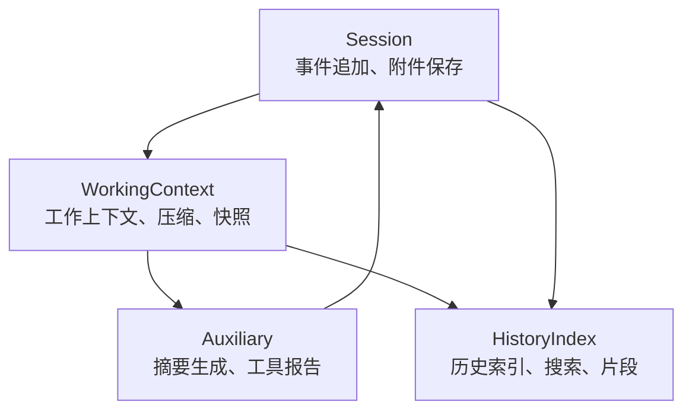
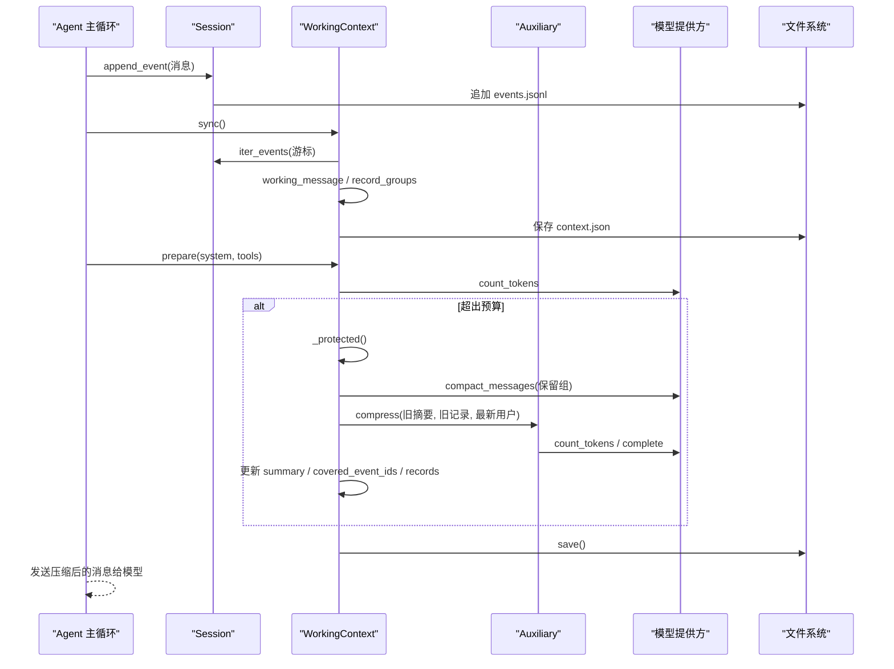
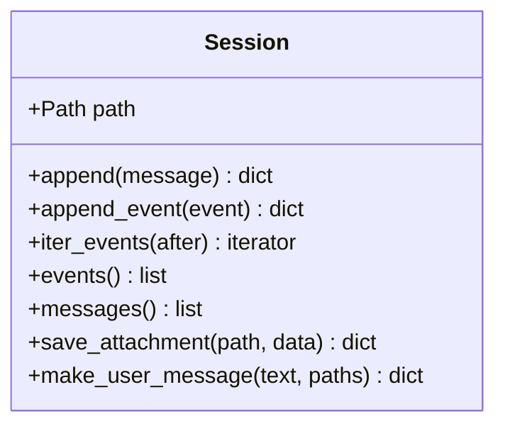
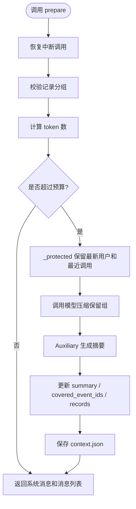
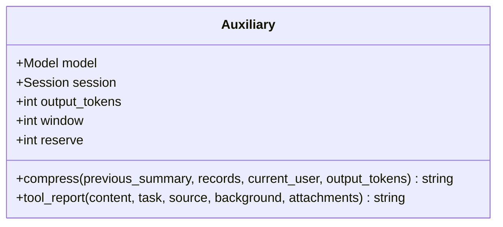
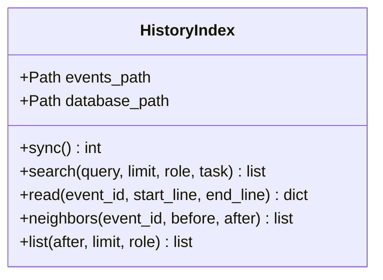
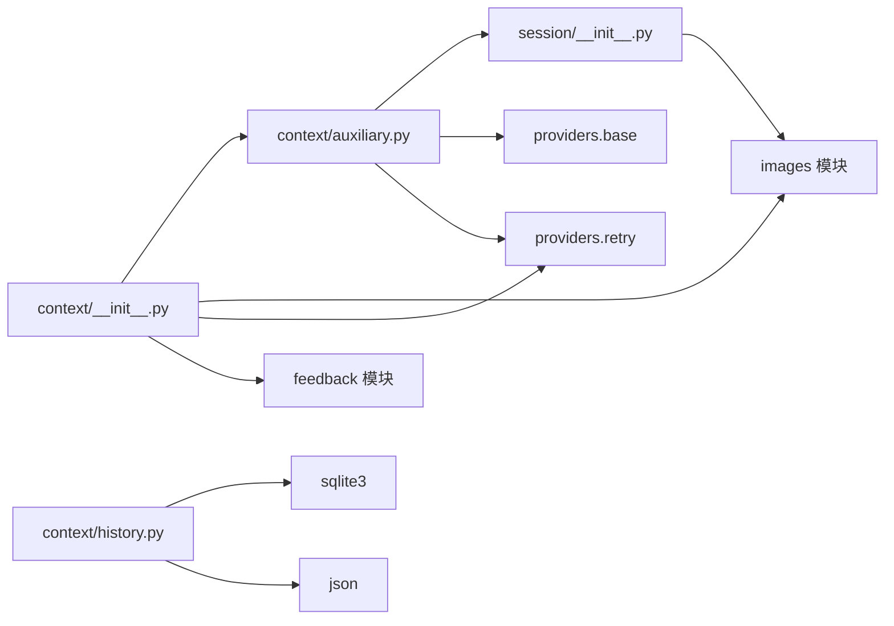

# 会话与上下文

<cite>
**本文引用的文件**   
- [skills_agent/context/__init__.py](file://skills_agent/context/__init__.py)
- [skills_agent/context/auxiliary.py](file://skills_agent/context/auxiliary.py)
- [skills_agent/context/history.py](file://skills_agent/context/history.py)
- [skills_agent/session/__init__.py](file://skills_agent/session/__init__.py)
- [docs/prompt-history/context-compression.md](file://docs/prompt-history/context-compression.md)
- [docs/prompt-history/context-summary-wrapper.md](file://docs/prompt-history/context-summary-wrapper.md)
</cite>

## 目录
1. [引言](#引言)
2. [项目结构](#项目结构)
3. [核心组件](#核心组件)
4. [架构总览](#架构总览)
5. [详细组件分析](#详细组件分析)
6. [依赖关系分析](#依赖关系分析)
7. [性能考虑](#性能考虑)
8. [故障排查指南](#故障排查指南)
9. [结论](#结论)
10. [附录：Python 使用示例路径](#附录python-使用示例路径)

## 引言
本文面向 Agent 主循环和上层调用方，说明会话存储、工作上下文、辅助摘要和历史检索的公开职责与数据契约。重点覆盖以下对象：
- `Session`：追加式事件日志、附件持久化和用户消息构造。
- `WorkingContext`：增量同步、上下文快照、压缩触发、中断恢复和 JSONL 持久化。
- `Auxiliary`：基于模型调用的上下文摘要生成、工具报告压缩和图片引用投影。
- `HistoryIndex`：对 `events.jsonl` 建立增量索引，提供搜索、片段读取、邻接浏览和按游标列表浏览。

这些组件共同实现“原始历史不可变 + 工作上下文可压缩 + 摘要可持久化 + 历史可回放”的设计目标。

## 项目结构
本功能分布在四个模块中：
- `skills_agent/session/__init__.py`：定义 `Session`，负责 `events.jsonl` 追加写入、事件迭代和附件落盘。
- `skills_agent/context/__init__.py`：定义 `WorkingContext`，封装 token 预算保护、记录分组、中断恢复、系统包装和压缩流程。
- `skills_agent/context/auxiliary.py`：定义 `Auxiliary`，封装摘要提示词、分批策略、重试、进度回调和输出长度控制。
- `skills_agent/context/history.py`：定义 `HistoryIndex`，使用 SQLite 对 `events.jsonl` 做增量索引，并提供全文搜索与片段读取。

**图表来源**
- [skills_agent/session/__init__.py:1-113](file://skills_agent/session/__init__.py#L1-L113)
- [skills_agent/context/__init__.py:1-446](file://skills_agent/context/__init__.py#L1-L446)
- [skills_agent/context/auxiliary.py:1-468](file://skills_agent/context/auxiliary.py#L1-L468)
- [skills_agent/context/history.py:1-309](file://skills_agent/context/history.py#L1-L309)

**章节来源**
- [skills_agent/session/__init__.py:1-113](file://skills_agent/session/__init__.py#L1-L113)
- [skills_agent/context/__init__.py:1-446](file://skills_agent/context/__init__.py#L1-L446)
- [skills_agent/context/auxiliary.py:1-468](file://skills_agent/context/auxiliary.py#L1-L468)
- [skills_agent/context/history.py:1-309](file://skills_agent/context/history.py#L1-L309)

## 核心组件
本节列出关键类及其对外职责，并说明它们如何参与 Agent 主循环。

| 组件 | 主要职责 | 关键方法或属性 | 持久化位置 |
|---|---|---|---|
| `Session` | 追加式交互历史、附件拷贝、用户消息构造 | `append`、`append_event`、`iter_events`、`messages`、`save_attachment`、`make_user_message` | `events.jsonl`、`attachments/` |
| `WorkingContext` | 增量同步事件、维护 records、token 预算保护、压缩、快照、中断恢复 | `sync`、`snapshot`、`prepare`、`save`、`records`、`latest_user` | `context.json` |
| `Auxiliary` | 调用模型生成上下文摘要、工具报告，处理图片引用、重试和进度 | `compress`、`tool_report`、`output_tokens`、`window`、`reserve` | 子任务日志目录 `subagents/` |
| `HistoryIndex` | 为 `events.jsonl` 建增量索引，支持搜索、片段读取、邻接浏览 | `sync`、`search`、`read`、`neighbors`、`list` | `history.sqlite` |

**章节来源**
- [skills_agent/session/__init__.py:1-113](file://skills_agent/session/__init__.py#L1-L113)
- [skills_agent/context/__init__.py:1-446](file://skills_agent/context/__init__.py#L1-L446)
- [skills_agent/context/auxiliary.py:1-468](file://skills_agent/context/auxiliary.py#L1-L468)
- [skills_agent/context/history.py:1-309](file://skills_agent/context/history.py#L1-L309)

## 架构总览
Agent 主循环的典型数据流如下：

**图表来源**
- [skills_agent/context/__init__.py:201-446](file://skills_agent/context/__init__.py#L201-L446)
- [skills_agent/context/auxiliary.py:201-468](file://skills_agent/context/auxiliary.py#L201-L468)
- [skills_agent/session/__init__.py:1-113](file://skills_agent/session/__init__.py#L1-L113)

## 详细组件分析

### Session：会话与事件日志
`Session` 是只追加的事件日志抽象。它不直接暴露“历史回放”接口；回放由 `HistoryIndex` 在 `events.jsonl` 之上构建。

#### 公开接口
- `__init__(root, session_id)`
  - 校验 `session_id`，创建 `Path(root)/session_id` 目录。
- `append(message)`
  - 包装成 `{"type": "message", "message": message}` 后调用 `append_event`。
- `append_event(event)`
  - 追加 `timestamp`、稳定 `event_id`（基于字节偏移），并以单行 JSON 写入 `events.jsonl`。
- `iter_events(after=0)`
  - 从指定字节偏移开始逐行读取，兼容旧日志补全 `event_id`。
- `events()`
  - 返回全部事件。
- `messages()`
  - 过滤出 `type=message` 的消息。
- `save_attachment(supplied_path, data=None)`
  - 将文件或内存数据复制到 `attachments/`，返回包含 `path`、`name`、`mime_type`、`url` 的元信息。
- `make_user_message(text, paths)`
  - 构造用户消息，处理文本、图片、PDF 和其他文件，限制最大图片数量。

#### 字段含义与约束
- `event_id`：形如 `event-{offset}`，用于唯一标识事件。
- `role`：消息角色，通常为 `user`、`assistant`、`tool`、`system`。
- `content`：文本、图片、文件或思考块组成的内容结构。
- `tool_calls`：助手响应中的工具调用列表，每个调用含 `id`、`name`、`arguments`。
- `tool_call_id`：工具结果对应的调用 ID。
- `reasoning_content`：推理预览内容，可能在 `working_message` 中被提取到消息层。
- `runtime_event`：运行时观察事件通常使用 `user` 角色但不视为真实用户请求。

#### 错误行为
- `session_id` 不符合正则时抛出 `ValueError`。
- 附件不是文件或超过图片上限时抛出 `ValueError`。
- 用户消息不包含文本或附件时抛出 `ValueError`。

**图表来源**
- [skills_agent/session/__init__.py:1-113](file://skills_agent/session/__init__.py#L1-L113)

**章节来源**
- [skills_agent/session/__init__.py:1-113](file://skills_agent/session/__init__.py#L1-L113)

### WorkingContext：工作上下文
`WorkingContext` 是 Agent 主循环的核心状态容器。它把 `Session` 中的原始事件转化为可发送给模型的 records，并在 token 预算不足时执行压缩。

#### 公开接口
- `__init__(session, model, auxiliary, max_tokens, keep_calls, on_activity, on_retry)`
  - 默认 token 预算为 `DEFAULT_CONTEXT_TOKENS`。
  - 加载 `context.json`，校验版本。
- `save()`
  - 原子写入临时文件再替换，避免损坏。
- `sync(select=None)`
  - 从 `session.iter_events(state.cursor)` 增量读取新事件。
  - 对 `error` 且 `response_interrupted` 的情况，尝试构造中断提示。
  - 可选 `select` 回调用于工具结果查询时的选择逻辑。
- `latest_user()`
  - 反向查找最近一个真实用户请求。
- `snapshot(system, tools)`
  - 返回 system、tools、records 和 `covered_event_ids` 的深拷贝，供外部检查或诊断。
- `prepare(system, tools)`
  - 恢复中断调用、校验记录分组、计算 token、触发压缩，最终返回可发送的系统消息和消息列表。

#### 关键字段
- `records`：当前工作记录列表，每项含 `event_id`、可选 `timestamp`、`message`。
- `state.summary`：已持久化的上下文摘要。
- `state.covered_event_ids`：已被摘要覆盖的原始事件 ID。
- `state.token_count`、`state.last_usage`：计数和使用情况。
- `max_tokens`、`keep_calls`：上下文预算和最近工具调用保护数量。

#### 数据契约
- 每条记录对应一个 `Session` 事件。
- `record_groups` 保证助手响应与其工具结果组成不可分割的组。
- 被压缩的记录会进入 `covered_event_ids`，以便后续通过 `HistoryIndex` 回放原始片段。
- 中断恢复生成的记录以 `recovered-` 前缀作为唯一 `event_id`，并携带 `recovered_from`。

**图表来源**
- [skills_agent/context/__init__.py:201-446](file://skills_agent/context/__init__.py#L201-L446)

**章节来源**
- [skills_agent/context/__init__.py:1-446](file://skills_agent/context/__init__.py#L1-L446)

### Auxiliary：辅助摘要生成
`Auxiliary` 负责调用模型完成两类任务：
1. 将旧的上下文记录和旧摘要合并为新摘要。
2. 将长工具输出压缩为不超过 2048 token 的报告。

#### 公开接口
- `__init__(model, session, output_tokens, context_tokens, on_activity)`
- `compress(previous_summary, records, current_user, output_tokens=None)`
  - 按分组分批发送 `_SUMMARY` 提示词，逐步累积草稿摘要。
  - 返回自然语言摘要字符串。
- `tool_report(content, task, source, background, attachments=None)`
  - 将工具输出、任务描述、背景和用户意图压缩为 Markdown 报告。

#### 内部契约
- `_SUMMARY` 要求返回结构化摘要语义，但运行时代码主要消费文本；文档中强调摘要应保留目标、约束、事实、未完成事项、事件引用等类别。
- `_groups` 强制助手调用与结果在同一批，不允许孤儿工具结果或未结束调用。
- `_image_references` 仅保留图片地址而不重复传输像素。
- `_private_session` 为摘要和工具报告创建 `subagents/` 下的私有事件日志。

**图表来源**
- [skills_agent/context/auxiliary.py:1-468](file://skills_agent/context/auxiliary.py#L1-L468)

**章节来源**
- [skills_agent/context/auxiliary.py:1-468](file://skills_agent/context/auxiliary.py#L1-L468)

### HistoryIndex：历史回放与搜索
`HistoryIndex` 只对当前会话目录下的 `events.jsonl` 建立索引，不会扫描独立任务记录。

#### 公开接口
- `__init__(session_path)`
  - 自动解析 `events.jsonl` 所在目录，并指向 `history.sqlite`。
- `sync()`
  - 增量读取新增事件，更新 `turn_id`、`task`、分词 FTS5 索引。
- `search(query, limit=8, role=None, task=None)`
  - 先精确匹配，再用 BM25 补充排序，返回参考条目。
- `read(event_id, start_line=1, end_line=None)`
  - 读取解码后的原文片段，并返回配对的工具调用事件。
- `neighbors(event_id, before=1, after=1)`
  - 返回附近消息及关联的调用/结果事件。
- `list(after=None, limit=20, role=None)`
  - 按时间顺序浏览历史记录。

#### 搜索结果字段
- `event_id`：原始事件 ID。
- `turn_id`：最近一次用户消息 ID。
- `role`：消息角色。
- `kind`：事件种类，如 `user`、`assistant`、`tool`、`error`。
- `task`：任务摘要，可能来自用户首行或工具任务名。
- `timestamp`：事件时间。
- `raw_ref`：`events.jsonl:行号`，可用于定位原始日志。
- `line_count`、`start_line`、`end_line`：行范围。
- `preview`、`preview_truncated`：片段预览。
- `paired_events`：与当前事件关联的工具调用或结果事件。

**图表来源**
- [skills_agent/context/history.py:1-309](file://skills_agent/context/history.py#L1-L309)

**章节来源**
- [skills_agent/context/history.py:1-309](file://skills_agent/context/history.py#L1-L309)

## 依赖关系分析

**图表来源**
- [skills_agent/context/__init__.py:1-446](file://skills_agent/context/__init__.py#L1-L446)
- [skills_agent/context/auxiliary.py:1-468](file://skills_agent/context/auxiliary.py#L1-L468)
- [skills_agent/context/history.py:1-309](file://skills_agent/context/history.py#L1-L309)
- [skills_agent/session/__init__.py:1-113](file://skills_agent/session/__init__.py#L1-L113)

**章节来源**
- [skills_agent/context/__init__.py:1-446](file://skills_agent/context/__init__.py#L1-L446)
- [skills_agent/context/auxiliary.py:1-468](file://skills_agent/context/auxiliary.py#L1-L468)
- [skills_agent/context/history.py:1-309](file://skills_agent/context/history.py#L1-L309)
- [skills_agent/session/__init__.py:1-113](file://skills_agent/session/__init__.py#L1-L113)

## 性能考虑
- **合理设置 token 预算**：`max_tokens` 应与模型上下文窗口和最大输出长度协调。若 `model.model_context_window` 存在，`prepare` 会取更保守的阈值，避免压缩后仍无法容纳受保护消息。
- **避免频繁全量压缩**：压缩仅在达到触发阈值（例如窗口的 80%）或网关专用流程满足条件时发生。主循环不应每次轮询都调用 `prepare`，而应在有新事件或需要发送请求时调用。
- **利用增量历史查询**：`WorkingContext.sync` 基于 `cursor` 增量读取，`HistoryIndex.search`、`neighbors`、`list` 也通过游标或字节偏移减少全量扫描。
- **缓存已序列化的会话快照**：`Session.events()` 和 `Session.messages()` 会重新遍历日志；对于不需要实时性的场景，可在应用层缓存 `messages()` 结果，或在需要完整回放时使用 `HistoryIndex.read`。
- **控制图片负载**：`make_user_message` 限制单次请求图片数量，`Auxiliary._image_references` 在摘要生成时只保留图片地址，避免重复传输大附件。
- **谨慎调整 `keep_calls`**：最近若干次助手调用会被标记为受保护，防止压缩删掉关键工具调用链。过小可能导致压缩失败，过大则降低压缩收益。
- **区分“usage 计数”和“估算计数”**：当模型具备 `count_tokens` 且类型为 `usage` 时，`WorkingContext` 会记录实际使用情况并尝试在网关模式下提前压缩；否则依赖估算值。

[本节为通用性能建议，不直接分析具体代码行]

## 故障排查指南

### 会话文件损坏
**现象**
- 启动时无法加载 `context.json`。
- 压缩过程中上下文状态异常。

**排查要点**
- 检查 `context.json` 是否存在且为合法 JSON。
- 检查 `version` 字段是否为受支持的版本。
- 确认 `save()` 是否成功完成原子替换。

**相关代码位置**
- 加载和版本校验：`WorkingContext.__init__`
- 原子写入：`WorkingContext.save`

**章节来源**
- [skills_agent/context/__init__.py:1-200](file://skills_agent/context/__init__.py#L1-L200)

### 历史截断
**现象**
- `HistoryIndex.search` 返回的 `preview` 被截断。
- `read` 只能拿到部分行。

**原因**
- FTS5 分块时对过长行进行切分。
- 调用方未传入足够的 `start_line`、`end_line`。

**处理方法**
- 使用 `read(event_id)` 获取完整文本。
- 使用 `neighbors` 查看相邻消息和关联工具调用。
- 通过 `raw_ref` 定位 `events.jsonl` 中的原始行。

**章节来源**
- [skills_agent/context/history.py:1-309](file://skills_agent/context/history.py#L1-L309)

### 压缩后丢失关键指令
**现象**
- 压缩后模型忘记用户刚修改的约束。
- 工具调用链不完整。

**原因**
- 受保护集合可能未覆盖最新用户消息或最近工具调用。
- 压缩后摘要未能正确表达用户更正。

**处理方法**
- 检查 `keep_calls` 是否足够。
- 检查 `latest_user` 是否被保留。
- 检查 `summary` 是否保留了用户约束、决策变更和重要标识。
- 对反复出现的指令缺失，考虑增大 `output_tokens` 或缩小待压缩的历史批次。

**章节来源**
- [skills_agent/context/__init__.py:201-446](file://skills_agent/context/__init__.py#L201-L446)
- [docs/prompt-history/context-compression.md:1-129](file://docs/prompt-history/context-compression.md#L1-L129)

### 并发写入冲突
**现象**
- `events.jsonl` 出现交错或解析错误。
- `context.json` 部分写入。

**原因**
- 多个进程同时追加 `events.jsonl`。
- 非原子写入导致中间文件被读取。

**处理方法**
- 确保只有一个写端追加 `events.jsonl`。
- 使用 `Session.append_event`，而不是直接打开文件追加。
- 使用 `WorkingContext.save()`，它先写 `.tmp` 再替换。
- 若必须多进程，请引入进程级锁或消息队列。

**章节来源**
- [skills_agent/session/__init__.py:1-113](file://skills_agent/session/__init__.py#L1-L113)
- [skills_agent/context/__init__.py:1-200](file://skills_agent/context/__init__.py#L1-L200)

### 工具调用未完成
**现象**
- 压缩或发送时报“未完成工具调用组”。
- 恢复后仍拒绝发送。

**原因**
- 上一次运行中断，缺少工具结果。
- 当前正在执行的工具调用尚未结束。

**处理方法**
- 让 `WorkingContext.prepare` 先执行 `recover_interrupted_calls`。
- 不要对仍在执行的工具结果组强行压缩。
- 检查 recovered 记录的 `recovered_from`，确认它链接到原始调用事件。

**章节来源**
- [skills_agent/context/__init__.py:1-200](file://skills_agent/context/__init__.py#L1-L200)

### 附件或图片异常
**现象**
- 用户消息构造失败。
- 摘要生成中图片丢失或过多。

**处理方法**
- 验证附件路径和 MIME 类型。
- 遵守 `MAX_REQUEST_IMAGES` 限制。
- 使用 `make_user_message` 而非手动拼接图片字段。
- 注意 `Auxiliary` 在摘要阶段只保留图片引用。

**章节来源**
- [skills_agent/session/__init__.py:1-113](file://skills_agent/session/__init__.py#L1-L113)
- [skills_agent/context/auxiliary.py:1-200](file://skills_agent/context/auxiliary.py#L1-L200)

## 结论
`Session`、`WorkingContext`、`Auxiliary` 和 `HistoryIndex` 共同构成 Agent 的会话与上下文基础设施：
- `Session` 提供不可变事件源和附件存储。
- `WorkingContext` 维护可压缩的工作记录，保护最近用户和工具调用，并通过 `context.json` 持久化。
- `Auxiliary` 使用模型能力生成上下文摘要和工具报告，同时记录辅助任务的私有日志。
- `HistoryIndex` 为原始事件建立增量索引，支持搜索、片段读取和邻接浏览。

正确使用这些组件的关键在于：只在必要时追加事件、按需同步工作上下文、在预算接近上限时触发压缩、通过历史索引回放被摘要覆盖的原始片段，并避免多进程并发写入。

[本节为总结性内容，不直接分析具体文件]

## 附录：Python 使用示例路径
以下为常见用法的伪代码路径。实际实现位于各模块公开接口，请勿直接复制内部函数。

- 加载已有会话
  - 使用 `Session(Path("根目录"), "会话ID")` 初始化。
  - 通过 `session.events()` 或 `session.messages()` 读取历史。
  - 使用 `HistoryIndex(Path("会话目录"))` 建立历史索引。

- 追加系统提示和用户消息
  - 使用 `session.append_event({"type": "message", "message": {"role": "system", "content": ...}})`。
  - 使用 `session.make_user_message("文本", [图片路径])` 构造用户消息。
  - 使用 `session.append(user_message)`。

- 触发上下文压缩
  - 先调用 `context.sync()` 同步新事件。
  - 再调用 `context.prepare(system_prompt, tools)`。
  - 捕获 `ContextBudgetError`，检查是否因受保护消息或最小摘要仍超限。

- 读取历史片段
  - 使用 `index.search("关键词", limit=8)`。
  - 使用 `index.read(event_id, start_line, end_line)`。
  - 使用 `index.neighbors(event_id, before=1, after=1)`。
  - 使用 `index.list(after="上一个事件ID", limit=20)`。

- 恢复断点
  - 确保 `WorkingContext.prepare` 已调用，它会恢复中断工具结果。
  - 检查 `records` 中是否存在 `recovered_from` 字段。
  - 若仍报未完成工具调用组，说明该工具仍在执行，不应继续压缩。

**章节来源**
- [skills_agent/session/__init__.py:1-113](file://skills_agent/session/__init__.py#L1-L113)
- [skills_agent/context/__init__.py:1-446](file://skills_agent/context/__init__.py#L1-L446)
- [skills_agent/context/history.py:1-309](file://skills_agent/context/history.py#L1-L309)