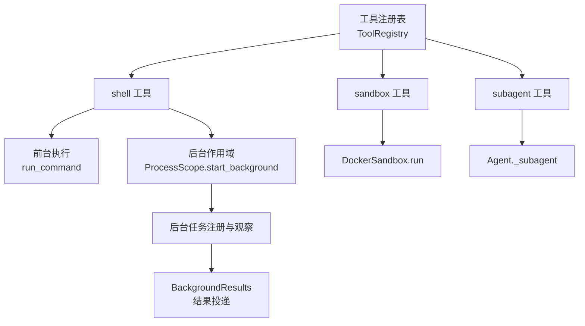
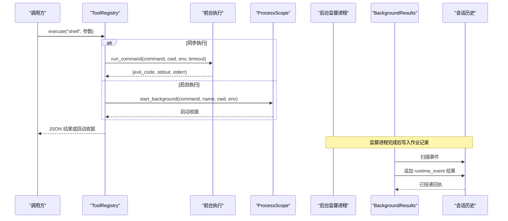
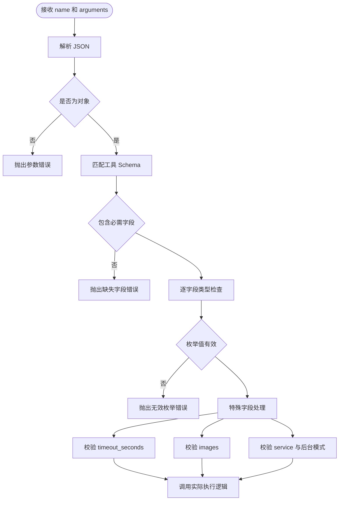
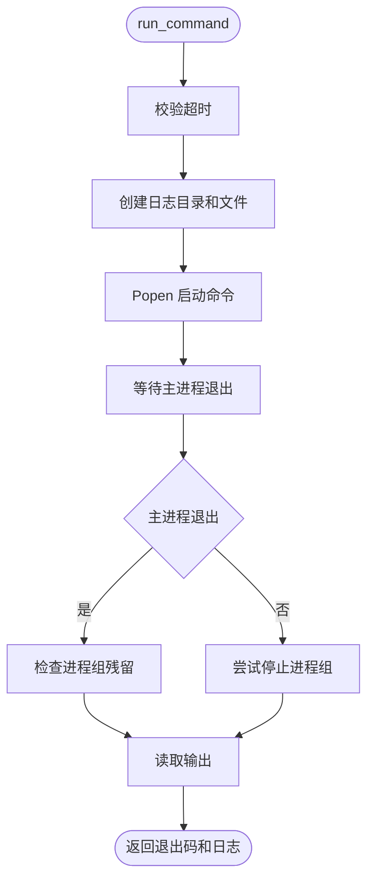
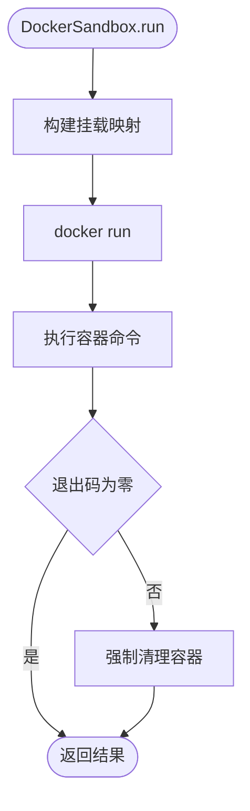
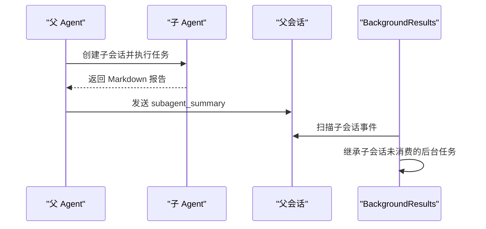
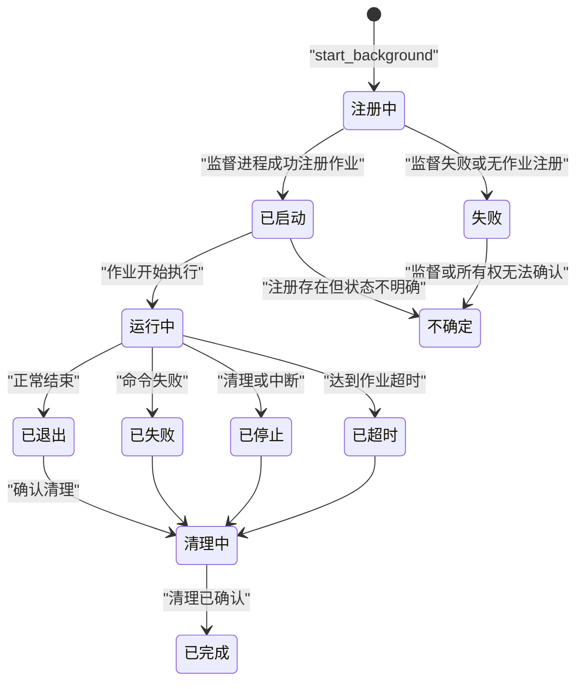
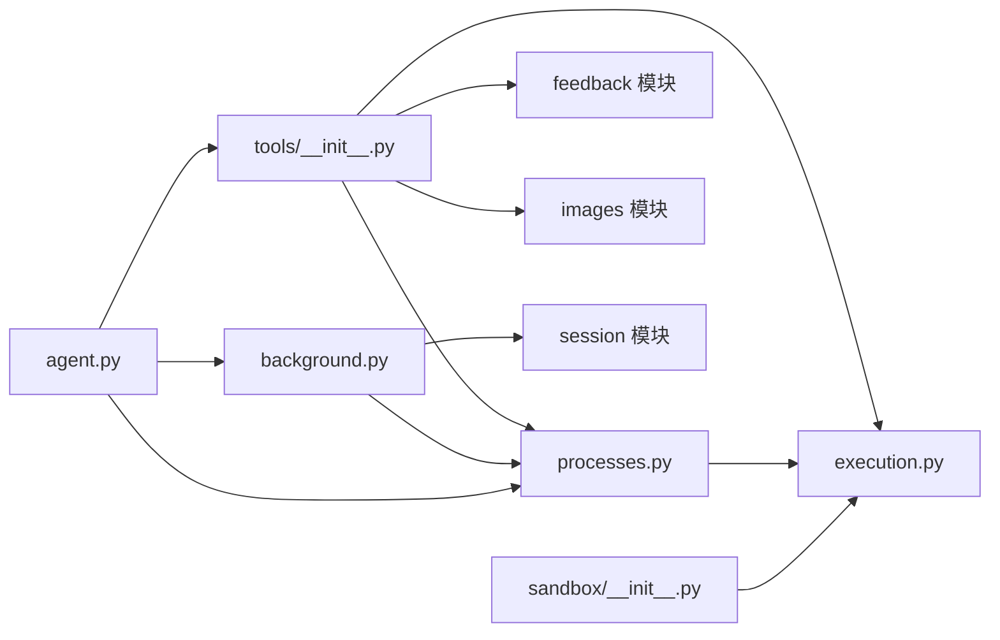
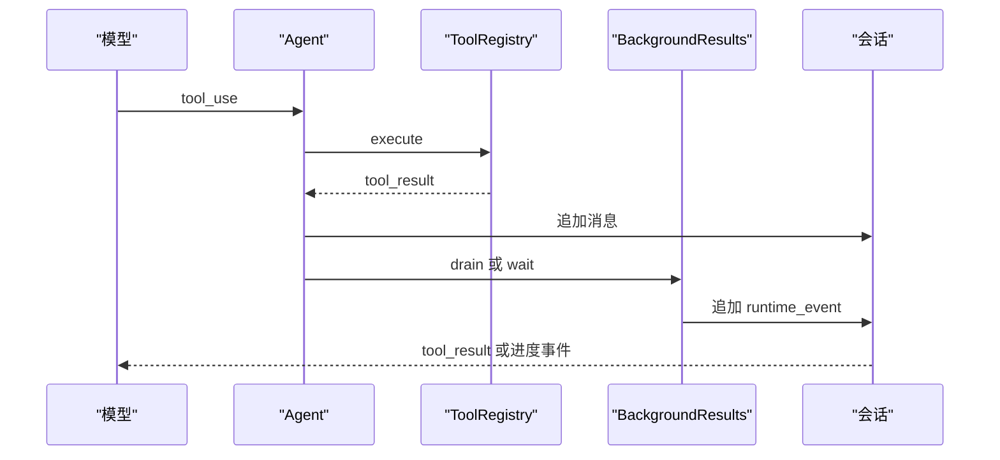

# 工具与后台任务

<cite>
**本文引用的文件**   
- [tools/__init__.py](file://skills_agent/tools/__init__.py)
- [execution.py](file://skills_agent/execution.py)
- [processes.py](file://skills_agent/processes.py)
- [background.py](file://skills_agent/background.py)
- [sandbox/__init__.py](file://skills_agent/sandbox/__init__.py)
- [agent.py](file://skills_agent/agent.py)
</cite>

## 目录
1. [简介](#简介)
2. [项目结构](#项目结构)
3. [核心组件](#核心组件)
4. [架构总览](#架构总览)
5. [详细组件分析](#详细组件分析)
6. [依赖关系分析](#依赖关系分析)
7. [性能考虑](#性能考虑)
8. [故障排查指南](#故障排查指南)
9. [结论](#结论)
10. [附录：API 参考与示例](#附录api-参考与示例)

## 简介
本仓库实现了 Agent 侧的工具注册表、命令执行入口、沙箱执行、子代理委派，以及基于进程组隔离的后台任务管理。其关键职责包括：

- 为 `shell`、`sandbox`、`subagent` 三个工具提供参数签名和运行时校验。
- 在宿主进程中同步执行命令，并在超时或异常时清理同一进程组中的残留进程。
- 将长生命周期任务交给独立监督进程，通过文件系统记录所有权、状态、标准输出和错误输出。
- 在 Agent 同步边界投递后台结果、不确定性事件和子代理摘要。
- 通过 Docker 容器对命令进行网络隔离和只读挂载。
- 暴露 `BackgroundJobError`、`BackgroundResults`、`ProcessScope`、`completion_result` 等接口供上层消费。

## 项目结构
围绕本次文档目标的相关代码集中在以下模块：

| 路径 | 职责 |
|---|---|
| `skills_agent/tools/__init__.py` | 工具注册表、工具参数 Schema、工具执行分发 |
| `skills_agent/execution.py` | 前台命令执行、进程组清理、超时、日志截断 |
| `skills_agent/processes.py` | 后台任务注册、观察、结果读取、作用域、监督启动 |
| `skills_agent/background.py` | 后台结果投递、不确定性报告、子代理委托继承 |
| `skills_agent/sandbox/__init__.py` | Docker 沙箱运行和容器清理 |
| `skills_agent/agent.py` | 子代理创建、会话上下文传递、进度转发 |



**图表来源**
- [tools/__init__.py:23-191](file://skills_agent/tools/__init__.py#L23-L191)
- [execution.py:201-369](file://skills_agent/execution.py#L201-L369)
- [processes.py:606-821](file://skills_agent/processes.py#L606-L821)
- [background.py:1-291](file://skills_agent/background.py#L1-L291)
- [sandbox/__init__.py:1-78](file://skills_agent/sandbox/__init__.py#L1-L78)
- [agent.py:299-390](file://skills_agent/agent.py#L299-L390)

**章节来源**
- [tools/__init__.py:23-191](file://skills_agent/tools/__init__.py#L23-L191)
- [execution.py:201-369](file://skills_agent/execution.py#L201-L369)
- [processes.py:606-821](file://skills_agent/processes.py#L606-L821)
- [background.py:1-291](file://skills_agent/background.py#L1-L291)
- [sandbox/__init__.py:1-78](file://skills_agent/sandbox/__init__.py#L1-L78)
- [agent.py:299-390](file://skills_agent/agent.py#L299-L390)

## 核心组件

### ToolRegistry：工具注册与参数校验
`ToolRegistry` 维护当前工作空间、可选的沙箱、可选的子代理回调、日志目录和活动回调，并动态生成工具的 JSON Schema。

| 属性或方法 | 类型 | 行为说明 |
|---|---|---|
| `workspace` | `Path` | 工具执行的宿主工作目录，会展开用户目录并解析绝对路径 |
| `sandbox` | 可选对象 | 必须提供 `run(command, timeout_seconds, log_dir)` |
| `subagent` | 可选函数 | 接收 `(name, task, history)` 并返回最终报告 |
| `execute(name, arguments)` | 字符串 | 解析工具名和 JSON 参数，调用对应实现，返回 JSON 字符串 |

工具签名如下：

| 工具 | 必需字段 | 可选字段 | 行为 |
|---|---|---|---|
| `shell` | `name`、`command`、`run_in_background` | `timeout_seconds`、`result_mode`、`images`、`background_lifecycle` | 宿主 shell 命令；可同步或注册后台任务 |
| `sandbox` | `name`、`command` | `timeout_seconds`、`result_mode`、`images` | 在 Docker 容器中执行命令 |
| `subagent` | `name`、`task` | `history` | 委派子代理并返回 Markdown 报告 |

参数校验规则：

- 参数必须是合法 JSON 对象。
- 缺少必需字段或传入未声明字段会报错。
- `boolean` 字段要求布尔值，`string` 字段不允许空字符串。
- `enum` 字段必须在允许值内。
- `timeout_seconds` 在前台和后台有不同约束：前台默认 120 秒、最大 600 秒；后台任务默认 3600 秒，服务模式无默认上限但必须为正有限数。
- `images` 使用专用校验器，限制数量和每个图片大小。
- `background_lifecycle=service` 仅允许在 `run_in_background=true` 时使用。

**章节来源**
- [tools/__init__.py:23-191](file://skills_agent/tools/__init__.py#L23-L191)

### 执行入口：前台、沙箱与子代理
`ToolRegistry.execute` 是统一入口：

1. 查找工具 Schema。
2. 解析并校验 JSON 参数。
3. 更新活动回调。
4. 根据工具名路由到具体实现。
5. 捕获非清理异常，包装为 `{"error": ...}`。
6. 恢复活动回调。

| 工具 | 调用方式 | 返回值 |
|---|---|---|
| `shell`（同步） | `execution.run_command` | 退出码、标准输出、标准错误、清理信息 |
| `shell`（后台） | `ProcessScope.start_background` | 启动收据，包含 `job_id`、状态目录、日志路径 |
| `sandbox` | `DockerSandbox.run` | 容器退出码、日志、清理诊断 |
| `subagent` | `self.subagent(name, task, history)` | 子代理最终报告，包裹在 `{"result": report}` 中 |

**章节来源**
- [tools/__init__.py:117-191](file://skills_agent/tools/__init__.py#L117-L191)
- [execution.py:201-369](file://skills_agent/execution.py#L201-L369)
- [processes.py:606-821](file://skills_agent/processes.py#L606-L821)
- [sandbox/__init__.py:52-78](file://skills_agent/sandbox/__init__.py#L52-L78)

### BackgroundResults：后台结果与不确定性
`BackgroundResults` 负责从会话历史中拉取后台任务完成证据，并将结果追加回会话。它维护：

- `_known`：已发现但尚未投递的任务快照。
- `_delivered`：已投递的结果标识集合。
- `_uncertain`：当前不确定任务。
- `_delegated`：子代理会话委托映射。
- `_reported_children`：已成功报告的子代理会话标识。

核心方法：

| 方法 | 输入 | 输出 | 语义 |
|---|---|---|---|
| `drain(append)` | 追加函数 | `(已投递数量, 是否仍有待处理任务)` | 扫描会话事件、观察后台作业、去重、投递结果或不确定性 |
| `wait(append)` | 追加函数 | 已投递数量 | 轮询直到有结果或没有等待任务；若存在阻塞任务则重复发送不确定性提醒 |
| `_receipts()` | 无 | 内部状态更新 | 从会话事件重建已知任务、结果回执、不确定性回执和子代理委托 |

背景任务状态分为三类：

| 状态 | 含义 |
|---|---|
| `started` | 监督进程成功注册了作业 |
| `failed` | 监督失败或未确认启动 |
| `unconfirmed` | 注册证据存在但完成状态或监督关系无法确认 |

**章节来源**
- [background.py:1-291](file://skills_agent/background.py#L1-L291)

### ProcessScope：后台任务作用域
`ProcessScope` 表示一次 Agent 回合内的后台任务命名空间。它通过文件系统目录保存作用域元数据、作业记录和启动期望。

| 方法 | 参数 | 返回值 | 行为 |
|---|---|---|---|
| `__init__(session_path, allow_persistent=False)` | 会话路径、是否允许持久服务 | 无 | 创建隔离的作用域目录 |
| `attach(path)` | 作用域路径 | `ProcessScope` | 附加已有作用域，不写入新文件 |
| `mark_successful()` | 无 | 无 | 标记作用域已完成 |
| `start_background(command, name, cwd, env, timeout_seconds, background_lifecycle, images)` | 见下 | 启动收据字典 | 注册后台任务并返回启动收据 |
| `close_owner(owner_session_id)` | 所有者会话标识 | 无 | 清理某个所有者的后台任务 |
| `close(preserve_persistent=False)` | 是否保留持久服务 | 无 | 关闭作用域并清理后台任务 |

`start_background` 的关键约束：

- 命令和名称必须是非空字符串。
- `background_lifecycle` 只能是 `task` 或 `service`。
- 非服务模式的后台任务默认超时 3600 秒；服务模式默认无超时。
- 工作目录必须是真实存在的绝对目录。
- 环境变量键值必须都是字符串。
- 服务模式下需要作用域允许持久化。
- 返回的是启动收据，不是最终结果。

**章节来源**
- [processes.py:606-821](file://skills_agent/processes.py#L606-L821)

### BackgroundJobError 与 completion_result
`BackgroundJobError` 表示后台任务的完成状态、所有权或清理无法安全建立。

`completion_result(job, max_bytes=16384)` 用于读取已终止且清理已确认的作业结果：

- 验证作业 ID 与作用域哈希一致。
- 要求作业状态处于终态且清理已确认。
- 读取标准输出和错误输出的尾部内容，默认最多 16384 字节。
- 返回结构化结果，包含退出码、时长、超时标志、清理信息和日志路径。

**章节来源**
- [processes.py:30-108](file://skills_agent/processes.py#L30-L108)
- [processes.py:325-412](file://skills_agent/processes.py#L325-L412)

## 架构总览



**图表来源**
- [tools/__init__.py:117-191](file://skills_agent/tools/__init__.py#L117-L191)
- [execution.py:201-369](file://skills_agent/execution.py#L201-L369)
- [processes.py:606-821](file://skills_agent/processes.py#L606-L821)
- [background.py:1-291](file://skills_agent/background.py#L1-L291)

## 详细组件分析

### 工具签名与 JSON Schema 校验
工具参数通过 Python 数据结构描述，再由 `ToolRegistry.execute` 手动校验，而不是由外部 JSON Schema 库直接驱动。校验流程如下：



**图表来源**
- [tools/__init__.py:117-191](file://skills_agent/tools/__init__.py#L117-L191)

**章节来源**
- [tools/__init__.py:23-191](file://skills_agent/tools/__init__.py#L23-L191)

### 三种执行模式

#### 模式一：shell 同步执行
- 在当前进程中通过 `subprocess.Popen` 启动命令。
- 使用 POSIX `waitid` 和非阻塞探测判断主进程退出。
- 主进程退出后检查同一进程组是否存在残留成员。
- 若有残留，先发送 `SIGTERM`，再发送 `SIGKILL`。
- 超时情况下设置 `timed_out=True` 并截断输出。
- 清理失败会抛出 `ToolCleanupError`，并携带诊断信息。



**图表来源**
- [execution.py:201-369](file://skills_agent/execution.py#L201-L369)

**章节来源**
- [execution.py:201-369](file://skills_agent/execution.py#L201-L369)

#### 模式二：sandbox 沙箱执行
`DockerSandbox.run` 的行为：

- 对工作目录授予写权限。
- 对其他根目录授予只读权限。
- 使用 `docker run --rm --network none` 启动容器。
- 复用 `run_command` 实现超时、日志和清理。
- 清理阶段调用 `docker rm -f`，并区分容器已被移除与守护进程失败。



**图表来源**
- [sandbox/__init__.py:1-78](file://skills_agent/sandbox/__init__.py#L1-L78)
- [execution.py:201-369](file://skills_agent/execution.py#L201-L369)

**章节来源**
- [sandbox/__init__.py:1-78](file://skills_agent/sandbox/__init__.py#L1-L78)

#### 模式三：subagent 子代理执行
`ToolRegistry.execute` 将 `subagent` 工具委托给外部 `self.subagent` 回调；在 Agent 中该回调是 `Agent._subagent`。

关键点：

- 子代理拥有独立会话。
- 可通过 `history=true` 获取父会话原始历史快照。
- 子代理的最终 Markdown 报告作为 `{"result": report}` 返回。
- 子代理结束时，父 Agent 发送 `subagent_summary` 事件，包含子会话 ID、会话路径和所有者会话 ID。
- `BackgroundResults` 支持子代理委托：如果子代理成功完成，其仍待消费的后台任务可被父会话继续消费。



**图表来源**
- [agent.py:299-390](file://skills_agent/agent.py#L299-L390)
- [background.py:1-291](file://skills_agent/background.py#L1-L291)
- [tools/__init__.py:117-191](file://skills_agent/tools/__init__.py#L117-L191)

**章节来源**
- [agent.py:299-390](file://skills_agent/agent.py#L299-L390)
- [background.py:1-291](file://skills_agent/background.py#L1-L291)
- [tools/__init__.py:117-191](file://skills_agent/tools/__init__.py#L117-L191)

### 后台任务生命周期



**图表来源**
- [processes.py:109-412](file://skills_agent/processes.py#L109-L412)
- [processes.py:606-821](file://skills_agent/processes.py#L606-L821)
- [background.py:1-291](file://skills_agent/background.py#L1-L291)

**章节来源**
- [processes.py:109-412](file://skills_agent/processes.py#L109-L412)
- [processes.py:606-821](file://skills_agent/processes.py#L606-L821)
- [background.py:1-291](file://skills_agent/background.py#L1-L291)

### 输入输出约束
| 项目 | 约束 |
|---|---|
| 工具参数 | 必须为 JSON 对象，字段受 Schema 限制 |
| 命令 | `shell` 和 `sandbox` 使用字符串命令；后台任务通过 `/bin/sh -c` 执行 |
| 标准输出和错误输出 | 前台默认可能截断；后台默认最多读取 16384 字节尾部 |
| 图片附件 | 最多 `MAX_REQUEST_IMAGES` 张，每张不超过 1 MB |
| 工作目录 | 前台和后台都要求真实目录；后台要求绝对路径 |
| 环境变量 | 后台要求键和值均为字符串；额外注入作用域、上下文和调用标识 |
| 超时 | 前台最大 600 秒；后台任务默认 3600 秒；服务模式无默认超时 |
| 进程组 | 前台命令使用新会话；清理阶段向整个进程组发送信号 |
| 沙箱网络 | 禁用容器网络 |
| 文件权限 | 工作目录可写；其他挂载目录只读 |

**章节来源**
- [tools/__init__.py:23-191](file://skills_agent/tools/__init__.py#L23-L191)
- [execution.py:1-200](file://skills_agent/execution.py#L1-L200)
- [execution.py:201-369](file://skills_agent/execution.py#L201-L369)
- [processes.py:606-821](file://skills_agent/processes.py#L606-L821)
- [sandbox/__init__.py:1-78](file://skills_agent/sandbox/__init__.py#L1-L78)

## 依赖关系分析



**图表来源**
- [tools/__init__.py:1-191](file://skills_agent/tools/__init__.py#L1-L191)
- [execution.py:1-369](file://skills_agent/execution.py#L1-L369)
- [processes.py:1-821](file://skills_agent/processes.py#L1-L821)
- [background.py:1-291](file://skills_agent/background.py#L1-L291)
- [sandbox/__init__.py:1-78](file://skills_agent/sandbox/__init__.py#L1-L78)
- [agent.py:299-390](file://skills_agent/agent.py#L299-L390)

**章节来源**
- [tools/__init__.py:1-191](file://skills_agent/tools/__init__.py#L1-L191)
- [processes.py:1-821](file://skills_agent/processes.py#L1-L821)
- [background.py:1-291](file://skills_agent/background.py#L1-L291)

## 性能考虑
- 前台命令不应长时间阻塞；超过 600 秒的命令应改用后台任务。
- 后台任务默认 3600 秒，适合中等长度任务；超长任务应考虑服务模式和明确的生命周期。
- 后台结果读取默认限制 16384 字节，避免大日志阻塞界面。
- 进程组检查使用短超时轮询，防止 `ps` 等系统命令无限等待。
- 沙箱使用 `--network none`，减少网络 I/O 对外部系统的副作用。
- 子代理仅在必要时启用 `history=true`，因为完整上下文快照成本较高。

[本节为通用指导，不直接分析具体文件]

## 故障排查指南

| 现象 | 可能原因 | 诊断步骤 | 修复建议 |
|---|---|---|---|
| 命令执行失败 | 命令不存在、参数错误、权限不足、工作目录无效 | 查看 `exit_code`、`stderr`、`stdout_path`、`stderr_path` | 修正命令、检查工作目录和权限 |
| 超时但未返回干净结果 | 进程组清理失败或子进程未跟随退出 | 检查 `timed_out`、`cleanup_required`、`cleanup_confirmed`、`cleanup_message` | 确保脚本显式等待子任务；避免守护进程脱离进程组 |
| 沙箱镜像不可用 | Docker 镜像缺失、拉取失败、容器创建失败 | 查看 `stdout`、`stderr` 和清理诊断 | 预拉取镜像、检查 Docker 守护进程和网络 |
| 子进程僵尸化 | 主进程退出后仍有子进程存活 | 检查 `cleanup_initial_process_count`、`cleanup_reason` | 让脚本显式等待子进程；避免 `nohup`、`&` 脱离进程组 |
| 后台结果投递延迟 | 监督进程未退出、结果文件未写完、会话未同步 | 调用 `BackgroundResults.drain` 并轮询 `pending` | 等待结果事件；检查监督进程和作业记录 |
| 权限不足 | 无法写入日志、作用域目录、容器目录 | 检查目录权限、Docker 用户映射 | 确保 Agent 用户对日志和作用域目录有写权限 |
| 后台任务消失 | 注册文件损坏、作用域符号链接、监督身份无法确认 | 查看 `error`、`_scope_path`、`process_record_path` | 不要直接删除后台任务目录；通过清理 API 恢复 |
| 子代理未完成 | 子代理中断、失败或历史记录检索未就绪 | 查看 `subagent_summary` 状态和 `child_session_id` | 检查子会话日志；避免在父会话关闭前强依赖子任务 |

**章节来源**
- [execution.py:201-369](file://skills_agent/execution.py#L201-L369)
- [processes.py:325-412](file://skills_agent/processes.py#L325-L412)
- [processes.py:606-821](file://skills_agent/processes.py#L606-L821)
- [background.py:1-291](file://skills_agent/background.py#L1-L291)
- [sandbox/__init__.py:1-78](file://skills_agent/sandbox/__init__.py#L1-L78)

## 结论
本模块以工具注册表为中心，把宿主命令、Docker 沙箱和子代理统一到相同的调用入口，并通过作用域、监督进程和会话事件实现可靠的后台任务管理。前台执行强调进程组清理，后台执行强调所有权证明和不确定性表达，沙箱执行强调网络和挂载隔离。正确使用这些边界可以避免僵尸进程、资源泄漏和不可观测的后台任务。

[本节为总结性内容，不直接分析具体文件]

## 附录：API 参考与示例

### Python 示例：注册自定义工具
由于仓库中未提供第三方工具扩展点，常见做法是封装现有工具或在应用层组合调用。下面给出概念性示例，展示如何组织自定义工具逻辑：

```python
from pathlib import Path
from skills_agent.tools import ToolRegistry
from skills_agent.sandbox import DockerSandbox

workspace = Path.cwd()
sandbox = DockerSandbox(image="my-image", workspace=workspace, read_roots=[Path("/data")])

registry = ToolRegistry(workspace=workspace, sandbox=sandbox)

# 同步执行 shell 命令
print(registry.execute("shell", '{"name":"hello","command":"echo hello","run_in_background":false}'))

# 后台执行 shell 命令
print(registry.execute("shell", '{"name":"long-task","command":"sleep 60","run_in_background":true}'))

# 在沙箱中执行命令
print(registry.execute("sandbox", '{"name":"inspect","command":"ls /data","timeout_seconds":30}'))

# 委派子代理
print(registry.execute("subagent", '{"name":"investigate","task":"检查日志并返回结论","history":true}'))
```

**章节来源**
- [tools/__init__.py:23-191](file://skills_agent/tools/__init__.py#L23-L191)
- [sandbox/__init__.py:1-78](file://skills_agent/sandbox/__init__.py#L1-L78)

### Python 示例：监听后台任务完成事件
```python
import time
from pathlib import Path
from skills_agent.background import BackgroundResults
from skills_agent.processes import ProcessScope

# 假设已有会话路径和作用域路径
session_path = Path("sessions/my-session")
scope_paths = [Path("sessions/my-session/process-scopes")]

results = BackgroundResults(session=session_path, scope_paths=lambda: scope_paths)

for _ in range(20):
    delivered, pending = results.drain(append=lambda event: print("收到后台事件:", event))
    if delivered:
        print("有后台结果已投递")
    if not pending:
        break
    time.sleep(0.2)
```

**章节来源**
- [background.py:1-291](file://skills_agent/background.py#L1-L291)

### Python 示例：读取后台任务标准输出和错误输出
```python
from pathlib import Path
from skills_agent.processes import observe_background_jobs, completion_result

jobs = observe_background_jobs(scope_paths=[Path("sessions/my-session/process-scopes")], tolerate_unconfirmed=True)

for job in jobs:
    if job.get("state") == "exited" and job.get("cleanup_confirmed"):
        result = completion_result(job, max_bytes=1024 * 1024)
        print("标准输出:", result.get("stdout"))
        print("错误输出:", result.get("stderr"))
        print("日志路径:", result.get("stdout_path"), result.get("stderr_path"))
```

**章节来源**
- [processes.py:109-412](file://skills_agent/processes.py#L109-L412)

### Agent 工具调用链路集成
与 Agent 工具调用的集成要点：

| 概念 | 对应机制 |
|---|---|
| `tool_use` | 上层模型发出工具调用，进入 `ToolRegistry.execute` |
| `tool_result` | 工具返回 JSON 字符串，上层将其转为工具结果消息 |
| 进度更新 | `on_activity` 回调可在工具执行前后上报活动；子代理也会转发阶段活动 |
| 不确定性元数据 | 后台任务不确定性通过 `runtime_event` 和 `background_job_uncertainty` 投递 |
| 结果投递 | 后台任务完成通过 `runtime_event` 和 `background_job_result` 投递 |
| 子代理汇总 | 子代理完成时发送 `subagent_summary`，附带状态和会话 ID |



**图表来源**
- [tools/__init__.py:117-191](file://skills_agent/tools/__init__.py#L117-L191)
- [background.py:1-291](file://skills_agent/background.py#L1-L291)
- [agent.py:299-390](file://skills_agent/agent.py#L299-L390)

**章节来源**
- [tools/__init__.py:117-191](file://skills_agent/tools/__init__.py#L117-L191)
- [background.py:1-291](file://skills_agent/background.py#L1-L291)
- [agent.py:299-390](file://skills_agent/agent.py#L299-L390)

### 最佳实践
- 使用只读挂载：对不需要修改的数据目录使用 `read_roots`，避免误写。
- 限制资源配额：尽量在命令内部限制 CPU、内存和磁盘使用；沙箱本身不提供内核级配额。
- 避免长时间前台阻塞：超过 120 秒的任务改为后台任务，超过 600 秒更应避免前台执行。
- 对敏感环境变量做最小权限控制：不要向后台环境泄露密钥；必要时在服务内按需加载。
- 显式等待子任务：脚本应等待内部子进程退出，避免主进程退出后留下僵尸或孤儿进程。
- 使用确定性名称和证据：工具 `name` 要简洁可读，输出应包含路径、命令和可复现证据。
- 谨慎使用持久服务：仅在允许持久化的作用域中启用服务，并主动检查就绪状态。
- 优先使用沙箱：对不可信命令优先选择 `sandbox`，以减少宿主环境风险。
- 合理设置超时：前台使用较小超时，后台任务按预期时长设置，服务任务配合健康检查而非无限等待。

[本节为通用指导，不直接分析具体文件]