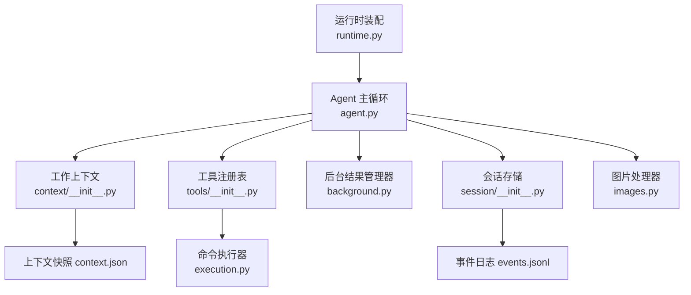
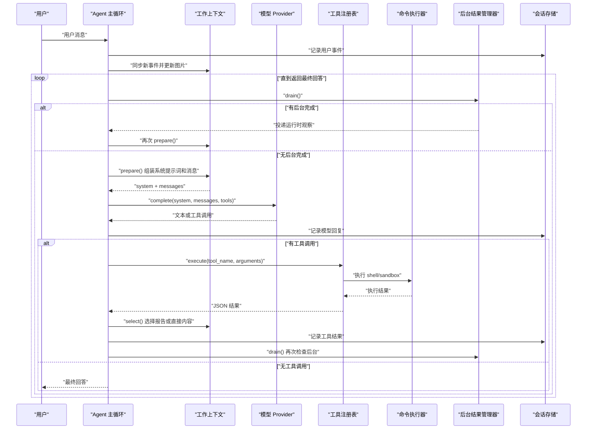
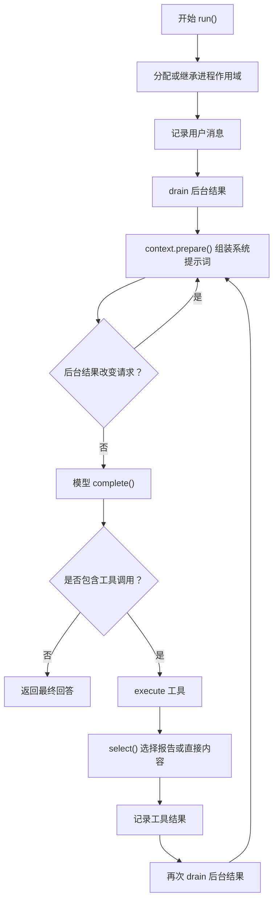
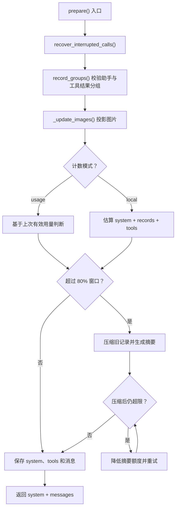
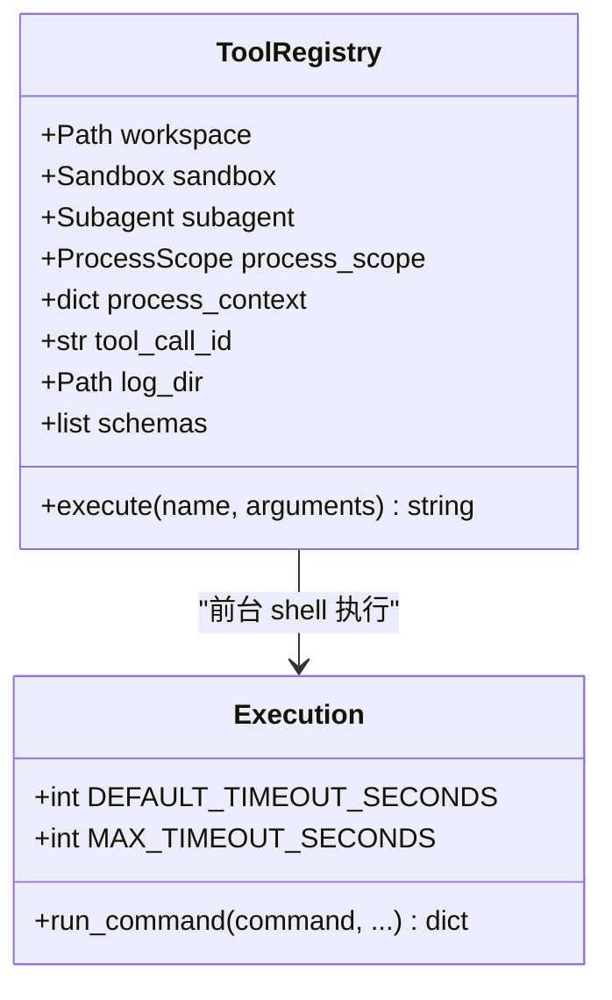
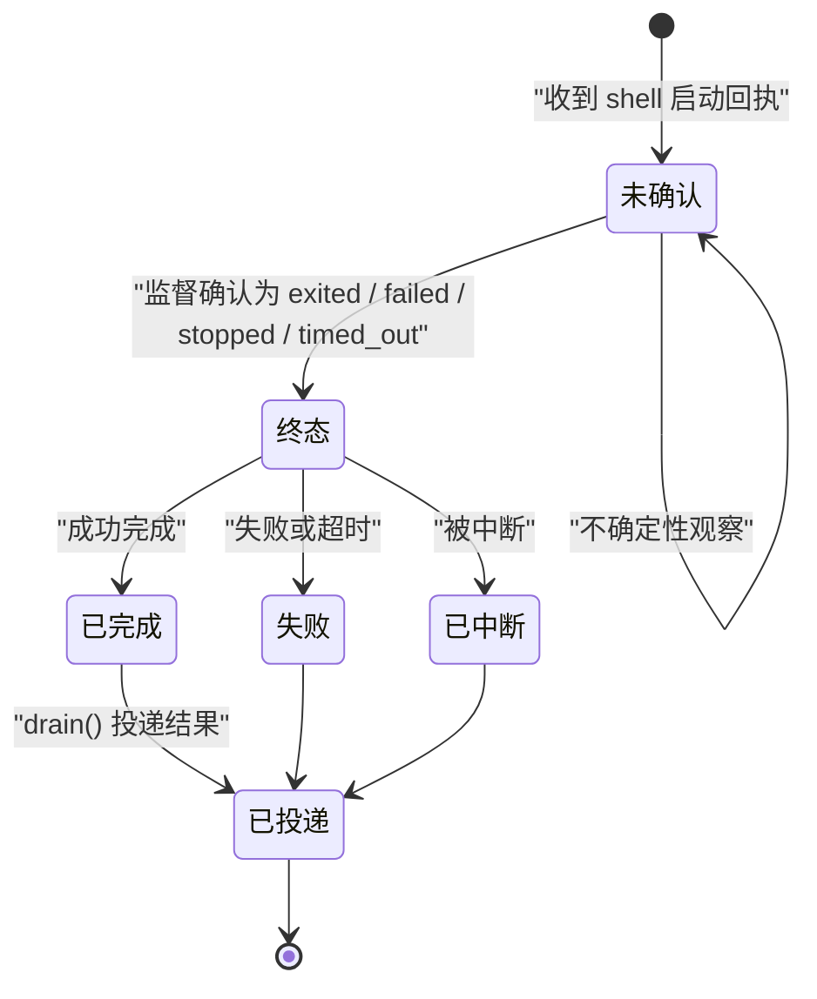
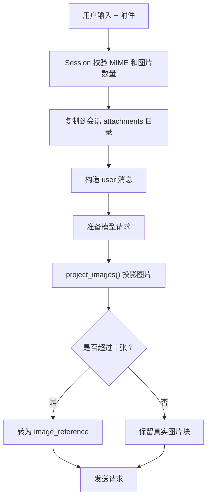
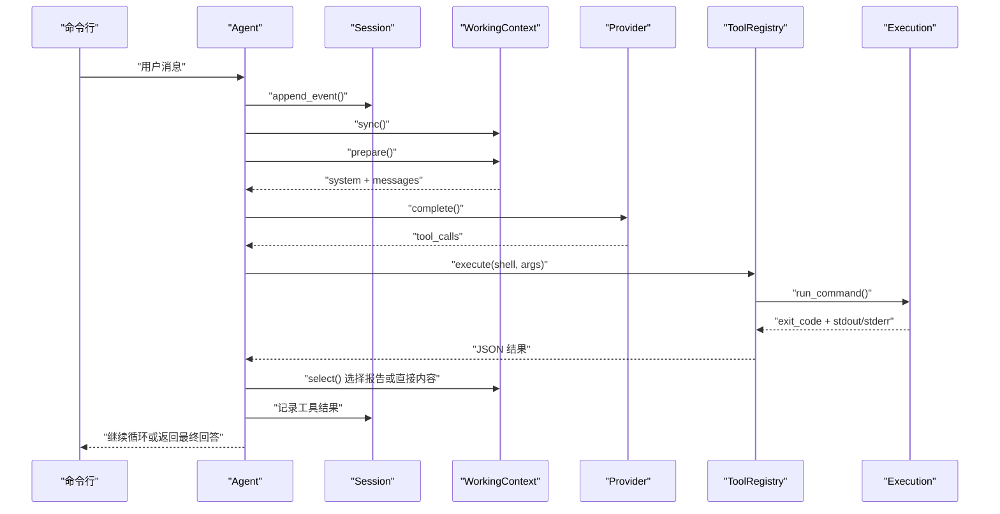
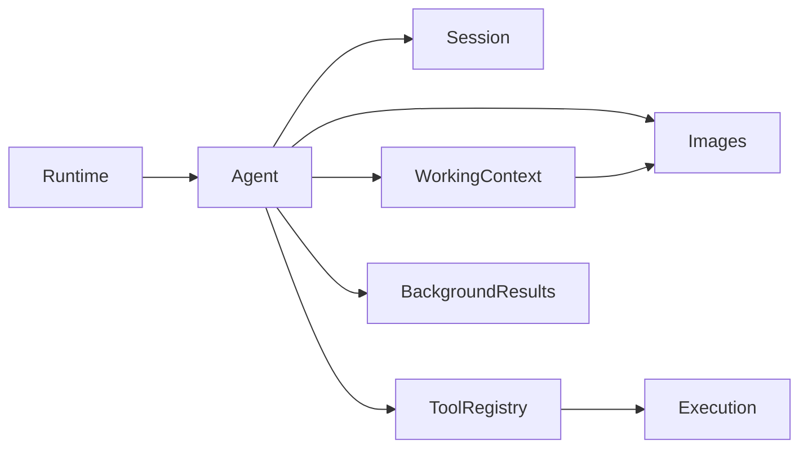

# Agent 核心引擎

<cite>
**本文引用的文件**
- [skills_agent/agent.py](file://skills_agent/agent.py)
- [skills_agent/context/__init__.py](file://skills_agent/context/__init__.py)
- [skills_agent/tools/__init__.py](file://skills_agent/tools/__init__.py)
- [skills_agent/background.py](file://skills_agent/background.py)
- [skills_agent/session/__init__.py](file://skills_agent/session/__init__.py)
- [skills_agent/images.py](file://skills_agent/images.py)
- [skills_agent/runtime.py](file://skills_agent/runtime.py)
- [skills_agent/execution.py](file://skills_agent/execution.py)
- [docs/usage.md](file://docs/usage.md)
</cite>

## 目录
1. [简介](#简介)
2. [项目结构](#项目结构)
3. [核心组件](#核心组件)
4. [架构总览](#架构总览)
5. [详细组件分析](#详细组件分析)
6. [依赖关系分析](#依赖关系分析)
7. [性能考虑](#性能考虑)
8. [故障排查指南](#故障排查指南)
9. [结论](#结论)

## 简介
Agent 核心引擎围绕 `Agent` 主循环组织：读取工作上下文、组装系统提示词、注册工具、调度模型调用、执行工具、处理图片与反馈，并协调前台对话和后台任务。它通过会话存储持久化原始事件，通过工作上下文管理压缩后的可发送消息，通过工具注册表把 shell、sandbox 和子 Agent 暴露给模型，并通过后台结果管理器把已完成的后台作业作为“运行时观察”注入下一轮请求。

该引擎不是简单地把用户文本发给模型，而是维护一个完整的双层状态机：
- 前台状态：用户输入、模型回复、工具调用与结果。
- 后台状态：shell 启动回执、进程监督、未完成不确定性、已完成结果。

当用户输入包含图片附件时，引擎先保存不可变副本；当模型输出需要执行脚本或检查环境时，引擎通过工具执行命令，并把结果回写工作上下文；当后台任务完成时，引擎把结果包装为“非用户指令”的运行时观察，驱动模型继续推进任务。

## 项目结构
Agent 核心代码集中在 `skills_agent` 包中，按职责划分：
- `agent.py`：Agent 主类、系统提示词、主循环、子 Agent 委托。
- `context/__init__.py`：工作上下文、中断恢复、上下文压缩、Token 预算。
- `tools/__init__.py`：工具注册表、参数校验、shell/sandbox/subagent 执行。
- `background.py`：后台作业生命周期、不确定性与完成投递。
- `session/__init__.py`：追加式事件日志、附件保存、用户消息构造。
- `images.py`：图片读取、引用投影、每请求最多十张图片限制。
- `runtime.py`：CLI 参数、Provider 创建、Agent 装配。
- `execution.py`：前台命令执行、进程组清理、超时与诊断。
- `docs/usage.md`：运行方式、配置项、交互行为说明。

**图表来源**
- [skills_agent/runtime.py:33-58](file://skills_agent/runtime.py#L33-L58)
- [skills_agent/agent.py:23-105](file://skills_agent/agent.py#L23-L105)
- [skills_agent/context/__init__.py:1-40](file://skills_agent/context/__init__.py#L1-L40)
- [skills_agent/tools/__init__.py:1-60](file://skills_agent/tools/__init__.py#L1-L60)
- [skills_agent/background.py:1-30](file://skills_agent/background.py#L1-L30)
- [skills_agent/session/__init__.py:1-30](file://skills_agent/session/__init__.py#L1-L30)
- [skills_agent/images.py:1-25](file://skills_agent/images.py#L1-L25)
- [skills_agent/execution.py:1-30](file://skills_agent/execution.py#L1-L30)

**章节来源**
- [skills_agent/runtime.py:1-58](file://skills_agent/runtime.py#L1-L58)
- [skills_agent/agent.py:1-120](file://skills_agent/agent.py#L1-L120)
- [docs/usage.md:1-40](file://docs/usage.md#L1-L40)

## 核心组件
| 组件 | 主要职责 | 关键数据结构 | 对外接口 |
|---|---|---|---|
| `Agent` | 主循环、系统提示词、模型调度、工具执行、后台协调 | `model`、`session`、`tools`、`context`、`_background_results` | `run(user_message)`、`close()` |
| `WorkingContext` | 增量同步会话、中断恢复、上下文压缩、Token 预算控制 | `records`、`summary`、`token_count`、`cursor` | `sync()`、`prepare()`、`snapshot()` |
| `ToolRegistry` | 声明 shell、sandbox、subagent 工具，校验参数并执行 | `schemas`、`process_scope`、`process_context` | `execute(name, arguments)` |
| `BackgroundResults` | 解析启动回执、追踪未确认任务、投递完成结果 | `_known`、`_uncertain`、`_delivered` | `drain(append)`、`wait(append)` |
| `Session` | 追加式事件日志、附件拷贝、用户消息构造 | `events.jsonl`、附件目录 | `append_event()`、`make_user_message()` |
| `Image 处理模块` | 图片字节读取、URL 引用投影、请求级图片限制 | `MAX_REQUEST_IMAGES=10`、`MAX_IMAGE_BYTES=1_000_000` | `image_bytes()`、`project_images()` |
| `Execution` | 前台命令执行、进程组信号、超时清理、诊断 | `DEFAULT_TIMEOUT_SECONDS=120`、`MAX_TIMEOUT_SECONDS=600` | `run_command()` |
| `Runtime` | 加载配置、创建 Provider、构建 Agent | CLI 参数、TOML 配置 | `create_agent(args, session, ...)` |

**章节来源**
- [skills_agent/agent.py:23-120](file://skills_agent/agent.py#L23-L120)
- [skills_agent/context/__init__.py:1-60](file://skills_agent/context/__init__.py#L1-L60)
- [skills_agent/tools/__init__.py:1-120](file://skills_agent/tools/__init__.py#L1-L120)
- [skills_agent/background.py:1-60](file://skills_agent/background.py#L1-L60)
- [skills_agent/session/__init__.py:1-40](file://skills_agent/session/__init__.py#L1-L40)
- [skills_agent/images.py:1-30](file://skills_agent/images.py#L1-L30)
- [skills_agent/execution.py:1-40](file://skills_agent/execution.py#L1-L40)
- [skills_agent/runtime.py:1-58](file://skills_agent/runtime.py#L1-L58)

## 架构总览
Agent 的主循环是一个“读取上下文 → 发起模型请求 → 消费工具调用 → 执行工具 → 回写上下文 → 检查后台任务”的闭环。

**图表来源**
- [skills_agent/agent.py:280-481](file://skills_agent/agent.py#L280-L481)
- [skills_agent/context/__init__.py:280-446](file://skills_agent/context/__init__.py#L280-L446)
- [skills_agent/tools/__init__.py:120-191](file://skills_agent/tools/__init__.py#L120-L191)
- [skills_agent/background.py:200-291](file://skills_agent/background.py#L200-L291)
- [skills_agent/session/__init__.py:15-40](file://skills_agent/session/__init__.py#L15-L40)

**章节来源**
- [skills_agent/agent.py:201-481](file://skills_agent/agent.py#L201-L481)

## 详细组件分析

### Agent 主循环与系统提示词
Agent 在初始化时组合多个系统级信息：
- 当前工作目录、Git 仓库状态、平台、实际 shell、操作系统等环境信息。
- 技能目录目录清单。
- 工具使用约束、图片附加规则、背景任务协议、shell 与 sandbox 的执行约定。
- 可选的子 Agent 委托策略和历史检索指引。
- 自定义 `instructions`。

系统提示词的核心原则是：能直接回答就回答；需要读、验证、修改或执行时使用工具；从用户目标推导完成条件；保留证据、产物和未决事项；对冲突证据给出区分；按技能描述选择 SKILL.md；图片最多十张、每张不超过一百万字节；后台任务要使用 background-tasks 技能并遵守进程组契约；长输出使用 result_mode 控制自动报告、直接内容或结论摘要。

主循环 `run()` 负责：
- 分配或继承进程作用域。
- 启动后台任务轮次。
- 执行 `_run()`。
- 成功时标记本轮完成。
- 失败时关闭进程作用域。
- finally 中清理进程作用域和后台任务轮次。

`_run()` 的核心流程：
1. 记录用户消息。
2. 循环内先 drain 后台结果。
3. 调用 `context.prepare()` 组装系统提示词和工具声明。
4. 如果后台结果改变了待发送上下文，重建请求。
5. 流式调用模型。
6. 记录模型回复。
7. 如果有工具调用，逐个执行。
8. 如果没有工具调用且内容为空，报错。
9. 否则返回最终回答。

**图表来源**
- [skills_agent/agent.py:320-481](file://skills_agent/agent.py#L320-L481)

**章节来源**
- [skills_agent/agent.py:60-120](file://skills_agent/agent.py#L60-L120)
- [skills_agent/agent.py:280-481](file://skills_agent/agent.py#L280-L481)

### 工作上下文：消息类型、中断恢复与上下文压缩
工作上下文维护一份增量同步的可发送消息序列，同时保留原始会话事件。其关键能力包括：

| 能力 | 行为 | 触发条件 |
|---|---|---|
| 增量同步 | 从会话事件游标向后读取，转换消息，保存图片投影，更新 Token 计数 | 每次用户消息、模型回复或后台观察进入后调用 `sync()` |
| 中断恢复 | 为尚未产生结果的 tool call 插入“被中断”的工具结果 | `prepare()` 开头调用 `recover_interrupted_calls()` |
| 分组校验 | 助手响应与其所有 tool result 组成一组，不允许孤儿或重复 ID | `record_groups()` |
| 图片投影 | 每个 assistant 之后只保留最近十张图片，其余转为引用 | `_update_images()` 和 `project_images()` |
| 上下文压缩 | 达到阈值时生成历史摘要，替换旧消息 | 本地计数模式或 usage 模式分别判断 |
| 保护窗口 | 最新用户消息和最近十条模型调用不被压缩 | `_protected()` |
| 直接输出保护 | result_mode=direct 时优先保留原始内容 | `_select()` 和 `prepare()` |

中断恢复的关键路径：
- 上一次运行被中断，可能留下已发出的 tool call 但没有对应的 tool result。
- `recover_interrupted_calls()` 扫描记录，找到没有 answer 的 tool call。
- 为每个缺失结果生成唯一恢复 ID。
- 插入带 `recovered_from` 的恢复记录。
- 原始会话不会被修改，恢复记录仅存在于工作上下文。

上下文压缩的关键路径：
- 本地计数模式下，估算 system + records + tools 的 token 数。
- 若超过预算阈值，调用模型压缩受保护消息之后的旧消息。
- 生成摘要并替换旧记录。
- 重新计算压缩后长度，必要时逐步降低摘要输出额度。
- 若仍超出预算，抛出 `ContextBudgetError`。
- usage 模式下，只在网关报告用量超过窗口的百分之八十时才压缩。

**图表来源**
- [skills_agent/context/__init__.py:280-446](file://skills_agent/context/__init__.py#L280-L446)

**章节来源**
- [skills_agent/context/__init__.py:1-200](file://skills_agent/context/__init__.py#L1-L200)
- [skills_agent/context/__init__.py:201-446](file://skills_agent/context/__init__.py#L201-L446)

### 工具注册表与工具调用声明
工具注册表向模型暴露三类工具：

| 工具 | 用途 | 关键字段 |
|---|---|---|
| `shell` | 在工作目录执行任意 shell 命令 | `name`、`command`、`run_in_background`、`result_mode`、`timeout_seconds`、`images`、`background_lifecycle` |
| `sandbox` | 在 Docker 沙箱中执行命令 | `name`、`command`、`result_mode`、`timeout_seconds` |
| `subagent` | 委托独立任务，仅最终报告返回 | `name`、`task`、`history` |

工具参数校验严格：
- 必须匹配 schema 的 required 字段。
- JSON 参数必须合法。
- 布尔值必须是布尔，字符串不能为空。
- enum 字段必须在允许值范围内。
- `background_lifecycle=service` 要求 `run_in_background=true`。
- 后台 `timeout_seconds` 必须是正有限数值。
- 前台 `timeout_seconds` 必须在 1 到 600 秒之间。

工具执行路径：
1. 查找 schema。
2. 解析并校验 JSON 参数。
3. 校验 images、timeout、enum、required。
4. 记录 activity。
5. 根据工具名执行 shell、sandbox 或 subagent。
6. 将错误包装为 JSON 结果。
7. 清除 activity。

对于 shell 工具：
- 前台执行默认超时 120 秒，最大 600 秒。
- 后台执行需要激活的进程作用域。
- 前台执行完成后，可将 `images` 附加到结果。
- 后台执行通过 `process_scope.start_background()` 登记作业。

**图表来源**
- [skills_agent/tools/__init__.py:1-191](file://skills_agent/tools/__init__.py#L1-L191)
- [skills_agent/execution.py:1-80](file://skills_agent/execution.py#L1-L80)

**章节来源**
- [skills_agent/tools/__init__.py:1-191](file://skills_agent/tools/__init__.py#L1-L191)

### 后台任务状态与中断恢复
后台任务由 `BackgroundResults` 管理。它不直接持有进程对象，而是以会话事件和进程作用域中的记录为依据。

后台状态流转：
- `unconfirmed`：已收到启动回执，但无法确认监督状态。
- `exited`、`failed`、`stopped`、`timed_out`：终态。
- `completed`：完成并产出结果。
- `interrupted`：被中断。
- `verified_scope`：仅证明元数据阻塞器修复，不等同于任务完成。

关键机制：
- 启动回执来自 shell 工具的标准输出信封，只有标准信封才算注册证据。
- 完成结果通过 `RUNTIME_EVENT` 投递。
- 不确定性通过 `UNCERTAINTY_EVENT` 投递。
- 子 Agent 完成后可移交其未消费的后台任务。
- 等待模式下，若无工具输出则重新触发模型，避免永远等待不确定性。

**图表来源**
- [skills_agent/background.py:1-120](file://skills_agent/background.py#L1-L120)
- [skills_agent/background.py:200-291](file://skills_agent/background.py#L200-L291)

**章节来源**
- [skills_agent/background.py:1-291](file://skills_agent/background.py#L1-L291)

### 图片附件与工具返回图片
图片处理分为两个阶段：
1. 用户输入阶段：`Session.make_user_message()` 复制附件，识别 PNG、JPEG、GIF、WebP、PDF，构造用户消息。
2. 模型请求阶段：`images.project_images()` 把图片投影为 URL 引用，最多保留最近十张，其余仅保留引用和省略原因。

约束：
- 每请求最多十张图片。
- 每张图片不超过一百万字节。
- 图片路径必须是本地文件或可检索 URL。
- 工具结果中的图片由工具注册表或后台完成结果附加。
- 系统提示词明确要求通过 images 技能附加图片，不要随意粘贴二进制。

**图表来源**
- [skills_agent/session/__init__.py:60-113](file://skills_agent/session/__init__.py#L60-L113)
- [skills_agent/images.py:1-109](file://skills_agent/images.py#L1-L109)
- [skills_agent/agent.py:100-200](file://skills_agent/agent.py#L100-L200)

**章节来源**
- [skills_agent/session/__init__.py:60-113](file://skills_agent/session/__init__.py#L60-L113)
- [skills_agent/images.py:1-109](file://skills_agent/images.py#L1-L109)
- [skills_agent/agent.py:100-200](file://skills_agent/agent.py#L100-L200)

### 从用户输入到工具执行再到结果返回的实际调用链
以下是一条典型调用链：

1. 用户通过 CLI 输入自然语言。
2. `Agent.run()` 记录用户消息到 `Session.append_event()`。
3. `Context.sync()` 同步新事件，投影图片，更新 Token 计数。
4. `BackgroundResults.drain()` 检查是否有已完成的后台任务。
5. `Context.prepare()` 组装系统提示词和工具 schema。
6. `Model.complete()` 接收流式响应。
7. 模型返回 tool call。
8. `ToolRegistry.execute()` 校验参数。
9. 如果是 shell，调用 `execution.run_command()` 执行命令。
10. 执行结果回写上下文，`Agent._select()` 决定使用报告或直接内容。
11. 工具结果记录到会话。
12. 再次 drain 后台任务，决定是否继续循环。
13. 如果模型不再返回工具调用，返回最终回答。

**图表来源**
- [skills_agent/agent.py:320-481](file://skills_agent/agent.py#L320-L481)
- [skills_agent/tools/__init__.py:120-191](file://skills_agent/tools/__init__.py#L120-L191)
- [skills_agent/execution.py:1-120](file://skills_agent/execution.py#L1-L120)
- [skills_agent/context/__init__.py:201-320](file://skills_agent/context/__init__.py#L201-L320)

**章节来源**
- [skills_agent/agent.py:320-481](file://skills_agent/agent.py#L320-L481)
- [skills_agent/tools/__init__.py:120-191](file://skills_agent/tools/__init__.py#L120-L191)
- [skills_agent/execution.py:1-120](file://skills_agent/execution.py#L1-L120)

### 何时触发摘要生成、上下文压缩、反馈脚本和后台作业
| 场景 | 触发条件 | 处理方式 |
|---|---|---|
| 摘要生成 | 上下文接近或超过预算，或 usage 模式超过窗口百分之八十 | 调用辅助模块压缩旧记录，生成历史摘要 |
| 上下文压缩 | 本地计数超过阈值，或 usage 模式超过百分之八十 | 压缩受保护窗口之后的旧消息，替换为摘要 |
| 反馈脚本 | 工具执行结果包含反馈字段或图片反馈 | 通过 `feedback_content` 生成增强内容，再注入会话 |
| 后台作业 | shell 工具设置 `run_in_background=true` | 登记进程作用域，返回启动回执，后续通过运行时观察投递结果 |
| 子 Agent | 工具调用 `subagent` | 创建子会话，可选传入完整工作上下文快照 |
| 中断恢复 | 上一次运行留下未完成的 tool call | 插入恢复工具结果，使上下文可发送 |

摘要与压缩的区别：
- “摘要”通常指辅助生成的历史总结，用于保留旧信息的语义。
- “上下文压缩”是工作上下文的整体压缩过程，可能包含摘要生成。
- usage 模式依赖网关返回的有效用量，不猜测新增附件长度。
- 本地计数模式在 `prepare()` 中估算并触发压缩。

**章节来源**
- [skills_agent/context/__init__.py:280-446](file://skills_agent/context/__init__.py#L280-L446)
- [skills_agent/background.py:200-291](file://skills_agent/background.py#L200-L291)
- [skills_agent/agent.py:201-280](file://skills_agent/agent.py#L201-L280)

## 依赖关系分析
Agent 是中心协调者，但不直接实现所有能力：
- 依赖 `Session` 做追加式日志和附件存储。
- 依赖 `WorkingContext` 做增量同步、中断恢复和上下文压缩。
- 依赖 `ToolRegistry` 做工具声明和执行。
- 依赖 `BackgroundResults` 做后台任务生命周期管理。
- 依赖 `images` 做图片投影和限制。
- 依赖 `execution` 做前台命令执行和进程组清理。
- 依赖 `providers` 做模型 API 调用（由 `runtime.create_provider` 提供）。

**图表来源**
- [skills_agent/agent.py:23-120](file://skills_agent/agent.py#L23-L120)
- [skills_agent/runtime.py:33-58](file://skills_agent/runtime.py#L33-L58)

潜在耦合点：
- Agent 同时持有 `context`、`tools.process_scope`、`tools.process_context`、`_background_results.owner`，这些对象共享会话路径和进程作用域。
- 工作上下文和会话都访问 `events.jsonl`，但职责不同：会话负责追加，上下文负责增量同步和可发送视图。
- 后台结果既依赖会话事件，又依赖进程作用域中的观测结果，二者不一致时会标记为不确定性。

**章节来源**
- [skills_agent/agent.py:23-105](file://skills_agent/agent.py#L23-L105)
- [skills_agent/background.py:1-120](file://skills_agent/background.py#L1-L120)
- [skills_agent/context/__init__.py:1-60](file://skills_agent/context/__init__.py#L1-L60)

## 性能考虑
Agent 的性能瓶颈主要集中在三处：模型调用、上下文计数与压缩、命令执行和进程清理。

### 合理设置上下文预算
- `context_tokens` 是工作上下文预算。
- `model_context_window` 是模型实际窗口。
- usage 模式取 `min(context_tokens, model_context_window)` 的百分之八十触发压缩。
- 本地计数模式取 `min(context_tokens, model_context_window - max_output_tokens)`。
- 建议把 `context_tokens` 设为略小于模型窗口，避免频繁压缩导致多次辅助模型调用。
- 如果网关能稳定返回用量，优先使用 `token_counter=usage`，减少额外计数开销。

参考配置字段见：
- [runtime.py:10-32](file://skills_agent/runtime.py#L10-L32)
- [docs/usage.md:20-60](file://docs/usage.md#L20-L60)

### 控制图片数量
- 每请求最多十张图片。
- 每张图片不超过一百万字节。
- 过多图片或过大图片会触发截断、引用降级或上传失败。
- 建议在工具中使用 images 技能压缩后再附加。
- 历史图片尽量以 URL 引用形式传递，避免反复读取大文件。

参考实现：
- [images.py:1-109](file://skills_agent/images.py#L1-L109)
- [agent.py:100-200](file://skills_agent/agent.py#L100-L200)

### 避免过长工具输出
- 长工具输出应使用 result_mode：
  - `auto`：八千一百九十二 token 以内保留原始内容，更长时生成报告。
  - `direct`：保留原始源码或数据，适合技能说明、代码和精确数据。
  - `report`：生成结论加证据。
- 如果 direct 内容超出上下文预算，引擎会改为返回 source 和范围，而不是截断。
- 工具脚本应主动过滤大数据，只打印相关发现。

参考逻辑：
- [agent.py:201-280](file://skills_agent/agent.py#L201-L280)
- [tools/__init__.py:20-60](file://skills_agent/tools/__init__.py#L20-L60)
- [context/__init__.py:320-446](file://skills_agent/context/__init__.py#L320-L446)

### 前台命令超时与进程清理
- 前台命令默认 120 秒，最大 600 秒。
- 后台 task 默认 3600 秒，service 无默认截止时间。
- 清理失败会抛出 `ToolCleanupError`，阻止 Agent 正常继续。
- 长时间命令应使用后台任务，而不是无限延长前台超时。

参考实现：
- [execution.py:1-120](file://skills_agent/execution.py#L1-L120)
- [tools/__init__.py:20-100](file://skills_agent/tools/__init__.py#L20-L100)

### 后台任务与轮次边界
- 后台结果在每轮开始前和模型响应结束后 drain。
- 如果后台结果改变了上下文，会重建请求。
- 等待模式会在没有工具输出时重新触发模型，避免卡死在不确定性上。
- 服务类后台任务不应阻塞最终交付，但仍需验证就绪状态。

参考逻辑：
- [agent.py:320-481](file://skills_agent/agent.py#L320-L481)
- [background.py:200-291](file://skills_agent/background.py#L200-L291)

**章节来源**
- [skills_agent/runtime.py:10-32](file://skills_agent/runtime.py#L10-L32)
- [skills_agent/images.py:1-109](file://skills_agent/images.py#L1-L109)
- [skills_agent/agent.py:201-481](file://skills_agent/agent.py#L201-L481)
- [skills_agent/execution.py:1-120](file://skills_agent/execution.py#L1-L120)
- [docs/usage.md:20-120](file://docs/usage.md#L20-L120)

## 故障排查指南
| 现象 | 可能原因 | 排查步骤 |
|---|---|---|
| 模型返回既无答案也无工具调用 | 模型输出为空 | 检查会话事件，确认 `content` 是否为空字符串 |
| 工具执行后上下文无法发送 | 存在未完成的 tool call | 检查中断恢复是否插入恢复记录 |
| 后台任务一直显示未确认 | 监督未确认、记录丢失或所有权不一致 | 查看进程作用域、会话事件中的启动回执和运行时观察 |
| 图片无法附加 | 超过十张、超过一百万字节、路径无效 | 检查 `images.py` 的限制和工具参数 |
| 上下文预算不足 | 图片、附件、工具输出或历史摘要过大 | 调整 `context_tokens`、使用 report 模式、减少图片 |
| 前台命令清理失败 | 进程组未退出或信号清理异常 | 检查 `ToolCleanupError` 的诊断信息 |
| 压缩后消息数量变化 | 模型压缩接口返回的消息条数与输入不一致 | 引擎会抛出上下文预算错误，避免错位配对 |
| 子 Agent 中断 | 父 Agent 被中断或子 Agent 内部异常 | 检查 `subagent_summary` 状态：completed、failed、interrupted |

常见错误类型：
- `ContextBudgetError`：上下文超过预算，压缩后仍无法容纳。
- `ToolCleanupError`：命令进程组清理失败，Agent 不应继续正常流程。
- `BackgroundJobError`：后台作业记录或监督状态异常。
- `ImageRequestError`：图片路径、大小或 URL 不合法。

**章节来源**
- [skills_agent/context/__init__.py:10-40](file://skills_agent/context/__init__.py#L10-L40)
- [skills_agent/execution.py:20-120](file://skills_agent/execution.py#L20-L120)
- [skills_agent/background.py:1-120](file://skills_agent/background.py#L1-L120)
- [skills_agent/images.py:10-30](file://skills_agent/images.py#L10-L30)
- [skills_agent/agent.py:360-481](file://skills_agent/agent.py#L360-L481)

## 结论
Agent 核心引擎是一个以 `Agent` 为主循环、以 `WorkingContext` 为可发送视图、以 `Session` 为原始事实源、以 `ToolRegistry` 为工具边界、以 `BackgroundResults` 为后台任务协调器的系统。它的重点不是单次问答，而是维护一个可恢复、可压缩、可观测的任务执行状态。

最佳实践可以概括为：
- 用 `context_tokens` 和 `model_context_window` 合理控制上下文预算。
- 用 result_mode 控制工具输出长度。
- 用 images 技能管理图片，避免单请求超过十张、单图超过一百万字节。
- 用后台任务承载长时间工作，而不是盲目增加前台超时。
- 用 history 子 Agent 检索历史，避免在主对话中重复低效搜索。
- 关注运行时观察，把后台结果当作数据而非新指令。
- 在中断后依靠恢复记录和会话回放继续推进任务。