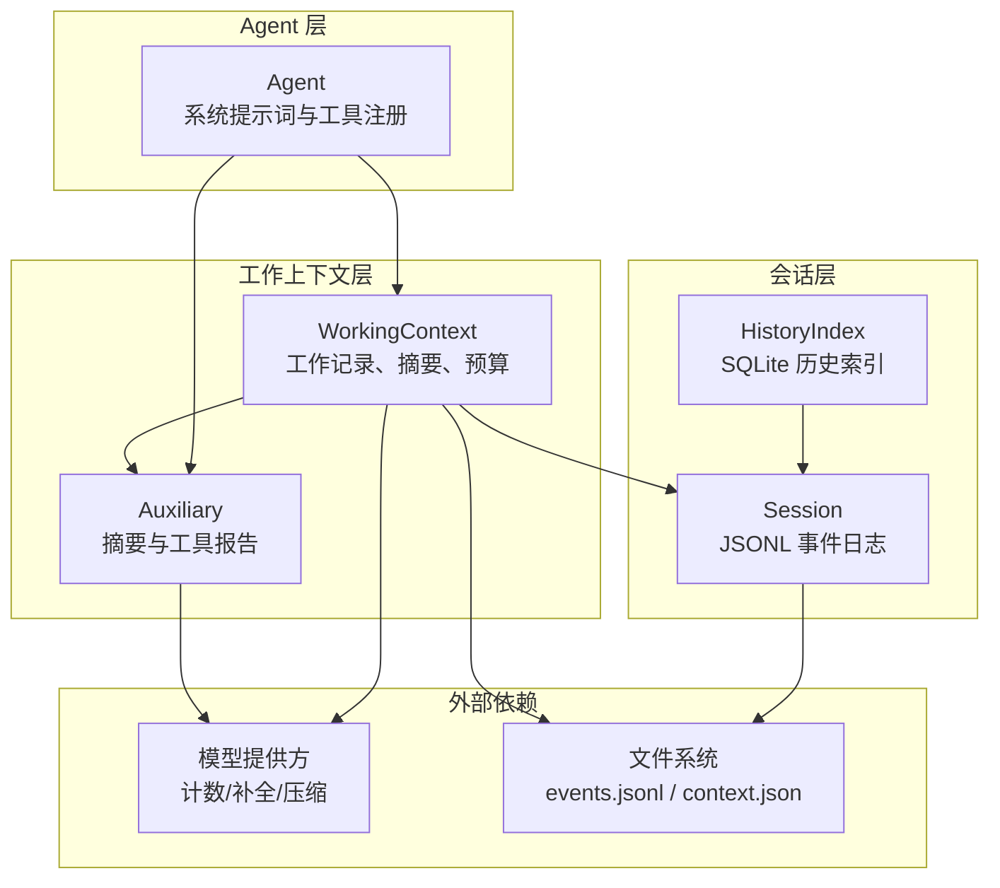
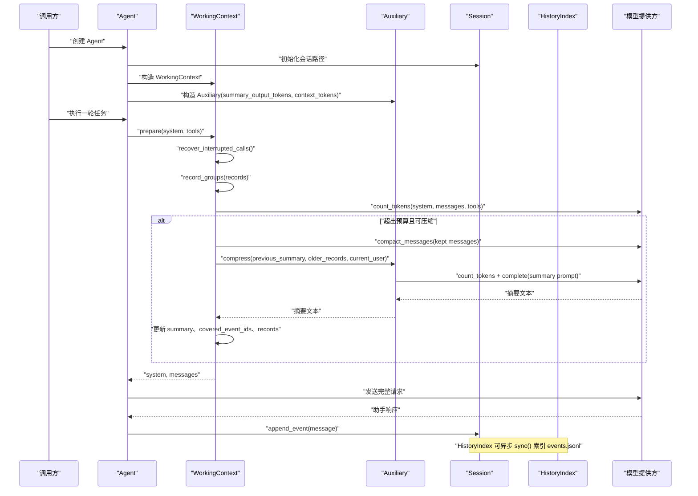
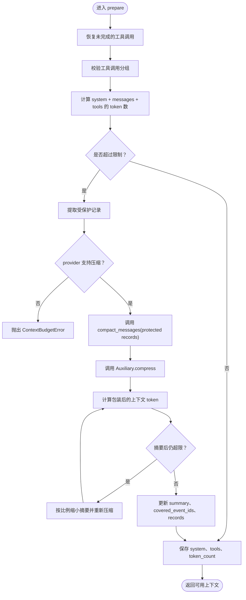
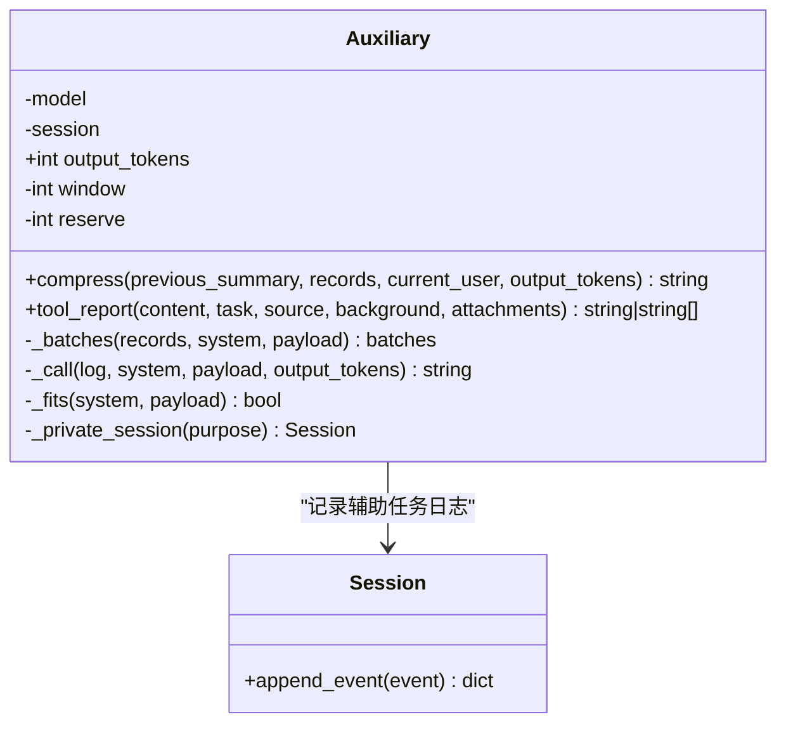
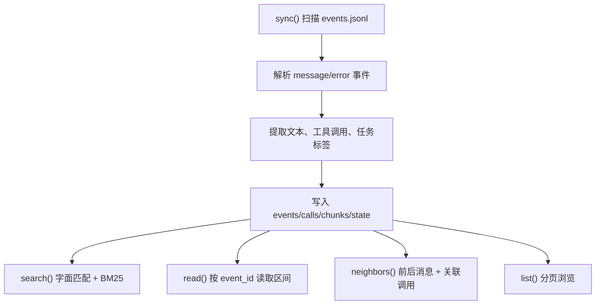
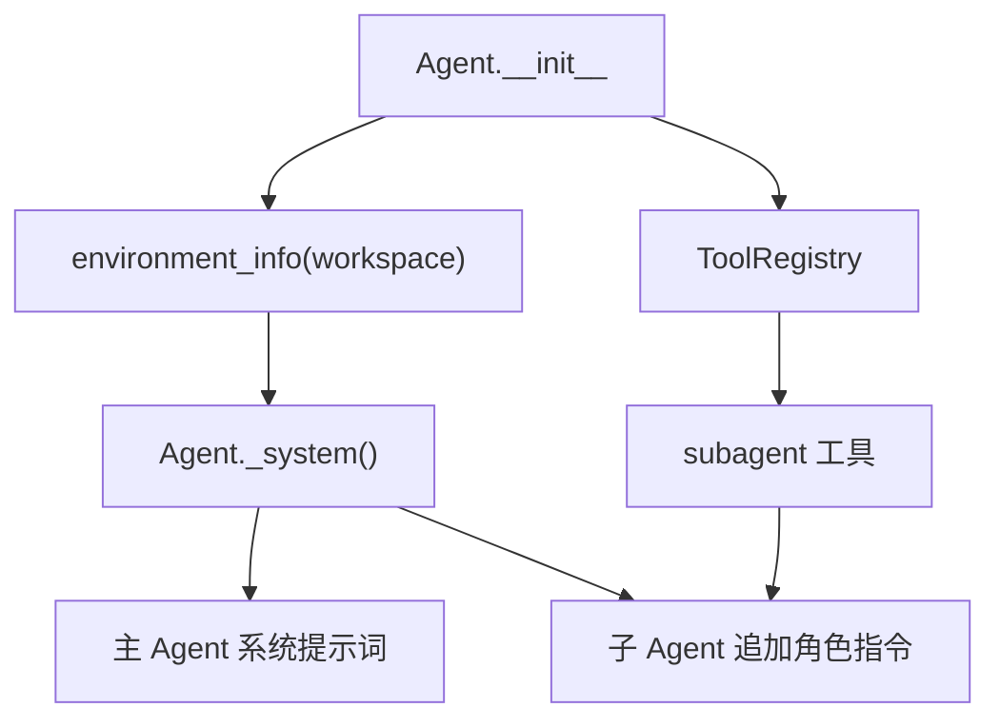
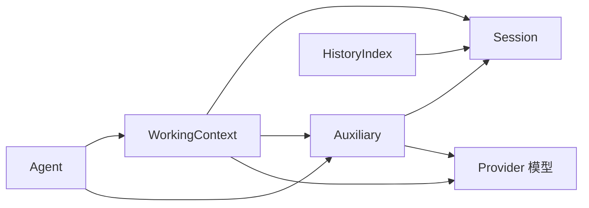

# 上下文与会话管理

<cite>
**本文引用的文件**   
- [skills_agent/context/__init__.py](file://skills_agent/context/__init__.py)
- [skills_agent/context/auxiliary.py](file://skills_agent/context/auxiliary.py)
- [skills_agent/context/history.py](file://skills_agent/context/history.py)
- [skills_agent/session/__init__.py](file://skills_agent/session/__init__.py)
- [skills_agent/agent.py](file://skills_agent/agent.py)
- [docs/prompt-history/context-compression.md](file://docs/prompt-history/context-compression.md)
- [docs/prompt-history/context-summary-wrapper.md](file://docs/prompt-history/context-summary-wrapper.md)
- [docs/prompt-history/agent-system.md](file://docs/prompt-history/agent-system.md)
- [docs/prompt-history/auxiliary-attachments.md](file://docs/prompt-history/auxiliary-attachments.md)
</cite>

## 目录
1. [引言](#引言)
2. [项目结构](#项目结构)
3. [核心组件](#核心组件)
4. [架构总览](#架构总览)
5. [详细组件分析](#详细组件分析)
6. [依赖关系分析](#依赖关系分析)
7. [性能与预算优化](#性能与预算优化)
8. [故障排查指南](#故障排查指南)
9. [结论](#结论)
10. [附录：实际示例](#附录实际示例)

## 引言
本文件聚焦会话与上下文管理子系统，解释以下关键职责：
- `WorkingContext`：维护当前任务的工作上下文、辅助摘要、历史消息、图片和附件，并负责上下文压缩与 token 预算控制。
- `Auxiliary`：生成和更新工作摘要、工具输出报告，并在独立日志中记录辅助模型调用。
- `Session`：以 JSONL 追加式方式持久化事件、保存附件、构建用户消息。
- `HistoryIndex`：对主会话的原始事件进行增量索引，提供搜索、阅读、邻居浏览和历史列表接口。
- 系统提示词采集：工作目录、Git 仓库、平台、shell 与操作系统信息如何注入主 Agent 与子 Agent。

该设计将“不可变的原始会话日志”与“可压缩的工作上下文”分离，使长对话既能恢复断点，又能在模型上下文窗口内继续推进。

## 项目结构
与上下文与会话相关的主要代码位于 `skills_agent` 包中：

**图表来源**
- [skills_agent/session/__init__.py:1-113](file://skills_agent/session/__init__.py#L1-L113)
- [skills_agent/context/__init__.py:1-446](file://skills_agent/context/__init__.py#L1-L446)
- [skills_agent/context/auxiliary.py:1-468](file://skills_agent/context/auxiliary.py#L1-L468)
- [skills_agent/context/history.py:1-309](file://skills_agent/context/history.py#L1-L309)
- [skills_agent/agent.py:1-200](file://skills_agent/agent.py#L1-L200)

**章节来源**
- [skills_agent/session/__init__.py:1-113](file://skills_agent/session/__init__.py#L1-L113)
- [skills_agent/context/__init__.py:1-446](file://skills_agent/context/__init__.py#L1-L446)
- [skills_agent/context/auxiliary.py:1-468](file://skills_agent/context/auxiliary.py#L1-L468)
- [skills_agent/context/history.py:1-309](file://skills_agent/context/history.py#L1-L309)
- [skills_agent/agent.py:1-200](file://skills_agent/agent.py#L1-L200)

## 核心组件
- **Session**：每个会话对应一个目录，包含 `events.jsonl` 追加日志和可选附件目录。它负责写入带时间戳和稳定 `event_id` 的事件，以及保存输入或反馈中的图片、PDF 和其他附件。
- **WorkingContext**：从 Session 增量同步新消息，维护 `records`、`summary`、`covered_event_ids`、`token_count` 等状态，并在 `prepare()` 时执行上下文压缩、保护最近用户请求与最近工具调用组，最终返回可用于模型调用的 system、tools 与消息序列。
- **Auxiliary**：封装独立的摘要生成、工具报告生成、token 计数和重试逻辑；为每次辅助任务创建私有子日志，避免污染主会话。
- **HistoryIndex**：基于 SQLite 和 FTS5 对 `events.jsonl` 建立增量索引，支持按字面匹配与 BM25 检索、按事件读取、按字节偏移查找邻居，以及分页浏览。
- **Agent**：初始化 `EnvironmentInfo`、`ToolRegistry`、`WorkingContext` 与 `Auxiliary`，并生成主 Agent 与子 Agent 共享的系统提示词。

**章节来源**
- [skills_agent/session/__init__.py:1-113](file://skills_agent/session/__init__.py#L1-L113)
- [skills_agent/context/__init__.py:1-446](file://skills_agent/context/__init__.py#L1-L446)
- [skills_agent/context/auxiliary.py:1-468](file://skills_agent/context/auxiliary.py#L1-L468)
- [skills_agent/context/history.py:1-309](file://skills_agent/context/history.py#L1-L309)
- [skills_agent/agent.py:1-200](file://skills_agent/agent.py#L1-L200)

## 架构总览
上下文与会会话的整体数据流如下：

**图表来源**
- [skills_agent/agent.py:1-200](file://skills_agent/agent.py#L1-L200)
- [skills_agent/context/__init__.py:201-446](file://skills_agent/context/__init__.py#L201-L446)
- [skills_agent/context/auxiliary.py:201-468](file://skills_agent/context/auxiliary.py#L201-L468)
- [skills_agent/session/__init__.py:1-113](file://skills_agent/session/__init__.py#L1-L113)

## 详细组件分析

### WorkingContext：工作上下文、摘要边界与 token 预算
`WorkingContext` 是“当前任务上下文”的核心对象。它的职责包括：
- 从 Session 增量同步新事件，清洗传输日志，保留 provider 所需状态。
- 把中断的工具调用恢复为虚拟结果，保证下一次请求能发送完整分组。
- 维护历史记录、图片投影、摘要、已覆盖事件 ID 和 token 计数。
- 在 `prepare()` 中决定是否需要压缩，并始终保护最近的工具调用组和最新用户请求。

#### 关键数据结构
| 字段 | 含义 | 复杂度说明 |
|---|---|---|
| `session` | 底层不可变事件源 | O(1) 引用 |
| `model` | 模型提供方，提供计数、压缩、补全能力 | 通过回调委托 |
| `auxiliary` | 摘要与工具报告生成器 | 通过回调委托 |
| `max_tokens` | 最大上下文 token 预算 | 常量 |
| `keep_calls` | 受保护的最近工具调用数量，默认 10 | 影响保护集合大小 |
| `state.records` | 工作记录列表 | 追加 O(1)，压缩后可能替换 |
| `state.summary` | 历史摘要文本 | 随压缩增长或缩短 |
| `state.covered_event_ids` | 已被摘要覆盖的事件 ID | 单调递增 |
| `state.token_count` | 最近一次计数字符串或数值 | 用于快速判断是否压缩 |

#### 上下文压缩流程

**图表来源**
- [skills_agent/context/__init__.py:201-446](file://skills_agent/context/__init__.py#L201-L446)

#### 保护机制
`_protected()` 会保留两类记录：
1. 最近 `keep_calls` 个助手响应及其全部工具结果。
2. 最后一个用户请求。
3. 受保护助手响应之后的所有记录，确保历史边界不会错位。

这保证了压缩不会误删正在执行的工具结果，也不会丢失最新用户指令。

#### 图片与附件处理
- `image_records()` 会把图片投影到当前工作记录的时间线中，并为图片引用补充 `event_id`，便于证据追踪。
- `_update_images()` 会在同步新消息后刷新图片投影，必要时重置 token 计数并持久化。
- 助手响应消费了请求中的图片；随后工具报告不应再次直接读取当前任务背景，以避免重复附件。

#### 使用建议
- 设置合理的 `context_tokens`，使其接近但小于模型上下文窗口。
- 保持 `keep_calls` 足够大，以便最近工具调用链完整。
- 当模型提供方支持 `can_compact` 时，优先使用压缩路径；否则应主动控制历史长度。

**章节来源**
- [skills_agent/context/__init__.py:1-446](file://skills_agent/context/__init__.py#L1-L446)

### Auxiliary：摘要生成与工具报告
`Auxiliary` 负责两件事：
1. 把旧摘要与新工作记录合并为新摘要。
2. 把过长工具输出、背景材料或附件压缩成不超过 2048 token 的报告。

#### 摘要生成
- 使用独立提示词 `_SUMMARY`，强调只读证据、不执行历史、区分用户决策与观察结果。
- 输出形式由文档记录演进为自然语言摘要加引用映射，引用键如 `R1` 映射到事件 ID。
- 如果只有旧摘要而没有新记录，则按预算缩短旧摘要。
- 每次压缩都会记录到私有 Session 日志，便于诊断。

#### 工具报告
- 使用 `_REPORT` 提示词生成结构化 Markdown 报告。
- 超长文本会被分块，先尝试合并部分报告，若仍超限则继续拆分。
- 附件会以只读原生图片或文件块附加，并标注来源 reference。

#### 预算控制
- `output_tokens`：摘要或报告的输出预算。
- `window`：辅助任务使用的上下文窗口，取 `context_tokens` 与模型上下文窗口的最小值。
- `reserve`：为输出预留的最小空间，防止计数准确但补全被截断。

**图表来源**
- [skills_agent/context/auxiliary.py:1-468](file://skills_agent/context/auxiliary.py#L1-L468)
- [skills_agent/session/__init__.py:1-113](file://skills_agent/session/__init__.py#L1-L113)

**章节来源**
- [skills_agent/context/auxiliary.py:1-468](file://skills_agent/context/auxiliary.py#L1-L468)
- [docs/prompt-history/context-compression.md:1-129](file://docs/prompt-history/context-compression.md#L1-L129)
- [docs/prompt-history/auxiliary-attachments.md:1-35](file://docs/prompt-history/auxiliary-attachments.md#L1-L35)

### Session：JSONL 追加式日志
`Session` 是会话的根存储：
- 每个会话目录名为合法 ID，内部至少包含 `events.jsonl`。
- `append_event()` 写入带 UTC 时间戳、稳定 `event_id` 的 JSONL 行。
- `iter_events(after)` 支持从已有偏移量继续读取，适合长时间运行服务增量回放。
- `messages()` 过滤出 `type=message` 的事件，供上层聚合。
- `save_attachment()` 复制输入文件或内存数据到会话附件目录，返回路径、名称、MIME 类型和 URL。
- `make_user_message()` 构建用户消息，最多允许固定数量的图片，并对 PDF 和二进制文件采用不同处理策略。

#### 事件类型
| 事件类型 | 含义 |
|---|---|
| `message` | 正常助手、用户、工具或系统消息 |
| `error` | 错误或部分响应内容，可携带 `partial_content` |
| `auxiliary_task` | 辅助任务入口，标记用途 |
| `model_request` | 辅助任务中的模型请求快照 |
| `background_job_result` | 后台任务完成结果（由更高层注入） |
| `runtime_event` | 运行时观察事件（由框架注入） |

#### 断点恢复机制
- 每次写入都附带稳定 `event_id`，即使旧日志没有显式 ID，也会根据字节偏移重建。
- `iter_events(after)` 从上次位置继续读取，不需要重放整个文件。
- `WorkingContext.sync()` 通过 `cursor` 记住最后处理的事件偏移，避免重复解析。
- 对于中断的 provider 响应，`WorkingContext` 会插入“未完成”助手内容，配合 `recover_interrupted_calls()` 生成虚拟工具结果。

**章节来源**
- [skills_agent/session/__init__.py:1-113](file://skills_agent/session/__init__.py#L1-L113)

### HistoryIndex：历史查询接口
`HistoryIndex` 不修改 `events.jsonl`，而是维护 SQLite 数据库和 FTS5 全文索引：
- `sync()` 增量扫描新增行，解析 `message` 与 `error` 事件，提取文本、工具调用、任务标签和时间戳。
- `search(query, limit, role, task)` 优先字面匹配，再回退到 BM25，支持按角色和任务过滤。
- `read(event_id, start_line, end_line)` 读取原始解码内容，并返回关联的工具调用/结果事件。
- `neighbors(event_id, before, after)` 返回附近消息及关联调用事件。
- `list(after, limit, role)` 按字节偏移分页浏览历史。

**图表来源**
- [skills_agent/context/history.py:1-309](file://skills_agent/context/history.py#L1-L309)

**章节来源**
- [skills_agent/context/history.py:1-309](file://skills_agent/context/history.py#L1-L309)

### 系统提示词与环境信息采集
主 Agent 的系统提示词由 `Agent._system()` 生成，并通过 `environment_info()` 采集运行时环境。采集的信息包括：
- 工作目录。
- Git 仓库元信息。
- 平台信息。
- shell 信息。
- 操作系统信息。

这些信息会注入主 Agent 与子 Agent 的工作提示词，使模型知道执行环境、沙箱约束、技能位置和会话历史来源。

**图表来源**
- [skills_agent/agent.py:1-200](file://skills_agent/agent.py#L1-L200)
- [docs/prompt-history/agent-system.md:1-134](file://docs/prompt-history/agent-system.md#L1-L134)

**章节来源**
- [skills_agent/agent.py:1-200](file://skills_agent/agent.py#L1-L200)
- [docs/prompt-history/agent-system.md:1-134](file://docs/prompt-history/agent-system.md#L1-L134)

## 依赖关系分析

**图表来源**
- [skills_agent/agent.py:1-200](file://skills_agent/agent.py#L1-L200)
- [skills_agent/context/__init__.py:1-446](file://skills_agent/context/__init__.py#L1-L446)
- [skills_agent/context/auxiliary.py:1-468](file://skills_agent/context/auxiliary.py#L1-L468)
- [skills_agent/context/history.py:1-309](file://skills_agent/context/history.py#L1-L309)
- [skills_agent/session/__init__.py:1-113](file://skills_agent/session/__init__.py#L1-L113)

### 耦合与内聚
- `WorkingContext` 与 `Session` 耦合较紧：它需要理解事件结构、事件 ID 和图片投影。
- `Auxiliary` 与 `Session` 的耦合仅用于辅助任务私有日志，不影响主会话。
- `HistoryIndex` 只读取 `events.jsonl`，不修改主日志，内聚于历史检索。
- `Agent` 是协调者，集中持有 `environment_info`、`ToolRegistry`、`WorkingContext` 和 `Auxiliary`。

### 循环依赖
- 当前结构中不存在循环导入：`Agent` 依赖 `context` 和 `session`，而 `context` 依赖 `session`，单向依赖清晰。

**章节来源**
- [skills_agent/agent.py:1-200](file://skills_agent/agent.py#L1-L200)
- [skills_agent/context/__init__.py:1-446](file://skills_agent/context/__init__.py#L1-L446)
- [skills_agent/context/auxiliary.py:1-468](file://skills_agent/context/auxiliary.py#L1-L468)
- [skills_agent/context/history.py:1-309](file://skills_agent/context/history.py#L1-L309)
- [skills_agent/session/__init__.py:1-113](file://skills_agent/session/__init__.py#L1-L113)

## 性能与预算优化
### 控制历史长度
- 设置 `context_tokens` 接近但不超过模型上下文窗口，避免 `WorkingContext.prepare()` 频繁触发保护上下文压缩失败。
- 合理调整 `keep_calls`，保留足够的工具调用链，减少因保护记录过多导致的压缩失败。
- 避免向用户消息中附加大量无关附件；图片请求上限由 `MAX_REQUEST_IMAGES` 控制。

### 合理使用 `summary_output_tokens`
- `summary_output_tokens` 同时作为 `Auxiliary.output_tokens`，直接影响摘要生成的输出预算。
- 过大会增加辅助模型调用成本，过小可能导致摘要无法容纳重要引用。
- 当模型上下文窗口有限时，应降低 `summary_output_tokens`，让 `WorkingContext` 有更多输入空间给受保护消息和系统包装。

### 避免重复附件
- 图片在助手响应中被消费；后续工具报告不应再次直接读取当前任务或背景中的图片。
- `Auxiliary.tool_report()` 在多次分块生成后会用 `_image_references()` 保留图片地址而非像素，避免重复上传。
- 对二进制文件，优先保存为附件并通过脚本读取，而不是嵌入文本。

### 利用模型提供方能力
- 如果模型支持 `count_tokens`，优先使用该路径，因为 `WorkingContext` 能缓存 `token_count` 并减少重复计数。
- 如果模型支持 `compact_messages`，压缩路径可减少原始消息数量，但仍需验证压缩后消息数量不变。
- 对于不支持计数的模型，应更保守地控制历史长度，避免依赖 80% 阈值反复压缩。

[本节为通用性能建议，不直接分析具体代码行]

## 故障排查指南

### 上下文预算不足
- 现象：抛出 `ContextBudgetError`，提示工作上下文需要的 token 数大于可用预算。
- 常见原因：
  - `context_tokens` 设置过大。
  - 最近工具调用组过多，导致保护记录无法压缩。
  - 摘要包装本身占用过多输入空间。
  - 模型不支持压缩或压缩后消息数量变化。
- 处理建议：
  - 降低 `context_tokens`。
  - 减小 `summary_output_tokens`。
  - 检查是否有超大 direct 结果未被替换为可读范围。
  - 确认 provider 的 `compact_messages` 行为是否稳定。

**章节来源**
- [skills_agent/context/__init__.py:201-446](file://skills_agent/context/__init__.py#L201-L446)

### 工具调用分组异常
- 现象：出现“孤立工具结果”“重复工具调用 ID”“未完成工具调用”等错误。
- 常见原因：
  - 历史记录不完整。
  - 中断恢复逻辑尚未写入虚拟结果。
  - 外部数据篡改了 `records`。
- 处理建议：
  - 让 `WorkingContext.recover_interrupted_calls()` 先生成虚拟结果。
  - 不要手动拼接 `records`，应通过 `Session.append_event()` 追加真实事件。
  - 检查中断事件的 `response_interrupted` 与 `partial_content`。

**章节来源**
- [skills_agent/context/__init__.py:1-200](file://skills_agent/context/__init__.py#L1-L200)

### 摘要生成失败
- 现象：`Auxiliary` 抛出 Provider 错误或无文本响应。
- 常见原因：
  - 输入超出辅助上下文窗口。
  - 模型意外请求工具。
  - 输出被长度截断且没有可用部分文本。
- 处理建议：
  - 降低 `summary_output_tokens`。
  - 检查 `_SUMMARY` 提示词是否要求纯文本输出。
  - 查看辅助私有日志中的 `auxiliary_task`、`model_request` 和 `error` 事件。

**章节来源**
- [skills_agent/context/auxiliary.py:201-468](file://skills_agent/context/auxiliary.py#L201-L468)

### 历史检索无结果
- 现象：`HistoryIndex.search()` 或 `read()` 找不到期望事件。
- 常见原因：
  - 尚未调用 `sync()`。
  - 查询为空或 limit 小于 1。
  - 使用了未知 `event_id`。
  - 只搜索特定角色或任务，但未正确设置过滤器。
- 处理建议：
  - 先调用 `sync()`。
  - 使用 `list()` 浏览最近事件。
  - 使用 `neighbors()` 定位相邻事件。
  - 检查查询是否命中 FTS5 分词规则，尤其是中文、日文、韩文字符。

**章节来源**
- [skills_agent/context/history.py:1-309](file://skills_agent/context/history.py#L1-L309)

## 结论
该子系统通过三层分工实现稳健的长对话管理：
- `Session` 提供不可变、可恢复的原始事件日志。
- `WorkingContext` 维护当前任务上下文，负责图片投影、中断恢复、摘要边界和 token 预算。
- `Auxiliary` 在独立日志中生成摘要和工具报告，避免干扰主会话。
- `HistoryIndex` 在不改写原始日志的前提下提供高效历史检索。
- `Agent` 将环境信息注入系统提示词，统一指导主 Agent 与子 Agent 的行为。

推荐实践是：合理配置 `context_tokens` 与 `summary_output_tokens`，避免重复附件，充分利用模型提供的计数与压缩能力，并通过 Session 和 HistoryIndex 保留可审计、可回放、可恢复的历史。

[本节为总结性内容，不直接分析具体文件]

## 附录：实际示例

### 会话恢复示例
场景：一次长任务中途中断，重启后希望继续执行。

步骤：
1. 使用 `Session(path, session_id)` 打开会话目录。
2. 调用 `Session.iter_events(after=last_offset)` 回放新增事件。
3. 调用 `WorkingContext.sync()` 增量同步到新事件。
4. `WorkingContext` 自动识别中断响应，并调用 `recover_interrupted_calls()` 插入虚拟工具结果。
5. 调用 `WorkingContext.prepare(system, tools)` 获取可发送的上下文；若仍可压缩，则自动生成新摘要。
6. 将返回的消息发送给模型，继续任务。

参考实现路径：
- [skills_agent/session/__init__.py:1-113](file://skills_agent/session/__init__.py#L1-L113)
- [skills_agent/context/__init__.py:201-446](file://skills_agent/context/__init__.py#L201-L446)

### 历史回放示例
场景：需要查看某个工具调用之前的用户意图和之后的工具结果。

步骤：
1. 通过 `HistoryIndex(session_path).sync()` 建立或更新索引。
2. 使用 `search(query, limit=8)` 找到目标事件 ID。
3. 使用 `neighbors(event_id, before=2, after=2)` 查看前后消息。
4. 使用 `read(event_id, start_line=1, end_line=None)` 读取原始文本区间。
5. 如需分页浏览，使用 `list(after=event_id, limit=20)`。

参考实现路径：
- [skills_agent/context/history.py:1-309](file://skills_agent/context/history.py#L1-L309)

### 上下文截断示例
场景：对话很长，即将超过模型上下文窗口。

步骤：
1. `WorkingContext.prepare()` 检测到 token 数达到阈值。
2. 提取受保护记录：最近用户请求和最近 10 个工具调用组。
3. 调用 provider 的 `compact_messages()` 压缩受保护记录。
4. 调用 `Auxiliary.compress()` 将旧摘要和更早记录合并为新摘要。
5. 更新 `summary`、`covered_event_ids` 和 `records`。
6. 如果仍超限，则按比例缩小摘要并重试，直到满足预算或抛出 `ContextBudgetError`。

参考实现路径：
- [skills_agent/context/__init__.py:201-446](file://skills_agent/context/__init__.py#L201-L446)
- [skills_agent/context/auxiliary.py:201-468](file://skills_agent/context/auxiliary.py#L201-L468)

### 摘要生成示例
场景：用户修正了之前的目标，需要把新目标和历史证据整合进摘要。

步骤：
1. 收集需要摘要的“更早记录”。
2. 获取最新的用户请求作为当前任务。
3. 调用 `Auxiliary.compress(previous_summary, older_records, current_user, output_tokens=budget)`。
4. Auxiliary 分批发送 `_SUMMARY` 提示词，并记录私有日志。
5. 返回自然语言摘要，其中可使用 `R1`、`R2` 等引用键指向事件 ID。
6. `WorkingContext` 将摘要包装进 `<historical_summary>`，并标记为派生参考，不是新用户指令。

参考实现路径：
- [skills_agent/context/auxiliary.py:1-200](file://skills_agent/context/auxiliary.py#L1-L200)
- [skills_agent/context/__init__.py:201-446](file://skills_agent/context/__init__.py#L201-L446)
- [docs/prompt-history/context-summary-wrapper.md:1-72](file://docs/prompt-history/context-summary-wrapper.md#L1-L72)