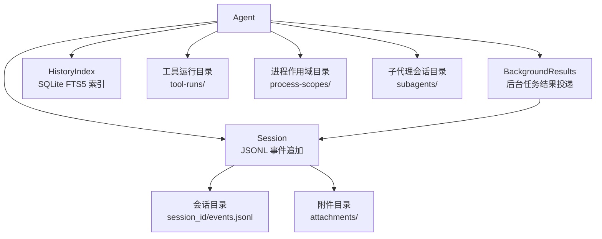
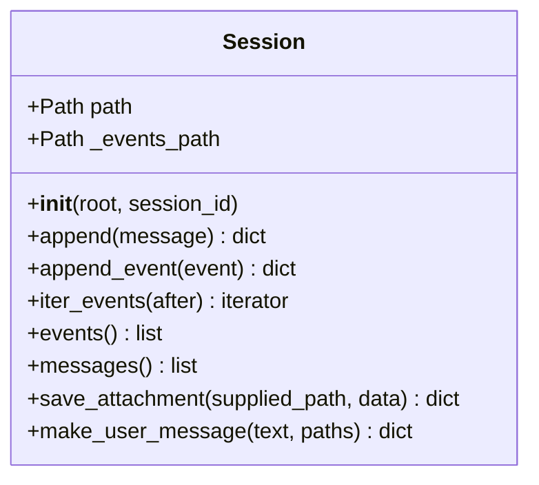
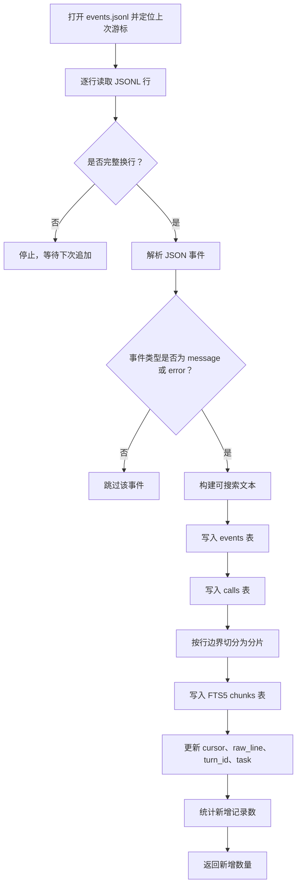
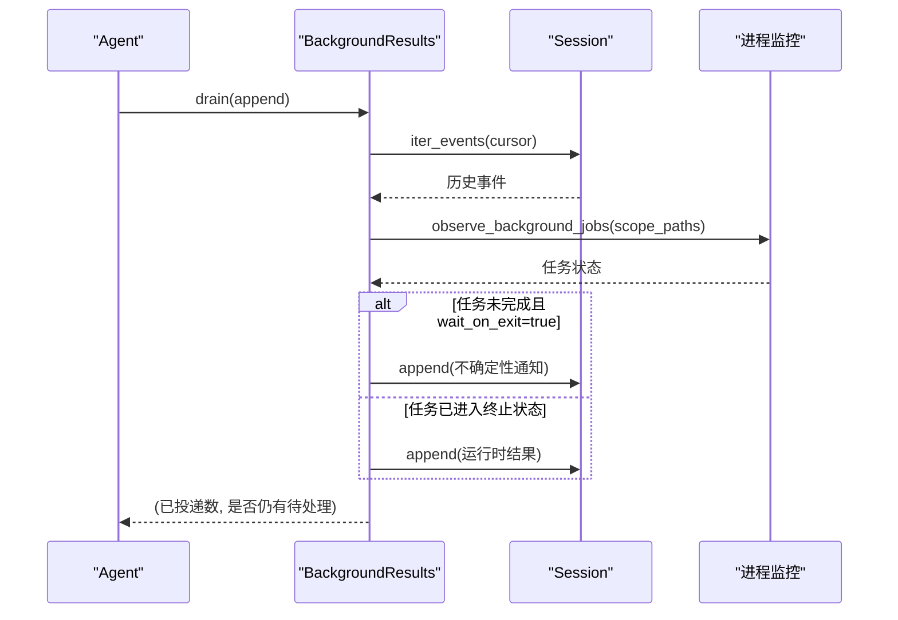
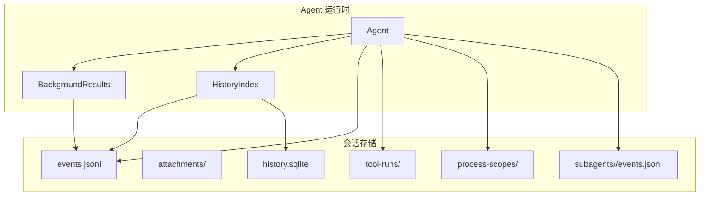
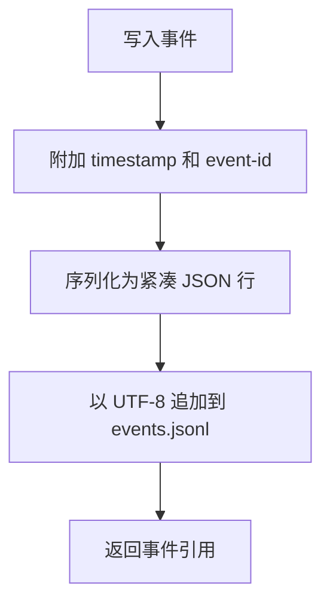
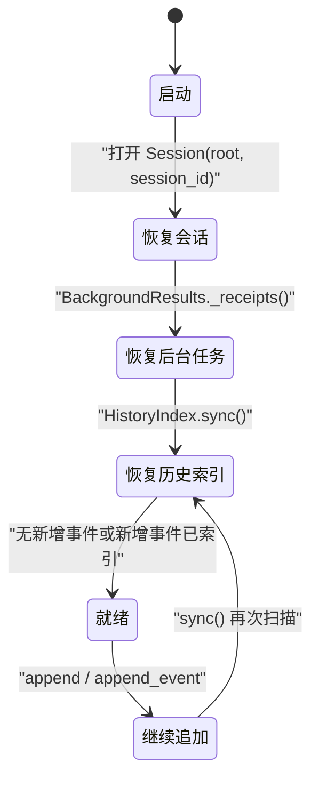
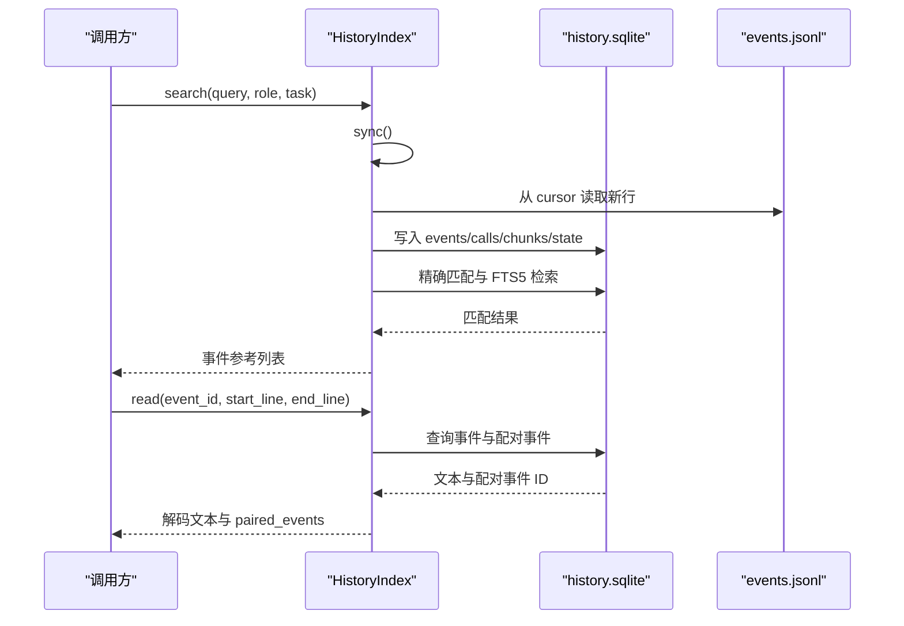
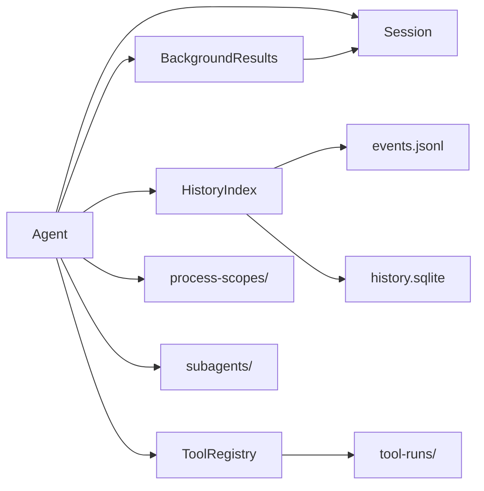

# 会话持久化与历史回放

<cite>
**本文引用的文件**   
- [skills_agent/session/__init__.py](file://skills_agent/session/__init__.py)
- [tests/test_session.py](file://tests/test_session.py)
- [skills_agent/context/history.py](file://skills_agent/context/history.py)
- [tests/test_history_retrieval.py](file://tests/test_history_retrieval.py)
- [skills_agent/background.py](file://skills_agent/background.py)
- [skills_agent/agent.py](file://skills_agent/agent.py)
</cite>

## 目录
1. [引言](#引言)
2. [项目结构](#项目结构)
3. [核心组件](#核心组件)
4. [架构总览](#架构总览)
5. [详细组件分析](#详细组件分析)
6. [依赖关系分析](#依赖关系分析)
7. [性能考虑](#性能考虑)
8. [故障排查指南](#故障排查指南)
9. [结论](#结论)
10. [附录：使用示例与最佳实践](#附录使用示例与最佳实践)

## 引言
本文件聚焦会话持久化与历史回放机制，解释 Agent 如何通过 `Session` 类以 JSONL 格式追加事件、如何命名会话目录、如何从断点恢复、如何区分已完成和未完成的后台任务记录，以及如何使用 `HistoryIndex` 进行按会话读取、过滤事件类型、回放对话和导出调试信息。文档同时覆盖工具调用轨迹、中断信号、后台任务状态等常见事件类型，并给出创建新会话、追加消息、加载历史、从中断处恢复、查看工具调用轨迹的实际步骤与常见问题排查方法。

## 项目结构
与会话持久化和历史回放直接相关的代码主要分布在以下位置：
- `skills_agent/session/__init__.py`：定义 `Session`，负责 JSONL 事件写入、附件保存、用户消息构造。
- `skills_agent/context/history.py`：定义 `HistoryIndex`，基于 SQLite FTS5 对主会话的 `events.jsonl` 建立增量索引，并提供搜索、阅读、邻居浏览接口。
- `skills_agent/background.py`：解析会话中的后台任务启动回执、不确定性通知和完成结果，将运行时观察写回会话，并通过游标实现幂等投递。
- `skills_agent/agent.py`：在 Agent 初始化时挂载工具运行日志目录、子代理会话目录、进程作用域目录，并在关键流程中触发历史同步。
- 测试文件用于验证顺序保留、附件隔离、JSONL 断点恢复、历史搜索与配对事件等行为。

图表来源
- [skills_agent/session/__init__.py:1-113](file://skills_agent/session/__init__.py#L1-L113)
- [skills_agent/context/history.py:1-309](file://skills_agent/context/history.py#L1-L309)
- [skills_agent/background.py:1-291](file://skills_agent/background.py#L1-L291)
- [skills_agent/agent.py:1-200](file://skills_agent/agent.py#L1-L200)

章节来源
- [skills_agent/session/__init__.py:1-113](file://skills_agent/session/__init__.py#L1-L113)
- [skills_agent/context/history.py:1-309](file://skills_agent/context/history.py#L1-L309)
- [skills_agent/background.py:1-291](file://skills_agent/background.py#L1-L291)
- [skills_agent/agent.py:1-200](file://skills_agent/agent.py#L1-L200)

## 核心组件
### Session：会话事件与附件
`Session` 是会话持久化的基础对象，承担以下职责：
- 校验并规范化 `session_id`，创建以 `session_id` 命名的会话目录。
- 在 `events.jsonl` 中以追加模式写入带时间戳和字节偏移的事件行。
- 提供 `append`、`append_event`、`iter_events`、`events`、`messages` 等方法，支持只读回放。
- 通过 `save_attachment` 将输入或工具反馈快照复制到不可变附件目录，生成唯一路径、MIME 类型和 URL。
- 通过 `make_user_message` 构造包含文本、图片和 PDF 附件的用户消息块，并对二进制内容生成可读摘要。

关键点：
- 每个事件都会添加 `timestamp` 和 `event_id`；`event_id` 基于写入时的流偏移量，便于断点定位。
- `iter_events(after=0)` 从指定字节偏移开始逐行读取，兼容旧日志；若缺少 `event_id`，会回补为 `event-{offset}`。
- `messages()` 仅返回类型为 `message` 的事件，适合回放对话。
- 附件复制后不修改原文件，同一源文件多次使用会生成不同副本，避免后续修改影响历史。

图表来源
- [skills_agent/session/__init__.py:1-113](file://skills_agent/session/__init__.py#L1-L113)

章节来源
- [skills_agent/session/__init__.py:1-113](file://skills_agent/session/__init__.py#L1-L113)
- [tests/test_session.py:1-82](file://tests/test_session.py#L1-L82)

### HistoryIndex：历史索引与回放
`HistoryIndex` 不对原始 JSONL 做原地改写，而是维护一个同目录下的 `history.sqlite`，将已完成的 `message` 和 `error` 事件增量索引到 SQLite 表中，并使用 FTS5 构建可搜索分片。

主要能力：
- `sync()`：从上次记录的字节游标继续扫描 `events.jsonl`，跳过不完整行，索引新的完整事件，返回新增记录数。
- `search(query, limit, role, task)`：优先精确匹配事件 ID、调用 ID 或字面字符串，再使用 BM25 检索，支持按角色和任务过滤。
- `read(event_id, start_line, end_line)`：按行范围读取解码后的文本，并返回配对的工具调用或结果事件。
- `neighbors(event_id, before, after)`：列出前后相邻事件以及关联的调用/结果事件。
- `list(after, limit, role)`：按字节偏移分页浏览事件列表。

索引行为：
- 只索引 `type=message` 和 `type=error` 事件，忽略流式 delta、上下文选择、内部中间记录。
- 对 `tool_calls` 提取任务名，并将 `tool` 结果与其调用配对。
- 对中文和日文、韩文等字符使用双元词切分，提高混合语言检索效果。
- 所有查询和读取均不修改 `events.jsonl`，保证幂等与可重复性。

图表来源
- [skills_agent/context/history.py:1-309](file://skills_agent/context/history.py#L1-L309)

章节来源
- [skills_agent/context/history.py:1-309](file://skills_agent/context/history.py#L1-L309)
- [tests/test_history_retrieval.py:1-182](file://tests/test_history_retrieval.py#L1-L182)

### BackgroundResults：后台任务状态与幂等投递
`BackgroundResults` 负责从会话历史中识别后台任务的启动回执、不确定性通知和最终结果，并把运行时观察写回会话。

关键机制：
- `_receipts()`：从 `session.iter_events(self._cursor)` 恢复已知任务、已交付结果、不确定任务和子代理委托关系，并更新自身游标。
- `drain(append)`：结合进程监控结果，判断任务是否处于终止状态；对未完成但阻塞的任务生成“不确定性”观察，对已完成任务生成“结果”观察。
- `wait(append)`：循环驱动 `drain`，直到有结果或不再有待处理任务；若无工具输出但仍有阻塞任务，会重新发送不确定性提醒。
- 所有写入都通过 `append` 回调追加到 `Session.append`，并由 `_delivered` 集合去重，确保相同结果不会重复写入会话。

图表来源
- [skills_agent/background.py:1-291](file://skills_agent/background.py#L1-L291)
- [skills_agent/session/__init__.py:1-113](file://skills_agent/session/__init__.py#L1-L113)

章节来源
- [skills_agent/background.py:1-291](file://skills_agent/background.py#L1-L291)

## 架构总览
下图展示 Agent、Session、HistoryIndex 与 BackgroundResults 之间的协作关系，以及 JSONL 事件、附件、工具运行日志、进程作用域和子代理会话的存储布局。

图表来源
- [skills_agent/agent.py:1-200](file://skills_agent/agent.py#L1-L200)
- [skills_agent/session/__init__.py:1-113](file://skills_agent/session/__init__.py#L1-L113)
- [skills_agent/context/history.py:1-309](file://skills_agent/context/history.py#L1-L309)
- [skills_agent/background.py:1-291](file://skills_agent/background.py#L1-L291)

## 详细组件分析

### 事件类型与写入顺序
`Session.append_event` 会在写入前构造统一事件结构，包括：
- `timestamp`：UTC ISO 时间。
- `event_id`：基于当前文件偏移量生成的稳定标识。
- 原始事件内容，例如 `type="message"` 的消息、工具调用、工具结果、后台任务运行时事件、子代理摘要等。

典型事件类型：
- `message`：用户输入、模型响应、工具调用、工具结果、系统提示、中断信号等。
- `background_job_result`：后台任务完成结果。
- `background_job_uncertainty`：后台任务状态不确定或尚未确认。
- `subagent_summary`：子代理执行摘要，可能携带子会话 ID 和所有者信息。
- 其他内部事件如 `text_delta`、`tool_call_delta`、`context_selection` 会被 `HistoryIndex` 忽略，以避免把流式中间数据纳入可搜索历史。

写入顺序规则：
- JSONL 行严格按追加顺序递增。
- `iter_events` 使用 `tell()` 和 `readline()` 维护字节游标，保证每次重启都能从最后一个已知位置继续。
- `HistoryIndex.sync()` 同样基于字节游标和换行完整性判断，避免读取正在被截断的行。

图表来源
- [skills_agent/session/__init__.py:1-113](file://skills_agent/session/__init__.py#L1-L113)

章节来源
- [skills_agent/session/__init__.py:1-113](file://skills_agent/session/__init__.py#L1-L113)

### 会话文件命名规则与目录结构
- 会话根目录：`root/session_id`。
- 事件文件：`events.jsonl`。
- 附件目录：`attachments/`，每个附件使用 UUID 前缀命名，避免同名冲突。
- 工具运行目录：`tool-runs/`，由 Agent 初始化时挂载。
- 进程作用域目录：`process-scopes/`，用于后台任务的状态与清理归属。
- 子代理会话目录：`subagents/<child_session_id>/events.jsonl`，由子代理或委托逻辑创建。

`session_id` 必须匹配 `[A-Za-z0-9][A-Za-z0-9_.-]{0,127}`，不能包含 `..`、绝对路径、多级路径分隔符或其他非法字符。

章节来源
- [skills_agent/session/__init__.py:1-113](file://skills_agent/session/__init__.py#L1-L113)
- [tests/test_session.py:1-82](file://tests/test_session.py#L1-L82)

### 幂等性与断点恢复
幂等性体现在多个层面：
- `Session.iter_events` 对缺失 `event_id` 的回补行为保证旧日志仍可稳定引用。
- `HistoryIndex.sync()` 记录 `cursor`（字节偏移）、`raw_line`（行号）、`turn_id` 和 `task`，重启后从上次位置继续索引，不会重复索引已有事件。
- `BackgroundResults._cursor` 记录历史消费位置；`_delivered` 记录已投递的终端结果 ID，避免重复写入。
- 不完整行不会被索引或回放，只有追加完成后才进入历史。

断点恢复流程：
1. Agent 启动后创建或复用 `Session`。
2. `BackgroundResults` 从 `session.iter_events(_cursor)` 恢复已知后台任务、已交付结果和子代理委托。
3. `HistoryIndex` 从 `history.sqlite` 的 `state.cursor` 继续扫描 `events.jsonl`。
4. 如果进程作用域存在但未完成，Agent 会尝试附加已有作用域，并把无效作用域保留给诊断观察者。

图表来源
- [skills_agent/background.py:1-291](file://skills_agent/background.py#L1-L291)
- [skills_agent/context/history.py:1-309](file://skills_agent/context/history.py#L1-L309)
- [skills_agent/session/__init__.py:1-113](file://skills_agent/session/__init__.py#L1-L113)

章节来源
- [skills_agent/background.py:1-291](file://skills_agent/background.py#L1-L291)
- [skills_agent/context/history.py:1-309](file://skills_agent/context/history.py#L1-L309)
- [skills_agent/session/__init__.py:1-113](file://skills_agent/session/__init__.py#L1-L113)

### producer 执行完成与未完成观察的区别
后台任务生命周期通过两类运行时事件区分：
- `background_job_result`：任务进入终止状态，附带退出码、标准输出、标准错误、任务种类、启动 ID、已解决的不确定性 ID 等。
- `background_job_uncertainty`：任务状态无法确认，或仍在等待退出，附带任务快照、作用域路径、记录路径、清理状态等诊断字段。

区分逻辑：
- 若任务状态属于 `exited`、`failed`、`stopped`、`timed_out`，则视为完成，生成结果事件。
- 若任务状态不是终止状态，或监控缺失、记录损坏，则标记为 `unconfirmed`，生成不确定性事件。
- 对于 `wait_on_exit=true` 的任务，未完成状态会阻塞任务完成，直到结果送达或被显式确认。

章节来源
- [skills_agent/background.py:1-291](file://skills_agent/background.py#L1-L291)

### 历史查询接口
`HistoryIndex` 提供以下查询能力：
- 按 `session_id` 读取：传入会话路径或 `events.jsonl` 路径，`HistoryIndex` 自动定位会话目录并读取对应 `events.jsonl`。
- 过滤事件类型：通过 `role=user|assistant|tool|system` 和 `task` 参数限制搜索结果。
- 回放对话：通过 `list` 获取按字节偏移排序的事件参考，再使用 `read` 获取完整文本。
- 查看工具调用轨迹：通过 `neighbors` 或 `read` 的 `paired_events` 字段，找到调用与结果的配对关系。
- 导出调试日志：可通过 `search` 和 `read` 输出结构化结果，包括 `event_id`、`raw_ref`、`start_line`、`end_line`、`preview` 等。

图表来源
- [skills_agent/context/history.py:1-309](file://skills_agent/context/history.py#L1-L309)

章节来源
- [skills_agent/context/history.py:1-309](file://skills_agent/context/history.py#L1-L309)
- [tests/test_history_retrieval.py:1-182](file://tests/test_history_retrieval.py#L1-L182)

## 依赖关系分析
- `Agent` 依赖 `Session` 追加事件，并依赖 `BackgroundResults` 投递后台任务观察。
- `BackgroundResults` 依赖 `Session.iter_events` 恢复历史，依赖进程监控确定任务状态。
- `HistoryIndex` 依赖 `events.jsonl` 作为唯一次要数据源，依赖 `history.sqlite` 存储增量索引。
- 工具注册表将工具运行日志写入 `tool-runs`，与 `Session` 的会话目录解耦，便于单独调试工具执行。
- 子代理会话通过 `subagents/<id>` 目录隔离，父会话通过 `subagent_summary` 事件关联子会话。

图表来源
- [skills_agent/agent.py:1-200](file://skills_agent/agent.py#L1-L200)
- [skills_agent/session/__init__.py:1-113](file://skills_agent/session/__init__.py#L1-L113)
- [skills_agent/context/history.py:1-309](file://skills_agent/context/history.py#L1-L309)
- [skills_agent/background.py:1-291](file://skills_agent/background.py#L1-L291)

章节来源
- [skills_agent/agent.py:1-200](file://skills_agent/agent.py#L1-L200)
- [skills_agent/session/__init__.py:1-113](file://skills_agent/session/__init__.py#L1-L113)
- [skills_agent/context/history.py:1-309](file://skills_agent/context/history.py#L1-L309)
- [skills_agent/background.py:1-291](file://skills_agent/background.py#L1-L291)

## 性能考虑
- JSONL 追加写入使用二进制模式与 UTF-8 编码，避免频繁重建会话带来的额外开销。
- `HistoryIndex.sync()` 采用增量索引，只在有新行时增加记录，重复调用返回零增量。
- FTS5 分片按行边界切分，单片大小和行数受控，有利于大文本检索与范围读取。
- 附件复制避免修改源文件，防止历史回溯时被外部编辑污染。
- 后台任务结果投递通过 `_delivered` 集合去重，避免重复写入会话导致回放膨胀。

[本节为通用性能讨论，不直接分析具体文件，因此不附“章节来源”]

## 故障排查指南
### 常见错误与原因
- 文件损坏：`events.jsonl` 中存在非 JSON 行、不完整行或乱码，导致 `json.loads` 失败或索引中断。
- 并发写入：多个进程同时追加到同一 `events.jsonl`，可能破坏行边界，使游标错位。
- 事件顺序错乱：外部脚本重写或删除历史中间行，导致 `byte_offset`、`event_id` 与真实顺序不一致。
- JSONL 解析失败：历史回放或后台任务恢复时遇到无效事件结构。
- 附件路径失效：附件被移动或删除，导致历史回放无法读取原始快照。
- 工具调用配对异常：`tool_call_id` 重复但结果错位，导致 `paired_events` 不准确。

### 排查步骤
1. 检查会话目录是否存在，`events.jsonl` 是否可读取。
2. 使用 `Session.events()` 或 `HistoryIndex.list()` 检查事件数量和顺序。
3. 使用 `HistoryIndex.read(event_id)` 查看目标事件的解码文本和配对事件。
4. 检查 `history.sqlite` 是否存在且可读写，确认 `state.cursor` 是否与文件末尾一致。
5. 对于后台任务问题，检查 `process-scopes/` 下是否有残留作用域，以及 `BackgroundResults` 是否报告 `unconfirmed`。
6. 对于工具调用轨迹，使用 `HistoryIndex.neighbors(event_id)` 查找调用与结果。
7. 若怀疑并发写入，应改为单生产者写入同一 JSONL，或使用互斥锁隔离写入端。
8. 若附件丢失，检查 `attachments/` 目录，必要时从源文件或备份恢复。

章节来源
- [skills_agent/session/__init__.py:1-113](file://skills_agent/session/__init__.py#L1-L113)
- [skills_agent/context/history.py:1-309](file://skills_agent/context/history.py#L1-L309)
- [skills_agent/background.py:1-291](file://skills_agent/background.py#L1-L291)
- [tests/test_history_retrieval.py:1-182](file://tests/test_history_retrieval.py#L1-L182)

## 结论
`Session` 以 JSONL 形式提供简单可靠的追加式会话日志，`HistoryIndex` 在此基础上提供高效、可恢复、可搜索的历史回放能力，`BackgroundResults` 则把后台任务的生命周期转化为会话中的运行时观察。三者共同构成一个面向 Agent 的持久化与回放基础设施：既支持断点恢复，又保持幂等性和可观测性。正确使用时应避免频繁重建会话、谨慎清理旧日志、在批量评测中隔离会话 ID，并利用历史回放定位工具执行和后台任务问题。

[本节为总结性内容，不直接分析具体文件，因此不附“章节来源”]

## 附录：使用示例与最佳实践

### 实际示例
#### 创建新会话
- 选择一个合法的 `session_id`，例如 `eval-task-001`。
- 创建 `Session(root, session_id)`，会自动创建会话目录和 `events.jsonl`。

章节来源
- [skills_agent/session/__init__.py:1-113](file://skills_agent/session/__init__.py#L1-L113)
- [tests/test_session.py:1-82](file://tests/test_session.py#L1-L82)

#### 追加消息
- 使用 `session.append({"role": "user", "content": "..."})` 追加用户消息。
- 使用 `session.append_event({"type": "...", ...})` 追加自定义事件，例如工具调用、工具结果、后台任务状态。

章节来源
- [skills_agent/session/__init__.py:1-113](file://skills_agent/session/__init__.py#L1-L113)

#### 加载历史
- 重新实例化 `Session(root, session_id)`，调用 `messages()` 或 `events()` 回放。
- 使用 `HistoryIndex(session.path).list()` 浏览事件参考。
- 使用 `HistoryIndex.search(query, role, task)` 过滤并检索。

章节来源
- [skills_agent/session/__init__.py:1-113](file://skills_agent/session/__init__.py#L1-L113)
- [skills_agent/context/history.py:1-309](file://skills_agent/context/history.py#L1-L309)

#### 从中断处恢复
- 保持 `session_id` 不变，重新启动 Agent。
- `BackgroundResults` 会从上一次 `_cursor` 恢复后台任务状态。
- `HistoryIndex` 会从 `history.sqlite` 的 `cursor` 继续索引。

章节来源
- [skills_agent/background.py:1-291](file://skills_agent/background.py#L1-L291)
- [skills_agent/context/history.py:1-309](file://skills_agent/context/history.py#L1-L309)

#### 查看工具调用轨迹
- 使用 `HistoryIndex.read(call_event_id)` 获取工具调用事件。
- 查看返回结果中的 `paired_events`，找到对应的工具结果事件。
- 使用 `HistoryIndex.neighbors(event_id)` 查看前后相邻事件及关联调用。

章节来源
- [skills_agent/context/history.py:1-309](file://skills_agent/context/history.py#L1-L309)
- [tests/test_history_retrieval.py:1-182](file://tests/test_history_retrieval.py#L1-L182)

### 最佳实践
- 避免频繁重建会话：长期使用同一个 `session_id` 追加事件，减少历史迁移成本。
- 谨慎清理旧日志：删除 `events.jsonl` 或 `history.sqlite` 会丢失历史；清理前应先导出所需片段。
- 在批量评测中隔离会话 ID：每个评测任务使用独立 `session_id`，避免事件交叉。
- 利用历史回放定位工具执行问题：通过 `tool-runs/` 与 `HistoryIndex.paired_events` 联合分析调用与结果。
- 避免并发写入同一 JSONL：应由单一生产者追加，或在应用层加锁。
- 保留附件快照：不要手动删除 `attachments/`，否则历史回放可能丢失原始证据。
- 关注后台任务不确定性：出现 `background_job_uncertainty` 时应检查进程作用域和日志，而不是盲目重试任务。

[本节为通用指导，不直接分析具体文件，因此不附“章节来源”]