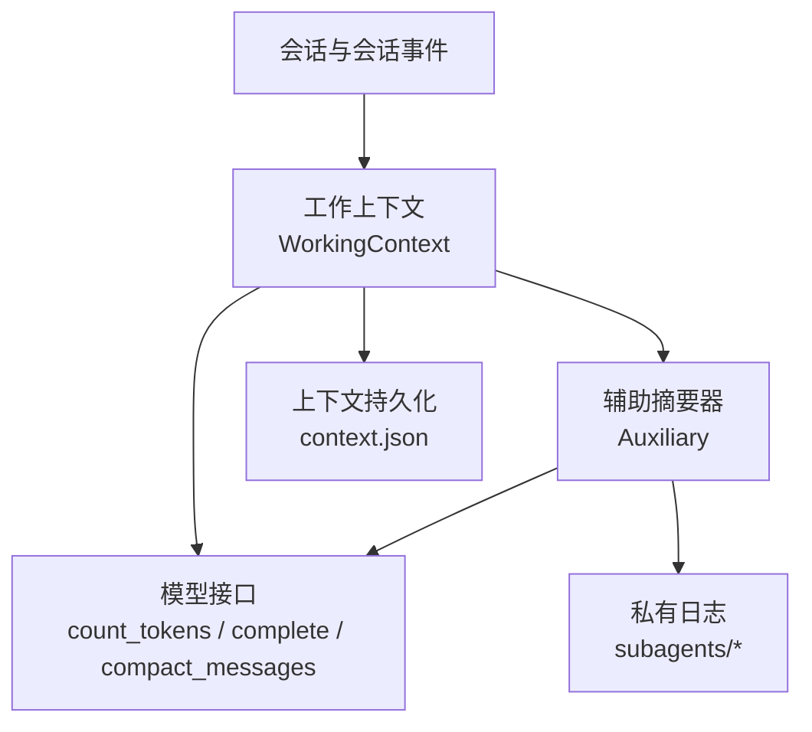
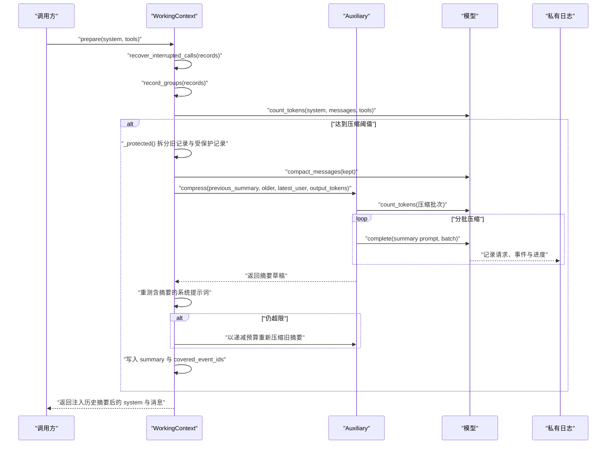
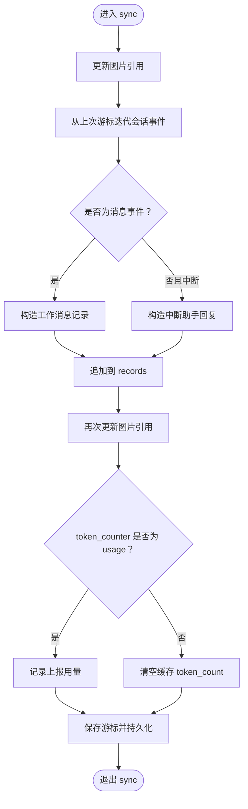
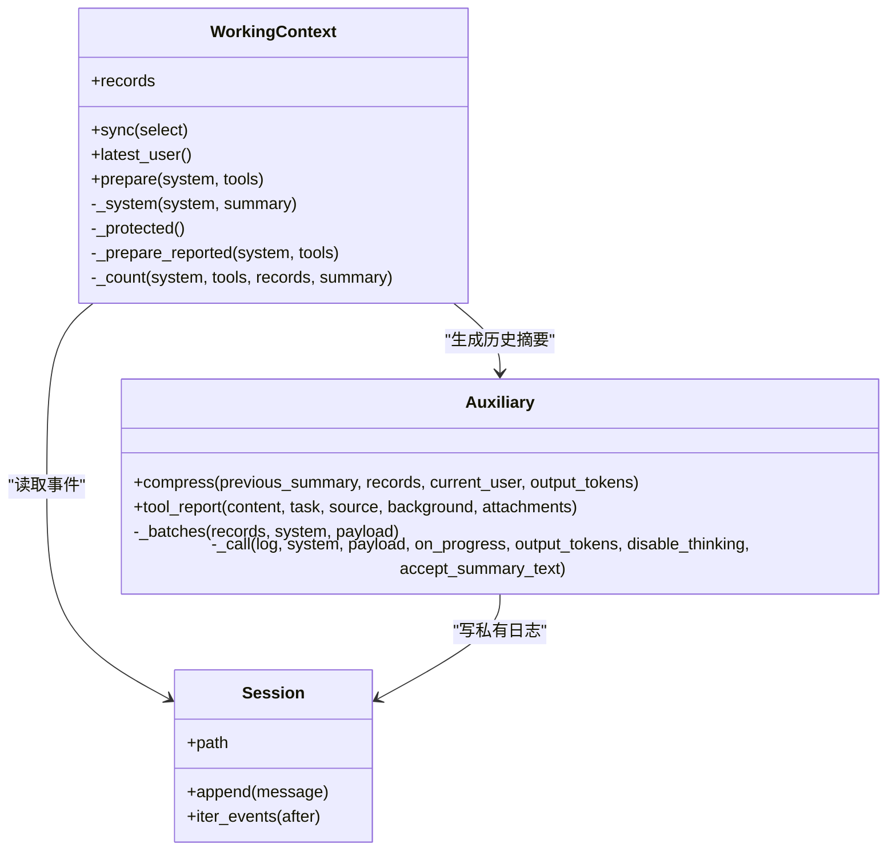
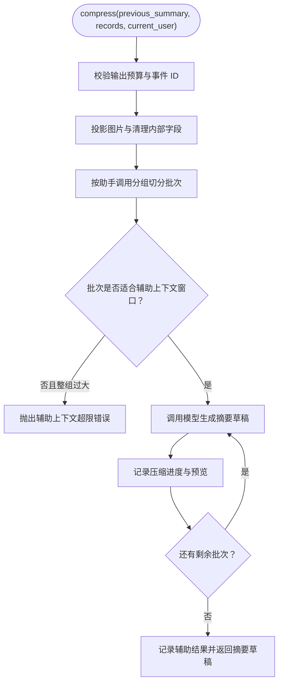
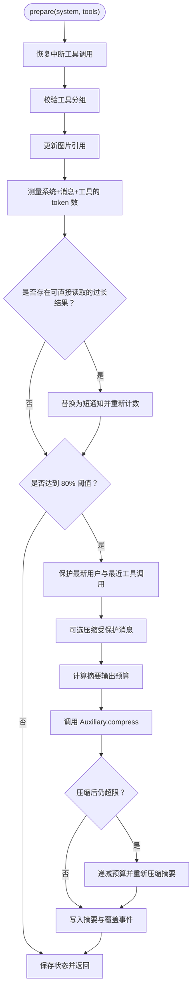
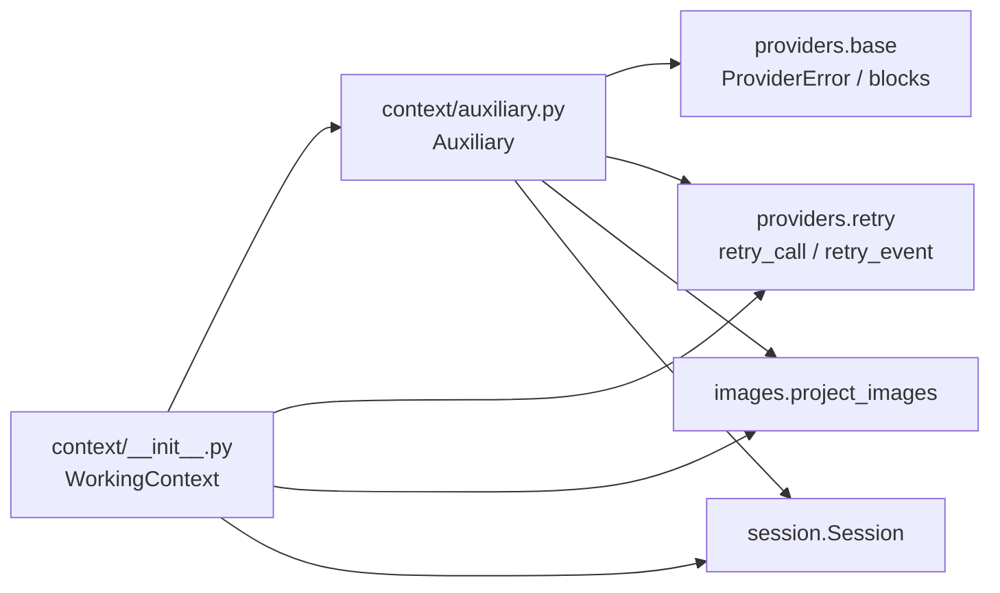

# 工作上下文与辅助摘要

<cite>
**本文引用的文件**   
- [skills_agent/context/__init__.py](file://skills_agent/context/__init__.py)
- [skills_agent/context/auxiliary.py](file://skills_agent/context/auxiliary.py)
- [docs/prompt-history/context-compression.md](file://docs/prompt-history/context-compression.md)
- [docs/prompt-history/context-summary-wrapper.md](file://docs/prompt-history/context-summary-wrapper.md)
- [docs/prompt-history/auxiliary-attachments.md](file://docs/prompt-history/auxiliary-attachments.md)
- [tests/test_context.py](file://tests/test_context.py)
- [tests/test_context_auxiliary.py](file://tests/test_context_auxiliary.py)
</cite>

## 目录
1. [引言](#引言)
2. [项目结构](#项目结构)
3. [核心组件](#核心组件)
4. [架构总览](#架构总览)
5. [详细组件分析](#详细组件分析)
6. [依赖关系分析](#依赖关系分析)
7. [性能考虑](#性能考虑)
8. [故障排查指南](#故障排查指南)
9. [结论](#结论)

## 引言
本文聚焦工作上下文与辅助摘要两个协作部分：`WorkingContext` 负责维护当前任务的工作状态、历史记录和上下文预算；`Auxiliary` 负责在预算不足时生成可继续使用的历史摘要，并通过 `context_summary_wrapper` 把摘要注入系统提示词。文档说明它们如何保存工作目录、Git 仓库路径、平台、shell、操作系统信息、图片附件、子代理状态和工具调用结果，以及压缩何时触发、如何保留关键信息、如何处理富文本与图片、如何避免重复图片和控制输出 token 预算。

## 项目结构
与本文相关的实现集中在以下位置：
- 工作上下文定义、持久化、压缩入口与系统包装：`skills_agent/context/__init__.py`
- 辅助摘要生成、批量切分、重试、附件投影与工具报告：`skills_agent/context/auxiliary.py`
- 上下文压缩与摘要包装的历史行为说明：`docs/prompt-history/context-compression.md`、`docs/prompt-history/context-summary-wrapper.md`、`docs/prompt-history/auxiliary-attachments.md`
- 行为验证测试：`tests/test_context.py`、`tests/test_context_auxiliary.py`

图表来源
- [skills_agent/context/__init__.py:201-446](file://skills_agent/context/__init__.py#L201-L446)
- [skills_agent/context/auxiliary.py:201-468](file://skills_agent/context/auxiliary.py#L201-L468)

章节来源
- [skills_agent/context/__init__.py:201-446](file://skills_agent/context/__init__.py#L201-L446)
- [skills_agent/context/auxiliary.py:201-468](file://skills_agent/context/auxiliary.py#L201-L468)

## 核心组件
### WorkingContext：工作上下文
`WorkingContext` 是增量式、可持久化的工作上下文。它从会话中读取新事件，构造消息记录，并在调用前检查输入 token 是否超出预算；必要时对旧记录进行压缩并生成历史摘要。其职责包括：
- 同步会话中的新消息、中断恢复的工具结果、图片附件投影和 token 使用统计。
- 保护最近的用户请求与最近若干完整工具调用组，防止压缩误删关键上下文。
- 通过 `_system` 方法把历史摘要作为派生参考注入系统提示词。
- 处理直接读取过长工具结果的降级策略：当原始结果无法放入当前上下文时，替换为包含元数据的短提示，而不是重新读取全部原始内容。

关键行为要点：
- `sync()` 按游标增量读取会话事件，追加到 `records`，并在需要时更新图片引用和 token 计数。
- `prepare(system, tools)` 先恢复未完成工具调用的中断结果，校验工具分组完整性，再决定是否压缩。
- `_protected()` 保留最新用户请求和最近的 `keep_calls` 个完整工具调用组，其余作为“旧记录”参与压缩。
- `_system()` 将 `state.summary` 包裹在 `<historical_summary>` 中，明确其为派生历史参考而非新用户指令。
- `snapshot()` 提供 system、tools、records 与已覆盖事件 ID 的快照，便于上层调试或外部消费。

章节来源
- [skills_agent/context/__init__.py:1-120](file://skills_agent/context/__init__.py#L1-L120)
- [skills_agent/context/__init__.py:201-446](file://skills_agent/context/__init__.py#L201-L446)

### Auxiliary：辅助摘要器
`Auxiliary` 是独立的辅助模型调用层，用于：
- 根据选定工作记录和旧摘要生成新的延续摘要。
- 控制摘要的输出 token 预算，避免摘要本身导致主上下文再次溢出。
- 把富文本、图片和文件附件投影为只读证据，同时避免重复发送相同附件。
- 对长工具输出生成不超过 2048 token 的 Markdown 报告。

关键行为要点：
- `compress(previous_summary, records, current_user, output_tokens=None)` 将记录分组、投影图片、构建带 `output_budget_tokens` 的请求，并按辅助上下文窗口分批调用模型。
- `_SUMMARY` 提示词强调材料是只读证据，要求输出包含自然语言摘要和引用映射，不编造事件 ID，必要时缩短旧摘要。
- `_messages()` 和 `_image_payload()` 把 JSON 材料与原生附件组合，并为每个附件添加来源标签，标记为只读。
- `_call()` 限制工具调用，默认禁用思考模式，捕获流式输出，允许在正常 token 长度终止时接受已有片段。
- `tool_report()` 支持超长工具输出的分段摘要、合并与二次重写，保证最终报告不超过 2048 token。

章节来源
- [skills_agent/context/auxiliary.py:1-200](file://skills_agent/context/auxiliary.py#L1-L200)
- [skills_agent/context/auxiliary.py:201-468](file://skills_agent/context/auxiliary.py#L201-L468)
- [docs/prompt-history/context-compression.md:1-129](file://docs/prompt-history/context-compression.md#L1-L129)
- [docs/prompt-history/auxiliary-attachments.md:1-35](file://docs/prompt-history/auxiliary-attachments.md#L1-L35)

## 架构总览
工作上下文与辅助摘要的整体交互如下：

图表来源
- [skills_agent/context/__init__.py:201-446](file://skills_agent/context/__init__.py#L201-L446)
- [skills_agent/context/auxiliary.py:201-468](file://skills_agent/context/auxiliary.py#L201-L468)

## 详细组件分析

### WorkingContext 的状态与生命周期
`WorkingContext` 的持久化状态位于 `context.json`，初始状态包含版本、游标、历史摘要、已覆盖事件 ID、记录列表和 token 计数。每次同步都会追加新事件，并尝试记录实际使用量。

图表来源
- [skills_agent/context/__init__.py:201-260](file://skills_agent/context/__init__.py#L201-L260)

#### 关键属性与职责
- `session.path`：会话根目录，通常对应工作目录和 Git 仓库相关路径。
- `model`：模型接口，提供 token 计数、完成生成和可选的消息压缩能力。
- `auxiliary`：辅助摘要器，负责历史摘要生成。
- `max_tokens`：上下文最大 token 预算。
- `keep_calls`：保护最近多少组完整工具调用。
- `path`：`context.json` 持久化路径。
- `state.records`：工作记录列表，每条记录包含事件 ID、时间戳（可选）和工作消息。
- `state.summary`：历史摘要。
- `state.covered_event_ids`：已被压缩进历史摘要的事件 ID，避免重复压缩。
- `state.token_count` 与 `state.last_usage`：缓存的输入 token 数和限额信息。

#### 如何读取 WorkingContext 状态
典型用法包括：
- 通过 `context.records` 读取当前工作记录。
- 通过 `context.latest_user()` 获取最新用户请求。
- 通过 `context.snapshot(system, tools)` 获取一次可消费的上下文快照。
- 通过 `context.state.summary`、`context.state.covered_event_ids`、`context.state.token_count` 了解压缩历史和预算状态。

示例路径参考：
- 读取记录与最新用户：[skills_agent/context/__init__.py:260-300](file://skills_agent/context/__init__.py#L260-L300)
- 获取快照：[skills_agent/context/__init__.py:300-320](file://skills_agent/context/__init__.py#L300-L320)

章节来源
- [skills_agent/context/__init__.py:1-120](file://skills_agent/context/__init__.py#L1-L120)
- [skills_agent/context/__init__.py:201-320](file://skills_agent/context/__init__.py#L201-L320)
- [tests/test_context.py:60-120](file://tests/test_context.py#L60-L120)

### 历史消息、工具调用与中断恢复
工作上下文要求工具调用与其结果组成不可分割的分组。`record_groups()` 会校验：
- 没有孤立的工具结果。
- 助手响应中的工具调用 ID 不重复。
- 所有待确认工具调用都有对应的工具结果。
- 如果存在未完成的工具调用组，则拒绝发送或压缩。

对于中断运行留下的未完成工具调用，`recover_interrupted_calls()` 会插入“恢复结果”，其中包含任务名称、原始调用标识和中断提示信息。这些恢复记录以 `recovered-` 前缀引用，不会被当作真实执行结果，但可在摘要中被引用。

图表来源
- [skills_agent/context/__init__.py:1-120](file://skills_agent/context/__init__.py#L1-L120)
- [skills_agent/context/__init__.py:201-446](file://skills_agent/context/__init__.py#L201-L446)
- [skills_agent/context/auxiliary.py:201-468](file://skills_agent/context/auxiliary.py#L201-L468)

章节来源
- [skills_agent/context/__init__.py:1-120](file://skills_agent/context/__init__.py#L1-L120)
- [skills_agent/context/__init__.py:201-360](file://skills_agent/context/__init__.py#L201-L360)
- [tests/test_context.py:120-200](file://tests/test_context.py#L120-L200)

### 辅助摘要生成与维护
`Auxiliary.compress()` 是摘要生成的核心入口。其行为包括：
1. 校验 `output_tokens` 为正数。
2. 复制记录并投影图片，过滤敏感字段，移除内部传输状态。
3. 校验事件 ID 唯一。
4. 创建私有会话日志，记录压缩任务目的。
5. 按 `_groups()` 划分助手响应与工具结果，保证每组不被拆散。
6. 分批调用模型，每批都使用 `_SUMMARY` 提示词，并带上 `previous_summary`、`draft`、`records`、`current_user_task` 和 `output_budget_tokens`。
7. 允许接收非结构化摘要文本，但禁止意外工具调用。
8. 成功时记录 `auxiliary_result`，并返回草稿。

图表来源
- [skills_agent/context/auxiliary.py:201-360](file://skills_agent/context/auxiliary.py#L201-L360)

章节来源
- [skills_agent/context/auxiliary.py:1-200](file://skills_agent/context/auxiliary.py#L1-L200)
- [skills_agent/context/auxiliary.py:201-360](file://skills_agent/context/auxiliary.py#L201-L360)
- [tests/test_context_auxiliary.py:1-120](file://tests/test_context_auxiliary.py#L1-L120)

### 上下文压缩流程
压缩发生在 `WorkingContext.prepare()` 中。主要阶段如下：

1. **恢复中断调用**：补全上一次停止后缺失的工具结果。
2. **校验工具分组**：确保没有孤儿结果或未完成任务。
3. **更新图片引用**：避免过期图片被后续报告误用。
4. **测量输入 token**：
   - 若模型使用 `usage` 计数，走 `_prepare_reported()`。
   - 否则计算 `limit = min(max_tokens, model_context_window - max_output_tokens)`。
5. **直接读取过长结果降级**：如果某条记录的原始执行结果无法放入上下文，将其替换为包含来源和元数据的简短通知，然后重新计数。
6. **判断压缩阈值**：当输入 token 达到 `min(context_window * 0.8, limit)` 且模型支持压缩时，进入压缩流程。
7. **保护关键信息**：保留最新用户请求和最近 `keep_calls` 个完整工具调用组。
8. **可选压缩 kept 消息**：调用模型的 `compact_messages()`，并保持消息数量一致。
9. **计算摘要预算**：预留系统提示词包装占用的 token，得到 `output_tokens`。
10. **生成或缩短摘要**：
    - 首次压缩旧记录。
    - 如果仍超限，循环缩小 `output_tokens`，只对已生成的摘要再次压缩。
11. **提交压缩结果**：更新 `summary`、`covered_event_ids`、`records`，并保存状态。

图表来源
- [skills_agent/context/__init__.py:320-446](file://skills_agent/context/__init__.py#L320-L446)

章节来源
- [skills_agent/context/__init__.py:320-446](file://skills_agent/context/__init__.py#L320-L446)
- [tests/test_context.py:201-501](file://tests/test_context.py#L201-L501)

### 富文本、图片与长输出处理
#### 图片与附件
- `project_images()` 会投影消息中的图片引用。
- `image_records()` 在记录级别投影图片，并为无事件 ID 的图片补充事件关联。
- `auxiliary._image_references()` 在辅助调用中保留图片地址但不重复附加像素数据。
- `auxiliary._messages()` 为每个图片或文件附件添加只读来源标签，例如“来自某证据事件的只读附件”。

#### 富文本与推理内容
- `working_message()` 会提取 provider 返回的推理内容，避免丢失思考链，同时移除传输日志。
- `_evidence_message()` 会移除内部字段、签名和加密内容，并去除被标记为红思考的内容。

#### 长工具输出
- `Auxiliary.tool_report()` 先将完整输出视为一个任务；如果超过辅助上下文窗口，则按行或字符二分切分。
- 分段报告可合并；若合并后仍超限，则进一步拆分，直到可合并或只剩单段。
- 最终报告上限为 2048 token；若重写后仍超限，则抛出错误。

章节来源
- [skills_agent/context/__init__.py:1-120](file://skills_agent/context/__init__.py#L1-L120)
- [skills_agent/context/auxiliary.py:1-200](file://skills_agent/context/auxiliary.py#L1-L200)
- [docs/prompt-history/auxiliary-attachments.md:1-35](file://docs/prompt-history/auxiliary-attachments.md#L1-L35)

### 与主 Agent 和子 Agent 的交互方式
- 主 Agent 通过 `WorkingContext.sync()` 和 `prepare()` 消费会话事件，并决定是否需要压缩。
- 主 Agent 通过 `context_summary_wrapper`，即 `WorkingContext._system()`，把历史摘要注入系统提示词，明确其为派生参考。
- 子 Agent 由 `Auxiliary` 通过独立 `Session` 管理私有日志，记录压缩、token 计数、模型请求、事件和错误。
- 工具报告可以携带背景信息，包括当前用户任务、历史消息和工具记录，但会投影图片以避免重复传输大附件。

章节来源
- [skills_agent/context/__init__.py:260-360](file://skills_agent/context/__init__.py#L260-L360)
- [skills_agent/context/auxiliary.py:201-468](file://skills_agent/context/auxiliary.py#L201-L468)

## 依赖关系分析

图表来源
- [skills_agent/context/__init__.py:1-120](file://skills_agent/context/__init__.py#L1-L120)
- [skills_agent/context/auxiliary.py:1-200](file://skills_agent/context/auxiliary.py#L1-L200)

### 耦合与内聚
- `WorkingContext` 与 `Auxiliary` 通过明确的 `compress()` 接口解耦：前者负责预算、保护和调度，后者负责提示词、批次、重试和附件投影。
- 两者都依赖 `Session`，但 `Auxiliary` 的私有日志与主会话分离，避免干扰用户事件。
- 图片投影逻辑集中在 `images.project_images` 和相关辅助函数中，减少重复代码。

### 潜在风险
- 如果 `compact_messages()` 改变消息数量，上下文会抛出预算错误，因为消息与工具结果无法一一配对。
- 如果辅助生成意外请求工具，会被拒绝，避免摘要阶段执行副作用。
- 如果受保护消息本身已超过预算，压缩不会删除受保护记录，而是抛出预算错误。

章节来源
- [skills_agent/context/__init__.py:320-446](file://skills_agent/context/__init__.py#L320-L446)
- [skills_agent/context/auxiliary.py:201-468](file://skills_agent/context/auxiliary.py#L201-L468)

## 性能考虑
### 合理设置最大历史长度
- 使用 `max_tokens` 控制上下文输入上限，避免长期会话无限膨胀。
- 使用 `keep_calls` 保留最近若干完整工具调用，提高压缩后仍可解释性。
- 测试表明，当模型上下文窗口较小时，阈值会基于 `model_context_window - max_output_tokens` 调整，因此应同时配置合理的 `max_output_tokens`。

### 避免重复图片附件
- 使用 `project_images()` 和 `image_records()` 投影图片引用，而不是反复传输二进制内容。
- 在辅助调用中，附件仅保留来源标签和路径或名称，避免重复发送。
- 工具报告分段合并时会保留图片引用，而不是重复附加图片像素。

### 控制 summary_output_tokens 预算
- `Auxiliary.output_tokens` 是默认摘要输出预算。
- `WorkingContext.prepare()` 会预留系统提示词包装占用空间，再计算传递给 `Auxiliary.compress()` 的 `output_tokens`。
- 如果摘要仍然导致上下文超限，会按减半策略逐步降低预算，直到可容纳为止。

### 长时间会话保持上下文稳定
- 使用 `covered_event_ids` 记录已压缩事件，避免重复压缩同一批旧记录。
- 第二次压缩只对新 displaced 记录进行，并使用旧摘要作为基础。
- 压缩失败时不会替换旧上下文，也不会回放原始历史，从而保护稳定性。
- 使用 `on_activity` 回调观察压缩开始与结束，便于监控长时间任务。

章节来源
- [skills_agent/context/__init__.py:320-446](file://skills_agent/context/__init__.py#L320-L446)
- [skills_agent/context/auxiliary.py:201-468](file://skills_agent/context/auxiliary.py#L201-L468)
- [tests/test_context.py:201-501](file://tests/test_context.py#L201-L501)
- [tests/test_context_auxiliary.py:120-250](file://tests/test_context_auxiliary.py#L120-L250)

## 故障排查指南

### 常见问题与定位
1. **工作上下文 token 超限**
   - 现象：`prepare()` 抛出 `ContextBudgetError`。
   - 可能原因：受保护消息过长、系统提示词过大、摘要生成后仍超限。
   - 排查：检查 `last_usage.limit`、`token_count`、`max_tokens` 和 `model_context_window`。
   - 相关路径：[skills_agent/context/__init__.py:360-446](file://skills_agent/context/__init__.py#L360-L446)

2. **压缩期间活动状态未清除**
   - 现象：`on_activity` 始终显示压缩中。
   - 可能原因：压缩过程中抛出异常或被中断。
   - 机制：`try/finally` 会在成功或失败后调用 `on_activity(None)`。
   - 相关路径：[skills_agent/context/__init__.py:360-420](file://skills_agent/context/__init__.py#L360-L420)

3. **辅助摘要生成请求了工具调用**
   - 现象：辅助生成抛出错误。
   - 原因：辅助摘要不应执行工具；遇到工具调用会被拒绝。
   - 相关路径：[skills_agent/context/auxiliary.py:300-360](file://skills_agent/context/auxiliary.py#L300-L360)

4. **工具报告超过 2048 token**
   - 现象：重写后仍超限，抛出错误。
   - 原因：工具输出或背景信息过大，且无法进一步拆分合并。
   - 相关路径：[skills_agent/context/auxiliary.py:360-468](file://skills_agent/context/auxiliary.py#L360-L468)

5. **历史摘要格式错误或引用不完整**
   - 现象：摘要不是合法 JSON，或引用键缺失。
   - 行为：辅助层不会因格式错误直接丢弃摘要；只要返回非空文本，就视为可用摘要。
   - 相关路径：[tests/test_context_auxiliary.py:1-120](file://tests/test_context_auxiliary.py#L1-L120)

### 诊断建议
- 查看 `context.json` 中的 `summary`、`covered_event_ids`、`token_count`、`last_usage`。
- 查看 `subagents/*` 下的私有日志，了解辅助压缩、token 计数和模型请求。
- 使用 `on_activity` 监听 `compression` 阶段，区分 waiting、thinking、summary。
- 使用 `snapshot()` 获取一次可复现的上下文快照，用于比较压缩前后差异。

章节来源
- [skills_agent/context/__init__.py:320-446](file://skills_agent/context/__init__.py#L320-L446)
- [skills_agent/context/auxiliary.py:201-468](file://skills_agent/context/auxiliary.py#L201-L468)
- [tests/test_context.py:201-501](file://tests/test_context.py#L201-L501)
- [tests/test_context_auxiliary.py:1-200](file://tests/test_context_auxiliary.py#L1-L200)

## 结论
`WorkingContext` 和 `Auxiliary` 共同构成一个稳健的长会话上下文管理机制：前者维护工作目录、会话事件、图片引用、工具调用分组和上下文预算，后者负责生成可继续使用的历史摘要，并把摘要安全地注入系统提示词。压缩过程优先保护最新用户请求和最近工具调用，只在必要时压缩旧记录；富文本、图片和长输出通过投影、去重、分段和重写等方式控制在预算内。配合合理的 `max_tokens`、`keep_calls`、`summary_output_tokens` 和 `on_activity` 监控，可以在长时间任务中保持上下文稳定、可解释且不易失效。