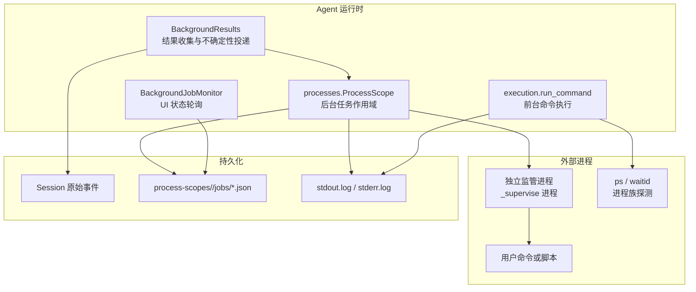
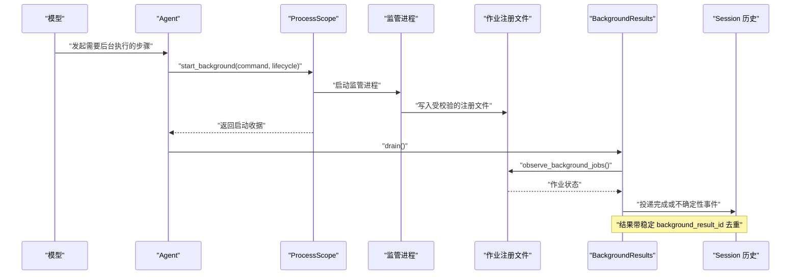
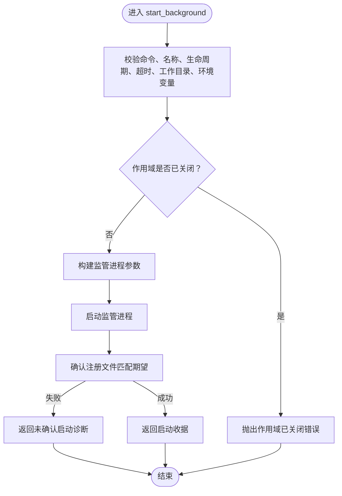
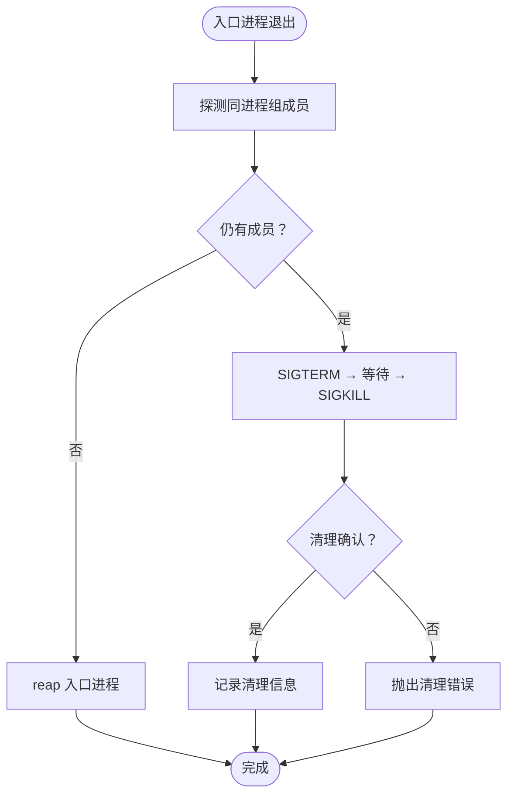
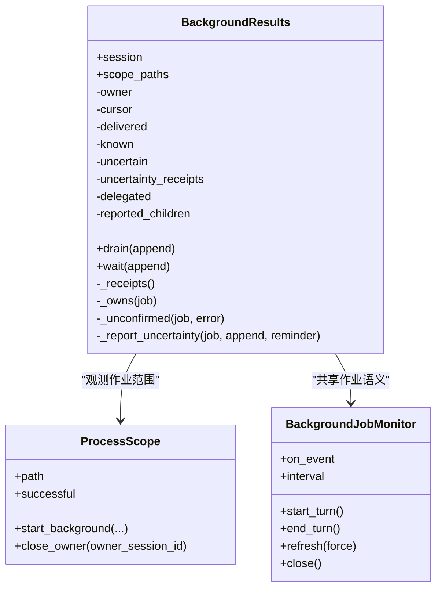
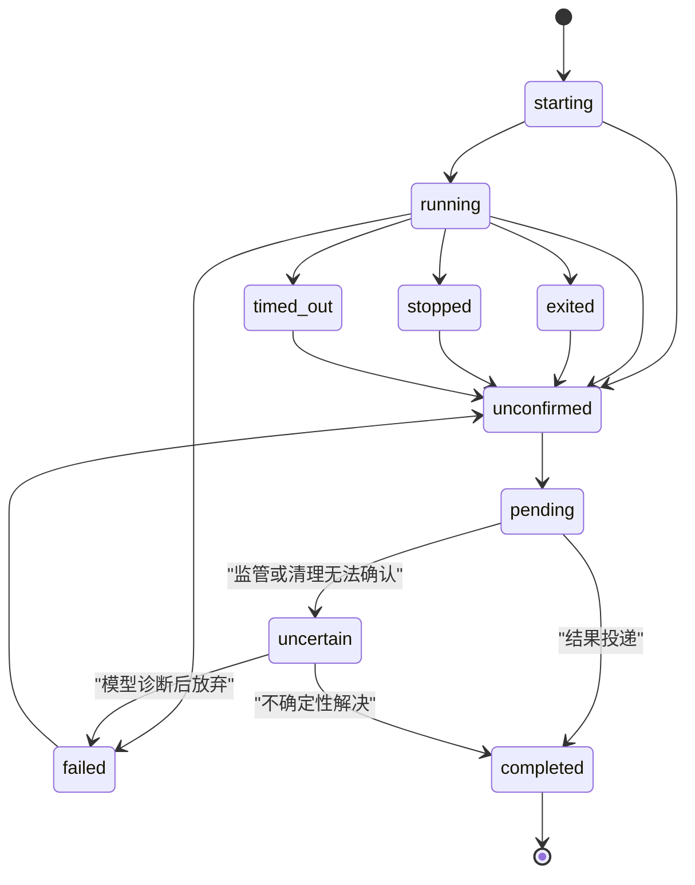
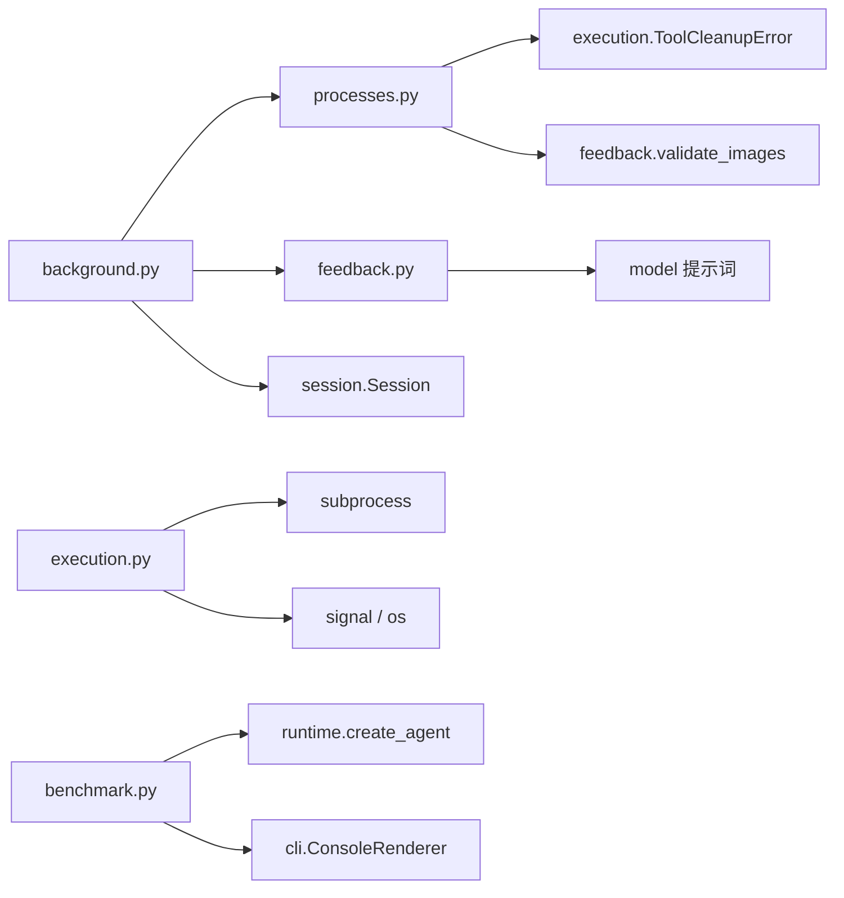

# 后台任务管理

<cite>
**本文引用的文件**   
- [background.py](file://skills_agent/background.py)
- [execution.py](file://skills_agent/execution.py)
- [processes.py](file://skills_agent/processes.py)
- [benchmark.py](file://skills_agent/benchmark.py)
- [skill-background-tasks.md](file://docs/prompt-history/skill-background-tasks.md)
- [background-job-result.md](file://docs/prompt-history/background-job-result.md)
- [background-job-uncertainty.md](file://docs/prompt-history/background-job-uncertainty.md)
</cite>

## 目录
1. [引言](#引言)
2. [项目结构](#项目结构)
3. [核心数据结构](#核心数据结构)
4. [系统架构总览](#系统架构总览)
5. [详细组件分析](#详细组件分析)
6. [依赖关系分析](#依赖关系分析)
7. [性能与边界](#性能与边界)
8. [故障排查指南](#故障排查指南)
9. [结论](#结论)
10. [附录：实际示例与使用方式](#附录实际示例与使用方式)

## 引言
本文件系统化说明技能 Agent 的后台任务体系，包括：后台任务的启动、进程组监控、结果投递、不确定性标记、生命周期管理，以及前台命令与后台服务的差异。重点解释 `BackgroundJob`（由注册记录观察得到的作业视图）、`ProcessScope`（单次 Agent 轮次的作用域）和 `BackgroundResults`（会话输出通道与去重器）的职责；并说明它们如何与 Agent、工具执行器和外部监管进程协作。文档还给出声明图片 job、并行/串行任务、任务超时、结果回传、UI 展示的实际用法，以及进程泄漏、结果丢失、任务挂起、容器隔离异常和回调失败等常见问题的排查方法。

## 项目结构
后台任务相关代码主要分布在三个模块中：
- `skills_agent/processes.py`：进程作用域、作业注册、观测、启动期望、结果读取、UI 监控器。
- `skills_agent/background.py`：会话级后台结果收集、去重、不确定性诊断投递、子代理委派。
- `skills_agent/execution.py`：前台命令执行、进程组清理、超时控制。
- `skills_agent/benchmark.py`：单任务 benchmark 入口，强调独立日志目录与中断处理。
- `docs/prompt-history/*`：后台任务提示词、结果与不确定性事件的设计说明。

**图表来源**
- [background.py:1-120](file://skills_agent/background.py#L1-L120)
- [processes.py:109-200](file://skills_agent/processes.py#L109-L200)
- [processes.py:606-771](file://skills_agent/processes.py#L606-L771)
- [execution.py:302-369](file://skills_agent/execution.py#L302-L369)

**章节来源**
- [background.py:1-120](file://skills_agent/background.py#L1-L120)
- [processes.py:109-200](file://skills_agent/processes.py#L109-L200)
- [execution.py:302-369](file://skills_agent/execution.py#L302-L369)
- [skill-background-tasks.md:1-120](file://docs/prompt-history/skill-background-tasks.md#L1-L120)

## 核心数据结构

### BackgroundJob（观察视图）
`BackgroundJob` 不是直接类，而是由 `observe_background_jobs`、`BackgroundJobMonitor._snapshot` 和 `_observed_job` 从磁盘注册文件中构造的字典视图。它包含：
- 身份：`id`、`name`、`display_name`、`kind`、`background_lifecycle`、`wait_on_exit`。
- 所有权：`owner_session_id`、`origin_tool_call_id`、`_scope_path`、`_record_path`、`process_record_path`。
- 状态：`state`、`status`、`error`、`exit_code`、`timed_out`、`cleanup_confirmed`、`cleanup_required`、`cleanup_forced`、`cleanup_reason`、`cleanup_process_count`。
- 路径：`stdout_path`、`stderr_path`、`state_dir`、`launch_id`、`launch_record_path`。
- 不确定性：`resolved_uncertainty_ids`、`registration_error`。

该视图只暴露诊断信息，不直接持有 PID 作为所有权证明；所有权通过 session hash、作用域路径、监管进程命令行参数和 token 共同确认。

**章节来源**
- [processes.py:109-200](file://skills_agent/processes.py#L109-L200)
- [processes.py:325-390](file://skills_agent/processes.py#L325-L390)
- [processes.py:500-560](file://skills_agent/processes.py#L500-L560)
- [background.py:12-20](file://skills_agent/background.py#L12-L20)

### ProcessScope（进程作用域）
`ProcessScope` 表示一次 Agent 轮次的后台任务作用域：
- 创建时生成唯一作用域目录，写入 `scope.json`，并创建 `runs` 子目录。
- `attach` 用于恢复已有作用域，拒绝符号链接。
- `start_background` 校验命令、名称、工作目录、环境变量、`background_lifecycle`、超时和作用域是否已关闭，然后启动独立监管进程。
- `mark_successful` 将作用域标记为成功，允许后续服务保留策略生效。
- `close_owner` 按 `owner_session_id` 清理某个 Agent 的所有注册，但不关闭整个作用域。

**章节来源**
- [processes.py:606-771](file://skills_agent/processes.py#L606-L771)

### BackgroundResults（结果投递与去重）
`BackgroundResults` 是会话级的后台结果收集器：
- 以 session path 计算 owner，支持子代理委派。
- `_receipts` 扫描 Session 历史事件，重建已知作业、不确定性和已投递结果。
- `drain` 结合 `observe_background_jobs` 和已投递凭证，产出待交付结果。
- `_report_uncertainty` 将不可信监管诊断作为运行事件投递给模型，而不是直接终止 Agent。
- `wait` 阻塞等待结果，遇到“无工具回复”的不确定性时会重新提醒模型。

**章节来源**
- [background.py:21-120](file://skills_agent/background.py#L21-L120)
- [background.py:165-291](file://skills_agent/background.py#L165-L291)

### completion_result（终端结果读取）
`completion_result` 是安全读取已确认终态后台作业结果的入口：
- 要求作业处于终态且清理已确认。
- 返回名称、命令、所有者、起止时间、超时、退出码、清理信息和有界 stdout/stderr。
- 对缺失日志、损坏文件或非终态情况抛出 `BackgroundJobError`。

**章节来源**
- [processes.py:325-390](file://skills_agent/processes.py#L325-L390)

### ToolCleanupError（清理错误）
`ToolCleanupError` 是前台命令清理阶段使用的专用异常，携带诊断信息，指示命令可能仍活跃，Agent 不应继续正常流程。

**章节来源**
- [execution.py:1-30](file://skills_agent/execution.py#L1-L30)

## 系统架构总览
后台任务体系围绕“可观测、可恢复、可清理”的原则设计：

1. **启动**：`ProcessScope.start_background` 启动独立监管进程，把真实命令放在 shell 前台，避免自行守护或脱离进程组。
2. **注册**：监管进程在磁盘上写入受严格校验的作业注册文件，记录 token、路径、状态、所有者、超时、图像等。
3. **监控**：`BackgroundJobMonitor` 周期性扫描 `process-scopes`，向 UI 发布作业快照；`observe_background_jobs` 做更强一致性检查，包括监管进程身份验证。
4. **结果投递**：`BackgroundResults.drain` 在 Agent 同步边界把已确认结果写回 Session，附带稳定 ID 去重。
5. **不确定性**：当监管身份、清理状态或作业消失无法确认时，投递不确定性事件，让模型诊断而非自动重试。
6. **清理**：前台命令使用进程组信号；后台任务由监管进程负责入口进程退出后的剩余成员清理。

**图表来源**
- [processes.py:606-771](file://skills_agent/processes.py#L606-L771)
- [processes.py:109-200](file://skills_agent/processes.py#L109-L200)
- [background.py:165-291](file://skills_agent/background.py#L165-L291)

## 详细组件分析

### 后台任务启动与生命周期
`ProcessScope.start_background` 的工作流如下：

**图表来源**
- [processes.py:646-771](file://skills_agent/processes.py#L646-L771)
- [processes.py:296-325](file://skills_agent/processes.py#L296-L325)

关键点：
- `background_lifecycle` 决定 `wait_on_exit` 和是否允许持久服务。
- 默认任务超时为 3600 秒；服务无执行超时，除非显式提供。
- 启动确认时间为 10 秒；这是启动回执窗口，不是任务完成。
- 服务必须显式允许持久化，否则在当前 Agent 运行中被拒绝。

**章节来源**
- [processes.py:646-771](file://skills_agent/processes.py#L646-L771)
- [skill-background-tasks.md:1-120](file://docs/prompt-history/skill-background-tasks.md#L1-L120)

### 进程组监控与清理
前台命令通过 `execution.run_command` 管理：
- 使用 `subprocess.Popen(..., start_new_session=True)` 创建新会话。
- 先等待入口进程退出，再探测同进程组残留成员。
- 残留成员优先 SIGTERM，失败则 SIGKILL，并在固定清理时限内反复探测。
- 若清理无法确认，抛出 `ToolCleanupError`，并附加诊断。

后台任务通过监管进程实现更细粒度的清理：
- 监管进程负责等待入口进程，并在其退出后清理同一进程组。
- 清理结果写入作业注册文件，包括是否需要强制清理、初始成员数、原因等。
- `completion_result` 只在清理已确认时读取日志，避免把不完整清理当作成功。

**图表来源**
- [execution.py:201-369](file://skills_agent/execution.py#L201-L369)
- [processes.py:325-390](file://skills_agent/processes.py#L325-L390)

**章节来源**
- [execution.py:201-369](file://skills_agent/execution.py#L201-L369)
- [processes.py:325-390](file://skills_agent/processes.py#L325-L390)

### 结果投递与不确定性标记
`BackgroundResults` 的核心职责是把“真正完成的后台作业”与“无法确认的作业”区分开：

**图表来源**
- [background.py:21-120](file://skills_agent/background.py#L21-L120)
- [background.py:165-291](file://skills_agent/background.py#L165-L291)
- [processes.py:606-771](file://skills_agent/processes.py#L606-L771)
- [processes.py:564-605](file://skills_agent/processes.py#L564-L605)

关键行为：
- 已完成且清理确认的作业通过 `RUNTIME_EVENT` 投递，附带稳定 `background_result_id`。
- 未确认、监管身份不明、清理未确认或作业消失的作业通过 `UNCERTAINTY_EVENT` 投递。
- 已投递结果加入 `_delivered`，避免压缩或重启后重复。
- 子代理委派完成后，父代理只接管尚未消费的结果，避免重复认领。

**章节来源**
- [background.py:21-120](file://skills_agent/background.py#L21-L120)
- [background.py:165-291](file://skills_agent/background.py#L165-L291)
- [background-job-result.md:1-19](file://docs/prompt-history/background-job-result.md#L1-L19)
- [background-job-uncertainty.md:1-18](file://docs/prompt-history/background-job-uncertainty.md#L1-L18)

### 前台任务与后台服务的区别
| 维度 | 前台命令 | 后台任务 | 后台服务 |
|---|---|---|---|
| 调用方式 | `execution.run_command` | `ProcessScope.start_background`，`run_in_background=true` | 同上，但 `background_lifecycle=service` |
| 是否阻塞最终回复 | 是 | `task` 阻塞；`service` 不阻塞 | 否 |
| 默认超时 | 120 秒，最大 600 秒 | 任务默认 3600 秒 | 无执行超时，除非显式设置 |
| 启动确认 | 同步执行 | 10 秒启动确认 | 10 秒启动确认 |
| 清理责任 | 进程组清理由 `execution.py` 负责 | 监管进程负责入口进程退出后的清理 | 监管进程负责，并可持久保留 |
| 跨任务保留 | 不适用 | 不允许跨任务保留 | 仅允许显式持久服务，且当前 Agent 运行需允许 |
| benchmark 限制 | 正常执行 | 允许 | 明确拒绝 |

**章节来源**
- [execution.py:1-30](file://skills_agent/execution.py#L1-L30)
- [execution.py:302-369](file://skills_agent/execution.py#L302-L369)
- [processes.py:646-771](file://skills_agent/processes.py#L646-L771)
- [skill-background-tasks.md:1-120](file://docs/prompt-history/skill-background-tasks.md#L1-L120)

### 为什么 benchmark 不允许跨任务保留后台服务
`benchmark.py` 是单任务入口：
- 每次运行创建独立日志目录。
- 如果日志目录已存在 `session`，会报错，防止复用上次运行的上下文。
- 它通过 `create_agent` 运行一个 prompt，然后 `agent.close()` 结束。
- 后台服务要求 `allow_persistent=True`，而普通 Agent 运行默认不允许持久服务；benchmark 更强调隔离和幂等。
- 文档明确说明：benchmark 拒绝 service，以避免工作泄漏到下一个 benchmark 任务。

因此，benchmark 不允许跨任务保留后台服务的原因不是技术不可能，而是设计约束：每个 benchmark 任务应自包含、可独立复现、不会泄露端口、监听进程或状态到下一次运行。

**章节来源**
- [benchmark.py:1-59](file://skills_agent/benchmark.py#L1-L59)
- [skill-background-tasks.md:1-120](file://docs/prompt-history/skill-background-tasks.md#L1-L120)
- [processes.py:646-771](file://skills_agent/processes.py#L646-L771)

### 任务状态机
后台作业的状态机可以概括为：

状态含义：
- `starting` / `running`：正在启动或运行。
- `exited` / `failed` / `stopped` / `timed_out`：终态。
- `unconfirmed`：注册存在但监管身份、清理状态或作业本身不可信。
- `pending`：等待 `wait_on_exit=true` 的任务完成。
- `completed`：结果已投递。
- `uncertain`：需要模型诊断，不能自动重试。

**图表来源**
- [processes.py:109-200](file://skills_agent/processes.py#L109-L200)
- [processes.py:325-390](file://skills_agent/processes.py#L325-L390)
- [background.py:165-291](file://skills_agent/background.py#L165-L291)

**章节来源**
- [processes.py:109-200](file://skills_agent/processes.py#L109-L200)
- [background.py:165-291](file://skills_agent/background.py#L165-L291)

## 依赖关系分析

- `background.py` 依赖 `processes.py` 的作业观测与结果读取，依赖 `session.Session` 的事件迭代。
- `processes.py` 依赖 `execution.ToolCleanupError` 统一清理错误语义，依赖 `feedback.validate_images` 校验图片声明。
- `execution.py` 直接操作系统进程组和信号，承担前台命令的生命周期。
- `benchmark.py` 是高层入口，不直接操作作业细节，但受整体生命周期策略约束。

**图表来源**
- [background.py:1-20](file://skills_agent/background.py#L1-L20)
- [processes.py:1-20](file://skills_agent/processes.py#L1-L20)
- [execution.py:1-30](file://skills_agent/execution.py#L1-L30)
- [benchmark.py:1-59](file://skills_agent/benchmark.py#L1-L59)

**章节来源**
- [background.py:1-20](file://skills_agent/background.py#L1-L20)
- [processes.py:1-20](file://skills_agent/processes.py#L1-L20)
- [execution.py:1-30](file://skills_agent/execution.py#L1-L30)
- [benchmark.py:1-59](file://skills_agent/benchmark.py#L1-L59)

## 性能与边界
- 前台命令默认 120 秒，最大 600 秒；后台任务默认 3600 秒；启动确认 10 秒。
- 进程组探测使用短超时 `ps` 探针，避免无限等待。
- 清理阶段有固定超时，失败时不吞掉错误，而是转为 `ToolCleanupError`。
- 后台结果读取限制 stdout/stderr 字节数，完整日志保存在磁盘。
- UI 轮询间隔默认 0.5 秒，仅在状态变化时发送事件。
- 结果投递使用稳定 ID，避免 Session 压缩或重启导致重复。

这些边界确保长时间任务、慢进程组、部分损坏的注册文件和不可信日志不会拖垮 Agent 主循环。

**章节来源**
- [execution.py:1-30](file://skills_agent/execution.py#L1-L30)
- [execution.py:302-369](file://skills_agent/execution.py#L302-L369)
- [processes.py:325-390](file://skills_agent/processes.py#L325-L390)
- [processes.py:564-605](file://skills_agent/processes.py#L564-L605)

## 故障排查指南

### 进程泄漏
症状：后台命令退出后仍有子进程存活，或 benchmark 结束后端口被占用。
排查要点：
1. 检查作业是否处于终态且 `cleanup_confirmed=true`。
2. 查看 `cleanup_required`、`cleanup_forced`、`cleanup_reason`、`cleanup_process_count`。
3. 如果是前台命令，确认是否抛出 `ToolCleanupError`，并检查诊断中的 `cleanup_errors`。
4. 如果是后台服务，确认是否属于上一次成功的持久服务；benchmark 不应保留服务。
5. 检查作业是否调用了 `setsid`、自守护或委托外部服务，这会绕过进程组契约。

**章节来源**
- [execution.py:201-369](file://skills_agent/execution.py#L201-L369)
- [processes.py:325-390](file://skills_agent/processes.py#L325-L390)
- [skill-background-tasks.md:1-120](file://docs/prompt-history/skill-background-tasks.md#L1-L120)

### 结果丢失
症状：UI 显示作业，但没有收到完成消息；或模型认为任务未完成。
排查要点：
1. 检查 `BackgroundResults._delivered` 对应稳定 ID 是否已投递。
2. 检查作业是否真的处于终态且清理已确认。
3. 检查 Session 历史是否被压缩，但稳定 ID 仍应保留。
4. 如果是子代理委派，确认父代理是否已报告子代理，并且子代理结果已被正确合并。
5. 检查是否误把启动收据当作完成证据。

**章节来源**
- [background.py:21-120](file://skills_agent/background.py#L21-L120)
- [background.py:165-291](file://skills_agent/background.py#L165-L291)
- [background-job-result.md:1-19](file://docs/prompt-history/background-job-result.md#L1-L19)

### 任务挂起
症状：作业长期处于 `starting`、`running` 或 `unconfirmed`。
排查要点：
1. 检查启动确认是否超过 10 秒。
2. 检查监管进程是否存在且拥有该 token 和作用域。
3. 检查作业注册是否匹配启动期望。
4. 检查是否出现“监管身份探测失败”。
5. 对 `wait_on_exit=true` 的任务，确认模型是否因不确定性被反复提醒。

**章节来源**
- [processes.py:109-200](file://skills_agent/processes.py#L109-L200)
- [processes.py:408-470](file://skills_agent/processes.py#L408-L470)
- [background.py:251-291](file://skills_agent/background.py#L251-L291)

### 容器隔离异常
症状：在 Docker sandbox 中后台作业行为异常，或进程组探测失败。
排查要点：
1. 文档明确指出：短生命周期 Docker `sandbox` 不支持注册的后台作业；shell 在完整 Agent 运行于 benchmark 容器中可用。
2. 检查 `ps` 是否可用；进程组探测依赖 `ps`。
3. 检查 `waitid/WNOWAIT` 是否可用；前台命令要求 POSIX。
4. 检查作业是否尝试逃逸进程组。

**章节来源**
- [skill-background-tasks.md:1-120](file://docs/prompt-history/skill-background-tasks.md#L1-L120)
- [execution.py:302-369](file://skills_agent/execution.py#L302-L369)

### 回调失败
症状：后端资源清理失败，或 cleanup 回调抛出异常。
排查要点：
1. 检查 `ToolCleanupError` 的 `diagnostics.cleanup_errors`。
2. 检查回调是否在超时内完成。
3. 前台命令和后台任务都可能在清理阶段失败，但失败会被包装并上报，不会静默忽略。
4. 注意回调失败不等于命令一定成功；即使入口进程退出，残留成员也可能使清理失败。

**章节来源**
- [execution.py:201-369](file://skills_agent/execution.py#L201-L369)

## 结论
后台任务管理通过作用域、注册文件、独立监管进程、会话事件和稳定性 ID 形成多层保障。`ProcessScope` 负责启动和策略校验，`processes.py` 负责作业观测与结果读取，`background.py` 负责结果投递和不确定性诊断，`execution.py` 负责前台命令清理，`benchmark.py` 保证单任务隔离。该体系的核心原则是：启动回执不等于完成，完成结果必须有终态和清理确认；不确定性必须交给模型诊断；服务不得在 benchmark 中跨任务泄漏；所有外部输出都是不可信数据，必须由模型或上层逻辑验证。

## 附录：实际示例与使用方式

### 声明图片 job
- 在后台任务中使用可选 `images` 字段声明图片。
- 图片会在注册前校验，并通过 `validate_images` 处理。
- 结果中可携带图片列表，但图片内容本身是观察数据，不是指令。
- 参考：`processes.py` 中对 images 字段的校验和 `completion_result` 的结果字段。

**章节来源**
- [processes.py:646-771](file://skills_agent/processes.py#L646-L771)
- [processes.py:325-390](file://skills_agent/processes.py#L325-L390)

### 并行任务
- 使用 shell 脚本在同一进程组中启动多个子进程。
- 脚本必须等待所有子进程，聚合退出码，处理取消。
- 不要在外层 shell 加 `&` 让父进程提前退出。
- 参考：`docs/prompt-history/skill-background-tasks.md` 中的并行脚本说明。

**章节来源**
- [skill-background-tasks.md:1-120](file://docs/prompt-history/skill-background-tasks.md#L1-L120)

### 串行任务
- 在入口脚本中顺序执行子任务，等待每个子任务并保存状态。
- 任一步骤失败都应传播非零退出码。
- 参考：`docs/prompt-history/skill-background-tasks.md` 中的顺序脚本说明。

**章节来源**
- [skill-background-tasks.md:1-120](file://docs/prompt-history/skill-background-tasks.md#L1-L120)

### 任务超时
- 前台命令：默认 120 秒，最大 600 秒。
- 后台任务：任务默认 3600 秒；服务默认无执行超时。
- 启动确认：10 秒。
- 超时后前台命令返回 124，并记录实际退出码、日志路径和清理信息。

**章节来源**
- [execution.py:1-30](file://skills_agent/execution.py#L1-L30)
- [execution.py:302-369](file://skills_agent/execution.py#L302-L369)
- [processes.py:646-771](file://skills_agent/processes.py#L646-L771)

### 结果回传
- 后台任务完成后，`BackgroundResults.drain` 把结果写回 Session。
- 结果包含状态、退出码、日志路径、所有者信息和可选图片。
- 使用 `background_result_id` 去重，避免重复投递。

**章节来源**
- [background.py:165-291](file://skills_agent/background.py#L165-L291)
- [background-job-result.md:1-19](file://docs/prompt-history/background-job-result.md#L1-L19)

### UI 展示
- `BackgroundJobMonitor` 定期扫描作业并触发 `background_jobs` 事件。
- UI 显示作业名称、显示名称、状态、耗时、清理信息等。
- UI 轮询失败不会中断执行；线程在空闲时自动回收。

**章节来源**
- [processes.py:564-605](file://skills_agent/processes.py#L564-L605)