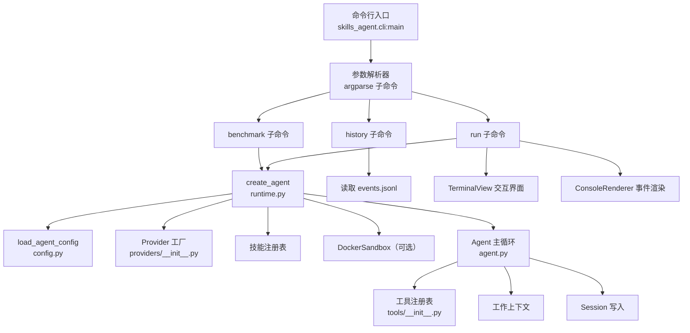
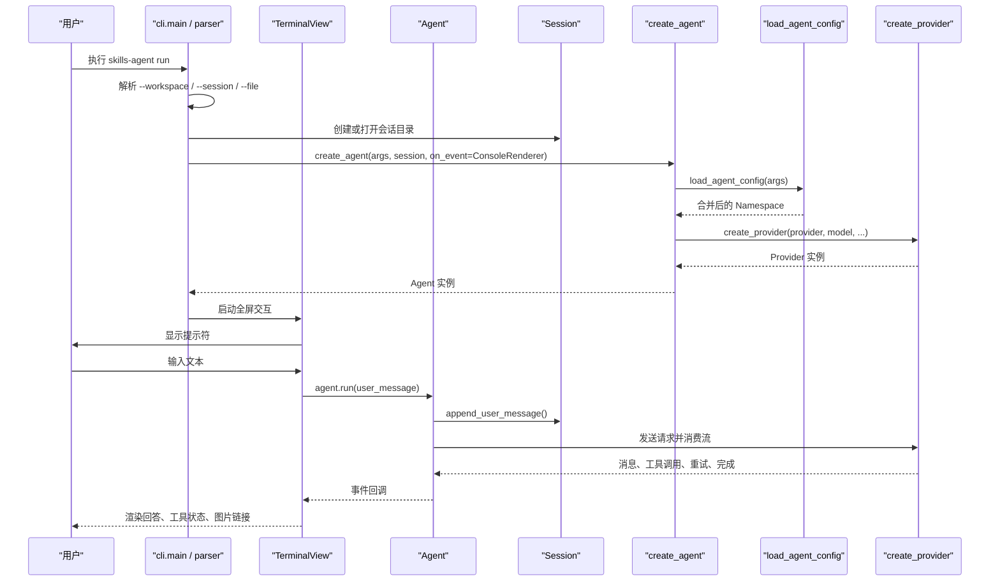
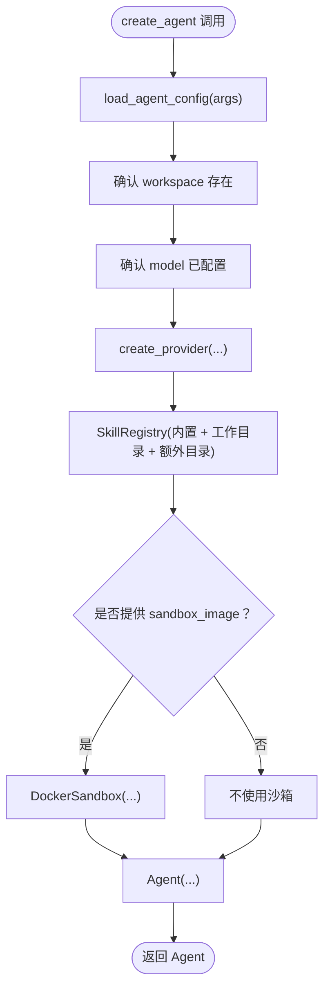
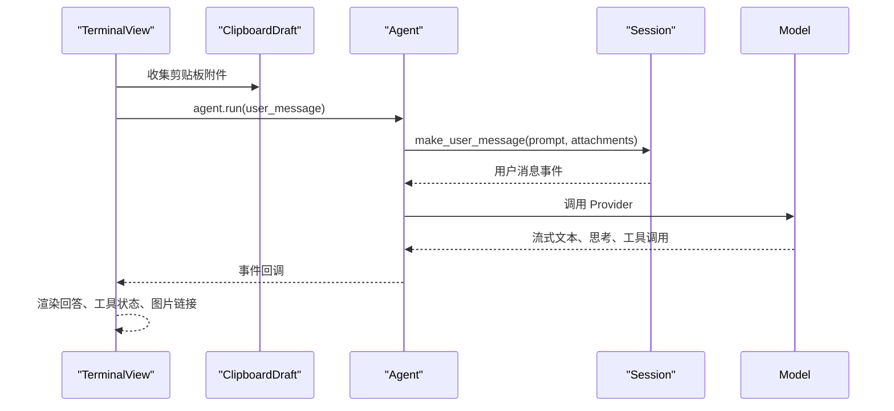
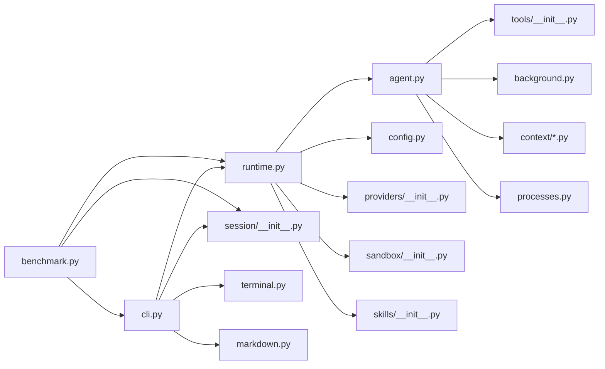

# 命令行与运行时

<cite>
**本文引用的文件**
- [pyproject.toml](file://pyproject.toml)
- [README.md](file://README.md)
- [skills-agent.toml](file://skills-agent.toml)
- [skills_agent/cli.py](file://skills_agent/cli.py)
- [skills_agent/runtime.py](file://skills_agent/runtime.py)
- [skills_agent/agent.py](file://skills_agent/agent.py)
- [skills_agent/config.py](file://skills_agent/config.py)
- [skills_agent/benchmark.py](file://skills_agent/benchmark.py)
- [skills_agent/session/__init__.py](file://skills_agent/session/__init__.py)
- [skills_agent/providers/__init__.py](file://skills_agent/providers/__init__.py)
- [skills_agent/tools/__init__.py](file://skills_agent/tools/__init__.py)
- [skills_agent/terminal.py](file://skills_agent/terminal.py)
</cite>

## 目录
1. [简介](#简介)
2. [项目结构](#项目结构)
3. [核心组件](#核心组件)
4. [架构总览](#架构总览)
5. [详细组件分析](#详细组件分析)
6. [依赖关系分析](#依赖关系分析)
7. [性能与配置要点](#性能与配置要点)
8. [故障排查指南](#故障排查指南)
9. [结论](#结论)
10. [附录：参数速查](#附录参数速查)

## 简介
本项目提供 `skills-agent` 命令行工具，支持三类工作模式：
- 交互式会话：通过 `run` 进入终端，输入自然语言、附件和 `/exit` 命令。
- 历史回放：通过 `history` 查看已保存的会话记录。
- 单次任务测评：通过 `benchmark` 从提示文件执行一次 Agent 任务并退出。

入口点由包脚本注册为 `skills-agent = skills_agent.cli:main`。运行时装配模型 Provider、Agent、会话、技能注册表、工具注册表和可选沙箱，并通过事件驱动的方式渲染输出或写入持久化会话日志。

**章节来源**
- [pyproject.toml:1-23](file://pyproject.toml#L1-L23)
- [README.md:1-68](file://README.md#L1-L68)

## 项目结构
CLI 层负责解析子命令、创建会话、加载配置、构建 Agent，并在交互模式下启动终端视图。运行时负责将命令行参数合并到 TOML 配置与环境变量中，再构造 Provider、技能注册表、沙箱和 Agent。

**图表来源**
- [pyproject.toml:1-23](file://pyproject.toml#L1-L23)
- [skills_agent/cli.py:451-798](file://skills_agent/cli.py#L451-L798)
- [skills_agent/runtime.py:1-58](file://skills_agent/runtime.py#L1-L58)
- [skills_agent/config.py:1-74](file://skills_agent/config.py#L1-L74)
- [skills_agent/providers/__init__.py:1-20](file://skills_agent/providers/__init__.py#L1-L20)
- [skills_agent/agent.py:1-120](file://skills_agent/agent.py#L1-L120)
- [skills_agent/tools/__init__.py:1-191](file://skills_agent/tools/__init__.py#L1-L191)
- [skills_agent/session/__init__.py:1-113](file://skills_agent/session/__init__.py#L1-L113)
- [skills_agent/terminal.py:1-200](file://skills_agent/terminal.py#L1-L200)

**章节来源**
- [pyproject.toml:1-23](file://pyproject.toml#L1-L23)
- [skills_agent/cli.py:451-798](file://skills_agent/cli.py#L451-L798)
- [skills_agent/runtime.py:1-58](file://skills_agent/runtime.py#L1-L58)

## 核心组件
- **CLI 入口与命令解析**：`cli.py` 中的 `parser()` 定义 `run` 与 `history` 子命令；`main()` 处理信号、查找会话目录、回放或运行 Agent；`interact()` 负责交互循环。
- **运行时装配**：`runtime.py` 中的 `add_agent_arguments()` 添加通用模型参数，`create_agent()` 加载配置、校验工作目录、创建 Provider、技能注册表、沙箱和 Agent。
- **Agent**：`agent.py` 中的 `Agent` 持有模型、会话、上下文、辅助摘要、工具注册表、后台作业监控等，是调用链的核心。
- **配置系统**：`config.py` 提供默认值、枚举选择、TOML 校验以及“命令行 > TOML > 环境变量 > 默认值”的优先级。
- **会话存储**：`session/__init__.py` 中的 `Session` 以追加式 JSONL 保存事件，并提供消息与附件组装。
- **Provider 工厂**：`providers/__init__.py` 根据 provider 名称返回 OpenAI 或 Anthropic 实现。
- **工具注册表**：`tools/__init__.py` 定义 shell、sandbox、subagent 工具及其参数约束。
- **交互式终端**：`terminal.py` 使用 prompt_toolkit 实现全屏对话、思考预览、可展开工具结果、鼠标交互和历史回放。

**章节来源**
- [skills_agent/cli.py:451-798](file://skills_agent/cli.py#L451-L798)
- [skills_agent/runtime.py:1-58](file://skills_agent/runtime.py#L1-L58)
- [skills_agent/agent.py:1-120](file://skills_agent/agent.py#L1-L120)
- [skills_agent/config.py:1-74](file://skills_agent/config.py#L1-L74)
- [skills_agent/session/__init__.py:1-113](file://skills_agent/session/__init__.py#L1-L113)
- [skills_agent/providers/__init__.py:1-20](file://skills_agent/providers/__init__.py#L1-L20)
- [skills_agent/tools/__init__.py:1-191](file://skills_agent/tools/__init__.py#L1-L191)
- [skills_agent/terminal.py:1-200](file://skills_agent/terminal.py#L1-L200)

## 架构总览
下图展示一次 `run` 命令的典型控制流：CLI 解析参数、创建会话、加载配置、构造 Agent，然后在交互式终端中发送用户消息、接收事件、渲染输出。

**图表来源**
- [skills_agent/cli.py:451-798](file://skills_agent/cli.py#L451-L798)
- [skills_agent/runtime.py:1-58](file://skills_agent/runtime.py#L1-L58)
- [skills_agent/config.py:1-74](file://skills_agent/config.py#L1-L74)
- [skills_agent/providers/__init__.py:1-20](file://skills_agent/providers/__init__.py#L1-L20)
- [skills_agent/session/__init__.py:1-113](file://skills_agent/session/__init__.py#L1-L113)
- [skills_agent/terminal.py:1-200](file://skills_agent/terminal.py#L1-L200)

## 详细组件分析

### 命令行入口与子命令
入口函数是 `skills_agent.cli:main`。它先安装 SIGTERM 处理器，让外部终止直接结束整个会话；随后调用内部 `_main()` 解析参数并执行业务逻辑。

#### 参数解析结构
`parser()` 定义：
- 必需子命令：`run`、`history`。
- 公共选项：`--workspace`、`--sessions-dir`、`--session`。
- `history` 独有选项：`--full`。
- `run` 独有选项：`--file`，以及通过 `add_agent_arguments(run)` 注入的所有模型相关参数。

| 参数 | 所属命令 | 类型 | 行为说明 |
|---|---|---|---|
| `--config PATH` | `run` | 路径 | 指定 TOML 配置文件；未显式传入时默认读取工作目录下的 `skills-agent.toml`。 |
| `--provider` | `run` | 枚举 | 仅允许 `openai` 或 `anthropic`。 |
| `--model` | `run` | 字符串 | 模型名称；也可通过 `{PROVIDER}_MODEL` 环境变量设置。 |
| `--base-url` | `run` | 字符串 | 兼容服务的 API base URL。 |
| `--skill-dir` | `run` | 多值 | 追加额外技能目录。 |
| `--context-tokens` | `run` | 正整数 | 工作上下文 token 预算，默认来自常量，示例配置中为 524000。 |
| `--max-output-tokens` | `run` | 正整数 | 单次输出额度，含思考内容。 |
| `--summary-output-tokens` | `run` | 正整数 | 辅助摘要生成上限，默认 8192。 |
| `--api-format` | `run` | 枚举 | `auto`、`responses`、`chat`。 |
| `--token-counter` | `run` | 枚举 | `auto`、`official`、`usage`。 |
| `--model-context-window` | `run` | 正整数 | 模型实际窗口大小。 |
| `--sandbox-image` | `run` | 字符串 | 启用沙箱工具时使用指定 Docker 镜像。 |
| `--workspace` | `run`、`history` | 路径 | 工作目录；默认为当前目录。 |
| `--sessions-dir` | `run`、`history` | 路径 | 会话根目录；默认 `<workspace>/.agent/sessions`。 |
| `--session` | `run`、`history` | 字符串 | 会话名，默认 `default`。 |
| `--file` | `run` | 多值路径 | 作为下一条消息的附件。 |
| `--full` | `history` | 布尔 | 回放完整公开消息、命令和工具输出。 |
| `--prompt-file` | `benchmark` | 必填路径 | 单次任务提示文件。 |
| `--log-dir` | `benchmark` | 必填路径 | 每次 benchmark 必须使用独立日志目录。 |

**章节来源**
- [skills_agent/cli.py:451-798](file://skills_agent/cli.py#L451-L798)
- [skills_agent/runtime.py:1-58](file://skills_agent/runtime.py#L1-L58)
- [skills_agent/benchmark.py:1-59](file://skills_agent/benchmark.py#L1-L59)

#### `run` 子命令
- 用途：进入会话并进行多轮交互。
- 行为差异：
  - 如果标准输入和标准输出都是终端，则启动 `TerminalView` 全屏交互界面。
  - 否则回退为普通文本模式，但仍会创建 Agent 并进入交互循环。
  - 首次启动前会回放该会话已存在的记录。
  - 支持 `--file` 附件，也支持交互模式中的 `/file PATH`。
  - 允许持久进程，因为交互会话可能保留后台服务。

#### `history` 子命令
- 用途：回放主会话记录。
- 行为差异：
  - 不创建 Agent，也不发起网络请求。
  - 默认只渲染摘要；加上 `--full` 后展开公开消息、命令、工具输出和图片链接。
  - 成功回放后直接返回。

#### `benchmark` 子命令
- 入口：`python -m skills_agent.benchmark`。
- 必填参数：`--prompt-file`、`--workspace`、`--log-dir`。
- 行为差异：
  - 读取提示文件，不能为空。
  - 要求日志目录下不存在已有 `session` 子目录，确保每次评测隔离。
  - 在独立日志目录中创建 `Session("session")`。
  - 使用 `ConsoleRenderer` 接收事件，执行 `agent.run(user_message)` 后关闭 Agent。
  - 捕获 `KeyboardInterrupt` 返回 130；其他异常返回 1。
  - 不允许跨任务保留后台服务；Agent 的系统提示词明确禁止在 benchmark 中使用持久服务。

**章节来源**
- [skills_agent/cli.py:451-798](file://skills_agent/cli.py#L451-L798)
- [skills_agent/benchmark.py:1-59](file://skills_agent/benchmark.py#L1-L59)

### 运行时装配：Agent、配置、会话、工具与 Provider
`create_agent(args, session, *, on_event=None, allow_persistent_processes=False)` 是 CLI 与 benchmark 的共同装配点。

**图表来源**
- [skills_agent/runtime.py:1-58](file://skills_agent/runtime.py#L1-L58)
- [skills_agent/config.py:1-74](file://skills_agent/config.py#L1-L74)
- [skills_agent/providers/__init__.py:1-20](file://skills_agent/providers/__init__.py#L1-L20)
- [skills_agent/agent.py:1-120](file://skills_agent/agent.py#L1-L120)

#### 配置优先级
`load_agent_config(args)` 实现如下优先级：
1. 显式命令行参数。
2. TOML 配置文件。
3. 环境变量。
4. 内置默认值。

环境变量覆盖范围包括：
- `{PROVIDER}_MODEL`、`{PROVIDER}_BASE_URL`。
- `SKILLS_AGENT_API_FORMAT`、`SKILLS_AGENT_TOKEN_COUNTER`。

TOML 文件中的相对路径会以配置文件所在目录为基准解析，因此即使从其他工作目录选择不同配置文件，`skill_dirs` 仍可正确定位。

**章节来源**
- [skills_agent/config.py:1-74](file://skills_agent/config.py#L1-L74)

#### Provider 装配
`create_provider` 仅支持 `openai` 与 `anthropic`。若传入未知 provider，会抛出错误。OpenAI Provider 还会接收 `deepseek_effort` 环境值。

**章节来源**
- [skills_agent/providers/__init__.py:1-20](file://skills_agent/providers/__init__.py#L1-L20)

#### Agent 装配
`Agent.__init__` 初始化以下关键对象：
- `model`：Provider。
- `session`：持久会话。
- `skills`：技能注册表。
- `workspace`：绝对路径的工作目录。
- `context`：`WorkingContext`，负责上下文压缩、token 预算和重试。
- `auxiliary`：用于摘要与辅助生成。
- `tools`：`ToolRegistry`，注册 shell、sandbox、subagent。
- 后台作业监控与进程作用域，用于恢复和清理。

**章节来源**
- [skills_agent/agent.py:1-120](file://skills_agent/agent.py#L1-L120)

### 交互式终端行为
交互入口 `interact(agent, files)` 判断标准输入和输出是否均为终端：
- 是：导入 `TerminalView`，先回放已有会话事件，再启动实时渲染器。
- 否：回退到普通文本交互。

#### 一轮对话流程

**图表来源**
- [skills_agent/cli.py:451-798](file://skills_agent/cli.py#L451-L798)
- [skills_agent/session/__init__.py:1-113](file://skills_agent/session/__init__.py#L1-L113)
- [skills_agent/terminal.py:1-200](file://skills_agent/terminal.py#L1-L200)

#### 用户指令与快捷键
| 操作 | 行为 |
|---|---|
| 输入文本并按回车 | 发送一轮对话，包含文本与之前累积的附件。 |
| `/exit` | 立即退出交互。 |
| Ctrl-D | 触发 EOFError，返回 0，正常退出。 |
| Ctrl-C | 中断当前任务；CLI 捕获后打印空行并继续等待下一轮。 |
| `/file PATH` | 将路径加入待发送附件列表。 |
| 粘贴剪贴板内容 | 由 `ClipboardDraft` 转换为临时文件并随消息发送。 |

#### 全屏历史回放
当标准输入和标准输出均为终端时：
1. 先创建 `ConsoleRenderer(view, live=False)`。
2. 遍历 `agent.session.events()` 回放全部历史。
3. 创建新的 `ConsoleRenderer(view)` 开始实时交互。
4. 将 `agent.on_event` 绑定到 `view.post_event(renderer, event)`。

回放阶段不会改变已存储的事件；实时阶段也不会修改记录，而是增量渲染。

**章节来源**
- [skills_agent/cli.py:451-798](file://skills_agent/cli.py#L451-L798)
- [skills_agent/terminal.py:1-200](file://skills_agent/terminal.py#L1-L200)

### 事件渲染与工具状态
`ConsoleRenderer` 负责两类渲染：
- 流式文本与思考内容。
- 工具调用摘要、工具结果、后台任务状态、重试和错误。

它维护：
- 正在进行的工具调用。
- 工具 ID 到 UI key 的映射。
- 后台任务去重键。
- 活动状态，例如上下文压缩、subagent 执行、shell 执行。

当后端输出不完整但发生中断或错误时，渲染器会统计已收到的正文和思考字符，并提示“回答未完成”。

**章节来源**
- [skills_agent/cli.py:201-450](file://skills_agent/cli.py#L201-L450)
- [skills_agent/cli.py:451-777](file://skills_agent/cli.py#L451-L777)

## 依赖关系分析

**图表来源**
- [skills_agent/cli.py:1-200](file://skills_agent/cli.py#L1-L200)
- [skills_agent/runtime.py:1-58](file://skills_agent/runtime.py#L1-L58)
- [skills_agent/agent.py:1-120](file://skills_agent/agent.py#L1-L120)
- [skills_agent/benchmark.py:1-59](file://skills_agent/benchmark.py#L1-L59)

**章节来源**
- [skills_agent/cli.py:1-200](file://skills_agent/cli.py#L1-L200)
- [skills_agent/runtime.py:1-58](file://skills_agent/runtime.py#L1-L58)
- [skills_agent/agent.py:1-120](file://skills_agent/agent.py#L1-L120)
- [skills_agent/benchmark.py:1-59](file://skills_agent/benchmark.py#L1-L59)

## 性能与配置要点
- **上下文 token 预算**：`--context-tokens` 控制工作上下文压缩阈值；默认值来自上下文模块常量，示例 TOML 设置为 524000。
- **模型窗口限制**：`--model-context-window` 必须与实际模型能力匹配，发送输入加输出额度不能超过窗口。
- **输出额度**：`--max-output-tokens` 控制单次响应长度；示例 TOML 设置为 131072。
- **摘要输出**：`--summary-output-tokens` 控制辅助摘要生成上限，默认 8192。
- **API 格式**：`--api-format auto` 适合大多数场景；需要兼容旧接口时可设为 `responses` 或 `chat`。
- **Token 计数方式**：`--token-counter auto` 优先使用官方计数；必要时切换到 `official` 或 `usage`。
- **沙箱隔离**：仅在提供 `--sandbox-image` 时启用 `DockerSandbox`，并把可用技能根目录挂载为只读。
- **技能目录**：默认包含内置技能、`<workspace>/skills` 和通过 `--skill-dir` 追加的路径。

**章节来源**
- [skills_agent/runtime.py:1-58](file://skills_agent/runtime.py#L1-L58)
- [skills_agent/config.py:1-74](file://skills_agent/config.py#L1-L74)
- [skills-agent.toml:1-18](file://skills-agent.toml#L1-L18)
- [skills_agent/tools/__init__.py:1-191](file://skills_agent/tools/__init__.py#L1-L191)

## 故障排查指南

### 常见参数组合与预期行为
| 场景 | 推荐参数组合 | 说明 |
|---|---|---|
| 最小交互式会话 | `skills-agent run --session demo` | 使用当前工作目录、默认会话名；需配置 OPENAI_API_KEY 与 OPENAI_MODEL。 |
| 指定工作目录和附件 | `skills-agent run --session task --workspace /path/to/task --file ./input.txt` | 附件路径相对于工作目录解析。 |
| 回放历史 | `skills-agent history --session demo` | 不发起网络请求。 |
| 展开完整历史 | `skills-agent history --session demo --full` | 展开公开消息、命令和工具输出。 |
| 使用 Anthropic | `skills-agent run --provider anthropic --session demo` | 同时设置 ANTHROPIC_API_KEY 与 ANTHROPIC_MODEL。 |
| 指定自定义配置 | `skills-agent run --config /path/to/custom.toml` | 覆盖工作目录中的默认 TOML。 |
| 单次评测 | `python -m skills_agent.benchmark --prompt-file prompt.txt --workspace /task --log-dir /logs/run-1` | 日志目录必须干净。 |

**章节来源**
- [README.md:1-68](file://README.md#L1-L68)
- [skills_agent/cli.py:451-798](file://skills_agent/cli.py#L451-L798)
- [skills_agent/benchmark.py:1-59](file://skills_agent/benchmark.py#L1-L59)

### 典型错误与处理建议
| 错误现象 | 可能原因 | 处理建议 |
|---|---|---|
| “工作目录不存在” | `--workspace` 指向非目录。 | 检查路径是否存在且可读。 |
| “需要配置 model” | 未传 `--model`，也未设置对应 Provider 的 MODEL 环境变量。 | 设置 `OPENAI_MODEL` 或 `ANTHROPIC_MODEL`，或传入 `--model`。 |
| “Unknown provider” | `--provider` 值不是 `openai` 或 `anthropic`。 | 修正 provider 名称。 |
| “Unknown agent config option” | TOML 中存在未识别字段。 | 移除或修正配置项。 |
| “... must be a positive integer” | token 相关配置不是正整数。 | 改为正整数。 |
| “Attachment is not a file” | `--file` 或 `/file PATH` 指向不存在文件。 | 确认路径真实存在。 |
| “A request can contain at most N images” | 一次性图片附件超过上限。 | 减少图片数量或使用 PDF/文本附件。 |
| “日志目录已包含 session” | benchmark 日志目录重复使用。 | 更换独立日志目录。 |
| Ctrl-C 后仍残留进程 | 前台命令未正确退出。 | 检查脚本是否使用后台模式或正确清理进程组。 |
| 历史回放找不到会话 | `--sessions-dir` 或 `--session` 不正确。 | 检查会话根目录与会话名。 |

**章节来源**
- [skills_agent/cli.py:451-798](file://skills_agent/cli.py#L451-L798)
- [skills_agent/config.py:1-74](file://skills_agent/config.py#L1-L74)
- [skills_agent/session/__init__.py:1-113](file://skills_agent/session/__init__.py#L1-L113)
- [skills_agent/benchmark.py:1-59](file://skills_agent/benchmark.py#L1-L59)

### 中断与恢复机制
- `main()` 安装 SIGTERM 处理器，使外部终止直接退出整个 CLI，返回码为 `128 + signum`。
- 交互循环捕获 `KeyboardInterrupt`，打印空行并继续等待下一轮输入。
- `agent.run` 内部会记录每轮错误；即使某轮失败，交互循环仍可继续。
- 会话以追加式 JSONL 保存事件，再次使用同一会话名可恢复历史记录。
- Agent 启动时会扫描会话目录下的 `process-scopes`，恢复已知后台进程作用域，从而支持中断后继续观察后台任务。

**章节来源**
- [skills_agent/cli.py:451-798](file://skills_agent/cli.py#L451-L798)
- [skills_agent/agent.py:1-120](file://skills_agent/agent.py#L1-L120)
- [skills_agent/session/__init__.py:1-113](file://skills_agent/session/__init__.py#L1-L113)

## 结论
`skills-agent` 通过清晰的三层职责组织命令行、运行时和 Agent：
- CLI 负责用户入口、子命令、交互界面和事件渲染。
- 运行时负责把命令行、TOML、环境变量和默认值合并成稳定配置，并装配 Provider、技能、沙箱与 Agent。
- Agent 负责上下文管理、工具执行、后台作业、子任务委派以及与模型的交互。

对于日常使用，最小命令是 `skills-agent run --session demo`；对于自动化评测，应使用 `python -m skills_agent.benchmark` 并确保每个任务拥有独立日志目录。调试时应优先检查工作目录、会话路径、Provider 模型名称、token 预算与模型窗口是否匹配。

[本节不直接分析具体代码文件]

## 附录：参数速查

### 通用模型参数
| 参数 | 含义 | 默认行为 |
|---|---|---|
| `--config PATH` | 指定 TOML 配置文件 | 未显式传入时使用 `<workspace>/skills-agent.toml`。 |
| `--provider` | 模型提供方 | 默认 `openai`，TOML 或环境变量可覆盖。 |
| `--model` | 模型名称 | 必须通过 CLI、TOML、环境变量或 Provider 环境变量提供。 |
| `--base-url` | 兼容服务 API base URL | 可由 `{PROVIDER}_BASE_URL` 覆盖。 |
| `--api-format` | API 协议格式 | 默认 `auto`。 |
| `--token-counter` | token 计数策略 | 默认 `auto`。 |
| `--context-tokens` | 上下文 token 预算 | 默认来自上下文常量，示例 TOML 为 524000。 |
| `--max-output-tokens` | 单次输出额度 | 默认来自 Provider 常量，示例 TOML 为 131072。 |
| `--summary-output-tokens` | 辅助摘要输出上限 | 默认 8192。 |
| `--model-context-window` | 模型实际窗口 | 需与实际模型一致。 |
| `--sandbox-image` | 沙箱 Docker 镜像 | 未提供时不启用沙箱。 |

### 会话与工作区参数
| 参数 | 含义 |
|---|---|
| `--workspace` | 工作目录，默认当前目录。 |
| `--sessions-dir` | 会话根目录，默认 `<workspace>/.agent/sessions`。 |
| `--session` | 会话名，默认 `default`。 |
| `--file` | 作为下一条消息的附件。 |

### 子命令差异
| 子命令 | 必填参数 | 特殊行为 |
|---|---|---|
| `run` | 无 | 进入交互会话；支持附件、历史回放、Ctrl-C 中断恢复。 |
| `history` | 无 | 只读回放；`--full` 展开完整公开内容。 |
| `benchmark` | `--prompt-file`、`--workspace`、`--log-dir` | 单次任务，日志目录必须干净，不允许持久后台服务。 |

**章节来源**
- [skills_agent/cli.py:451-798](file://skills_agent/cli.py#L451-L798)
- [skills_agent/runtime.py:1-58](file://skills_agent/runtime.py#L1-L58)
- [skills_agent/config.py:1-74](file://skills_agent/config.py#L1-L74)
- [skills_agent/benchmark.py:1-59](file://skills_agent/benchmark.py#L1-L59)
- [skills-agent.toml:1-18](file://skills-agent.toml#L1-L18)