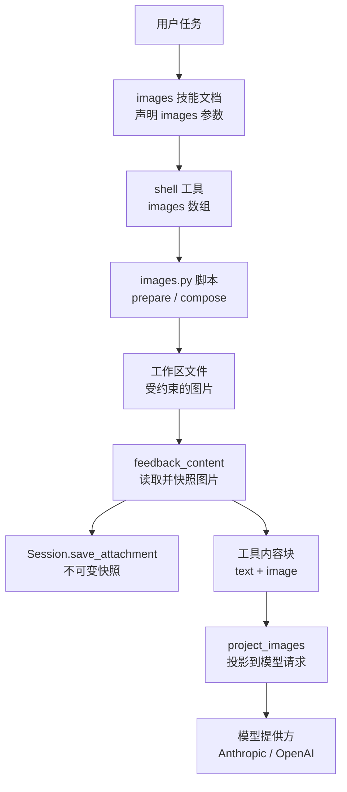
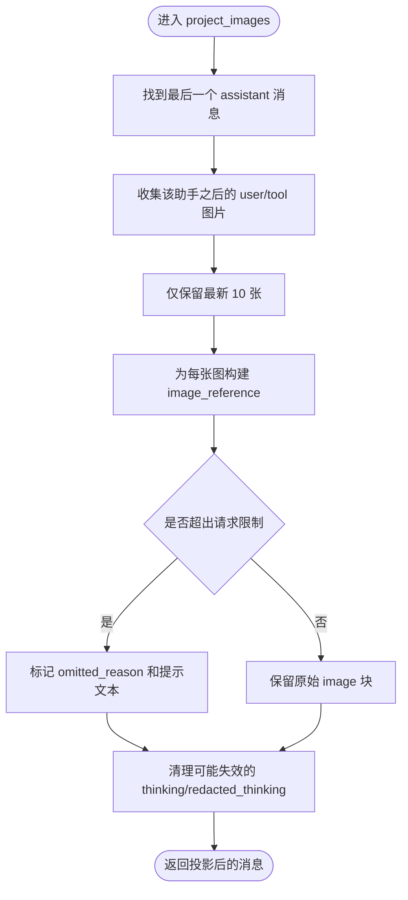
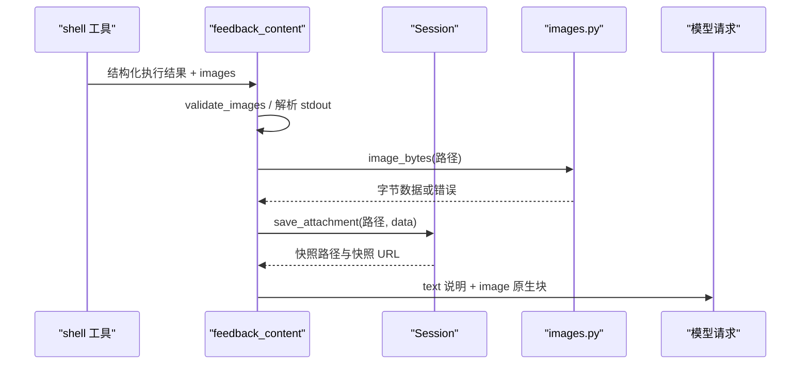
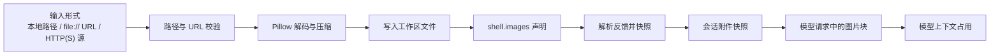
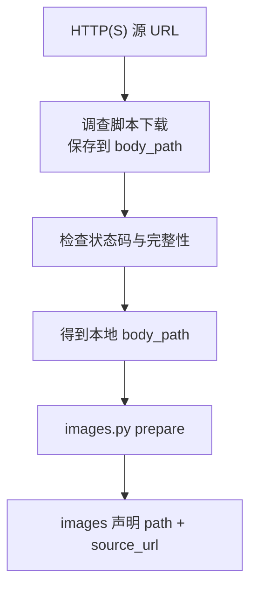
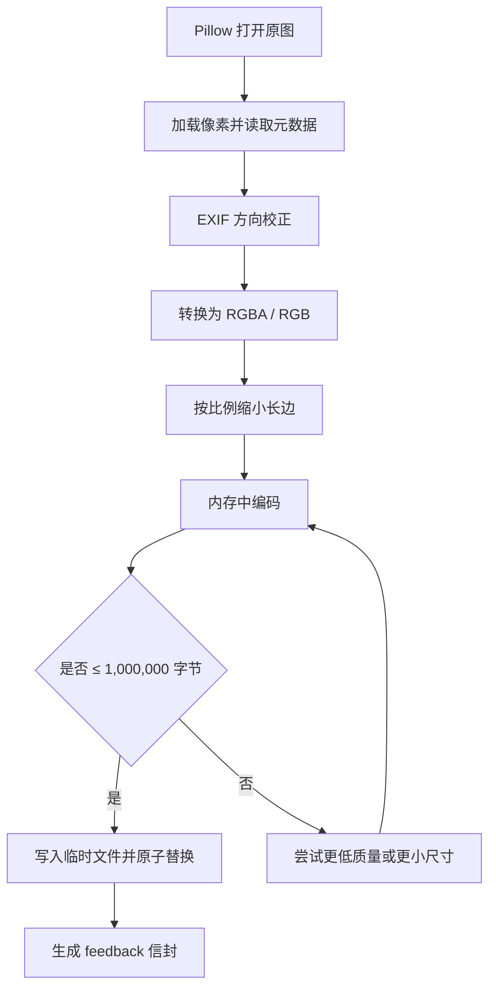
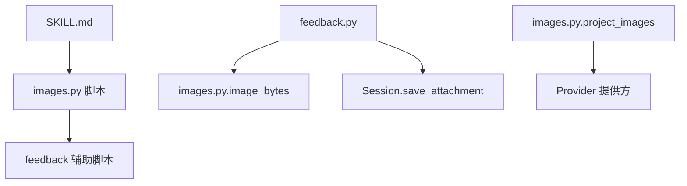

# 图片与附件处理

<cite>
**本文引用的文件**   
- [skills_agent/images.py](file://skills_agent/images.py)
- [skills_agent/feedback.py](file://skills_agent/feedback.py)
- [skills_agent/builtin_skills/images/SKILL.md](file://skills_agent/builtin_skills/images/SKILL.md)
- [skills_agent/builtin_skills/images/scripts/images.py](file://skills_agent/builtin_skills/images/scripts/images.py)
- [docs/prompt-history/auxiliary-attachments.md](file://docs/prompt-history/auxiliary-attachments.md)
- [docs/prompt-history/feedback-image-label.md](file://docs/prompt-history/feedback-image-label.md)
- [tests/test_request_images.py](file://tests/test_request_images.py)
- [tests/test_declared_images.py](file://tests/test_declared_images.py)
- [tests/test_tool_image_links.py](file://tests/test_tool_image_links.py)
</cite>

## 目录
1. [简介](#简介)
2. [项目结构](#项目结构)
3. [核心组件](#核心组件)
4. [架构总览](#架构总览)
5. [详细组件分析](#详细组件分析)
6. [依赖关系分析](#依赖关系分析)
7. [性能考虑](#性能考虑)
8. [故障排查指南](#故障排查指南)
9. [结论](#结论)
10. [附录：使用示例](#附录使用示例)

## 简介
本文件说明 Agent 如何接收、验证、压缩、缓存和发送图片，以及图片在消息、工具结果、反馈脚本与工作区之间的流转方式。重点包括：

- 本地路径、`file://` URL、HTTP(S) 源地址的输入形式。
- 通过 Pillow 进行解码、方向校正、尺寸缩放和编码压缩。
- 单次模型请求最多 10 张图片、每张图片不超过 1,000,000 字节（1 MB）的限制。
- 图片在消息中的文本占位、原始链接、快照链接和来源链接。
- 工作区文件、会话附件快照、工具输出及模型上下文的关联。
- 上传截图、附加 `input.txt`、在工具调用中包含图片链接的正确用法。
- 安全性：限制大小、拒绝危险路径或 URL、避免日志泄露敏感图片。
- 常见错误：无法加载、网络超时、格式不支持、超出大小限制的处理方法。

## 项目结构
图片相关代码分布在三个层次：

| 层次 | 文件 | 职责 |
|---|---|---|
| 运行时入口 | [skills_agent/builtin_skills/images/SKILL.md](file://skills_agent/builtin_skills/images/SKILL.md) | 定义向 shell 工具声明图片的规则、上限和最佳实践 |
| 图片准备脚本 | [skills_agent/builtin_skills/images/scripts/images.py](file://skills_agent/builtin_skills/images/scripts/images.py) | 使用 Pillow 准备、压缩、拼接图片，生成受控大小的工作区文件 |
| 运行时投影与反馈 | [skills_agent/images.py](file://skills_agent/images.py)、[skills_agent/feedback.py](file://skills_agent/feedback.py) | 将本地快照投影为模型请求中的图片引用，并把工具执行结果转换为原生图片 |



**图表来源**
- [skills_agent/builtin_skills/images/SKILL.md:1-124](file://skills_agent/builtin_skills/images/SKILL.md#L1-L124)
- [skills_agent/builtin_skills/images/scripts/images.py:1-266](file://skills_agent/builtin_skills/images/scripts/images.py#L1-L266)
- [skills_agent/feedback.py:1-173](file://skills_agent/feedback.py#L1-L173)
- [skills_agent/images.py:1-109](file://skills_agent/images.py#L1-L109)

**章节来源**
- [skills_agent/builtin_skills/images/SKILL.md:1-124](file://skills_agent/builtin_skills/images/SKILL.md#L1-L124)

## 核心组件

### 图片常量与请求限制
- 每次模型请求最多包含 **10 张图片**。
- 每张图片在 base64 编码前不得超过 **1,000,000 字节**。
- 这些限制同时适用于用户附件、工具结果和反馈图片。

**章节来源**
- [skills_agent/images.py:9-11](file://skills_agent/images.py#L9-L11)
- [skills_agent/builtin_skills/images/SKILL.md:1-124](file://skills_agent/builtin_skills/images/SKILL.md#L1-L124)

### 图片投影模块
`image_bytes`、`image_reference`、`project_images` 共同负责把消息中的图片块转换成稳定的文本引用，并在必要时保留原始图片数据。

- `image_bytes`：从本地快照路径读取图片，超过 1 MB 直接拒绝。
- `image_reference`：根据 `path` 或 `url` 生成稳定 URL；如果存在 `source_url`，会记录原始来源。
- `project_images`：以最近一次 assistant 消息为边界，只保留最新的 10 张用户或工具图片，其余图片保留文本引用但标记为未附加。



**图表来源**
- [skills_agent/images.py:38-109](file://skills_agent/images.py#L38-L109)

**章节来源**
- [skills_agent/images.py:1-109](file://skills_agent/images.py#L1-L109)
- [tests/test_request_images.py:1-217](file://tests/test_request_images.py#L1-L217)

### 反馈与附件模块
`feedback_content` 负责解析 shell 工具的执行结果，并将声明的图片或遗留的标准输出反馈转为原生图片块。

关键流程：

1. 优先使用显式 `images` 声明。
2. 若没有显式声明，则尝试解析 stdout 中的遗留反馈信封。
3. 对每个图片附件校验路径、标签、源 URL。
4. 读取图片并识别 MIME 类型。
5. 调用 `session.save_attachment` 保存不可变快照。
6. 生成文本说明块和原生图片块。



**图表来源**
- [skills_agent/feedback.py:58-173](file://skills_agent/feedback.py#L58-L173)
- [skills_agent/images.py:14-26](file://skills_agent/images.py#L14-L26)

**章节来源**
- [skills_agent/feedback.py:1-173](file://skills_agent/feedback.py#L1-L173)
- [tests/test_declared_images.py:1-394](file://tests/test_declared_images.py#L1-L394)

## 架构总览
整体数据流如下：



**图表来源**
- [skills_agent/builtin_skills/images/scripts/images.py:1-266](file://skills_agent/builtin_skills/images/scripts/images.py#L1-L266)
- [skills_agent/feedback.py:1-173](file://skills_agent/feedback.py#L1-L173)
- [skills_agent/images.py:1-109](file://skills_agent/images.py#L1-L109)

## 详细组件分析

### 图片获取与下载策略
当前实现中，图片最终来源于**主机上的绝对路径或 `file://` URL**。对于 HTTP(S) 图片，推荐流程是：

1. 先通过调查辅助脚本下载并保存响应体。
2. 确认下载成功且响应体完整。
3. 使用实际 `body_path` 作为图片路径。
4. 将原始 HTTP(S) URL 放入 `source_url`。

这意味着：

- 图片不是直接从任意网络 URL 下载到模型请求。
- 网络访问风险由下载步骤控制。
- `source_url` 用于追溯来源，不替代发送时的本地快照。



**图表来源**
- [skills_agent/builtin_skills/images/SKILL.md:1-124](file://skills_agent/builtin_skills/images/SKILL.md#L1-L124)

**章节来源**
- [skills_agent/builtin_skills/images/SKILL.md:1-124](file://skills_agent/builtin_skills/images/SKILL.md#L1-L124)

### Pillow 解码、尺寸检查和大小限制
`images.py` 脚本承担主要图像处理职责：

- 使用 Pillow 打开图片。
- 应用 EXIF 方向校正。
- 转换为 RGBA 或 RGB。
- 按目标格式尝试多级质量或尺寸降级。
- 只在内存中编码，直到满足 1 MB 限制才写入临时文件。
- 最终通过原子替换写入目标文件。

支持的输出扩展名包括 `.jpg`、`.jpeg`、`.png`、`.webp`。JPEG/WebP 会尝试多个质量等级；PNG 使用优化模式；WebP 使用指定方法。



**图表来源**
- [skills_agent/builtin_skills/images/scripts/images.py:61-149](file://skills_agent/builtin_skills/images/scripts/images.py#L61-L149)
- [skills_agent/builtin_skills/images/scripts/images.py:151-188](file://skills_agent/builtin_skills/images/scripts/images.py#L151-L188)

**章节来源**
- [skills_agent/builtin_skills/images/scripts/images.py:1-266](file://skills_agent/builtin_skills/images/scripts/images.py#L1-L266)
- [tests/test_images_skill.py:1-200](file://tests/test_images_skill.py#L1-L200)

### 消息中的图片表示、链接生成与缓存
图片在模型请求中通常以两种形式出现：

1. **文本引用块**：包含可读描述、图片 URL 和可选来源 URL。
2. **原生图片块**：包含快照路径、快照 URL、MIME 类型和来源信息。

链接含义：

| 字段 | 含义 |
|---|---|
| `path` | 主机上的本地快照路径 |
| `url` | 可被提供方读取的稳定快照 URL，通常是 `file://` 快照地址 |
| `source_url` | 原始图片来源，可以是 `file://` 或 HTTP(S) URL |
| `snapshot` | 反馈文本中生成的会话快照路径 |
| `omitted_reason` | 因请求限制而未附加的原因 |

缓存策略：

- `session.save_attachment` 会把图片保存到会话附件目录。
- 快照 URL 是不可变的，即使原工作区文件被删除，仍可用于后续重新附图。
- 投影阶段不会重复读取原始文件，而是复用已有引用。

**章节来源**
- [skills_agent/images.py:28-37](file://skills_agent/images.py#L28-L37)
- [skills_agent/feedback.py:118-173](file://skills_agent/feedback.py#L118-L173)
- [docs/prompt-history/feedback-image-label.md:1-37](file://docs/prompt-history/feedback-image-label.md#L1-L37)

### 图片请求与反馈脚本、工具输出、工作区文件的关联
| 组件 | 角色 | 与图片的关系 |
|---|---|---|
| shell 工具 | 执行命令并声明图片 | `images` 数组决定哪些工作区文件会被附加 |
| images.py | 准备或拼接图片 | 生成受 1 MB 限制的工作区文件 |
| feedback.py | 解析工具结果 | 把声明或遗留反馈转换为原生图片 |
| Session | 保存附件 | 生成不可变快照和快照 URL |
| project_images | 投影历史 | 控制哪些图片进入下一个模型请求 |

**章节来源**
- [skills_agent/feedback.py:58-173](file://skills_agent/feedback.py#L58-L173)
- [skills_agent/images.py:38-109](file://skills_agent/images.py#L38-L109)
- [tests/test_declared_images.py:1-394](file://tests/test_declared_images.py#L1-L394)

### 工具输出中的图片链接展示
终端视图会为工具结果中的图片生成可点击链接，指向原始源路径或快照路径。纯文本历史中会列出图片链接，但不读取图片内容。用户与助手消息中的图片不会被当作工具图片链接处理。

**章节来源**
- [tests/test_tool_image_links.py:1-200](file://tests/test_tool_image_links.py#L1-L200)

## 依赖关系分析



**图表来源**
- [skills_agent/builtin_skills/images/SKILL.md:1-124](file://skills_agent/builtin_skills/images/SKILL.md#L1-L124)
- [skills_agent/builtin_skills/images/scripts/images.py:1-40](file://skills_agent/builtin_skills/images/scripts/images.py#L1-L40)
- [skills_agent/feedback.py:1-20](file://skills_agent/feedback.py#L1-L20)
- [skills_agent/images.py:1-15](file://skills_agent/images.py#L1-L15)

**章节来源**
- [skills_agent/builtin_skills/images/scripts/images.py:1-40](file://skills_agent/builtin_skills/images/scripts/images.py#L1-L40)
- [skills_agent/feedback.py:1-20](file://skills_agent/feedback.py#L1-L20)

## 性能考虑

- **内存编码优先**：`bounded_encoding` 先在内存中尝试多种质量和尺寸组合，只有成功后才写盘，避免写出超大临时文件。
- **限制迭代次数**：最长边最多尝试约 13 个尺寸，逐步缩小到 128 像素长边。
- **避免重复读取**：投影阶段不调用文件读取，只复制和转换消息结构。
- **限制图片数量**：每个请求最多 10 张图，超出部分转为文本引用，减少模型上下文压力。
- **限制单图大小**：1 MB 硬上限防止 base64 膨胀后占用过多上下文。
- **压缩策略**：照片优先 JPEG/WebP，图表或文字优先 PNG；必要时降低分辨率而非无限降低质量。

[本节为通用性能建议，不直接分析具体代码行]

## 故障排查指南

| 现象 | 可能原因 | 排查方法 | 处理方式 |
|---|---|---|---|
| 图片无法加载 | 路径不存在、不是普通文件、包含 NUL 字符 | 检查 `path` 是否为绝对路径或合法 `file://` URL | 使用真实主机路径或已下载的本地副本 |
| 图片超出 1 MB | 原图过大或未压缩 | 查看文件大小和 MIME 头部 | 使用 `prepare` 生成压缩副本，再声明新输出路径 |
| Pillow 缺失 | 运行环境缺少 Pillow | 检查 Python 环境和依赖 | 使用项目安装的环境或安装 Pillow |
| 格式不支持 | 头部不是 PNG/JPEG/GIF/WebP | 检查文件头或扩展名 | 导出为支持格式后再处理 |
| 图片数量超过 10 张 | 同一请求附带太多图片 | 统计所有工具结果和用户附件 | 使用 `compose` 拼接成少数大图 |
| 网络请求失败或超时 | 下载脚本失败、URL 无效、网络不稳定 | 检查调查脚本的状态和响应完整性 | 先修复下载，再传入 `body_path` 和 `source_url` |
| 日志中出现敏感图片 | 把图片二进制或 base64 打印到标准输出 | 检查脚本是否直接输出图片内容 | 只输出路径、尺寸、字节数和状态 |
| 历史中显示“未附加” | 超过 10 张限制 | 查看 `omitted_reason` 和提示文本 | 合并图片或删除不再需要的旧图 |
| 工作区文件被覆盖 | 输出路径与源路径相同或指向同一文件 | 检查 `--output` 与源文件关系 | 让输出路径独立于源文件 |
| 链接不可点击 | 终端渲染位置变化或包裹换行 | 查看终端视图中图片标签行 | 点击标签下划线区域；不要依赖固定列号 |

**章节来源**
- [skills_agent/images.py:14-26](file://skills_agent/images.py#L14-L26)
- [skills_agent/feedback.py:12-57](file://skills_agent/feedback.py#L12-L57)
- [skills_agent/builtin_skills/images/scripts/images.py:42-188](file://skills_agent/builtin_skills/images/scripts/images.py#L42-L188)
- [tests/test_request_images.py:1-217](file://tests/test_request_images.py#L1-L217)
- [tests/test_declared_images.py:1-394](file://tests/test_declared_images.py#L1-L394)
- [tests/test_tool_image_links.py:1-200](file://tests/test_tool_image_links.py#L1-L200)

## 结论
该系统的图片处理围绕“本地快照 + 不可变会话快照 + 原始来源 URL”设计：

- 所有图片最终通过本地路径或 `file://` URL 进入运行时。
- HTTP(S) 图片应先下载为本地文件，再通过 `source_url` 保留来源。
- Pillow 负责解码、方向和尺寸处理，并通过多级压缩确保单图不超过 1 MB。
- 每次模型请求最多容纳 10 张图片；多余图片以文本引用保留。
- 工作区文件只是中间产物，真正可长期回查的是会话附件快照及其 URL。
- 安全性和可控性体现在路径白名单、URL 方案限制、文件大小限制和不直接上传到公网。

[本节为总结性内容，不直接分析具体代码行]

## 附录：使用示例

### 上传截图
1. 使用系统截图工具保存截图。
2. 将截图保存在工作区或已知绝对路径。
3. 在 shell 工具中使用 `images` 声明截图路径。
4. 如果需要原始来源，可将 `source_url` 设为截图文件名对应的 `file://` URL。

示例要点：

- `path` 必须是绝对主机路径或 `file://` URL。
- 截图应小于等于 1 MB；否则先用 `prepare` 生成压缩副本。
- 不要只打印截图路径，必须声明 `images`。

**章节来源**
- [skills_agent/builtin_skills/images/SKILL.md:1-124](file://skills_agent/builtin_skills/images/SKILL.md#L1-L124)

### 附加 input.txt
图片技能只接受图片，不接受 PDF 或任意文件附件。附加文本文件应使用专门的文本读取或文件操作工具，而不是 `images`。

推荐做法：

- 使用文本反馈或文件读取工具读取 `input.txt`。
- 将文本内容作为普通工具输出。
- 仅在确实需要视觉证据时才使用 `images`。

**章节来源**
- [skills_agent/builtin_skills/images/SKILL.md:1-124](file://skills_agent/builtin_skills/images/SKILL.md#L1-L124)

### 在工具调用中包含图片链接
正确做法是使用 shell 工具的 `images` 参数：

```json
{
  "name": "检查页面",
  "command": "python3 -u /absolute/workspace/draw.py",
  "run_in_background": false,
  "images": [
    {
      "path": "/absolute/workspace/output.png",
      "label": "绘制结果",
      "source_url": "https://example.test/original.png"
    }
  ]
}
```

注意事项：

- 如果图片来自 HTTP(S)，先下载，再传入 `body_path` 和原始 `source_url`。
- 如果图片超过 1 MB，先运行 `prepare`，然后声明压缩后的输出路径。
- 如果只需要执行命令而不发送图片，使用 `images: []`。
- 工具结果显示时，终端会显示原始源路径或快照路径的可点击链接。

**章节来源**
- [skills_agent/builtin_skills/images/SKILL.md:1-124](file://skills_agent/builtin_skills/images/SKILL.md#L1-L124)
- [tests/test_tool_image_links.py:1-200](file://tests/test_tool_image_links.py#L1-L200)

### 安全与隐私建议
- 始终限制图片大小为 1 MB。
- 拒绝非 `file`、`http`、`https` 的 URL 方案。
- 对 `file://` URL 要求本地绝对路径，不允许查询参数或片段。
- 不在日志中输出图片二进制、base64 或敏感截图内容。
- 使用会话快照 URL 代替公开可访问的网络地址。
- 对 `source_url` 只做溯源用途，不将其视为可信可下载资源。

**章节来源**
- [skills_agent/images.py:28-37](file://skills_agent/images.py#L28-L37)
- [skills_agent/feedback.py:12-57](file://skills_agent/feedback.py#L12-L57)
- [skills_agent/builtin_skills/images/scripts/images.py:20-40](file://skills_agent/builtin_skills/images/scripts/images.py#L20-L40)