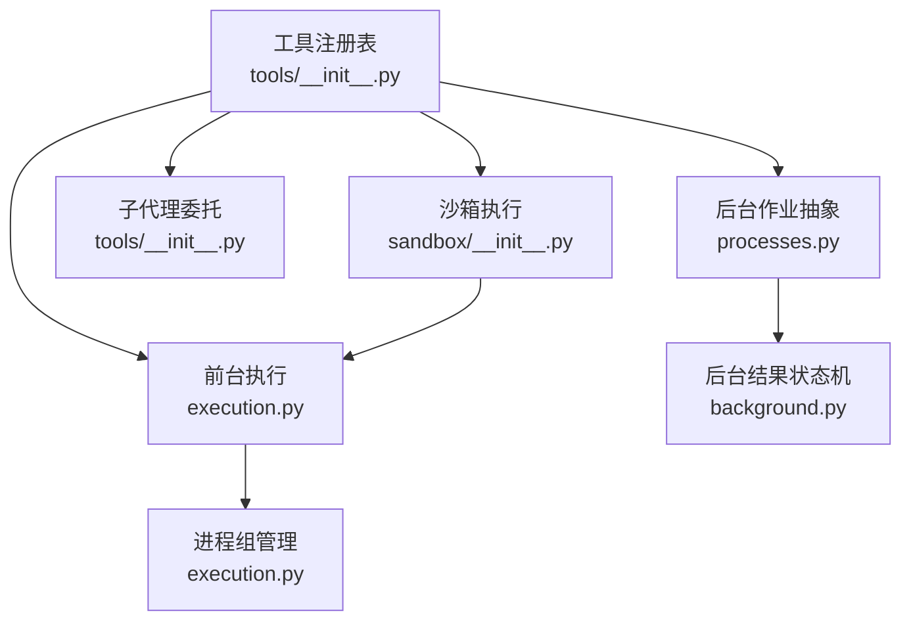
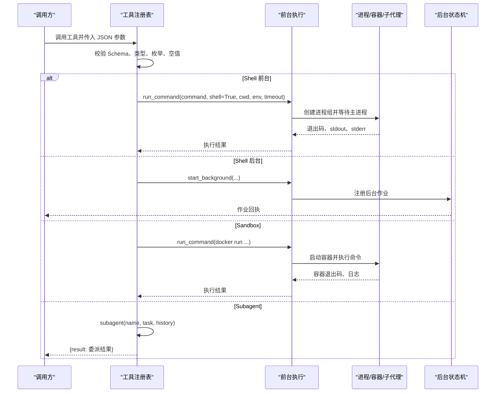
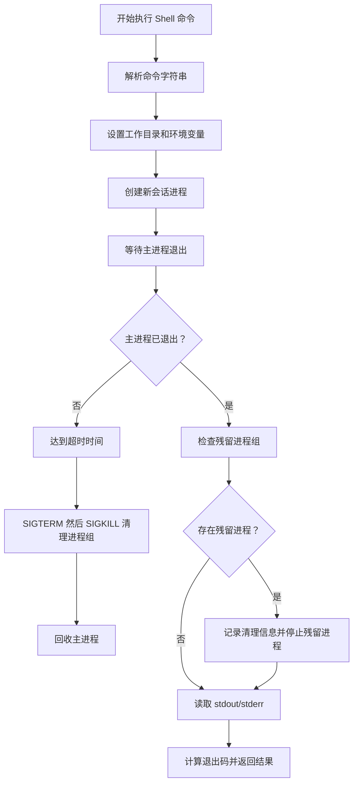
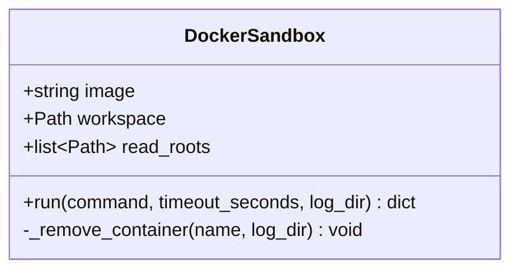
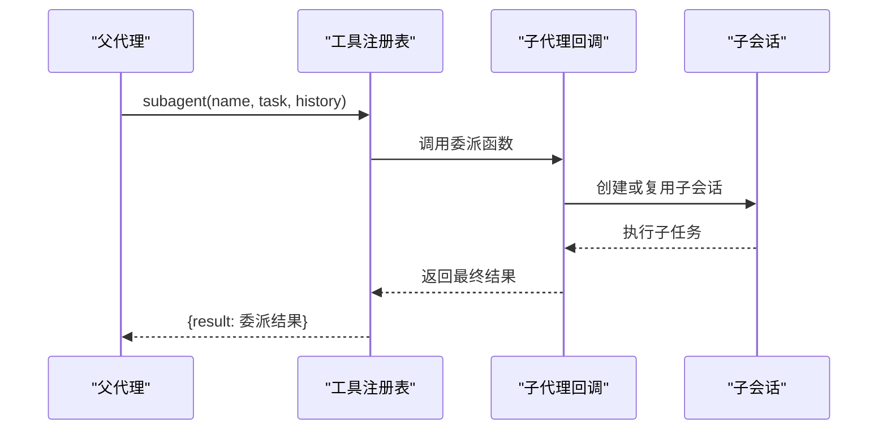
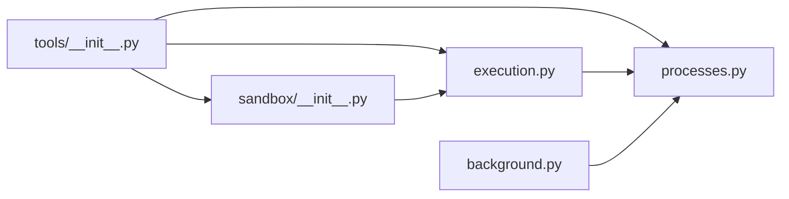

# Shell / Sandbox / Subagent 执行模式

<cite>
**本文引用的文件**   
- [processes.py](file://skills_agent/processes.py)
- [execution.py](file://skills_agent/execution.py)
- [background.py](file://skills_agent/background.py)
- [tools/__init__.py](file://skills_agent/tools/__init__.py)
- [sandbox/__init__.py](file://skills_agent/sandbox/__init__.py)
- [usage.md](file://docs/usage.md)
- [tool-subagent.md](file://docs/prompt-history/tool-subagent.md)
</cite>

## 目录
1. [引言](#引言)
2. [项目结构](#项目结构)
3. [核心组件](#核心组件)
4. [架构总览](#架构总览)
5. [详细组件分析](#详细组件分析)
6. [依赖关系分析](#依赖关系分析)
7. [性能与并发特性](#性能与并发特性)
8. [故障排查指南](#故障排查指南)
9. [结论](#结论)

## 引言
本文件聚焦三种工具执行模式：**Shell 执行**、**Sandbox 执行**和 **Subagent 执行**。它们分别面向本地进程执行、Docker 容器隔离执行以及将复杂任务委派给子代理。文档从适用场景、触发条件、输入参数、输出结构、生命周期管理、错误处理、并发限制、僵尸进程检测、信号传播和资源回收等角度进行对比说明，并结合 `processes.py` 中的后台作业抽象与 `background.py` 中的后台结果投递状态机，解释前台命令、后台进程、结果投递和清理流程如何协作。

## 项目结构
与执行模式直接相关的代码主要分布在以下模块：

| 路径 | 职责 |
|---|---|
| `skills_agent/tools/__init__.py` | 定义 shell、sandbox、subagent 三个工具的 Schema、参数校验和执行路由。 |
| `skills_agent/execution.py` | 实现前台命令执行、进程组管理、超时、SIGINT/SIGTERM 传播和残留进程清理。 |
| `skills_agent/processes.py` | 实现后台作业注册、监督、观察、恢复、终止码转换、完成结果读取和启动期望匹配。 |
| `skills_agent/background.py` | 维护后台结果投递状态机，把已确认的后台作业结果写入会话事件流。 |
| `skills_agent/sandbox/__init__.py` | 封装 Docker 容器运行、卷挂载、网络隔离和容器清理。 |
| `docs/usage.md` | 描述 CLI 行为、工作目录、工具摘要显示和整体 Agent 使用方式。 |
| `docs/prompt-history/tool-subagent.md` | 记录 subagent 工具提示词与参数的演进历史。 |

**图表来源**
- [tools/__init__.py:1-191](file://skills_agent/tools/__init__.py#L1-L191)
- [execution.py:1-369](file://skills_agent/execution.py#L1-L369)
- [processes.py:1-463](file://skills_agent/processes.py#L1-L463)
- [background.py:1-291](file://skills_agent/background.py#L1-L291)
- [sandbox/__init__.py:1-78](file://skills_agent/sandbox/__init__.py#L1-L78)

**章节来源**
- [tools/__init__.py:1-191](file://skills_agent/tools/__init__.py#L1-L191)
- [execution.py:1-369](file://skills_agent/execution.py#L1-L369)
- [processes.py:1-463](file://skills_agent/processes.py#L1-L463)
- [background.py:1-291](file://skills_agent/background.py#L1-L291)
- [sandbox/__init__.py:1-78](file://skills_agent/sandbox/__init__.py#L1-L78)

## 核心组件
本节按执行模式拆解关键组件及其职责。

### Shell 执行
- **入口**：工具注册表中名为 `shell` 的工具。
- **触发条件**：模型调用 shell 工具；通过 `run_in_background=false` 进入前台同步执行；通过 `run_in_background=true` 进入后台作业。
- **输入参数**：
  - `name`：简短动作名称。
  - `command`：任意 Shell 命令或多行脚本。
  - `timeout_seconds`：前台默认有限超时，后台可为正有限数；服务类型可无默认截止时间。
  - `result_mode`：自动、直出或报告模式，控制最终结果展示策略。
  - `images`：可选图片附件列表。
  - `run_in_background`：是否返回作业回执并继续后台执行。
  - `background_lifecycle`：仅后台有效，`task` 必须在 Agent 结束前完成，`service` 允许存活但需显式验证就绪。
- **输出结构**：前台返回退出码、标准输出、标准错误、清理信息和可选图片；后台返回作业回执，由后台状态机后续投递完成结果。

**章节来源**
- [tools/__init__.py:1-191](file://skills_agent/tools/__init__.py#L1-L191)

### Sandbox 执行
- **入口**：工具注册表中名为 `sandbox` 的工具，仅在配置了 sandbox 时可用。
- **触发条件**：模型调用 sandbox 工具。
- **输入参数**：
  - `name`：简短动作名称。
  - `command`：在容器中执行的 Shell 命令。
  - `timeout_seconds`：容器命令超时。
- **输出结构**：同前台 Shell 执行，包含退出码、标准输出、标准错误和可能的清理诊断。
- **隔离方式**：Docker 容器、无网络、工作目录挂载、只读根目录挂载、临时容器名、失败后强制删除。

**章节来源**
- [tools/__init__.py:1-191](file://skills_agent/tools/__init__.py#L1-L191)
- [sandbox/__init__.py:1-78](file://skills_agent/sandbox/__init__.py#L1-L78)

### Subagent 执行
- **入口**：工具注册表中名为 `subagent` 的工具，仅在配置了 subagent 回调时可用。
- **触发条件**：模型调用 subagent 工具。
- **输入参数**：
  - `name`：子任务名称。
  - `task`：自包含目标、约束、材料、操作边界和预期交付物。
  - `history`：是否携带当前会话原始历史作为只读背景。
- **输出结构**：不直接返回子任务内部过程，而是返回包装后的结果对象；子代理的最终报告由上层委派机制回传。
- **上下文语义**：普通子代理不继承父会话；历史检索模式下提供完整工作上下文作为只读背景。

**章节来源**
- [tools/__init__.py:1-191](file://skills_agent/tools/__init__.py#L1-L191)
- [tool-subagent.md:1-200](file://docs/prompt-history/tool-subagent.md#L1-L200)

## 架构总览
Shell、Sandbox 和 Subagent 共用工具注册表的参数校验和结果序列化层，但在具体执行阶段分叉：

**图表来源**
- [tools/__init__.py:1-191](file://skills_agent/tools/__init__.py#L1-L191)
- [execution.py:200-369](file://skills_agent/execution.py#L200-L369)
- [background.py:1-291](file://skills_agent/background.py#L1-L291)

## 详细组件分析

### Shell 执行模式

#### 适用场景
- 简单查找、系统信息收集、单步脚本执行。
- 需要直接访问宿主文件系统、环境变量和当前 Shell 环境的任务。
- 不需要强隔离的场景。

#### 触发条件
- 工具名为 `shell`。
- `run_in_background=false`：前台同步执行。
- `run_in_background=true`：后台异步执行，需要活动进程作用域。

#### 命令字符串解析
- 使用 Shell 模式启动命令，因此 `command` 会被 Shell 解析。
- 多行脚本、管道、重定向和 Shell 内置命令均可生效。
- 危险点：Shell 解析会展开变量、通配符、子命令和引号逻辑，应优先编写明确脚本而非拼接复杂命令行。

#### 工作目录与环境变量
- 工作目录为工具注册表初始化时的 workspace 路径。
- 前台执行时，若存在 `process_scope`，会向子进程注入：
  - `SKILLS_AGENT_PROCESS_SCOPE`：后台作业作用域路径。
  - `SKILLS_AGENT_PROCESS_CONTEXT`：当前工具调用上下文。
  - `SKILLS_AGENT_TOOL_CALL_ID`：当前工具调用标识。
- 环境变量基于宿主机环境合并注入，不会覆盖未显式设置的宿主变量。

#### 标准输出与标准错误捕获
- 标准输出和标准错误分别写入临时日志文件。
- 前台正常完成时读取完整输出；超时时最多读取固定大小尾部数据，避免阻塞和无限输出占用内存。
- 文本解码使用容错替换，回车换行被规范化。

#### 进程组管理与退出码处理
- 使用新会话启动子进程，并通过进程组信号终止残留进程。
- 先发送 `SIGTERM`，等待短暂宽限期；仍未退出则发送 `SIGKILL`。
- 如果主进程已退出但进程组仍有成员，会尝试清理并记录清理原因、残留进程数和清理是否强制。
- 超时返回退出码 124；非超时成功退出使用实际退出码；失败或非零退出码保留原值。
- 无法安全清理时会抛出 `ToolCleanupError`，阻止 Agent 继续正常推进。

**图表来源**
- [execution.py:1-369](file://skills_agent/execution.py#L1-L369)

**章节来源**
- [tools/__init__.py:1-191](file://skills_agent/tools/__init__.py#L1-L191)
- [execution.py:1-369](file://skills_agent/execution.py#L1-L369)

### Sandbox 执行模式

#### 适用场景
- 需要与宿主隔离的命令执行。
- 需要在受控镜像环境中运行 Python 脚本或其他依赖。
- 不希望命令修改宿主文件系统或访问宿主网络的场景。

#### 触发条件
- 工具名为 `sandbox`。
- 工具注册表初始化时提供了 sandbox 实例。

#### 容器隔离与镜像选择
- 使用 `docker run --rm --network none` 启动容器。
- 容器名称以随机 UUID 生成，避免命名冲突。
- 镜像由 `DockerSandbox.image` 指定，命令通过 `sh -lc` 在容器内执行。
- 镜像拉取失败属于底层 Docker 调用异常，由 `run_command` 统一包装为执行失败。

#### 挂载卷与权限
- 工作目录默认以读写模式挂载。
- 额外只读根目录通过 `read_roots` 传入并以只读模式挂载。
- 工作目录内的只读根目录不会被重复添加为只读挂载，以避免覆盖工作目录的写权限。
- 容器工作目录设置为宿主工作目录。

#### 资源限制
- 当前实现未显式设置 CPU、内存、PID 或磁盘 I/O 限制。
- 隔离主要通过容器网络和文件系统挂载控制。
- 如需更强资源限制，应在 Docker 镜像或外部编排层补充。

#### 生命周期与清理
- 使用 `--rm` 请求容器自动移除。
- 命令退出码非零时，显式调用 `docker rm -f` 确保容器被清理。
- 清理失败会抛出 `ToolCleanupError`，表示容器可能仍残留。

**图表来源**
- [sandbox/__init__.py:1-78](file://skills_agent/sandbox/__init__.py#L1-L78)

**章节来源**
- [sandbox/__init__.py:1-78](file://skills_agent/sandbox/__init__.py#L1-L78)
- [execution.py:200-369](file://skills_agent/execution.py#L200-L369)

### Subagent 执行模式

#### 适用场景
- 可独立完成的调查、日志分析、代码库探索或审查类任务。
- 需要从明确输入出发、产生证据并可交还报告的子任务。
- 不适合简单定位查询；紧密耦合且频繁依赖父会话信息的步骤应留在主代理。

#### 触发条件
- 工具名为 `subagent`。
- 工具注册表初始化时提供了 subagent 回调函数。

#### 任务委托协议
- 参数包括 `name`、`task` 和可选 `history`。
- 普通模式不继承父会话，必须由 `task` 提供完整目标、约束、材料和边界。
- `history=true` 模式会提供完整工作上下文作为只读背景，用于检索原始会话历史。
- 工具执行结果返回 `{result: 委派结果}`，而不是子代理的内部工具调用细节。

#### 上下文传递
- 普通子代理：父会话上下文不继承，任务必须自包含。
- 历史检索模式：子代理接收完整工作上下文作为只读背景，负责检索原始证据、判断相关性并返回报告。

#### 进度上报与结果回传
- 工具注册表只暴露最终结果接口，不直接暴露子代理内部进度。
- 实际进度和结果由上层委派机制通过子会话事件流和后台状态机协同处理。
- 子代理完成、失败或中断后，父会话可观察到其委派状态和最终报告。

#### 超时控制与重试策略
- Subagent 工具本身没有独立的超时字段；其超时由上层委派和会话生命周期管理。
- 重试策略不在工具 Schema 中声明，通常由上层调用方根据失败类型决定是否重试。
- 长时间挂起的子代理需要通过会话观察、后台结果状态和子会话目录进行诊断。

**图表来源**
- [tools/__init__.py:1-191](file://skills_agent/tools/__init__.py#L1-L191)
- [tool-subagent.md:1-200](file://docs/prompt-history/tool-subagent.md#L1-L200)

**章节来源**
- [tools/__init__.py:1-191](file://skills_agent/tools/__init__.py#L1-L191)
- [tool-subagent.md:1-200](file://docs/prompt-history/tool-subagent.md#L1-L200)

## 依赖关系分析

**图表来源**
- [tools/__init__.py:1-191](file://skills_agent/tools/__init__.py#L1-L191)
- [execution.py:1-369](file://skills_agent/execution.py#L1-L369)
- [processes.py:1-463](file://skills_agent/processes.py#L1-L463)
- [background.py:1-291](file://skills_agent/background.py#L1-L291)
- [sandbox/__init__.py:1-78](file://skills_agent/sandbox/__init__.py#L1-L78)

### 前台命令与后台作业的协作
- 前台命令通过 `run_command` 管理进程组、捕获输出、处理超时和清理残留。
- 后台命令通过 `ProcessScope.start_background` 注册作业，由监督进程管理生命周期。
- 后台结果通过 `BackgroundResults.drain` 观察作业状态，把已确认结果写入会话事件流。
- 不确定状态通过 `background_job_uncertainty` 事件通知，防止模型误把未知结果当作已完成。

**章节来源**
- [execution.py:200-369](file://skills_agent/execution.py#L200-L369)
- [processes.py:1-463](file://skills_agent/processes.py#L1-L463)
- [background.py:1-291](file://skills_agent/background.py#L1-L291)

## 性能与并发特性

### 并发限制
- 工具注册表本身不实现全局并发锁；每次工具调用串行执行参数校验和执行路由。
- 后台作业数量受 Agent 会话作用域、监督进程能力和宿主资源限制。
- Sandbox 容器数量受 Docker 守护进程和宿主资源限制。
- Subagent 并发取决于上层委派实现，不应假设存在内置上限。

### 僵尸进程检测
- 前台执行通过 `ps` 探测进程组状态，过滤僵尸进程（状态以 `Z` 开头）。
- 后台作业通过注册记录和监督进程 PID 验证所有权，避免误接管其他会话的作业。
- 作业观察支持“未确认”状态，用于表达证据缺失，而不是伪造退出状态。

### SIGINT/SIGTERM 传播
- 清理阶段暂时忽略主线程的 `SIGINT` 和 `SIGTERM`，保证清理流程不被中断。
- 对进程组依次发送 `SIGTERM` 和 `SIGKILL`，并在宽限期内检查主进程和残留进程。
- 清理失败会抛出 `ToolCleanupError`，附带清理错误详情和未完成标记。

### 资源回收策略
- 前台命令：主进程退出后清理同进程组残留进程；日志写入临时目录。
- Sandbox：容器失败时显式删除；清理失败抛出清理错误。
- 后台作业：通过监督进程、注册记录、清理标志和日志文件共同确认生命周期。
- 子代理：结果通过会话事件流回传，委派完成后不再持有子会话长期引用。

**章节来源**
- [execution.py:1-369](file://skills_agent/execution.py#L1-L369)
- [processes.py:1-463](file://skills_agent/processes.py#L1-L463)
- [background.py:1-291](file://skills_agent/background.py#L1-L291)
- [sandbox/__init__.py:1-78](file://skills_agent/sandbox/__init__.py#L1-L78)

## 故障排查指南

### Shell 执行常见问题

| 问题 | 诊断步骤 | 处理建议 |
|---|---|---|
| 命令找不到 | 检查命令是否存在于宿主 PATH；查看 stderr 日志；确认工作目录是否正确。 | 使用绝对路径或在脚本中提前 `cd` 到正确目录。 |
| 权限不足 | 检查宿主用户权限、文件权限和 SELinux/AppArmor 策略。 | 提升权限或使用具备所需权限的用户运行。 |
| 命令挂起 | 检查是否有交互式输入、后台子进程未退出或管道未关闭。 | 让脚本显式等待内部子任务，避免脱离进程组。 |
| 输出过大 | 前台正常输出完整；超时时输出可能被截断。 | 在脚本中过滤大输出，或改用后台作业并读取日志文件。 |
| 清理失败 | 查看 `cleanup_confirmed`、`cleanup_errors`、`cleanup_process_count`。 | 检查残留进程；必要时手动杀死进程组并修复会话状态。 |

**章节来源**
- [execution.py:1-369](file://skills_agent/execution.py#L1-L369)

### Sandbox 执行常见问题

| 问题 | 诊断步骤 | 处理建议 |
|---|---|---|
| Docker 不可用 | 检查 `docker` 命令是否可用、Docker 守护进程是否运行、当前用户是否有权限。 | 修复 Docker 安装或服务状态。 |
| 镜像不存在 | 查看 Docker 拉取错误；确认镜像名称和标签正确。 | 预拉取镜像或更换可用镜像。 |
| 镜像拉取超时 | 检查网络、镜像仓库可达性和代理配置。 | 提高网络稳定性或改用本地镜像。 |
| 权限不足 | 检查容器内用户权限和挂载卷权限。 | 调整文件或目录权限，或修改镜像用户。 |
| 容器残留 | 检查 `docker container ls --all`；查看清理错误。 | 手动清理容器并修复清理失败原因。 |

**章节来源**
- [sandbox/__init__.py:1-78](file://skills_agent/sandbox/__init__.py#L1-L78)
- [execution.py:200-369](file://skills_agent/execution.py#L200-L369)

### Subagent 执行常见问题

| 问题 | 诊断步骤 | 处理建议 |
|---|---|---|
| 无响应 | 检查子会话是否存在、委派是否成功、是否有长时间运行的工具调用。 | 观察子会话状态，必要时中止并重试。 |
| 上下文丢失 | 确认是否使用了 `history=true`，以及 `task` 是否包含必要背景。 | 在 `task` 中补充约束、材料和边界。 |
| 结果不完整 | 检查子代理是否只返回中间状态而非最终报告。 | 要求子代理返回结构化结论和证据。 |
| 长时间挂起 | 检查子代理内部工具调用、网络请求和模型响应。 | 增加上层超时和重试预算，限制单次任务规模。 |

**章节来源**
- [tools/__init__.py:1-191](file://skills_agent/tools/__init__.py#L1-L191)
- [tool-subagent.md:1-200](file://docs/prompt-history/tool-subagent.md#L1-L200)

## 实际调用示例

### 示例一：执行 `ls` 命令
- 使用 shell 工具。
- `run_in_background=false`。
- `command` 设为 `ls`。
- 工作目录为 workspace。
- 输出包含退出码、标准输出和标准错误。

适用性：简单文件列表，无需隔离。

**章节来源**
- [tools/__init__.py:1-191](file://skills_agent/tools/__init__.py#L1-L191)
- [execution.py:200-369](file://skills_agent/execution.py#L200-L369)

### 示例二：在容器中运行 Python 脚本
- 使用 sandbox 工具。
- `command` 设为 `python script.py`。
- 镜像由 `DockerSandbox.image` 决定。
- 工作目录以读写模式挂载。
- 容器无网络，适合受限执行。

适用性：需要隔离环境和稳定依赖镜像的任务。

**章节来源**
- [sandbox/__init__.py:1-78](file://skills_agent/sandbox/__init__.py#L1-L78)
- [tools/__init__.py:1-191](file://skills_agent/tools/__init__.py#L1-L191)

### 示例三：委托 subagent 完成复杂任务
- 使用 subagent 工具。
- `name` 设为任务简称。
- `task` 包含目标、输入、约束、边界和预期交付物。
- 若需检索原始会话历史，设置 `history=true`。
- 返回结果是委派结果，不是子代理内部执行细节。

适用性：可独立完成、边界清晰、需要证据和报告的复杂任务。

**章节来源**
- [tools/__init__.py:1-191](file://skills_agent/tools/__init__.py#L1-L191)
- [tool-subagent.md:1-200](file://docs/prompt-history/tool-subagent.md#L1-L200)

## 结论
Shell、Sandbox 和 Subagent 三种执行模式构成从轻量宿主执行到强隔离容器执行，再到高层任务委派的渐进式能力阶梯：

- **Shell** 适合快速、直接的宿主命令执行，重点在于进程组管理、超时和清理。
- **Sandbox** 适合需要 Docker 隔离的任务，重点在于镜像、卷、网络和清理。
- **Subagent** 适合复杂、边界清晰的子任务，重点在于任务描述、上下文边界和结果回传。

三者共享工具参数校验和结果序列化层，并通过前台执行、后台作业和会话事件流形成完整的执行、观测和清理闭环。实际使用中应根据任务复杂度、隔离需求和资源成本选择合适的模式，并始终关注超时、清理、权限和网络等边界条件。