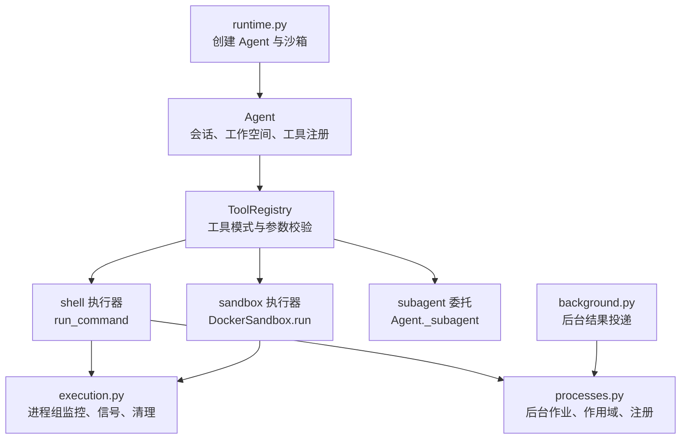
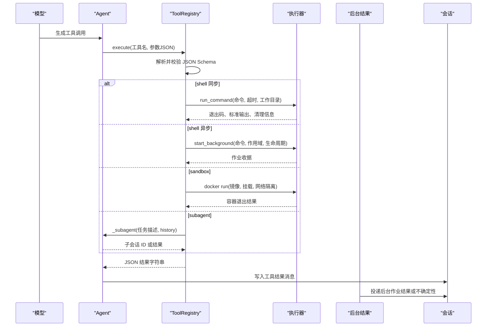
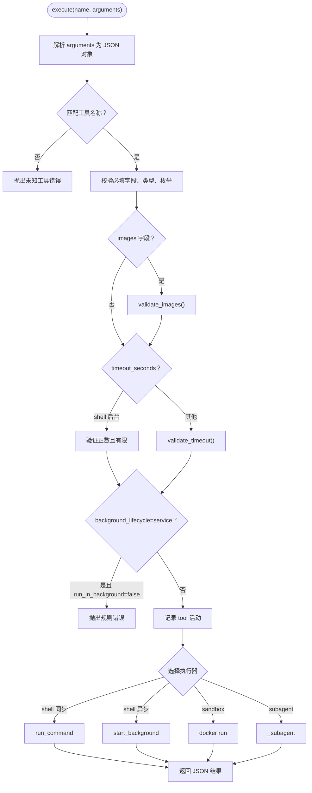
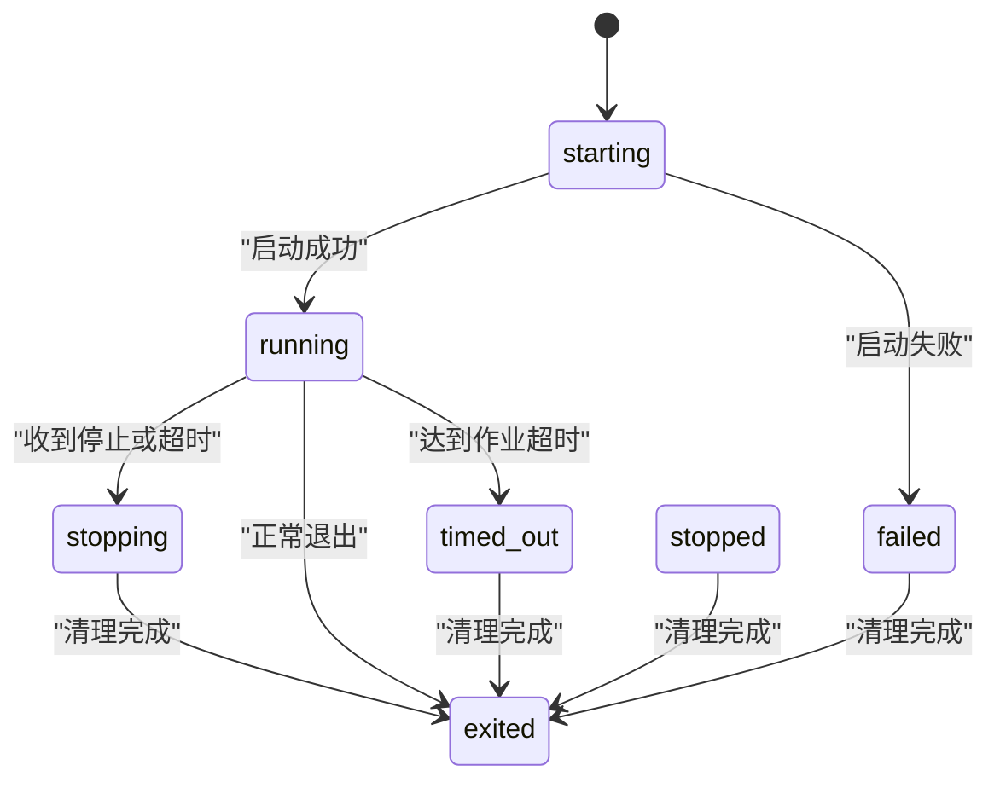
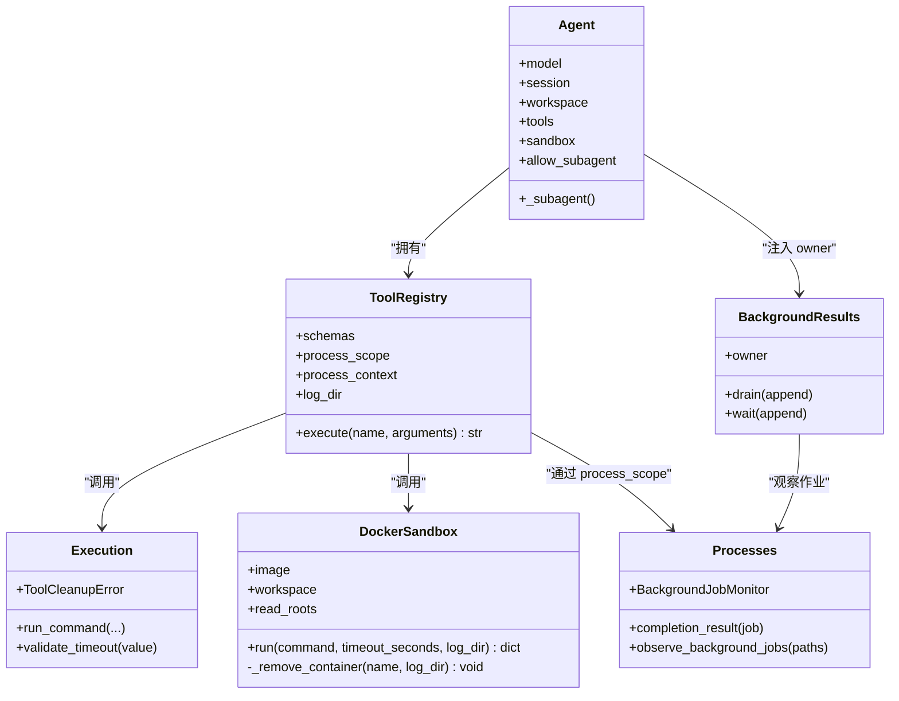

# 工具执行框架

<cite>
**本文引用的文件**
- [skills_agent/tools/__init__.py](file://skills_agent/tools/__init__.py)
- [skills_agent/execution.py](file://skills_agent/execution.py)
- [skills_agent/sandbox/__init__.py](file://skills_agent/sandbox/__init__.py)
- [skills_agent/processes.py](file://skills_agent/processes.py)
- [skills_agent/background.py](file://skills_agent/background.py)
- [skills_agent/agent.py](file://skills_agent/agent.py)
- [skills_agent/runtime.py](file://skills_agent/runtime.py)
</cite>

## 目录
1. [简介](#简介)
2. [项目结构](#项目结构)
3. [核心组件](#核心组件)
4. [架构总览](#架构总览)
5. [详细组件分析](#详细组件分析)
6. [依赖关系分析](#依赖关系分析)
7. [性能与资源特性](#性能与资源特性)
8. [故障排查指南](#故障排查指南)
9. [结论](#结论)

## 简介
本框架为模型驱动的智能体提供统一“工具”边界：模型不直接执行命令、容器或子任务，而是通过 ToolRegistry 注册的工具契约发起调用；Agent 根据工具名称路由到 shell、sandbox 或 subagent 三种执行器；运行时负责参数校验、超时控制、进程组清理、后台作业观察和结果回灌。

关键目标：
- 用 JSON Schema 约束工具参数，确保模型输出可解析且字段合法。
- 以有限超时和进程组机制防止僵尸进程和资源泄漏。
- 将前台命令、沙箱容器和子代理任务纳入统一的错误分类与结果格式。
- 将后台作业生命周期、不确定性和最终结果作为运行事件交付给模型上下文。

## 项目结构
围绕工具执行的相关代码主要分布在以下模块：

**图示来源**
- [skills_agent/agent.py:1-120](file://skills_agent/agent.py#L1-L120)
- [skills_agent/tools/__init__.py:1-191](file://skills_agent/tools/__init__.py#L1-L191)
- [skills_agent/execution.py:1-120](file://skills_agent/execution.py#L1-L120)
- [skills_agent/sandbox/__init__.py:1-78](file://skills_agent/sandbox/__init__.py#L1-L78)
- [skills_agent/processes.py:1-120](file://skills_agent/processes.py#L1-L120)
- [skills_agent/background.py:1-80](file://skills_agent/background.py#L1-L80)
- [skills_agent/runtime.py:1-58](file://skills_agent/runtime.py#L1-L58)

**章节来源**
- [skills_agent/agent.py:1-120](file://skills_agent/agent.py#L1-L120)
- [skills_agent/runtime.py:1-58](file://skills_agent/runtime.py#L1-L58)

## 核心组件
- ToolRegistry：声明工具名称、JSON Schema、必填字段、类型枚举、图片附加规则和调度逻辑。
- execution：前台命令执行、超时判断、进程组探测、SIGTERM/SIGKILL 清理、日志截断和清理异常封装。
- DockerSandbox：以 `docker run --network none` 方式运行命令，挂载只读工作区与技能目录，失败后确认容器清理。
- processes：后台作业注册、监督进程归属、启动期望、完成结果读取、作业观察和不确定性报告。
- background：从会话历史中恢复后台启动收据，扫描进程作用域，投递已完成作业并报告未确认状态。
- Agent：装配 ToolRegistry、BackgroundResults、ProcessScope，注入环境信息，并在系统提示中说明超时、结果模式和后台契约。
- runtime：解析配置、创建 Provider、SkillRegistry、DockerSandbox 和 Agent，是 CLI 侧入口。

**章节来源**
- [skills_agent/tools/__init__.py:1-191](file://skills_agent/tools/__init__.py#L1-L191)
- [skills_agent/execution.py:1-120](file://skills_agent/execution.py#L1-L120)
- [skills_agent/sandbox/__init__.py:1-78](file://skills_agent/sandbox/__init__.py#L1-L78)
- [skills_agent/processes.py:1-120](file://skills_agent/processes.py#L1-L120)
- [skills_agent/background.py:1-120](file://skills_agent/background.py#L1-L120)
- [skills_agent/agent.py:1-120](file://skills_agent/agent.py#L1-L120)
- [skills_agent/runtime.py:1-58](file://skills_agent/runtime.py#L1-L58)

## 架构总览
下图展示模型请求如何进入 Agent，再由 ToolRegistry 分发到具体执行器，并最终将结果写回会话。

**图示来源**
- [skills_agent/agent.py:1-120](file://skills_agent/agent.py#L1-L120)
- [skills_agent/tools/__init__.py:100-191](file://skills_agent/tools/__init__.py#L100-L191)
- [skills_agent/execution.py:240-369](file://skills_agent/execution.py#L240-L369)
- [skills_agent/sandbox/__init__.py:40-78](file://skills_agent/sandbox/__init__.py#L40-L78)
- [skills_agent/background.py:1-120](file://skills_agent/background.py#L1-L120)

## 详细组件分析

### ToolRegistry：注册、校验与调度
ToolRegistry 维护三类工具模式：
- shell：在宿主工作目录下执行任意 shell 命令。支持同步执行和后台作业两种路径。
- sandbox：仅在 DockerSandbox 存在时注册，用于在指定镜像内执行命令。
- subagent：仅在父 Agent 允许子代理时注册，用于委托独立任务。

参数契约由 `_schema` 生成，包含：
- name：短名称，面向用户显示。
- command：shell 或 sandbox 的脚本内容。
- timeout_seconds：前台默认 120 秒，最大 600 秒；后台 task 默认 3600 秒，service 无默认上限。
- result_mode：auto/direct/report，控制结果裁剪策略。
- images：可选图片列表，限制数量和大小，仅由上层附件流程处理。
- run_in_background：shell 专用开关，false 等待进程退出，true 返回作业收据。
- background_lifecycle：task/service，service 必须配合 run_in_background=true。
- history：subagent 专用开关，表示是否附带完整工作上下文进行历史检索。

校验流程如下：

**图示来源**
- [skills_agent/tools/__init__.py:1-191](file://skills_agent/tools/__init__.py#L1-L191)
- [skills_agent/execution.py:35-60](file://skills_agent/execution.py#L35-L60)

关键行为：
- 未执行的参数错误会携带 `executed=false`，帮助区分“模型参数错误”和“执行阶段错误”。
- 已执行但清理失败的异常被包装为 `ToolCleanupError`，保留诊断信息。
- shell 同步执行使用 `DEFAULT_TIMEOUT_SECONDS=120`，最大 600 秒。
- shell 后台执行要求当前存在 ProcessScope，否则拒绝。
- sandbox 执行复用 `validate_timeout`，并使用 DockerSandbox.run。
- subagent 委托返回 `{result: child_session_id}`，由上层 Agent 管理子会话。

**章节来源**
- [skills_agent/tools/__init__.py:1-191](file://skills_agent/tools/__init__.py#L1-L191)

### shell 命令执行：前台与后台
#### 前台执行
- 工作目录固定为 workspace。
- 标准输出和标准错误分别写入临时日志目录。
- 先等待入口进程退出，再探测同进程组剩余成员。
- 若仍有成员，则按 SIGTERM→等待→SIGKILL 的顺序清理，并记录清理原因和进程数量。
- 超时返回 exit_code=124，同时保留 stdout/stderr 及路径；输出最多截取 1MB。

#### 后台执行
- 通过 process_scope.start_background 启动，返回作业收据。
- 作业元数据包括名称、命令、cwd、owner_session_id、origin_tool_call_id、kind、wait_on_exit、background_lifecycle、timeout、图像等。
- 作业状态包括 starting、running、stopping、exited、failed、stopped、timed_out。
- 后台作业的生命周期分为：
  - task：必须在 Agent 结束前完成。
  - service：允许在服务上线后继续存活，成功 CLI 退出也不阻塞；失败或取消的 turn 会清理新服务。

**图示来源**
- [skills_agent/processes.py:1-120](file://skills_agent/processes.py#L1-L120)
- [skills_agent/processes.py:488-821](file://skills_agent/processes.py#L488-L821)

**章节来源**
- [skills_agent/execution.py:1-200](file://skills_agent/execution.py#L1-L200)
- [skills_agent/execution.py:240-369](file://skills_agent/execution.py#L240-L369)
- [skills_agent/processes.py:1-120](file://skills_agent/processes.py#L1-L120)
- [skills_agent/processes.py:488-821](file://skills_agent/processes.py#L488-L821)

### sandbox 容器执行
DockerSandbox.run 的行为：
- 对工作目录授予读写权限，对其他 read_roots 授予只读权限。
- 使用 `docker run --rm --network none`，禁用宿主机网络访问。
- 容器名称随机生成，避免命名冲突。
- 超时由 `run_command` 统一处理，退出码非零时显式调用清理回调。
- 清理时使用 `docker rm -f`，并通过 `docker container ls --all` 确认容器不存在；无法确认时会抛出 `ToolCleanupError`。

适用场景：
- 需要隔离依赖、避免污染宿主环境。
- 需要固定镜像版本、离线镜像或受控网络环境。
- 不适合长时间常驻服务；容器生命周期绑定单次命令。

风险点：
- 镜像拉取失败属于执行前或执行期异常。
- 容器删除失败会被视为清理失败，需检查 Docker daemon、磁盘空间和残留容器。
- 只读根路径必须真实存在且可解析；相对路径会在构造时展开并 resolve。

**章节来源**
- [skills_agent/sandbox/__init__.py:1-78](file://skills_agent/sandbox/__init__.py#L1-L78)
- [skills_agent/execution.py:1-120](file://skills_agent/execution.py#L1-L120)

### subagent 任务委托
subagent 不是普通 shell 命令，而是一个独立的子会话：
- 父 Agent 通过 `_subagent` 方法创建子会话。
- 工具参数包含 name、task、history。
- history=true 时，子 agent 会以只读方式获取完整当前工作上下文，用于历史检索。
- 返回值是子会话标识，由上层背景系统跟踪其摘要和结果。
- 子会话完成后，父会话通过 BackgroundResults 接收委派结果和未完成作业的转移。

适用场景：
- 多步调查、日志分析、代码库探索等可明确定义输入和输出的任务。
- 不需要频繁依赖父对话上下文的独立工作。
- 不希望阻塞主对话，但最终结果需要合并到父任务证据链。

注意：
- 普通 subagent 不会继承父对话历史；必须在 task 中写明目标、约束、材料和边界。
- subagent 的完成结果以运行时事件形式出现，不应当作新的用户指令。

**章节来源**
- [skills_agent/tools/__init__.py:60-120](file://skills_agent/tools/__init__.py#L60-L120)
- [skills_agent/agent.py:1-120](file://skills_agent/agent.py#L1-L120)
- [skills_agent/background.py:120-291](file://skills_agent/background.py#L120-L291)

### JSON Schema 参数契约与验证
ToolRegistry 对每个工具声明 parameters：
- type 为 object。
- properties 列出字段及其类型、枚举、最大值等约束。
- required 列出必填字段。
- additionalProperties 为 false，禁止未知字段。

验证顺序：
1. 解析 JSON；非法 JSON 或非标量值报错。
2. 校验必填字段是否存在。
3. 校验未知字段是否超出 schema 允许范围。
4. 对 images 调用 validate_images。
5. 对 timeout_seconds 调用 validate_timeout 或后台专用校验。
6. 校验 boolean 和 string 类型，空字符串不允许。
7. 校验 enum 值。
8. 校验 service 生命周期必须配合 run_in_background=true。

返回值格式：
- 成功：`{...}`，例如 shell 同步返回 exit_code、stdout、stderr、cleanup_* 字段；sandbox 返回容器执行结果；subagent 返回 `{result: child_session_id}`。
- 参数错误：可能包含 error 和 executed=false。
- 执行错误：error 字段包含异常信息；严重清理失败会抛出 ToolCleanupError，由上层捕获并转为诊断性错误。

**章节来源**
- [skills_agent/tools/__init__.py:1-191](file://skills_agent/tools/__init__.py#L1-L191)

### 超时控制与返回值处理
- 前台命令默认 120 秒，最大 600 秒。
- 后台 task 默认 3600 秒，service 无默认超时。
- 超时不是简单杀死入口进程：先尝试优雅终止，再强制终止，最后确认进程组为空。
- 超时返回 exit_code=124，并标记 timed_out、duration_seconds、日志路径。
- 清理失败会抛出 ToolCleanupError，包含 cleanup_confirmed=false 和 cleanup_errors。
- 后台作业完成时，BackgroundResults 会读取 bounded 日志并拼接结构化结果，再通过 runtime_event 追加到会话。

**章节来源**
- [skills_agent/execution.py:35-60](file://skills_agent/execution.py#L35-L60)
- [skills_agent/execution.py:240-369](file://skills_agent/execution.py#L240-L369)
- [skills_agent/background.py:201-291](file://skills_agent/background.py#L201-L291)

## 依赖关系分析

**图示来源**
- [skills_agent/agent.py:1-120](file://skills_agent/agent.py#L1-L120)
- [skills_agent/tools/__init__.py:1-191](file://skills_agent/tools/__init__.py#L1-L191)
- [skills_agent/sandbox/__init__.py:1-78](file://skills_agent/sandbox/__init__.py#L1-L78)
- [skills_agent/execution.py:1-120](file://skills_agent/execution.py#L1-L120)
- [skills_agent/processes.py:1-120](file://skills_agent/processes.py#L1-L120)
- [skills_agent/background.py:1-120](file://skills_agent/background.py#L1-L120)

耦合特点：
- ToolRegistry 是模型与执行器的唯一接口，屏蔽 shell、sandbox、subagent 差异。
- execution 提供底层进程能力，processes 在其之上构建持久化后台作业语义。
- background 依赖 session 事件流和 processes 的作业快照，实现可靠投递。
- Agent 协调所有子系统，但不直接操作 docker 或进程细节。

潜在循环：
- 没有直接循环导入；Agent 依赖 ToolRegistry，ToolRegistry 不反向依赖 Agent，只依赖 sandbox 和 process_scope。

**章节来源**
- [skills_agent/tools/__init__.py:1-191](file://skills_agent/tools/__init__.py#L1-L191)
- [skills_agent/execution.py:1-120](file://skills_agent/execution.py#L1-L120)
- [skills_agent/processes.py:1-120](file://skills_agent/processes.py#L1-L120)
- [skills_agent/background.py:1-120](file://skills_agent/background.py#L1-L120)

## 性能与资源特性
- 进程组探测使用 `ps -e -o pid= -o pgid= -o stat=`，并设置短暂超时，避免 ps 本身成为无限等待。
- 清理过程有 TERM_GRACE_SECONDS 和 CLEANUP_TIMEOUT_SECONDS 限制，防止清理卡死。
- 前台命令输出最大截取 1MB，避免大输出阻塞。
- 后台作业日志读取使用 tail 模式，限制 max_bytes，完整日志仍保留在磁盘。
- Docker 容器使用 `--network none` 避免网络风暴或外部依赖泄露。
- 后台作业观察采用定期扫描和事件去重，避免重复报告同一不确定性。
- 并发控制不在 ToolRegistry 内部硬编码；shell 可并行启动多个命令，sandbox 可并行启动多个容器，因此应由上层业务或测试用例控制并发度。

建议：
- 对大数据任务优先使用脚本过滤和分块写入文件。
- 对长任务优先使用 background-tasks skill 和 managed background processes。
- 对可并行且相互独立的任务合理拆分，避免单条命令占用过多 CPU、内存或 I/O。
- 对 sandbox 任务预拉取镜像，减少冷启动抖动。

[本节为通用指导，不直接分析具体文件]

## 故障排查指南

### shell 命令执行失败
常见症状：
- exit_code 非零。
- stderr 包含权限不足、命令不存在、路径错误。
- stdout 截断，提示 stdout_truncated=true。

排查步骤：
1. 查看工具结果中的 stdout_path 和 stderr_path。
2. 检查工作目录 workspace 和命令中使用的相对路径。
3. 检查环境变量是否由 process_scope 注入。
4. 若为后台任务，查看作业状态是否为 unconfirmed、failed、stopped 或 timed_out。
5. 检查脚本是否自行 daemonize、setsid 或 nohup，这会破坏进程组契约。

相关代码位置：
- [skills_agent/execution.py:240-369](file://skills_agent/execution.py#L240-L369)
- [skills_agent/tools/__init__.py:120-191](file://skills_agent/tools/__init__.py#L120-L191)

### 沙箱镜像拉取失败
常见症状：
- docker run 失败。
- 清理阶段提示容器无法删除。
- 日志中包含镜像拉取超时或认证失败。

排查步骤：
1. 确认 sandbox image 参数是否正确。
2. 检查 Docker daemon 是否可用、磁盘空间是否充足。
3. 检查网络是否受限，必要时使用离线镜像。
4. 若容器已被提前移除，框架会通过 `docker container ls --all` 判断缺失，此时清理被视为成功。
5. 若容器仍存在且无法删除，清理会抛出 ToolCleanupError。

相关代码位置：
- [skills_agent/sandbox/__init__.py:40-78](file://skills_agent/sandbox/__init__.py#L40-L78)
- [skills_agent/execution.py:1-120](file://skills_agent/execution.py#L1-L120)

### subagent 超时或未返回
常见症状：
- 子会话长时间无结果。
- 父会话报告 background_job_uncertainty。
- 子任务未完成且 wait_on_exit=true，阻塞最终回复。

排查步骤：
1. 确认 subagent 是否成功创建子会话。
2. 检查子会话是否生成 final report。
3. 若使用了 history=true，检查完整工作上下文是否过大。
4. 检查子任务是否陷入无限循环或等待外部资源。
5. 通过 BackgroundResults 的 uncertainty 事件定位未确认作业。

相关代码位置：
- [skills_agent/background.py:120-291](file://skills_agent/background.py#L120-L291)
- [skills_agent/tools/__init__.py:60-120](file://skills_agent/tools/__init__.py#L60-L120)

### 权限不足
常见症状：
- shell 命令报 permission denied。
- sandbox 容器内无法访问只读根路径。
- 清理阶段因 PermissionError 无法发送信号。

排查步骤：
- shell：确认执行用户、工作目录权限、sudo 使用方式。
- sandbox：确认只读根路径存在且可读，不要误把不可读目录加入 read_roots。
- 清理失败中的 diagnostics 会包含 phase、type、message 和 errno。

相关代码位置：
- [skills_agent/execution.py:60-120](file://skills_agent/execution.py#L60-L120)
- [skills_agent/sandbox/__init__.py:10-40](file://skills_agent/sandbox/__init__.py#L10-L40)

### 僵尸进程与清理失败
常见症状：
- 工具结束后仍有子进程存活。
- 日志中出现 cleanup_required=true。
- 清理超时或无法确认进程组为空。

排查步骤：
1. 检查命令是否使用 setsid、nohup 或后台守护进程。
2. 检查脚本是否在入口处等待内部子任务。
3. 查看 cleanup_message、cleanup_initial_process_count、cleanup_forced。
4. 若清理失败，检查操作系统是否支持 POSIX waitid/WNOWAIT。
5. 对 macOS 等平台，注意僵尸进程组可能导致信号失败，但仍应确认主进程已回收。

相关代码位置：
- [skills_agent/execution.py:1-200](file://skills_agent/execution.py#L1-L200)
- [skills_agent/execution.py:240-369](file://skills_agent/execution.py#L240-L369)

### 后台作业状态为 unconfirmed
常见症状：
- 作业出现在不确定性事件中。
- 作业缺少 supervisor 身份。
- 作业注册文件损坏或路径不一致。

排查步骤：
1. 检查进程作用域目录是否存在。
2. 检查 runs/*.json 注册文件是否完整。
3. 检查 launches/*.json 期望是否与注册匹配。
4. 检查 supervisor 进程是否仍在运行。
5. 若作业日志缺失，completion_result 会抛出 BackgroundJobError。

相关代码位置：
- [skills_agent/processes.py:1-200](file://skills_agent/processes.py#L1-L200)
- [skills_agent/processes.py:488-821](file://skills_agent/processes.py#L488-L821)
- [skills_agent/background.py:201-291](file://skills_agent/background.py#L201-L291)

## 结论
该工具执行框架以 ToolRegistry 为中心，将模型的工具调用收敛到明确的 JSON Schema 契约。shell、sandbox 和 subagent 三种模式分别对应本地进程、隔离容器和独立子会话，并由 execution、processes 和 background 共同保障超时、清理、观察和结果投递。

最佳实践包括：
- 始终为工具调用提供有意义的 name。
- 前台命令使用默认或显式超时，后台任务使用 background-lifecycle 明确生命周期。
- 使用 sandbox 隔离依赖和网络，使用 subagent 委派独立调查任务。
- 对大数据和长任务使用脚本过滤、文件落盘和后台作业。
- 将 stdout/stderr、日志路径、exit_code 和 cleanup_* 字段纳入最终证据，而不是仅凭退出码下结论。