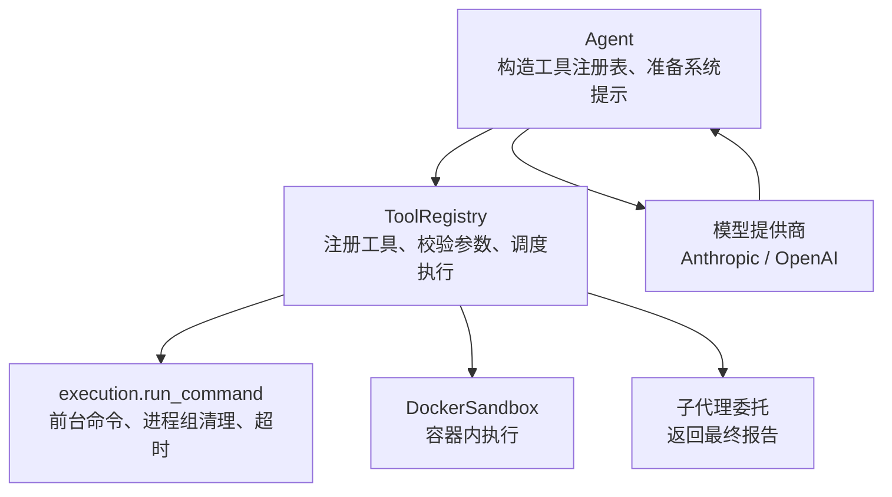
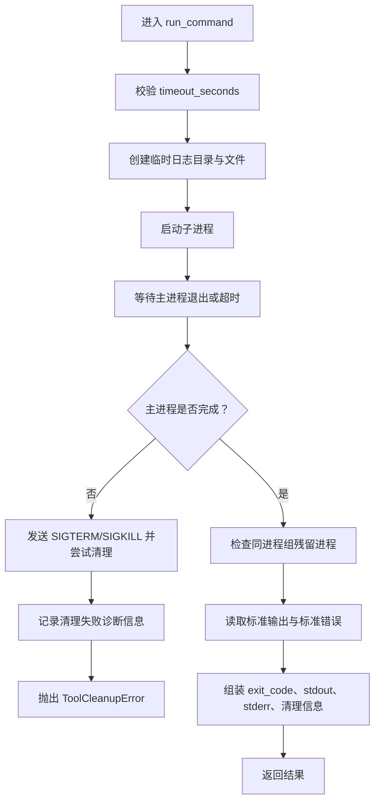
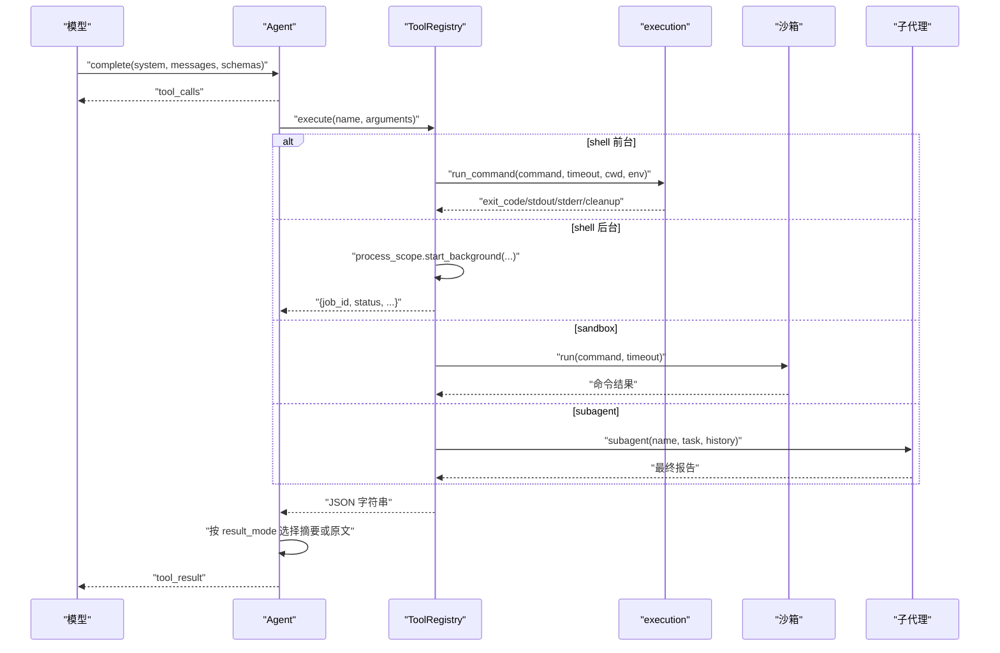
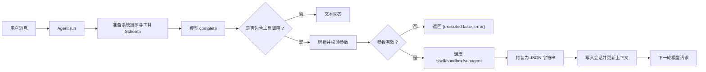
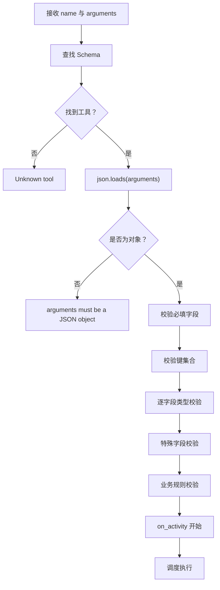
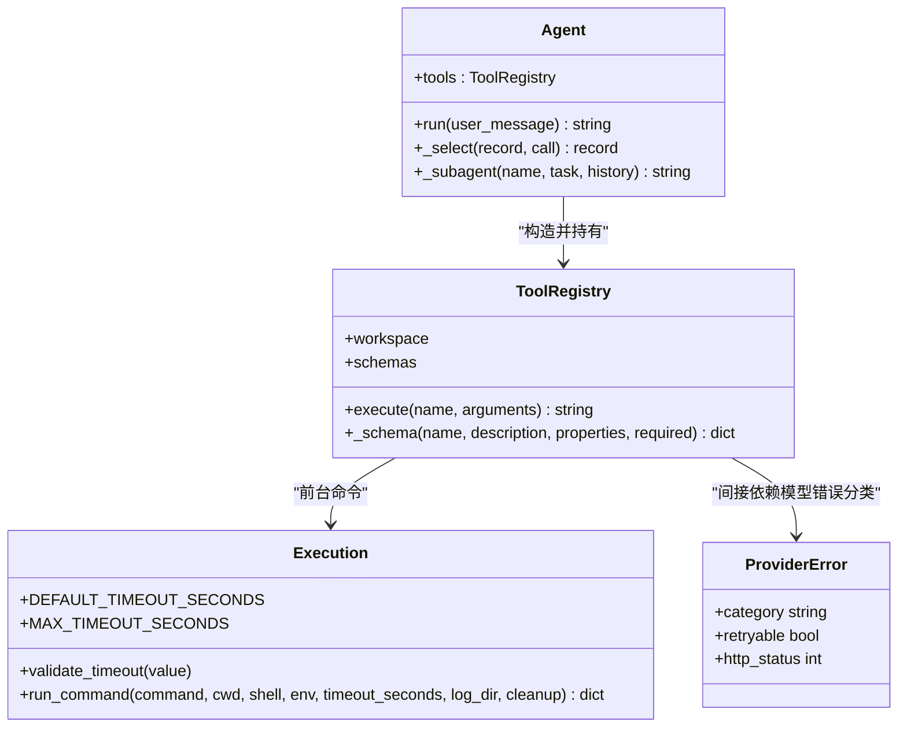

# 工具注册与参数校验

<cite>
**本文引用的文件**   
- [skills_agent/tools/__init__.py](file://skills_agent/tools/__init__.py)
- [skills_agent/execution.py](file://skills_agent/execution.py)
- [skills_agent/agent.py](file://skills_agent/agent.py)
- [tests/test_skills_tools.py](file://tests/test_skills_tools.py)
- [tests/test_tool_argument_failures.py](file://tests/test_tool_argument_failures.py)
- [skills_agent/providers/base.py](file://skills_agent/providers/base.py)
</cite>

## 目录
1. [引言](#引言)
2. [项目结构](#项目结构)
3. [核心组件](#核心组件)
4. [架构总览](#架构总览)
5. [详细组件分析](#详细组件分析)
6. [依赖关系分析](#依赖关系分析)
7. [性能与超时控制](#性能与超时控制)
8. [故障排查指南](#故障排查指南)
9. [结论](#结论)
10. [附录：错误分类与失败路径示例](#附录错误分类与失败路径示例)

## 引言
本文面向 Agent 运行时中“工具注册与参数校验”机制，围绕 `ToolRegistry`、JSON Schema 契约、参数解析、类型校验、超时控制、返回值处理、异常映射以及失败时如何向模型反馈进行系统化说明。重点解释：

- 工具如何通过 `ToolRegistry` 发现、注册和查找。
- 工具函数签名与 JSON Schema 的关系。
- 必填字段、类型、枚举和空字符串校验流程。
- 前台命令、后台任务、沙箱容器和子代理四种执行模式。
- 工具调用在 `Agent.run` 中的统一入口及结果回传。
- 常见问题的定位方法，包括 JSON Schema 不匹配、参数序列化失败、工具未找到、返回值无法被模型消费等。

## 项目结构
本机制主要涉及以下模块：

| 文件 | 职责 |
|---|---|
| `skills_agent/tools/__init__.py` | 定义 `ToolRegistry`，负责工具发现、Schema 生成、参数校验和调度执行。 |
| `skills_agent/execution.py` | 提供前台命令执行、进程组清理、超时控制和 `ToolCleanupError`。 |
| `skills_agent/agent.py` | 构造 `ToolRegistry`，将工具 Schema 提供给模型，并编排模型回复、工具调用、结果回填。 |
| `tests/test_skills_tools.py` | 覆盖工具注册、执行、超时、中断、沙箱和子代理行为。 |
| `tests/test_tool_argument_failures.py` | 覆盖无效 JSON、非对象参数、深层嵌套参数、不同模型接口下的失败路径。 |
| `skills_agent/providers/base.py` | 定义模型提供商错误分类，用于区分可重试与不可重试错误。 |



**图表来源**
- [skills_agent/agent.py:1-120](file://skills_agent/agent.py#L1-L120)
- [skills_agent/tools/__init__.py:1-60](file://skills_agent/tools/__init__.py#L1-L60)
- [skills_agent/execution.py:1-40](file://skills_agent/execution.py#L1-L40)

**章节来源**
- [skills_agent/tools/__init__.py:1-60](file://skills_agent/tools/__init__.py#L1-L60)
- [skills_agent/agent.py:1-120](file://skills_agent/agent.py#L1-L120)

## 核心组件

### ToolRegistry：工具注册与执行中心
`ToolRegistry` 是工具边界的核心类，承担以下职责：

1. **初始化阶段**  
   - 记录工作空间路径、可选的沙箱、子代理回调、日志目录和活动回调。
   - 构建工具 Schema 列表。
   - 支持动态注入 `process_scope`、`process_context` 和 `tool_call_id`，用于后台任务上下文传播。

2. **工具 Schema 注册**  
   - 始终注册 `shell` 工具。
   - 如果提供了沙箱，则注册 `sandbox` 工具。
   - 如果提供了子代理回调，则注册 `subagent` 工具。
   - 每个工具的 Schema 由 `_schema` 生成，包含名称、描述、参数对象、必填字段和禁止额外属性。

3. **参数解析与校验**  
   - 使用 `json.loads` 解析参数。
   - 校验参数必须是 JSON 对象。
   - 校验必填字段是否存在。
   - 校验传入键集合必须位于允许字段集合之间。
   - 对特殊字段做增强校验：
     - `images`：通过 `validate_images` 校验图片清单。
     - `timeout_seconds`：前台或沙箱走 `validate_timeout`；后台 shell 要求正有限浮点数。
     - 普通字段要求布尔值或字符串，且非空字符串。
     - 枚举字段必须在允许值内。
   - 业务规则校验：例如 `background_lifecycle=service` 必须配合 `run_in_background=true`。

4. **执行分发**  
   - 触发活动回调。
   - `shell`：前台执行或后台任务。
   - `sandbox`：调用沙箱运行命令。
   - `subagent`：调用子代理回调并包装为 `{result}`。

5. **异常与结果封装**  
   - 成功执行返回 JSON 字符串。
   - 捕获除 `ToolCleanupError` 外的所有异常，转为 `{"error": ...}`。
   - 如果参数解析或校验失败，标记 `executed=false`，以便上层知道该工具调用并未真正执行。

**章节来源**
- [skills_agent/tools/__init__.py:1-191](file://skills_agent/tools/__init__.py#L1-L191)

### execution：前台命令、超时与清理
`execution.py` 提供统一的命令执行入口 `run_command`，并定义：

- `DEFAULT_TIMEOUT_SECONDS = 120`
- `MAX_TIMEOUT_SECONDS = 600`
- `validate_timeout`：校验超时为正数、有限数且不大于最大值。
- `ToolCleanupError`：表示命令可能仍处于活跃状态，Agent 不应继续正常退出。
- 进程组探测、SIGTERM/SIGKILL 清理、残留进程检测、超时输出截断。
- 失败时写入 stdout/stderr 日志文件，并通过 `diagnostics` 传递原始错误、清理状态、进程信息和时长。



**图表来源**
- [skills_agent/execution.py:201-369](file://skills_agent/execution.py#L201-L369)
- [skills_agent/execution.py:1-120](file://skills_agent/execution.py#L1-L120)

**章节来源**
- [skills_agent/execution.py:1-120](file://skills_agent/execution.py#L1-L120)
- [skills_agent/execution.py:201-369](file://skills_agent/execution.py#L201-L369)

### Agent：统一执行入口与工具结果回传
`Agent` 负责：

- 构造 `ToolRegistry`，并将工具 Schema 暴露给模型。
- 从模型响应中提取工具调用。
- 调用 `tools.execute(name, arguments)`。
- 根据 `result_mode` 决定返回完整结果、精简报告或直接引用原始事件。
- 将工具结果写回会话消息，作为下一次模型调用的上下文。



**图表来源**
- [skills_agent/agent.py:200-479](file://skills_agent/agent.py#L200-L479)
- [skills_agent/tools/__init__.py:120-191](file://skills_agent/tools/__init__.py#L120-L191)
- [skills_agent/execution.py:201-369](file://skills_agent/execution.py#L201-L369)

**章节来源**
- [skills_agent/agent.py:200-479](file://skills_agent/agent.py#L200-L479)

## 架构总览
下图展示一次典型工具调用的端到端流程：



**图表来源**
- [skills_agent/agent.py:400-520](file://skills_agent/agent.py#L400-L520)
- [skills_agent/tools/__init__.py:100-191](file://skills_agent/tools/__init__.py#L100-L191)

## 详细组件分析

### 工具注册机制

#### 工具发现与注册策略
`ToolRegistry` 不在运行时扫描文件系统来发现脚本；它采用**显式注册 + 条件注册**的方式：

| 工具 | 是否始终注册 | 附加条件 | 主要用途 |
|---|---:|---|---|
| `shell` | 是 | 无 | 在工作空间执行任意 Shell 命令或多行脚本。 |
| `sandbox` | 否 | 构造时传入沙箱实例 | 在 Docker 容器中执行命令。 |
| `subagent` | 否 | 构造时传入子代理回调 | 将独立任务委派给子 Agent，仅最终报告返回父 Agent。 |

注册过程由构造函数直接完成，而不是通过装饰器。因此，“装饰器注册”不是当前实现方式；如果需要扩展新工具，应在 `ToolRegistry.__init__` 中追加新的 Schema。

**章节来源**
- [skills_agent/tools/__init__.py:12-110](file://skills_agent/tools/__init__.py#L12-L110)

#### JSON Schema 契约
每个工具的 Schema 由 `_schema(name, description, properties, required)` 生成，具有固定结构：

- `name`：工具名。
- `description`：给模型的工具说明。
- `parameters.type`：固定为 `object`。
- `parameters.properties`：字段定义。
- `parameters.required`：必填字段。
- `parameters.additionalProperties`：固定为 `False`，禁止模型传入未声明字段。

这意味着：**JSON Schema 不仅是文档，更是运行时校验契约**。模型生成的参数若包含未声明字段、缺失必填字段或类型错误，都会在校验阶段失败。

**章节来源**
- [skills_agent/tools/__init__.py:100-110](file://skills_agent/tools/__init__.py#L100-L110)

#### 工具函数签名约定
虽然 `ToolRegistry.execute` 是统一入口，但每种工具的实际“签名语义”如下：

| 工具 | 关键参数 | 返回结构 |
|---|---|---|
| `shell` | `name`、`command`、`run_in_background`、可选 `timeout_seconds`、`result_mode`、`images`、`background_lifecycle` | 前台：`{exit_code, stdout, stderr, cleanup_*}`；后台：作业回执。 |
| `sandbox` | `name`、`command`、可选 `timeout_seconds`、`result_mode` | 容器命令结果。 |
| `subagent` | `name`、`task`、可选 `history` | `{result: 子代理报告}`。 |

注意：`name` 并非 Shell 命令名，而是人类可读的任务目的；Shell 的真实命令来自 `command`。

**章节来源**
- [skills_agent/tools/__init__.py:20-110](file://skills_agent/tools/__init__.py#L20-L110)

### 参数解析与校验流程

#### 解析顺序
`ToolRegistry.execute` 的校验顺序非常关键：

1. 查找工具 Schema。
2. 解析 JSON。
3. 校验是否为对象。
4. 校验必填字段。
5. 校验传入键集合是否合法。
6. 逐字段校验类型、空值、枚举。
7. 执行工具特定业务规则。
8. 触发活动回调。
9. 调用具体执行器。



**图表来源**
- [skills_agent/tools/__init__.py:110-191](file://skills_agent/tools/__init__.py#L110-L191)

**章节来源**
- [skills_agent/tools/__init__.py:110-191](file://skills_agent/tools/__init__.py#L110-L191)

#### 必填字段校验
以 `shell` 为例，必填字段为：

- `name`
- `command`
- `run_in_background`

如果缺少这些字段，会触发“期望参数”错误。测试覆盖了缺少 `command`、缺少 `name`、`name` 为数字、空字符串 `name`、未知 `result_mode`、多余字段等场景。

**章节来源**
- [skills_agent/tools/__init__.py:40-70](file://skills_agent/tools/__init__.py#L40-L70)
- [tests/test_skills_tools.py:140-190](file://tests/test_skills_tools.py#L140-L190)

#### 类型检查与空值校验
- 布尔字段只接受 Python 布尔类型。
- 字符串字段只接受 Python 字符串类型。
- 字符串不能为空字符串。
- 枚举字段必须属于声明值。
- `timeout_seconds` 需要数值类型，并且在前台/沙箱场景中走 `validate_timeout`。

**章节来源**
- [skills_agent/tools/__init__.py:140-170](file://skills_agent/tools/__init__.py#L140-L170)
- [skills_agent/execution.py:35-45](file://skills_agent/execution.py#L35-L45)

#### 错误分类
工具参数错误分为三类：

| 类别 | 触发位置 | 表现 |
|---|---|---|
| 工具未找到 | Schema 查找失败 | `Unknown tool: <name>` |
| JSON 解析失败 | `json.loads` | `Tool arguments must be valid JSON` |
| 参数对象非法 | 非字典 | `Tool arguments must be a JSON object` |
| 必填字段缺失 | 字段集合校验 | `Expected arguments: ...` |
| 类型错误 | 字段类型检查 | `Argument <key> must be a <type>` |
| 空字符串 | 字符串空值检查 | `Argument <key> must not be empty` |
| 枚举非法 | 枚举检查 | `Invalid <key>: <value>` |
| 业务规则冲突 | 工具特定逻辑 | 例如 `background_lifecycle=service` 未启用后台 |

**章节来源**
- [skills_agent/tools/__init__.py:110-191](file://skills_agent/tools/__init__.py#L110-L191)

### 超时控制

#### 前台与沙箱超时
- 默认超时：`DEFAULT_TIMEOUT_SECONDS = 120`。
- 最大超时：`MAX_TIMEOUT_SECONDS = 600`。
- 校验失败时会抛出 `ValueError`，并被 `ToolRegistry.execute` 转换为工具错误。

#### 后台 shell 超时
后台 shell 的 `timeout_seconds` 要求更宽松：

- 必须是整数或浮点数。
- 必须大于 0。
- 必须是有限数。
- 可以超过 600 秒，因为这是作业自身执行期限，而不是启动确认等待时间。

**章节来源**
- [skills_agent/execution.py:18-45](file://skills_agent/execution.py#L18-L45)
- [skills_agent/tools/__init__.py:145-160](file://skills_agent/tools/__init__.py#L145-L160)

### 返回值处理与结果模式

#### 前台 shell 返回值
前台命令返回：

- `exit_code`
- `stdout`
- `stderr`
- 可能包含 `cleanup_required`、`cleanup_confirmed`、`cleanup_reason`、`cleanup_forced`、`cleanup_initial_process_count`、`cleanup_message`。
- 如果超时，还包含 `timed_out`、`process_returncode`、`timeout_seconds`、`duration_seconds`、日志路径和截断标志。

#### 结果模式
`result_mode` 有三种行为：

| 模式 | 含义 |
|---|---|
| `auto` | 长度小于等于阈值时保留原始结果；否则生成精简报告。 |
| `direct` | 保留原始结果或原始源引用。 |
| `report` | 生成结论性报告，附带证据。 |

`Agent._select` 会根据消息内容长度和 token 计数决定使用完整结果还是精简报告。

**章节来源**
- [skills_agent/execution.py:201-369](file://skills_agent/execution.py#L201-L369)
- [skills_agent/agent.py:200-280](file://skills_agent/agent.py#L200-L280)

### 异常到工具错误的映射

#### 普通异常
`ToolRegistry.execute` 捕获除 `ToolCleanupError` 以外的所有异常，并将其包装为：

```json
{
  "error": "<异常字符串>",
  "executed": false
}
```

其中 `executed=false` 仅在参数解析或校验阶段失败时出现；执行开始后即使后续出错，也不会重置该字段。

#### 清理异常
`ToolCleanupError` 不会被视为普通工具错误，而是向上传播。它表示命令清理未确认，Agent 不应继续正常退出。

#### 中断异常
`KeyboardInterrupt` 会穿透工具执行层，使 Agent 的中断路径接管清理。

**章节来源**
- [skills_agent/tools/__init__.py:160-191](file://skills_agent/tools/__init__.py#L160-L191)
- [skills_agent/execution.py:18-40](file://skills_agent/execution.py#L18-L40)
- [tests/test_skills_tools.py:90-130](file://tests/test_skills_tools.py#L90-L130)

### 失败路径下 Agent 如何向模型反馈
当工具调用失败时，Agent 的行为如下：

1. `tools.execute` 返回 JSON 字符串。
2. Agent 将该字符串写入会话的 `tool` 消息。
3. 下一次模型请求会携带该工具结果。
4. 对于无效参数，Agent 明确保留原始 `tool_call_id`，让模型能关联失败的调用。
5. 如果同一轮有多个工具调用，只有失败的参数会被标记为未执行，其他有效调用仍会被执行一次。

测试验证了：

- 无效 JSON 不会触发真实工具执行。
- 非对象 JSON 会被拒绝。
- 深层嵌套 JSON 会因递归限制被拒绝。
- Anthropic 原生流式格式会保留历史推理和有效调用。
- OpenAI 兼容格式会保留原始无效参数，便于调试。

**章节来源**
- [tests/test_tool_argument_failures.py:1-187](file://tests/test_tool_argument_failures.py#L1-L187)
- [skills_agent/agent.py:400-520](file://skills_agent/agent.py#L400-L520)

### 与 execution.py 的统一执行入口关系
`ToolRegistry` 对 `shell` 前台命令调用 `execution.run_command`，从而复用统一的：

- 超时校验。
- POSIX 进程组管理。
- 信号清理。
- 日志输出。
- 超时结果结构。
- 清理诊断。

沙箱和子代理不走 `run_command`，因为它们分别有独立的执行环境：Docker 容器和另一个 Agent 实例。

**章节来源**
- [skills_agent/tools/__init__.py:120-191](file://skills_agent/tools/__init__.py#L120-L191)
- [skills_agent/execution.py:201-369](file://skills_agent/execution.py#L201-L369)

### 与后台任务、沙箱、子代理执行模式的集成

#### 前台 shell
- `run_in_background=false`。
- 阻塞等待命令退出。
- 超时后返回带 `timed_out` 的结果。
- 清理残留进程并记录清理信息。

#### 后台 shell
- `run_in_background=true`。
- 通过 `process_scope.start_background` 启动作业。
- 返回作业回执，不阻塞当前 Agent 回合。
- 作业完成结果通过后台结果通道投递给 Agent。
- 支持 `background_lifecycle=task` 或 `service`。

#### 沙箱
- 使用 `DockerSandbox.run`。
- 命令在容器中执行。
- 超时控制与前台 shell 类似。
- 容器移除由沙箱负责。

#### 子代理
- 使用 `Agent._subagent`。
- 子 Agent 拥有独立 Session。
- 可选择是否继承父会话历史。
- 父 Agent 只消费子 Agent 的最终报告。

**章节来源**
- [skills_agent/tools/__init__.py:20-110](file://skills_agent/tools/__init__.py#L20-L110)
- [skills_agent/agent.py:300-479](file://skills_agent/agent.py#L300-L479)
- [tests/test_skills_tools.py:250-359](file://tests/test_skills_tools.py#L250-L359)

## 依赖关系分析



**图表来源**
- [skills_agent/tools/__init__.py:1-191](file://skills_agent/tools/__init__.py#L1-L191)
- [skills_agent/execution.py:1-369](file://skills_agent/execution.py#L1-L369)
- [skills_agent/agent.py:1-520](file://skills_agent/agent.py#L1-L520)
- [skills_agent/providers/base.py:1-200](file://skills_agent/providers/base.py#L1-L200)

**章节来源**
- [skills_agent/tools/__init__.py:1-191](file://skills_agent/tools/__init__.py#L1-L191)
- [skills_agent/execution.py:1-369](file://skills_agent/execution.py#L1-L369)
- [skills_agent/agent.py:1-520](file://skills_agent/agent.py#L1-L520)
- [skills_agent/providers/base.py:1-200](file://skills_agent/providers/base.py#L1-L200)

## 性能与超时控制

### 超时策略总结

| 场景 | 默认超时 | 最大/约束 | 行为 |
|---|---:|---|---|
| 前台 shell | 120 秒 | ≤600 秒 | 超时后返回带 `timed_out` 的结果。 |
| 沙箱命令 | 120 秒 | ≤600 秒 | 超时由沙箱执行器处理。 |
| 后台 shell 作业 | 无默认（通常更长） | 正有限数，可超过 600 秒 | 作业有自己的执行期限。 |
| 服务型后台 | 无默认 | 正有限数 | 不阻塞最终交付。 |

### 输出截断
- 前台命令超时后，stdout 和 stderr 最多保留约 1MB。
- 正常完成时不主动截断。
- 超长结果可通过 `result_mode=report` 生成精简报告。

### Token 与上下文影响
- `auto` 模式可能调用模型的 `count_text` 来决定是否需要报告。
- 报告生成失败不会阻止原始结果保存。
- 报告错误会作为 `report_error` 字段保留，避免掩盖原始执行结果。

**章节来源**
- [skills_agent/execution.py:1-45](file://skills_agent/execution.py#L1-L45)
- [skills_agent/execution.py:201-369](file://skills_agent/execution.py#L201-L369)
- [skills_agent/agent.py:200-280](file://skills_agent/agent.py#L200-L280)

## 故障排查指南

### 问题一：JSON Schema 不匹配
**现象**：模型返回的字段不符合工具定义。

**常见原因**：
- 缺少必填字段。
- 使用了未声明字段。
- 字段类型不正确。
- 枚举值不在允许列表中。

**排查步骤**：
1. 查看工具 Schema 的 `required` 和 `properties`。
2. 检查模型生成的参数是否包含额外字段。
3. 确认布尔值不是字符串 `"true"`。
4. 确认枚举值拼写正确。

**相关测试**：
- [tests/test_skills_tools.py:140-190](file://tests/test_skills_tools.py#L140-L190)

### 问题二：参数序列化失败
**现象**：工具返回 `Tool arguments must be valid JSON` 或 `Tool arguments must be a JSON object`。

**常见原因**：
- 参数不是合法 JSON。
- 参数是数组、字符串、null 或深度嵌套结构。
- 上游模型流式拼接产生不完整 JSON。

**排查步骤**：
1. 打印模型返回的原始 `arguments`。
2. 确认它是字符串形式的 JSON。
3. 确认它是 JSON 对象而非数组。
4. 避免超大嵌套结构导致递归限制。

**相关测试**：
- [tests/test_tool_argument_failures.py:1-120](file://tests/test_tool_argument_failures.py#L1-L120)

### 问题三：工具未找到
**现象**：返回 `Unknown tool: <name>`。

**常见原因**：
- 模型生成了未注册的 `name`。
- 自定义工具未添加到 `ToolRegistry`。
- 沙箱或子代理未被传入，导致对应工具未注册。

**排查步骤**：
1. 检查 `ToolRegistry.schemas` 中包含哪些工具。
2. 确认模型使用的工具名与实际注册名一致。
3. 如果需要沙箱或子代理，确保构造 `ToolRegistry` 时传入相应依赖。

**相关测试**：
- [tests/test_skills_tools.py:220-240](file://tests/test_skills_tools.py#L220-L240)

### 问题四：返回值无法被模型消费
**现象**：工具执行成功，但模型不理解结果。

**常见原因**：
- 输出过大但未使用合适的 `result_mode`。
- 报告生成失败。
- 原始结果太长，超出模型上下文窗口。
- 工具返回了复杂对象，但下游没有适配。

**排查步骤**：
1. 对长输出使用 `result_mode=report`。
2. 对精确源码或数据使用 `result_mode=direct`。
3. 检查 `Agent._select` 是否选择了精简报告。
4. 查看 `report_error` 是否出现。
5. 避免让工具直接输出超大规模原始数据。

**相关代码路径**：
- [skills_agent/agent.py:200-280](file://skills_agent/agent.py#L200-L280)

### 问题五：超时或清理失败
**现象**：工具长时间挂起、进程残留、清理失败。

**常见原因**：
- 脚本未等待子进程退出。
- 脚本使用 `setsid`、`nohup` 或自行守护化。
- 清理过程中进程组检查失败。
- Docker 容器移除失败。

**排查步骤**：
1. 检查命令是否在主进程退出前等待内部子任务。
2. 检查返回结果中是否包含 `cleanup_required`。
3. 查看日志目录中的 stdout/stderr。
4. 检查 `ToolCleanupError` 的诊断信息。
5. 对沙箱命令检查容器是否被移除。

**相关代码路径**：
- [skills_agent/execution.py:201-369](file://skills_agent/execution.py#L201-L369)
- [tests/test_skills_tools.py:90-130](file://tests/test_skills_tools.py#L90-L130)

## 结论
`ToolRegistry` 是当前 Agent 工具系统的核心边界。它不依赖装饰器注册工具，而是通过构造函数显式声明工具及其 JSON Schema，并在运行时严格校验模型返回的参数。这种设计把“模型输出”视为不可信输入，通过以下步骤保证安全性与可观测性：

1. 先解析 JSON。
2. 再校验对象结构。
3. 再校验必填字段和允许字段。
4. 再校验类型、空值和枚举。
5. 最后才执行工具。

超时控制集中在 `execution.py`，前台命令使用统一的进程组和清理机制；后台任务、沙箱和子代理各自维护生命周期。Agent 将工具结果序列化后写回会话，使模型能够基于结构化错误继续修正调用。

对于扩展新工具的建议：

- 优先判断是否应使用现有 `shell`、`sandbox` 或 `subagent`。
- 如需新工具，在 `ToolRegistry.__init__` 中添加 Schema。
- 为新字段补充类型、枚举和空值校验。
- 为新执行路径添加单元测试，覆盖成功、超时、清理失败、参数非法和中断场景。

## 附录：错误分类与失败路径示例

### 示例一：注册一个简单 shell 工具
当前仓库中没有使用装饰器注册新工具；新增工具应修改 `ToolRegistry`。若只是执行 Shell 命令，可直接使用已有 `shell` 工具：

- 工具名：`shell`
- 必填参数：`name`、`command`、`run_in_background`
- 前台执行示例语义：`run_in_background=false`
- 后台执行示例语义：`run_in_background=true`

该行为由测试覆盖，包括命令输出、退出码、工作空间和日志路径。

**章节来源**
- [skills_agent/tools/__init__.py:20-110](file://skills_agent/tools/__init__.py#L20-L110)
- [tests/test_skills_tools.py:40-100](file://tests/test_skills_tools.py#L40-L100)

### 示例二：传入无效参数的报错响应
当传入非法 JSON 或非对象参数时，`ToolRegistry.execute` 返回：

```json
{
  "executed": false,
  "error": "<错误说明>"
}
```

错误说明可能包含：

- “必须是合法 JSON”
- “必须是 JSON 对象”
- “期望参数：...”
- “参数必须为某类型”
- “参数不能为空”
- “参数枚举值无效”

**章节来源**
- [skills_agent/tools/__init__.py:110-191](file://skills_agent/tools/__init__.py#L110-L191)
- [tests/test_tool_argument_failures.py:60-120](file://tests/test_tool_argument_failures.py#L60-L120)

### 示例三：参数缺失时的提示文本
如果 `shell` 缺少 `command` 或 `run_in_background`，错误消息会列出期望参数，例如：

```
Expected arguments: name, command, run_in_background
```

这比单纯报错“缺少字段”更明确，有助于模型自动补全缺失参数。

**章节来源**
- [skills_agent/tools/__init__.py:40-70](file://skills_agent/tools/__init__.py#L40-L70)
- [tests/test_skills_tools.py:140-190](file://tests/test_skills_tools.py#L140-L190)

### 示例四：工具未找到的失败路径
如果模型调用了一个未注册工具，例如 `read_skill`，`ToolRegistry.execute` 会返回包含 `error` 的工具结果，而不会抛出未捕获异常。

**章节来源**
- [skills_agent/tools/__init__.py:110-130](file://skills_agent/tools/__init__.py#L110-L130)
- [tests/test_skills_tools.py:220-240](file://tests/test_skills_tools.py#L220-L240)

### 示例五：返回值无法被模型消费
当工具输出过长时，应使用 `result_mode=report` 或 `result_mode=direct`。`Agent._select` 会根据消息内容和 token 计数决定是否替换为精简报告或原始源引用。如果报告生成失败，原始结果仍保留在日志中，避免丢失执行证据。

**章节来源**
- [skills_agent/agent.py:200-280](file://skills_agent/agent.py#L200-L280)