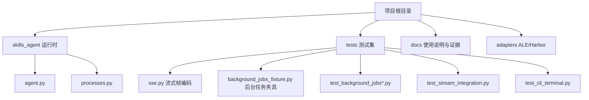
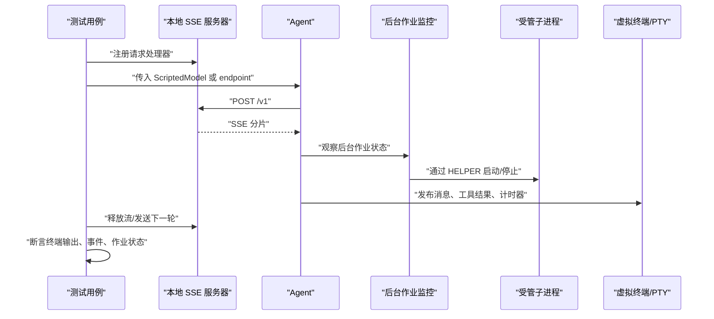
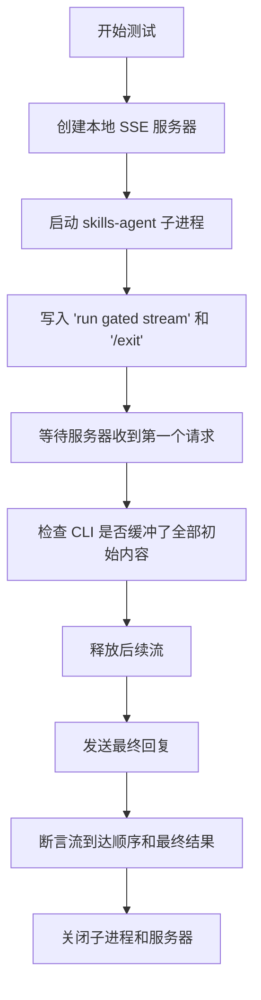
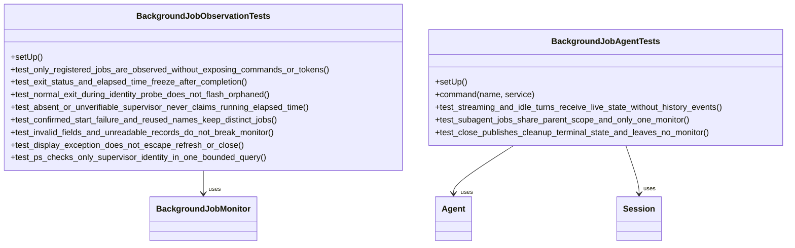
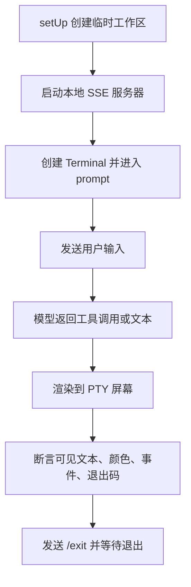
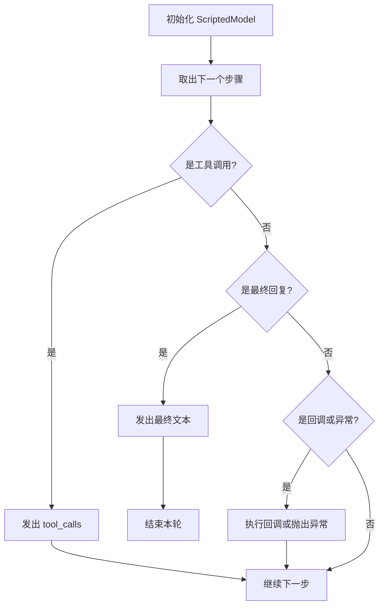
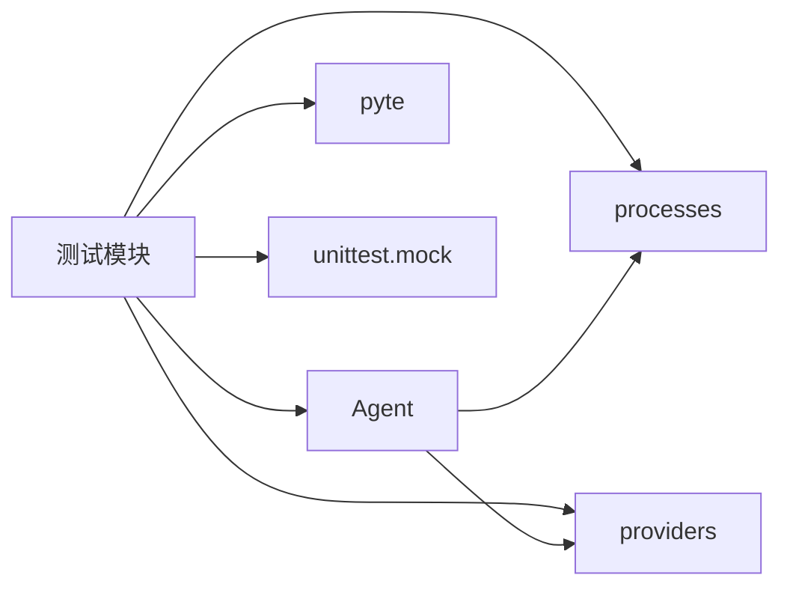

# 开发与测试

<cite>
**本文引用的文件**   
- [README.md](file://README.md)
- [pyproject.toml](file://pyproject.toml)
- [tests/background_jobs_fixture.py](file://tests/background_jobs_fixture.py)
- [tests/sse.py](file://tests/sse.py)
- [tests/test_background_jobs.py](file://tests/test_background_jobs.py)
- [tests/test_stream_integration.py](file://tests/test_stream_integration.py)
- [tests/test_cli_terminal.py](file://tests/test_cli_terminal.py)
- [tests/test_agent_context.py](file://tests/test_agent_context.py)
- [skills_agent/agent.py](file://skills_agent/agent.py)
- [skills_agent/processes.py](file://skills_agent/processes.py)
</cite>

## 目录
1. [简介](#简介)
2. [项目结构](#项目结构)
3. [核心组件](#核心组件)
4. [架构总览](#架构总览)
5. [详细组件分析](#详细组件分析)
6. [依赖关系分析](#依赖关系分析)
7. [性能与稳定性考虑](#性能与稳定性考虑)
8. [故障排查指南](#故障排查指南)
9. [结论](#结论)
10. [附录：新增测试清单](#附录新增测试清单)

## 简介
本指南面向开发者，说明如何在本仓库中安装测试依赖、运行测试，并理解现有测试的组织方式。重点包括：
- 使用本地模拟模型避免真实网络调用；
- 通过 SSE 模拟服务验证流式响应；
- 使用后台任务夹具管理受管进程；
- 通过虚拟终端和 PTY 验证交互式界面行为；
- 为新功能添加单元测试、集成测试和终端输出测试的方法；
- 调试技巧与常见问题处理。

该项目是 Python CLI Agent，负责会话、上下文、模型调用和工具执行。测试覆盖模型协议、后台作业、终端交互、工具执行和配置等模块。

**章节来源**
- [README.md:1-68](file://README.md#L1-L68)

## 项目结构
仓库包含运行时代码、内置技能、适配器、文档和测试目录。测试位于 `tests/`，主要按被测模块组织，例如：
- `test_background_jobs*.py`：后台作业观察、调度、状态、UI 和竞态；
- `test_stream_*.py`：OpenAI/Anthropic SSE 协议与流式展示；
- `test_cli_terminal.py`：基于 PTY 的终端渲染、输入、颜色和历史；
- `test_providers*.py`：Provider 封装、重试、用量统计和错误处理；
- `test_agent_context.py`：Agent 流程编排与脚本化模型。

**图示来源**
- [README.md:1-68](file://README.md#L1-L68)
- [pyproject.toml:1-23](file://pyproject.toml#L1-L23)
- [tests/sse.py:1-76](file://tests/sse.py#L1-L76)
- [tests/background_jobs_fixture.py:1-142](file://tests/background_jobs_fixture.py#L1-L142)
- [skills_agent/agent.py](file://skills_agent/agent.py)
- [skills_agent/processes.py](file://skills_agent/processes.py)

**章节来源**
- [README.md:1-68](file://README.md#L1-L68)
- [pyproject.toml:1-23](file://pyproject.toml#L1-L23)

## 核心组件
### 测试入口与依赖安装
- 运行时需要 Python 3.11+。
- 测试依赖通过可选依赖组安装：`python -m pip install -e '.[test]'`。
- 测试发现命令为：`python -m unittest discover -s tests -v`。
- 测试默认使用本地模拟模型；ALE 接口测试额外需要 `ALE_SOURCE_DIR`。

**章节来源**
- [README.md:45-68](file://README.md#L45-L68)
- [pyproject.toml:1-23](file://pyproject.toml#L1-L23)

### 本地模拟模型
测试通常不连接真实 API。常见做法有：
- 使用 `ScriptedModel` 构造固定调用序列，例如先调用某个工具，再返回最终文本；
- 使用 `call(name, args)` 表示一次工具调用，`final(text)` 表示一轮结束；
- 在更复杂的场景中使用自定义 HTTP 服务器提供 SSE 流。

这种设计把“模型行为”从外部服务解耦，使测试可重复且快速。

**章节来源**
- [tests/test_agent_context.py:20-45](file://tests/test_agent_context.py#L20-L45)
- [tests/test_background_jobs.py:25-45](file://tests/test_background_jobs.py#L25-L45)

### SSE 模拟框架
`sse.py` 提供三个关键能力：
- `frame(value)`：将对象或完成标记编码为 SSE 帧；
- `responses_from_chat(response)`：把简单消息体转换为 Responses 协议信封；
- `stream_response(response)`：生成完整的流式事件序列，支持 OpenAI 风格 Responses、旧版 choices delta 以及 Anthropic 风格消息块。

测试用这些函数拼装流事件，让 Agent 看到稳定的分片到达顺序。

**章节来源**
- [tests/sse.py:1-76](file://tests/sse.py#L1-L76)

### 后台任务夹具
`background_jobs_fixture.py` 提供 `BackgroundJobsFixture`，用于后台作业终端集成测试：
- 启动一个本地线程 HTTP 服务器作为 SSE endpoint；
- 控制模型何时继续流式输出；
- 通过 `HELPER` 启动真实受管子进程，并以 gate 文件和状态记录协调生命周期；
- 提供 `start_command`、`stop_command`、`helper`、`record`、`endpoint` 等方法；
- 在 `close()` 中释放模型门、关闭服务器、等待线程并清理仍在运行或停止中的作业。

该夹具适合同时验证“模型流 → Agent → 后台作业 → 终端 UI”的完整链路。

**章节来源**
- [tests/background_jobs_fixture.py:1-142](file://tests/background_jobs_fixture.py#L1-L142)
- [skills_agent/processes.py](file://skills_agent/processes.py)

### 虚拟终端与 PTY 测试
`test_cli_terminal.py` 使用 `pyte` 解析终端屏幕字符，并使用 PTY 驱动真实终端进程，验证：
- 宽字符、组合字符和回显宽度；
- 用户输入、光标编辑、历史回放；
- 颜色、提示符、计时器、中断恢复；
- 长消息、粘贴内容和背景单元格占用；
- 事件日志不包含 ANSI 转义。

这类测试更接近用户看到的终端行为，但比真实模型调用稳定。

**章节来源**
- [tests/test_cli_terminal.py:182-209](file://tests/test_cli_terminal.py#L182-L209)
- [tests/test_cli_terminal.py:209-470](file://tests/test_cli_terminal.py#L209-L470)

## 架构总览
下图展示测试如何围绕 Agent、SSE 模拟、后台任务和终端进行协作。

**图示来源**
- [tests/test_stream_integration.py:76-160](file://tests/test_stream_integration.py#L76-L160)
- [tests/test_background_jobs.py:151-230](file://tests/test_background_jobs.py#L151-L230)
- [tests/background_jobs_fixture.py:18-142](file://tests/background_jobs_fixture.py#L18-L142)
- [skills_agent/agent.py](file://skills_agent/agent.py)
- [skills_agent/processes.py](file://skills_agent/processes.py)

## 详细组件分析

### 流式集成测试
`test_stream_integration.py` 同时验证 OpenAI 和 Anthropic 两种协议：
- 使用 `ThreadingHTTPServer` 接收请求并返回 SSE；
- 用 `waiting`、`release`、`completed` 事件同步模型流进度；
- 启动 `skills-agent run` 子进程，读取其标准输出；
- 断言客户端在服务器完成前就能看到初始文本；
- 断言回放时事件的到达顺序一致。

**图示来源**
- [tests/test_stream_integration.py:76-160](file://tests/test_stream_integration.py#L76-L160)
- [tests/sse.py:1-76](file://tests/sse.py#L1-L76)

**章节来源**
- [tests/test_stream_integration.py:1-160](file://tests/test_stream_integration.py#L1-L160)
- [tests/sse.py:1-76](file://tests/sse.py#L1-L76)

### 后台作业测试
后台作业测试分为两类：
1. **观察测试**：不依赖 POSIX 子进程，直接操作监控器、记录和事件；
2. **Agent 集成测试**：仅在 POSIX 环境运行，使用真实受管进程、Gate 文件和 Session 回放。

**图示来源**
- [tests/test_background_jobs.py:25-150](file://tests/test_background_jobs.py#L25-L150)
- [tests/test_background_jobs.py:151-230](file://tests/test_background_jobs.py#L151-L230)

**章节来源**
- [tests/test_background_jobs.py:1-230](file://tests/test_background_jobs.py#L1-L230)

### 终端渲染与交互测试
终端测试的核心思路是：
- 用 `TerminalScreen` 和 `pyte.Stream` 验证宽字符、组合字符和缓冲区行为；
- 用 `ThreadingHTTPServer` 提供本地 SSE endpoint；
- 用 `Terminal` 驱动 PTY，模拟用户按键、查看可见行、等待退出；
- 断言颜色、计时器、历史、中断、粘贴和大段消息；
- 断言会话事件 JSONL 中不包含 ANSI 转义。

**图示来源**
- [tests/test_cli_terminal.py:182-209](file://tests/test_cli_terminal.py#L182-L209)
- [tests/test_cli_terminal.py:209-470](file://tests/test_cli_terminal.py#L209-L470)

**章节来源**
- [tests/test_cli_terminal.py:182-470](file://tests/test_cli_terminal.py#L182-L470)

### 脚本化模型与 Agent 编排
`ScriptedModel` 是测试中最常用的本地模型抽象：
- 继承计数器，便于断言调用次数；
- 通过 `call(name, args)` 插入工具调用；
- 通过 `final(text)` 插入最终回复；
- 可在中间抛出异常或插入异步回调；
- 常用于验证 Agent 的工具选择、错误恢复、重试、上下文恢复和子 Agent 行为。

**图示来源**
- [tests/test_agent_context.py:20-45](file://tests/test_agent_context.py#L20-L45)

**章节来源**
- [tests/test_agent_context.py:20-45](file://tests/test_agent_context.py#L20-L45)

## 依赖关系分析
测试依赖的主要运行时组件如下：
- `skills_agent.agent.Agent`：Agent 主循环、工具执行、事件发布；
- `skills_agent.processes.BackgroundJobMonitor` 与 `HELPER`：后台作业生命周期；
- `skills_agent.providers`：Provider 封装（测试中常用 mock 或本地 Provider）；
- `pyte`：终端屏幕解析；
- `unittest.mock.patch`：隔离系统调用、网络、进程和内部状态。

**图示来源**
- [tests/test_background_jobs.py:18-24](file://tests/test_background_jobs.py#L18-L24)
- [tests/test_cli_terminal.py:18-21](file://tests/test_cli_terminal.py#L18-L21)
- [tests/test_providers.py:1-11](file://tests/test_providers.py#L1-L11)

**章节来源**
- [tests/test_background_jobs.py:18-24](file://tests/test_background_jobs.py#L18-L24)
- [tests/test_cli_terminal.py:18-21](file://tests/test_cli_terminal.py#L18-L21)
- [tests/test_providers.py:1-11](file://tests/test_providers.py#L1-L11)

## 性能与稳定性考虑
- 测试尽量使用内存中的 `TemporaryDirectory`、本地线程服务器和脚本化模型，避免真实网络和磁盘 IO。
- 后台作业测试对非 POSIX 平台使用 `skipUnless`，减少不可复现的系统差异。
- SSE 测试通过事件对象同步流进度，避免硬 `time.sleep`。
- 终端测试只断言必要区域，避免对整个终端缓冲区做昂贵比较。
- 长时间运行的集成测试应设置超时和清理逻辑，防止 CI 被僵尸进程阻塞。

## 故障排查指南

### 测试失败：找不到测试依赖
**现象**：导入 `pyte` 失败。  
**原因**：未安装可选测试依赖。  
**解决**：
1. 创建虚拟环境；
2. 安装可编辑包及测试依赖：`python -m pip install -e '.[test]'`；
3. 再次运行测试。

**章节来源**
- [README.md:58-68](file://README.md#L58-L68)
- [pyproject.toml:1-23](file://pyproject.toml#L1-L23)

### 异步竞态：SSE 流未完成就断言
**现象**：偶尔断言失败，因为客户端在服务器写出全部数据前就已消费。  
**原因**：没有正确同步“初始文本到达”和“继续流”两个阶段。  
**解决**：
- 使用 `threading.Event` 表示 waiting、release、completed；
- 在服务器侧等待测试释放后再写出剩余数据；
- 在测试侧先断言已看到初始片段，再释放后续流；
- 为超时增加明确错误信息，帮助定位卡住的位置。

**章节来源**
- [tests/test_stream_integration.py:76-160](file://tests/test_stream_integration.py#L76-L160)

### 终端渲染不一致
**现象**：宽字符、组合字符或彩色输出在不同终端环境下表现不同。  
**原因**：终端宽度、宽字符显示、ANSI 转义和 PTY 行为存在平台差异。  
**解决**：
- 使用 `pyte` 直接解析屏幕缓冲区，断言具体单元格；
- 区分“可见文本”和“原始终端文本”，避免断言 ANSI 转义；
- 对宽字符分别断言首列和尾列；
- 使用 `assert_color` 辅助方法断言前景色和背景色；
- 只在确认 PTY 可用时使用 `TerminalTests`。

**章节来源**
- [tests/test_cli_terminal.py:182-209](file://tests/test_cli_terminal.py#L182-L209)
- [tests/test_cli_terminal.py:209-470](file://tests/test_cli_terminal.py#L209-L470)

### 后台任务未清理导致后续测试受影响
**现象**：测试结束后仍有子进程、gate 文件或后台作业状态残留。  
**原因**：测试提前退出或未调用夹具 `close()`。  
**解决**：
- 始终通过 `addCleanup` 或 `with` 管理临时目录；
- 使用 `BackgroundJobsFixture.close()` 释放模型门、关闭服务器并终止作业；
- 对 Agent 测试，确保调用 `agent.close()`；
- 如果必须手动终止，优先调用 `HELPER stop`，而不是直接 kill。

**章节来源**
- [tests/background_jobs_fixture.py:18-142](file://tests/background_jobs_fixture.py#L18-L142)
- [tests/test_background_jobs.py:151-230](file://tests/test_background_jobs.py#L151-L230)

### 打印日志与缩小复现
建议调试步骤：
1. 先在终端测试中打印 `terminal.visible` 和 `terminal.text`，确认渲染是否符合预期；
2. 在 SSE 测试中打印服务器收到的请求和已累积的字节；
3. 将复杂测试拆成最小复现：只保留一个工具调用、一条最终文本和一个断言；
4. 使用 `--full` 回放会话，展开命令和完整工具输出，对比历史与当前行为；
5. 隔离网络：始终指向本地 SSE endpoint，不要使用环境变量中的真实模型地址；
6. 隔离 Provider：用 `ScriptedModel` 或本地 `ThreadingHTTPServer` 替代真实 Provider。

**章节来源**
- [README.md:10-28](file://README.md#L10-L28)
- [tests/test_stream_integration.py:76-160](file://tests/test_stream_integration.py#L76-L160)
- [tests/test_cli_terminal.py:209-470](file://tests/test_cli_terminal.py#L209-L470)

### 使用 `--full` 回放会话
当问题出现在真实会话中时：
1. 使用历史记录命令回放会话；
2. 使用 `--full` 展开完整工具输出；
3. 对比正常分支和缺陷分支的输出；
4. 将复现路径缩小到某个工具调用、某条流事件或某个终端刷新；
5. 将该路径转化为本地 SSE 或 `ScriptedModel` 测试。

**章节来源**
- [README.md:10-28](file://README.md#L10-L28)

## 结论
本项目测试体系围绕四个层次构建：
- 单元层：使用 `ScriptedModel` 验证 Agent 流程和 Provider 包装；
- 协议层：使用 `sse.py` 验证 OpenAI/Anthropic 流式协议；
- 集成层：使用本地 SSE 服务器和 `BackgroundJobsFixture` 验证 Agent、后台作业和文件系统；
- 终端层：使用 `pyte` 和 PTY 验证用户可见的终端行为。

编写新测试时，优先选择最接近被测行为的层级：纯逻辑用单元测试，网络协议用 SSE 模拟，端到端行为用集成测试，用户界面用终端测试。保持现有测试风格的关键是：使用临时目录、线程服务器、事件同步、`addCleanup` 清理、最小复现和明确断言。

## 附录：新增测试清单

### 添加单元测试
- 放在 `tests/test_<模块>.py` 中；
- 使用 `unittest.TestCase`；
- 用 `ScriptedModel` 注入工具调用和最终回复；
- 用 `patch` 隔离外部系统；
- 每个用例职责单一，断言清晰。

### 添加集成测试
- 使用本地 `ThreadingHTTPServer` 提供 SSE；
- 用 `responses_from_chat` 和 `stream_response` 构造流；
- 使用 `TemporaryDirectory` 管理 workspace；
- 使用事件同步流进度；
- 断言请求顺序、事件顺序和最终结果。

### 添加终端输出测试
- 使用 `TerminalScreen` 验证宽字符和缓冲区；
- 使用 PTY 驱动真实终端进程；
- 断言可见文本、颜色、计时器和事件日志；
- 避免断言 ANSI 转义；
- 使用 `wait_for` 或 `prompt` 等待渲染完成。

### 添加后台作业测试
- 使用 `BackgroundJobsFixture` 或 `BackgroundJobMonitor`；
- 通过 gate 文件协调子进程生命周期；
- 断言作业状态、退出码、elapsed time 和清理行为；
- 确保 `close()` 或 `addCleanup` 清理所有资源。