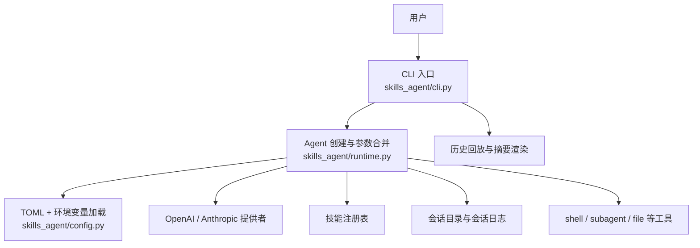
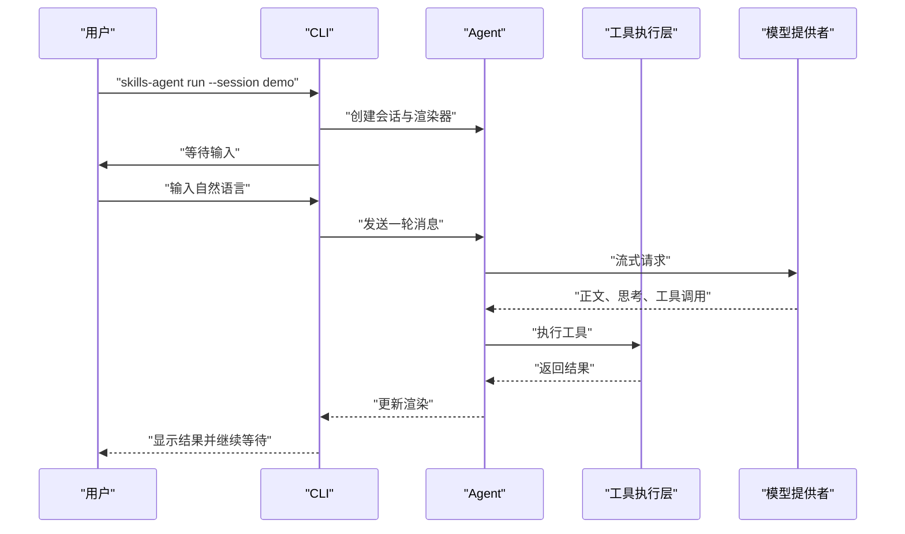
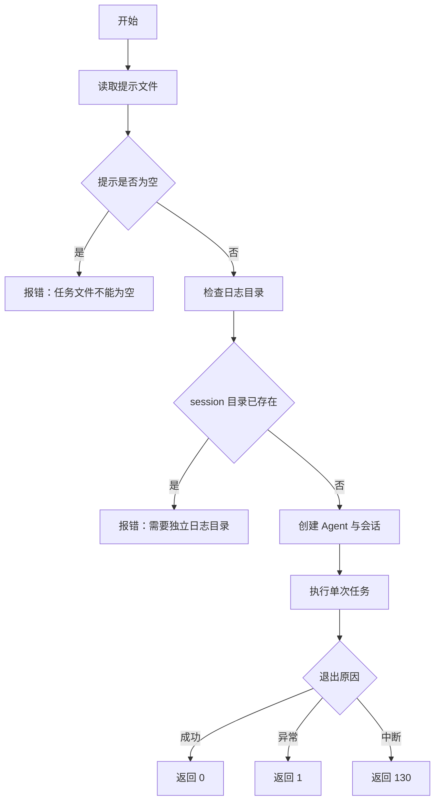
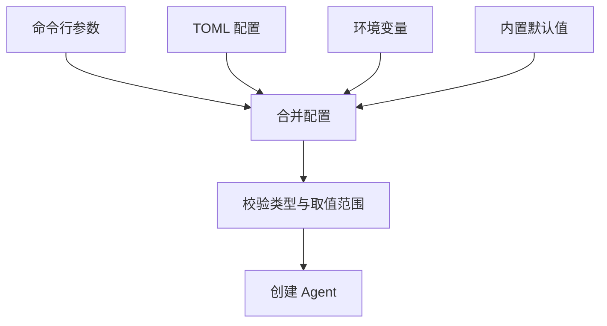

# 快速开始

<cite>
**本文引用的文件**   
- [README.md](file://README.md)
- [pyproject.toml](file://pyproject.toml)
- [skills-agent.toml](file://skills-agent.toml)
- [docs/usage.md](file://docs/usage.md)
- [skills_agent/cli.py](file://skills_agent/cli.py)
- [skills_agent/config.py](file://skills_agent/config.py)
- [skills_agent/environment.py](file://skills_agent/environment.py)
- [skills_agent/benchmark.py](file://skills_agent/benchmark.py)
- [skills_agent/runtime.py](file://skills_agent/runtime.py)
</cite>

## 目录
1. [简介](#简介)
2. [项目结构](#项目结构)
3. [安装与环境准备](#安装与环境准备)
4. [配置模型与密钥](#配置模型与密钥)
5. [运行交互式会话](#运行交互式会话)
6. [历史回放、工作目录与附件](#历史回放工作目录与附件)
7. [单次任务基准示例](#单次任务基准示例)
8. [命令行参数与配置优先级](#命令行参数与配置优先级)
9. [常见问题排查](#常见问题排查)
10. [总结](#总结)

## 简介
`skills-agent` 是一个 Python 命令行智能体。它读取内置技能和参考脚本，根据自然语言指令生成代码和命令，通过 shell 执行，再依据结果自我修正。与传统程序不同，它不是按固定流程运行一组预写函数，而是让模型在工具约束下动态规划：读技能、写脚本、执行、观察输出并迭代修复，直到完成任务或达到限制。

它的核心职责包括：
- 管理对话会话和历史记录；
- 维护上下文窗口、压缩策略和输出额度；
- 调用 OpenAI 或 Anthropic 接口；
- 执行 shell、子代理、文件和图片等工具；
- 提供交互终端、历史回放和单次任务模式。

与传统脚本相比，它更适合“描述目标后让模型逐步完成”的任务，例如分析环境、编写脚本、调试错误、整理报告等。

**本节来源**
- [README.md:1-68](file://README.md#L1-L68)

## 项目结构
仓库采用功能分层的组织方式：
- `skills_agent/`：运行时实现，包括 CLI、配置、提供者、会话、工具、背景任务、终端显示等；
- `skills_agent/builtin_skills/`：内置技能，如文件编辑、反馈、进程管理、工作区提取等；
- `docs/`：使用说明、提示词历史和评测资料；
- `adapters/`：ALE 与 Harbor 等外部适配器和测评控制器；
- `tests/`：单元测试；
- `pyproject.toml`：包元数据、依赖和入口点；
- `skills-agent.toml`：默认配置示例。



**图示来源**
- [skills_agent/cli.py:1-50](file://skills_agent/cli.py#L1-L50)
- [skills_agent/runtime.py:1-58](file://skills_agent/runtime.py#L1-L58)
- [skills_agent/config.py:1-74](file://skills_agent/config.py#L1-L74)

**本节来源**
- [pyproject.toml:1-23](file://pyproject.toml#L1-L23)
- [README.md:1-68](file://README.md#L1-L68)

## 安装与环境准备
本项目要求 Python 3.11 或更高版本，并通过 `pyproject.toml` 声明依赖和可执行入口。

推荐步骤如下：

1. 确认 Python 版本不低于 3.11：
   ```sh
   python3 --version
   ```

2. 创建虚拟环境：
   ```sh
   python3 -m venv .venv
   ```

3. 激活虚拟环境（Windows PowerShell 使用 `.venv\Scripts\Activate.ps1`）：
   ```sh
   source .venv/bin/activate
   ```

4. 以可编辑模式安装：
   ```sh
   pip install -e .
   ```

5. 验证入口命令是否可用：
   ```sh
   skills-agent --help
   ```

安装完成后，`skills-agent` 会由 `pyproject.toml` 中的脚本入口指向 `skills_agent.cli:main`。

**本节来源**
- [pyproject.toml:1-23](file://pyproject.toml#L1-L23)
- [README.md:6-23](file://README.md#L6-L23)

## 配置模型与密钥
默认配置示例位于 `skills-agent.toml`，其中包含上下文预算、模型窗口、输出额度等字段。最小化运行时只需设置 API Key 和模型名称。

### OpenAI 模式
```sh
export OPENAI_API_KEY='你的密钥'
export OPENAI_MODEL='支持工具调用的模型名称'
skills-agent run --session demo
```

### Anthropic 模式
```sh
export ANTHROPIC_API_KEY='你的密钥'
export ANTHROPIC_MODEL='支持工具调用的模型名称'
skills-agent run --provider anthropic --session claude
```

### 关键注意事项
- API Key **只从环境变量读取**，不会写入 TOML；`.env` 可由外部启动器加载，但本项目的 TOML 不直接解析 `.env`。
- 模型名称可通过命令行 `--model` 或对应 `OPENAI_MODEL` / `ANTHROPIC_MODEL` 指定。
- 兼容服务可使用 `--base-url` 和 `--api-format responses|chat`。
- 模型上下文窗口与输出额度必须与实际模型能力匹配；如果设置的值超过模型上限，可能触发请求失败、截断或上下文压缩异常。

**本节来源**
- [skills-agent.toml:1-18](file://skills-agent.toml#L1-L18)
- [README.md:24-48](file://README.md#L24-L48)
- [docs/usage.md:1-80](file://docs/usage.md#L1-L80)
- [skills_agent/runtime.py:32-58](file://skills_agent/runtime.py#L32-L58)

## 运行交互式会话
交互式会话是主要使用方式：输入自然语言，发送一轮，等待 Agent 思考、调用工具、执行命令并返回结果。

完整流程如下：

1. 设置环境变量并启动会话：
   ```sh
   export OPENAI_API_KEY='你的密钥'
   export OPENAI_MODEL='支持工具调用的模型名称'
   skills-agent run --session demo
   ```

2. 进入交互界面后输入自然语言：
   ```text
   > 检查当前工作目录
   > 继续分析刚才的结果
   ```

3. 退出会话：
   - 输入 `/exit`；
   - 或按下 `Ctrl-D`；
   - 中断当前任务使用 `Ctrl-C`。

4. 恢复同一会话：
   ```sh
   skills-agent run --session demo
   ```
   再次启动同名会话时，会先回放已保存的主会话历史，然后继续等待输入。

### 交互行为说明
- 每行输入作为一轮；
- `Ctrl-C` 停止当前任务并清理正在运行的工具；
- 会话默认保存在 `<workspace>/.agent/sessions`；
- 首次启动会自动采集工作目录、Git 状态、平台、Shell 和操作系统信息，用于系统提示词。



**图示来源**
- [skills_agent/cli.py:1-50](file://skills_agent/cli.py#L1-L50)
- [skills_agent/runtime.py:32-58](file://skills_agent/runtime.py#L32-L58)

**本节来源**
- [README.md:6-23](file://README.md#L6-L23)
- [docs/usage.md:1-40](file://docs/usage.md#L1-L40)
- [skills_agent/environment.py:1-76](file://skills_agent/environment.py#L1-L76)

## 历史回放、工作目录与附件
### 回放会话
无需配置 API Key 即可回放历史记录：
```sh
skills-agent history --session demo
skills-agent history --session demo --full
```
- 普通回放只显示摘要；
- `--full` 展开原始公开消息、命令源码和工具输出。

### 指定工作目录
```sh
skills-agent run --session task --workspace /path/to/task
```
- 默认工作目录是当前目录；
- 会话默认写入 `<workspace>/.agent/sessions`。

### 添加附件
```sh
skills-agent run --session files \
  --file ./image.png \
  --file ./report.pdf \
  --file ./data.csv
```
- 支持 PNG、JPEG、GIF、WebP、PDF 和 UTF-8 文本附件；
- 多个 `--file` 依次添加；
- 相对路径按工作目录解析。

**本节来源**
- [README.md:14-33](file://README.md#L14-L33)
- [docs/usage.md:41-110](file://docs/usage.md#L41-L110)
- [skills_agent/cli.py:201-320](file://skills_agent/cli.py#L201-L320)

## 单次任务基准示例
`benchmark` 适合自动化单次任务：从文件读取提示，运行到模型给出最终回答后退出，并使用独立日志目录。

最小示例：

1. 准备提示文件 `/path/to/prompt.txt`；
2. 准备工作目录 `/path/to/task`；
3. 运行：
   ```sh
   skills-agent benchmark \
     --prompt-file /path/to/prompt.txt \
     --workspace /path/to/task \
     --log-dir /path/to/run-logs
   ```

或者使用模块方式：
```sh
python -m skills_agent.benchmark \
  --prompt-file /path/to/prompt.txt \
  --workspace /path/to/task \
  --log-dir /path/to/run-logs
```

### 基准行为
- 每次运行创建独立的 `<log-dir>/session`；
- 已存在同名 session 目录时报错；
- 正常结束返回码为 0；
- 异常返回码为 1；
- 被中断返回码为 130；
- 不允许跨任务保留后台服务。



**图示来源**
- [skills_agent/benchmark.py:1-59](file://skills_agent/benchmark.py#L1-L59)

**本节来源**
- [README.md:49-68](file://README.md#L49-L68)
- [docs/usage.md:111-161](file://docs/usage.md#L111-L161)
- [skills_agent/benchmark.py:1-59](file://skills_agent/benchmark.py#L1-L59)

## 命令行参数与配置优先级
### 优先级规则
配置来源的优先级从高到低为：

1. 显式命令行参数；
2. `skills-agent.toml` 配置文件；
3. 已支持的环境变量；
4. 内置默认值。

API Key 始终只从环境变量读取。

### 常用参数
| 参数 | 作用 | 默认值或说明 |
|---|---|---|
| `--session NAME` | 指定会话名 | 交互式会话使用 |
| `--workspace PATH` | 指定工作目录 | 默认当前目录 |
| `--sessions-dir PATH` | 指定会话存储位置 | 默认 `<workspace>/.agent/sessions` |
| `--config PATH` | 指定 TOML 配置文件 | 默认读取工作目录下的 `skills-agent.toml` |
| `--provider openai|anthropic` | 选择模型提供方 | 默认 `openai` |
| `--model NAME` | 指定模型名称 | 也可用 `OPENAI_MODEL` / `ANTHROPIC_MODEL` |
| `--base-url URL` | 兼容服务的 API base URL | 可选 |
| `--skill-dir PATH` | 额外技能目录 | 可多次传入 |
| `--context-tokens N` | 工作上下文 token 预算 | 正整数 |
| `--max-output-tokens N` | 单次输出额度 | 正整数 |
| `--summary-output-tokens N` | 辅助生成输出上限 | 正整数 |
| `--api-format auto|responses|chat` | API 协议格式 | 默认自动 |
| `--token-counter auto|official|usage` | 用量计数模式 | 默认自动 |
| `--model-context-window N` | 模型实际上下文窗口 | 正整数 |
| `--sandbox-image IMAGE` | 指定 Docker 沙箱镜像 | 可选 |
| `--file PATH` | 添加附件 | 基准模式可用 |

### 配置文件关键字段
`skills-agent.toml` 中常见字段包括：
- `context_tokens`：工作上下文预算；
- `model_context_window`：模型总窗口；
- `max_output_tokens`：单次输出额度；
- `summary_output_tokens`：辅助生成输出上限；
- `provider`、`model`、`base_url`、`api_format`、`token_counter`；
- `skill_dirs`、`sandbox_image`。

这些值会被 `load_agent_config` 校验，token 类字段必须是正整数，枚举字段必须在允许集合内。



**图示来源**
- [skills_agent/config.py:1-74](file://skills_agent/config.py#L1-L74)
- [skills_agent/runtime.py:1-31](file://skills_agent/runtime.py#L1-L31)

**本节来源**
- [skills-agent.toml:1-18](file://skills-agent.toml#L1-L18)
- [skills_agent/config.py:1-74](file://skills_agent/config.py#L1-L74)
- [skills_agent/runtime.py:1-31](file://skills_agent/runtime.py#L1-L31)
- [docs/usage.md:41-110](file://docs/usage.md#L41-L110)

## 常见问题排查
### 安装失败
- **Python 版本过低**：项目要求 Python 3.11+，请先升级 Python。
- **依赖安装失败**：优先确认网络可达；必要时使用国内镜像源安装依赖后再执行 `pip install -e .`。
- **权限问题**：全局安装可能需要管理员权限，建议使用虚拟环境避免修改系统 Python。
- **虚拟环境未激活**：确保使用 `.venv/bin/python` 或已激活的 shell 运行 `skills-agent`。

**本节来源**
- [pyproject.toml:1-23](file://pyproject.toml#L1-L23)
- [README.md:6-13](file://README.md#L6-L13)

### API Key 未设置或模型名称缺失
- 启动时报需配置 model 或相应环境变量；
- OpenAI 模式应设置 `OPENAI_API_KEY` 和 `OPENAI_MODEL`；
- Anthropic 模式应设置 `ANTHROPIC_API_KEY` 和 `ANTHROPIC_MODEL`；
- 如果使用兼容服务，还需检查 `--base-url` 和 `--api-format`。

**本节来源**
- [skills_agent/runtime.py:32-58](file://skills_agent/runtime.py#L32-L58)
- [docs/usage.md:1-80](file://docs/usage.md#L1-L80)

### 会话目录权限不足
- 会话默认写入 `<workspace>/.agent/sessions`；
- 如果工作目录不可写，会无法创建或写入会话文件；
- 解决方法：切换到可写目录，或将工作目录改为有写入权限的路径；
- 也可通过 `--sessions-dir PATH` 指定可写的会话目录。

**本节来源**
- [docs/usage.md:100-110](file://docs/usage.md#L100-L110)
- [README.md:34-48](file://README.md#L34-L48)

### 模型上下文窗口或输出额度不匹配
- 如果 `model_context_window` 小于实际需要，或 `max_output_tokens` 过小，可能导致截断、压缩过早或请求失败；
- 请根据所用模型的实际规格调整；
- 官方支持约 1M 上下文、最高 393216 输出的模型应在配置中体现真实窗口与输出限额。

**本节来源**
- [skills-agent.toml:1-18](file://skills-agent.toml#L1-L18)
- [README.md:34-48](file://README.md#L34-L48)
- [docs/usage.md:41-110](file://docs/usage.md#L41-L110)

### 基准模式日志目录冲突
- `--log-dir` 下若已存在 `session` 子目录，基准模式会拒绝覆盖；
- 每次运行应使用新的日志目录，避免任务间污染。

**本节来源**
- [skills_agent/benchmark.py:1-59](file://skills_agent/benchmark.py#L1-L59)

## 总结
`skills-agent` 是一个面向任务的命令行智能体：它不像传统程序那样执行固定逻辑，而是在工具约束下动态编写和执行脚本，并根据结果自我修正。快速上手的关键是：
- 使用 Python 3.11+ 和虚拟环境安装；
- 设置对应的 API Key 和模型名称；
- 用 `skills-agent run --session demo` 进行交互式对话；
- 用 `history --full` 回放历史；
- 用 `--workspace` 和 `--file` 控制工作目录与附件；
- 用 `benchmark` 执行单次自动化任务；
- 注意配置优先级，并确保模型窗口与输出额度与实际模型一致。