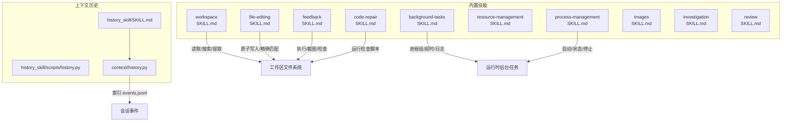
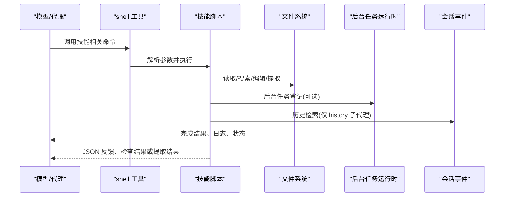
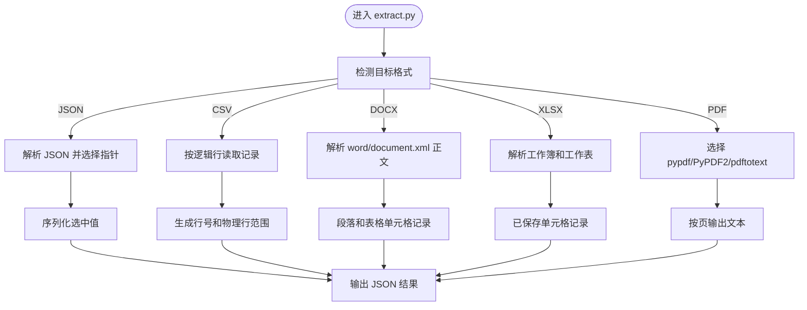
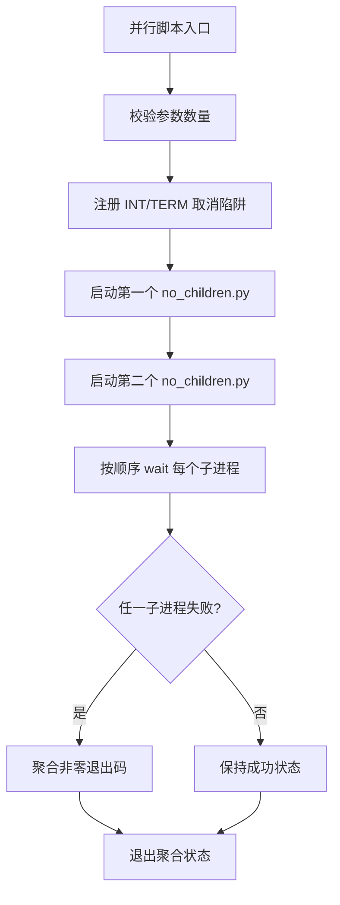
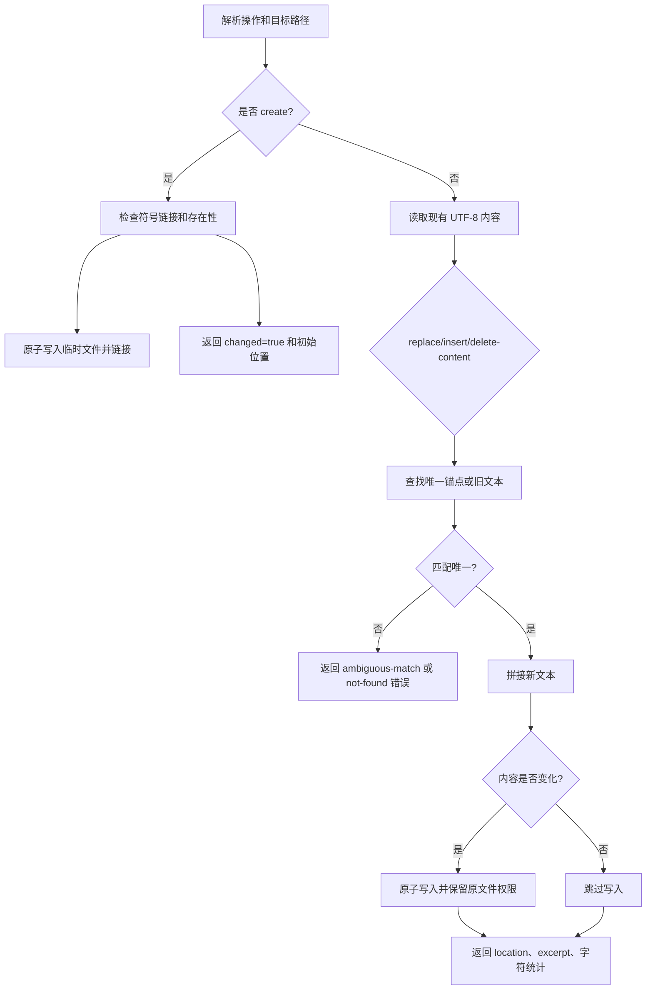
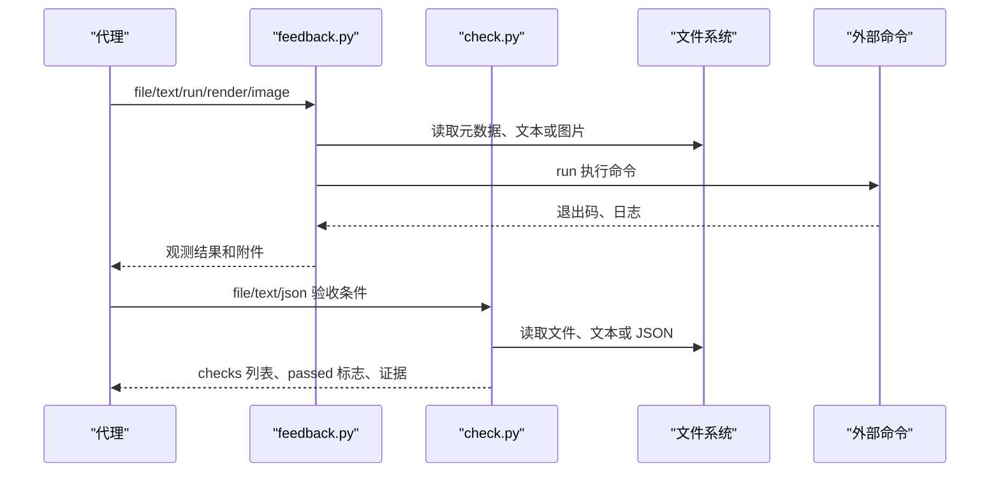
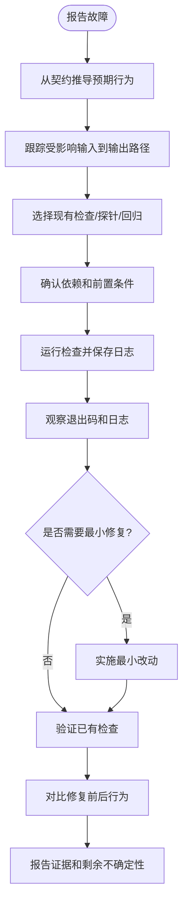
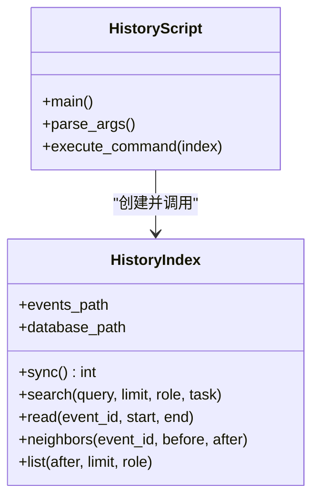
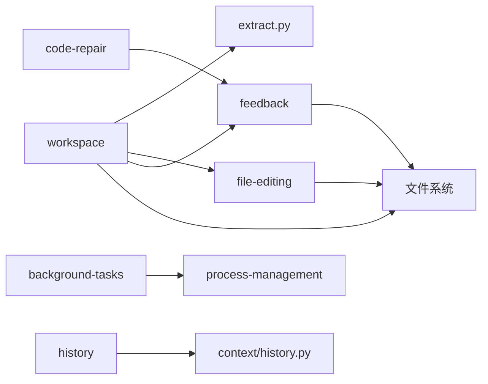

# 内置技能详解

<cite>
**本文引用的文件**   
- [workspace/SKILL.md](file://skills_agent/builtin_skills/workspace/SKILL.md)
- [workspace/scripts/workspace.py](file://skills_agent/builtin_skills/workspace/scripts/workspace.py)
- [workspace/scripts/extract.py](file://skills_agent/builtin_skills/workspace/scripts/extract.py)
- [workspace/references/extraction.md](file://skills_agent/builtin_skills/workspace/references/extraction.md)
- [background-tasks/SKILL.md](file://skills_agent/builtin_skills/background-tasks/SKILL.md)
- [background-tasks/scripts/no_children.py](file://skills_agent/builtin_skills/background-tasks/scripts/no_children.py)
- [background-tasks/scripts/sequential.py](file://skills_agent/builtin_skills/background-tasks/scripts/sequential.py)
- [background-tasks/scripts/parallel.sh](file://skills_agent/builtin_skills/background-tasks/scripts/parallel.sh)
- [file-editing/SKILL.md](file://skills_agent/builtin_skills/file-editing/SKILL.md)
- [file-editing/scripts/edit.py](file://skills_agent/builtin_skills/file-editing/scripts/edit.py)
- [file-editing/references/incremental-editing.md](file://skills_agent/builtin_skills/file-editing/references/incremental-editing.md)
- [feedback/SKILL.md](file://skills_agent/builtin_skills/feedback/SKILL.md)
- [feedback/scripts/feedback.py](file://skills_agent/builtin_skills/feedback/scripts/feedback.py)
- [feedback/scripts/check.py](file://skills_agent/builtin_skills/feedback/scripts/check.py)
- [feedback/references/acceptance-checks.md](file://skills_agent/builtin_skills/feedback/references/acceptance-checks.md)
- [feedback/references/feedback-loop.md](file://skills_agent/builtin_skills/feedback/references/feedback-loop.md)
- [code-repair/SKILL.md](file://skills_agent/builtin_skills/code-repair/SKILL.md)
- [code-repair/scripts/run_check.py](file://skills_agent/builtin_skills/code-repair/scripts/run_check.py)
- [code-repair/scripts/run_check.sh](file://skills_agent/builtin_skills/code-repair/scripts/run_check.sh)
- [history_skill/SKILL.md](file://skills_agent/context/history_skill/SKILL.md)
- [history_skill/scripts/history.py](file://skills_agent/context/history_skill/scripts/history.py)
- [context/history.py](file://skills_agent/context/history.py)
</cite>

## 目录
1. [引言](#引言)
2. [项目结构总览](#项目结构总览)
3. [核心技能清单](#核心技能清单)
4. [架构与子系统关系](#架构与子系统关系)
5. [详细技能分析](#详细技能分析)
6. [依赖关系分析](#依赖关系分析)
7. [性能与资源特征](#性能与资源特征)
8. [常见问题排查](#常见问题排查)
9. [结论](#结论)

## 引言
本参考文档面向需要理解、扩展或调试“内置技能”的开发者，覆盖以下技能：workspace、background-tasks、file-editing、feedback、code-repair、review、images、investigation、process-management、resource-management 和 history。每个技能均从用途、触发时机、输入参数与 JSON Schema、输出格式、关联脚本与 references 文档、典型使用示例，以及与其他子系统的关系进行说明。重点解释 workspace 的文件提取与工作区探测机制、background-tasks 的并行与串行任务脚本、file-editing 的增量编辑能力、feedback 的检查反馈循环、code-repair 的修复检查流程，以及 history skill 的历史消息检索方式。

对于 review、images、investigation、process-management、resource-management 等未包含独立实现脚本的技能，本文依据其 SKILL.md 说明其职责边界和使用方法；其中 resource-management 在仓库中存在 SKILL.md 及完整提示词历史，而 review、images、investigation、process-management 在仓库结构中仅有 SKILL.md 占位或引用其他技能的说明。

## 项目结构总览
内置技能按功能组织在 `skills_agent/builtin_skills` 下，每个技能通常包含三类内容：
- `SKILL.md`：技能描述、适用场景、调用规则、参数约定和注意事项。
- `scripts/`：可直接通过 shell 调用的 Python 或 Shell 参考实现。
- `references/`：补充说明、示例工作流、验收条件或跨回合操作指南。

历史检索能力位于 `skills_agent/context/history_skill`，由主代理通过带 `history: true` 的子代理加载。



**图表来源**
- [workspace/SKILL.md:1-26](file://skills_agent/builtin_skills/workspace/SKILL.md#L1-L26)
- [background-tasks/SKILL.md:1-131](file://skills_agent/builtin_skills/background-tasks/SKILL.md#L1-L131)
- [file-editing/SKILL.md:1-30](file://skills_agent/builtin_skills/file-editing/SKILL.md#L1-L30)
- [feedback/SKILL.md:1-31](file://skills_agent/builtin_skills/feedback/SKILL.md#L1-L31)
- [history_skill/SKILL.md:1-33](file://skills_agent/context/history_skill/SKILL.md#L1-L33)

**章节来源**
- [workspace/SKILL.md:1-26](file://skills_agent/builtin_skills/workspace/SKILL.md#L1-L26)
- [background-tasks/SKILL.md:1-131](file://skills_agent/builtin_skills/background-tasks/SKILL.md#L1-L131)
- [history_skill/SKILL.md:1-33](file://skills_agent/context/history_skill/SKILL.md#L1-L33)

## 核心技能清单
| 技能 | 主要用途 | 关键脚本 | 关键 references | 是否具备独立可执行逻辑 |
|---|---|---|---|---|
| workspace | 选择性读取大文件、结构化附件、环境探测 | `scripts/workspace.py`、`scripts/extract.py` | `references/extraction.md` | 是 |
| background-tasks | 注册后台计算或服务、管理生命周期 | `scripts/no_children.py`、`scripts/sequential.py`、`scripts/parallel.sh` | 无专用 references | 是（示例脚本） |
| file-editing | 精确增量编辑现有文本文件 | `scripts/edit.py` | `references/incremental-editing.md` | 是 |
| feedback | 获取文件、文本、命令结果、图片并做验收检查 | `scripts/feedback.py`、`scripts/check.py` | `references/acceptance-checks.md`、`references/feedback-loop.md` | 是 |
| code-repair | 诊断缺陷、最小修复、验证行为 | `scripts/run_check.py`、`scripts/run_check.sh` | 无专用 references | 是（检查辅助） |
| history | 检索主会话原始证据 | `scripts/history.py` | `SKILL.md` | 是 |
| resource-management | 规划内存、并发与规模 | 无独立脚本 | `SKILL.md` | 否（决策指导） |
| process-management | 跨调用进程启动、观察、等待、停止 | 见其 SKILL.md 引用 | 见其 SKILL.md 引用 | 由 SKILL.md 指引 |
| images | 声明图片、准备或组合图像 | 见其 SKILL.md 引用 | 见其 SKILL.md 引用 | 由 SKILL.md 指引 |
| investigation | 调查类工作入口 | 见其 SKILL.md 引用 | 见其 SKILL.md 引用 | 由 SKILL.md 指引 |
| review | 审查类工作入口 | 见其 SKILL.md 引用 | 见其 SKILL.md 引用 | 由 SKILL.md 指引 |

**章节来源**
- [workspace/SKILL.md:1-26](file://skills_agent/builtin_skills/workspace/SKILL.md#L1-L26)
- [background-tasks/SKILL.md:1-131](file://skills_agent/builtin_skills/background-tasks/SKILL.md#L1-L131)
- [file-editing/SKILL.md:1-30](file://skills_agent/builtin_skills/file-editing/SKILL.md#1-L30)
- [feedback/SKILL.md:1-31](file://skills_agent/builtin_skills/feedback/SKILL.md#L1-L31)
- [code-repair/SKILL.md:1-15](file://skills_agent/builtin_skills/code-repair/SKILL.md#L1-L15)
- [history_skill/SKILL.md:1-33](file://skills_agent/context/history_skill/SKILL.md#L1-L33)

## 架构与子系统关系
内置技能并不直接构成一个统一框架，而是围绕以下子系统协作：
- **工具执行**：所有技能最终通过 shell 工具执行 Python 或 Shell 脚本。workspace、file-editing、feedback、code-repair、history 都明确以脚本为参考实现。
- **后台任务**：background-tasks 通过 shell 的 `run_in_background` 启动原生进程组；process-management 提供跨调用进程管理接口。两者都与运行时生命周期、日志和清理协议绑定。
- **会话上下文**：history skill 通过 `HistoryIndex` 对主会话 `events.jsonl` 建立增量 SQLite 索引，供历史检索子代理只读访问。
- **反馈与验收**：feedback 提供文件、文本、命令和图片反馈，check 提供显式验收条件；code-repair 在其基础上选择检查或回归。
- **资源约束**：resource-management 不强制执行限制，但指导模型在扩大规模、并发或中间状态前估算内存和 CPU。



**图表来源**
- [background-tasks/SKILL.md:1-131](file://skills_agent/builtin_skills/background-tasks/SKILL.md#L1-L131)
- [feedback/SKILL.md:1-31](file://skills_agent/builtin_skills/feedback/SKILL.md#L1-L31)
- [history_skill/SKILL.md:1-33](file://skills_agent/context/history_skill/SKILL.md#L1-L33)

**章节来源**
- [background-tasks/SKILL.md:1-131](file://skills_agent/builtin_skills/background-tasks/SKILL.md#L1-L131)
- [feedback/SKILL.md:1-31](file://skills_agent/builtin_skills/feedback/SKILL.md#L1-L31)
- [history_skill/SKILL.md:1-33](file://skills_agent/context/history_skill/SKILL.md#L1-L33)

## 详细技能分析

### workspace 技能
#### 用途和适用场景
workspace 用于选择性读取大文件或结构化附件，包括 JSON、CSV、DOCX、XLSX、PDF，也可检查本地可执行文件和模块是否存在。它不适合简单定点文本读取或普通搜索——这些应直接用 shell 命令。它也明确区分“提取存储内容”和“文档布局、OCR、公式计算或程序行为”。

#### 触发时机
当需要定位输入中的相关部分、保留来源路径和行号、继续跟随截断游标，或探测运行环境时触发。

#### 输入参数与 JSON Schema
workspace 本身通过 shell 调用两个参考脚本：

1. `scripts/workspace.py`
   - 子命令：`read`、`search`。
   - `read PATH --start N --end M`：读取一行的 UTF-8 文本，返回带行号的行；默认范围为 `start` 起 200 行。
   - `search PATTERN PATH... [--regex] [--glob '*.py']`：递归搜索文件内容，返回文件名和一行基行号。
   - 行号校验要求 `1 <= start <= end`。
   - 正则表达式、glob 过滤和 UnicodeError 会转为参数错误。

2. `scripts/extract.py`
   - 支持 JSON Pointer、CSV 记录、DOCX 正文、XLSX 单元格、PDF 页面文本。
   - 公共字段包括 `source`、`format`、`text`、`truncated`、`next`。
   - JSON 指针为空表示根节点，数组索引从零开始，缺失成员或非法指针报错。
   - CSV 默认编码为 `utf-8-sig`，分隔符为一字符，不推断表头或类型。
   - XLSX 报告已保存单元格，不计算公式，日期保持序列号，样式不应用。
   - PDF 自动尝试 pypdf、PyPDF2、pdftotext，不安装依赖，不支持密码解密。

3. `scripts/probe_environment.py`
   - `--executable NAME` / `--module NAME` 检查能力，可重复。
   - 模块名为顶层名称，不含点；任一缺失退出码为 1。

#### 输出格式
- `workspace.py read`：逐行打印编号 UTF-8 文本。
- `workspace.py search`：每行输出 `文件:行号:内容`。
- `extract.py`：成功时打印单个 JSON 对象，失败时非零退出并输出错误。JSON 选择返回序列化后的值；CSV、DOCX、XLSX、PDF 返回记录集合、位置、截断标志和续读游标。

#### 关联脚本与 references
- 参考脚本：[scripts/workspace.py](file://skills_agent/builtin_skills/workspace/scripts/workspace.py)、[scripts/extract.py](file://skills_agent/builtin_skills/workspace/scripts/extract.py)。
- 参考文档：[references/extraction.md](file://skills_agent/builtin_skills/workspace/references/extraction.md)。

#### 典型使用示例
- 读取指定行范围：
  ```sh
  python3 <skill-dir>/scripts/workspace.py read <file> --start 1 --end 200
  ```
- 搜索 Python 文件中的模式：
  ```sh
  python3 <skill-dir>/scripts/workspace.py search '<pattern>' <path> --glob '*.py'
  ```
- 提取 JSON 子值：
  ```sh
  python3 <skill-dir>/scripts/extract.py json <data.json> --pointer '/users/0/name'
  ```
- 探测 PDF 读取器：
  ```sh
  python3 <skill-dir>/scripts/probe_environment.py --module pypdf --executable pdftotext
  ```

#### 与其他子系统的关系
- 工具执行：通过 shell 调用 Python 脚本，不引入固定工具注册。
- 后台任务：长时间工作应改用 managed background processes。
- 会话上下文：workspace 不应直接读取会话目录；历史检索交给 history skill 和 `history: true` 子代理。

#### 文件提取与工作区探测机制


**图表来源**
- [workspace/scripts/extract.py:1-200](file://skills_agent/builtin_skills/workspace/scripts/extract.py#L1-L200)
- [workspace/references/extraction.md:1-60](file://skills_agent/builtin_skills/workspace/references/extraction.md#L1-L60)

**章节来源**
- [workspace/SKILL.md:1-26](file://skills_agent/builtin_skills/workspace/SKILL.md#L1-L26)
- [workspace/scripts/workspace.py:1-59](file://skills_agent/builtin_skills/workspace/scripts/workspace.py#L1-L59)
- [workspace/scripts/extract.py:1-200](file://skills_agent/builtin_skills/workspace/scripts/extract.py#L1-L200)
- [workspace/references/extraction.md:1-60](file://skills_agent/builtin_skills/workspace/references/extraction.md#L1-L60)

### background-tasks 技能
#### 用途和适用场景
当 shell 调用必须提前返回，而其命令仍需继续运行时使用。适用于注册计算任务或保留服务，具有独立截止时间、自动完成结果和运行时监督。前台命令或内部并行且入口脚本等待所有子进程的脚本仍属于前台执行。

#### 触发时机
任何需要在 shell 工具返回后继续运行的命令都需要该技能。判断标准是“控制移交”，而不是持续时间、是否产生子进程或是否为服务器。

#### 输入参数与 JSON Schema
通过 shell 工具的 JSON 参数定义任务：
- `name`：人类可读的任务名。
- `command`：实际前台工作命令，不得追加 `&`、`nohup`、`setsid` 或自守护。
- `run_in_background`：布尔值，决定是否异步返回。
- `background_lifecycle`：`task` 或 `service`。
- `timeout_seconds`：前台命令最大 600 秒；后台任务可为任意正有限值，`task` 默认 3600 秒，`service` 不设置则无执行截止时间。
- `images`：最多十个绝对路径或 `file://` URL，每个最终图像不超过 1 MB。

#### 输出格式
- 启动回执包含稳定 `job_id`、`display_name`、`process_record_path`、`stdout_path`、`stderr_path`、内部 `state_dir` 和 `name`。
- 完成后投递实际状态、有界 stdout/stderr 和完整日志路径。
- 超时有效退出码为 124；未完成或无法确认的状态标记为 `unconfirmed`。

#### 关联脚本与 references
- 示例脚本：
  - `scripts/no_children.py`：无前驱/后继任务的刷新进度与保存结果示例。
  - `scripts/sequential.py`：同步运行一个子命令并保留退出状态。
  - `scripts/parallel.sh`：同一进程组启动两个子进程，逐个 wait，聚合非零状态，处理取消。

#### 典型使用示例
- 启动后台计算：
  ```json
  {
    "name": "构建分析输出",
    "command": "python3 -u /ABS/TASK/analyze.py",
    "run_in_background": true,
    "background_lifecycle": "task",
    "timeout_seconds": 7200
  }
  ```
- 启动保留服务：
  ```json
  {
    "name": "启动本地预览服务",
    "command": "python3 -u -m http.server 8765 --bind 127.0.0.1",
    "run_in_background": true,
    "background_lifecycle": "service"
  }
  ```
- 并行子任务示例：
  ```sh
  bash /ABS/SKILL/scripts/parallel.sh /ABS/TASK/results
  ```

#### 并行与串行任务脚本


**图表来源**
- [background-tasks/scripts/parallel.sh:1-63](file://skills_agent/builtin_skills/background-tasks/scripts/parallel.sh#L1-L63)
- [background-tasks/scripts/no_children.py:1-38](file://skills_agent/builtin_skills/background-tasks/scripts/no_children.py#L1-L38)

#### 与其他子系统的关系
- 工具执行：通过 shell 的 `run_in_background` 完成控制移交。
- 后台任务运行时：负责进程组清理、超时、日志保存、完成结果投递。
- 进程管理：仅在中途状态、日志尾、就绪检查、有界等待或显式停止时需要 process-management。

**章节来源**
- [background-tasks/SKILL.md:1-131](file://skills_agent/builtin_skills/background-tasks/SKILL.md#L1-L131)
- [background-tasks/scripts/no_children.py:1-38](file://skills_agent/builtin_skills/background-tasks/scripts/no_children.py#L1-L38)
- [background-tasks/scripts/sequential.py:1-26](file://skills_agent/builtin_skills/background-tasks/scripts/sequential.py#L1-L26)
- [background-tasks/scripts/parallel.sh:1-63](file://skills_agent/builtin_skills/background-tasks/scripts/parallel.sh#L1-L63)

### file-editing 技能
#### 用途和适用场景
用于精确修改现有文本或代码文件，保留周围内容、换行符和文件权限。不适合简单创建新文件、只读检查和二进制编辑。

#### 触发时机
当已知确切修改区域、需要基于当前保存内容增量调整，或一次修改可能影响后续相关修改时触发。

#### 输入参数与 JSON Schema
通过 `scripts/edit.py` 的命令行参数表达操作：
- `create PATH`：`--text TEXT`、`--text-file FILE` 或 stdin；拒绝覆盖已有文件。
- `replace PATH`：`--old TEXT` 或 `--old-file FILE`；替换为 `--new TEXT`、`--new-file FILE` 或 stdin。
- `insert PATH`：`--anchor TEXT` 或 `--anchor-file FILE`，`--position before|after`；内容来自 text/new。
- `delete-content PATH`：`--old TEXT` 或 `--old-file FILE`。
- `delete-file PATH`：删除单个常规文件，不递归。

参数要求：
- old 和 anchor 必须非空。
- 匹配必须唯一，重叠也算重复。
- 文本操作要求 UTF-8，不允许 NUL 字节。
- 目标必须是常规文件，不支持符号链接。
- 父目录必须存在。

#### 输出格式
每次操作返回 JSON，包含：
- `operation`：操作名。
- `path`：绝对路径。
- `changed`：是否发生写入。
- `location`：起始行和列。
- `excerpt`：带行号的附近文本片段。
- `characters_removed` / `characters_inserted`：变更统计。

#### 关联脚本与 references
- 参考脚本：[scripts/edit.py](file://skills_agent/builtin_skills/file-editing/scripts/edit.py)。
- 参考文档：[references/incremental-editing.md](file://skills_agent/builtin_skills/file-editing/references/incremental-editing.md)。

#### 典型使用示例
- 创建新文件：
  ```sh
  python3 /absolute/skill/scripts/edit.py create document.txt <<'TEXT'
  Section
  Original paragraph.
  TEXT
  ```
- 插入段落：
  ```sh
  python3 /absolute/skill/scripts/edit.py insert document.txt --anchor 'Original paragraph.' --position before <<'TEXT'
  Additional paragraph.
  TEXT
  ```
- 精确替换：
  ```sh
  python3 /absolute/skill/scripts/edit.py replace values.txt --old 'First: value' --new 'First: updated'
  ```

#### 增量编辑能力


**图表来源**
- [file-editing/scripts/edit.py:1-200](file://skills_agent/builtin_skills/file-editing/scripts/edit.py#L1-L200)
- [file-editing/references/incremental-editing.md:1-93](file://skills_agent/builtin_skills/file-editing/references/incremental-editing.md#L1-L93)

#### 与其他子系统的关系
- 工具执行：通过 shell 调用 Python 脚本，每次调用独立解析路径，变量不跨调用持久。
- 反馈：编辑后可用 feedback 的 `text` 或 `file` 验证真实写入内容。
- 会话上下文：不直接参与历史检索。

**章节来源**
- [file-editing/SKILL.md:1-30](file://skills_agent/builtin_skills/file-editing/SKILL.md#L1-L30)
- [file-editing/scripts/edit.py:1-200](file://skills_agent/builtin_skills/file-editing/scripts/edit.py#L1-L200)
- [file-editing/references/incremental-editing.md:1-93](file://skills_agent/builtin_skills/file-editing/references/incremental-editing.md#L1-L93)

### feedback 技能
#### 用途和适用场景
当下一步决策需要实际执行或工件证据时触发，包括有界命令运行、精确文本或 JSON 检查、HTML/SVG 渲染截图。单纯计划或不需执行的查找不应使用该技能。

#### 触发时机
需要行为证据、保存文本/值证据或视觉证据时。成功的写入、文件路径或截图命令本身不足以证明内容或视觉结果。

#### 输入参数与 JSON Schema
通过 `scripts/feedback.py` 提供获取操作：
- `file PATH [--limit 100]`：文件类型、大小、修改时间、SHA-256；目录元数据有界。
- `text PATH [--start 1 --end 200 --column 1 --max-chars 12000]`：编号 UTF-8 文本，支持 `next_line`/`next_column` 续读。
- `run --log-dir DIR [--timeout 120] -- COMMAND...`：实际退出码、超时标志、有界 stdout/stderr 尾部、完整二进制日志。
- `render PATH --output PNG [--width 1200 --height 800 --wait-ms 1000 --browser PATH --timeout 30]`：HTML/SVG 截图。
- `image PATH... [--label TEXT]`：现有图片像素，由运行时作为原生图像反馈发送。

通过 `scripts/check.py` 提供验收检查：
- `file PATH... [--min-bytes N]`：常规文件存在与最小大小。
- `text PATH --contains TEXT [--absent TEXT]`：文本存在或缺失。
- `json PATH [--pointer /path] --equals-json VALUE`：按 RFC 6901 指针比较 JSON 值。

#### 输出格式
- feedback 返回单个 JSON 信封，包含 `kind`、`source`、`observations`、`attachments`。
- run 和 render 超时返回 124；失败保留命令实际状态。
- check 返回 exit 0 表示提供的条件全部通过，exit 1 表示条件失败，exit 2 表示获取或输入错误。

#### 关联脚本与 references
- 参考脚本：[scripts/feedback.py](file://skills_agent/builtin_skills/feedback/scripts/feedback.py)、[scripts/check.py](file://skills_agent/builtin_skills/feedback/scripts/check.py)。
- 参考文档：[references/acceptance-checks.md](file://skills_agent/builtin_skills/feedback/references/acceptance-checks.md)、[references/feedback-loop.md](file://skills_agent/builtin_skills/feedback/references/feedback-loop.md)。

#### 检查反馈循环


**图表来源**
- [feedback/scripts/feedback.py:1-200](file://skills_agent/builtin_skills/feedback/scripts/feedback.py#L1-L200)
- [feedback/scripts/check.py:1-170](file://skills_agent/builtin_skills/feedback/scripts/check.py#L1-L170)
- [feedback/references/feedback-loop.md:1-77](file://skills_agent/builtin_skills/feedback/references/feedback-loop.md#L1-L77)

#### 与其他子系统的关系
- 工具执行：所有获取操作通过 shell 调用 Python 脚本。
- 后台任务：后台任务声明的图像在完成结果中附加；前台命令可通过 `images` 参数声明图片。
- 代码修复：code-repair 可在需要超时时优先使用 feedback 的 `run`。

**章节来源**
- [feedback/SKILL.md:1-31](file://skills_agent/builtin_skills/feedback/SKILL.md#L1-L31)
- [feedback/scripts/feedback.py:1-200](file://skills_agent/builtin_skills/feedback/scripts/feedback.py#L1-L200)
- [feedback/scripts/check.py:1-170](file://skills_agent/builtin_skills/feedback/scripts/check.py#L1-L170)
- [feedback/references/acceptance-checks.md:1-49](file://skills_agent/builtin_skills/feedback/references/acceptance-checks.md#L1-L49)
- [feedback/references/feedback-loop.md:1-77](file://skills_agent/builtin_skills/feedback/references/feedback-loop.md#L1-L77)

### code-repair 技能
#### 用途和适用场景
针对已报告或已观察到的代码故障进行诊断和经核实的修复。不适用于新功能开发、外观修改或缺乏缺陷证据的重构。

#### 触发时机
用户报告失败、测试失败、运行错误或行为不一致，且需要从输入到输出的真实路径中定位原因时触发。

#### 输入参数与 JSON Schema
code-repair 没有固定脚本接口，而是指导如何选择检查：
- 复用现有检查。
- 编写聚焦探针。
- 新建回归用例。
- 使用参考脚本：`scripts/run_check.py` 或 `scripts/run_check.sh`。

参考脚本参数：
- `log`：完整日志路径。
- `COMMAND...`：要执行的命令，`--` 后可省略前缀。
- 行为：保存合并输出，显示最后 8192 字节或约 30 行，打印退出码和日志路径，返回命令的实际退出码。
- 注意：这两个脚本不添加执行超时；如需超时请使用 feedback 的 `run`。

#### 输出格式
- 检查脚本返回命令的实际退出码。
- 日志包含完整输出，终端只显示尾部。
- 失败状态不会因格式化成功或表面成功行被覆盖。

#### 关联脚本与 references
- 参考脚本：[scripts/run_check.py](file://skills_agent/builtin_skills/code-repair/scripts/run_check.py)、[scripts/run_check.sh](file://skills_agent/builtin_skills/code-repair/scripts/run_check.sh)。

#### 典型使用示例
- 运行 Python 检查：
  ```sh
  python3 <skill-dir>/scripts/run_check.py /tmp/regression.log python -m unittest tests.test_example
  ```
- 使用 shell 版本：
  ```sh
  <skill-dir>/scripts/run_check.sh /tmp/regression.log -- python3 path/to/test.py
  ```

#### 修复检查流程


**图表来源**
- [code-repair/SKILL.md:1-15](file://skills_agent/builtin_skills/code-repair/SKILL.md#L1-L15)
- [code-repair/scripts/run_check.py:1-34](file://skills_agent/builtin_skills/code-repair/scripts/run_check.py#L1-L34)
- [code-repair/scripts/run_check.sh:1-25](file://skills_agent/builtin_skills/code-repair/scripts/run_check.sh#L1-L25)

#### 与其他子系统的关系
- feedback：需要超时、分离日志或更严格执行边界时使用 feedback 的 `run`。
- workspace：可能需要先定位相关文件。
- file-editing：修复后通过精确编辑更新受影响的代码。

**章节来源**
- [code-repair/SKILL.md:1-15](file://skills_agent/builtin_skills/code-repair/SKILL.md#L1-L15)
- [code-repair/scripts/run_check.py:1-34](file://skills_agent/builtin_skills/code-repair/scripts/run_check.py#L1-L34)
- [code-repair/scripts/run_check.sh:1-25](file://skills_agent/builtin_skills/code-repair/scripts/run_check.sh#L1-L25)

### history 技能
#### 用途和适用场景
仅在分配给 `history: true` 的历史检索子代理中使用，用于恢复原始主会话的需求、决策或执行证据。不用于工作区文件、私有子代理记录或执行历史任务。

#### 触发时机
主代理委派一个具名子代理并开启 `history: true`，同时提供具体问题时触发。普通子代理不会自动获得该技能或父会话上下文。

#### 输入参数与 JSON Schema
通过 `scripts/history.py` 操作 `HistoryIndex`：
- `session`：会话目录或其 `events.jsonl` 路径。
- `search "<query>" [--limit N] [--role ROLE] [--task TASK]`：关键词搜索。
- `read EVENT_ID [--start 1 --end N]`：按事件 ID 读取解码内容范围。
- `neighbors EVENT_ID [--before N] [--after N]`：查看相邻事件。
- `list [--after EVENT_ID] [--limit N] [--role ROLE]`：按角色或游标浏览。

#### 输出格式
- 返回 JSON，包含搜索结果、事件范围、关联调用、turn_id、原始引用等。
- 事件 ID 是稳定的字节偏移引用。
- 搜索预览明确是部分内容；使用前应读取匹配范围。
- 范围指记录解码内容的一行基行号，不是 JSONL 文件行号。

#### 关联脚本与 references
- 参考脚本：[scripts/history.py](file://skills_agent/context/history_skill/scripts/history.py)。
- 核心索引实现：[context/history.py](file://skills_agent/context/history.py)。
- 使用说明：[history_skill/SKILL.md](file://skills_agent/context/history_skill/SKILL.md)。

#### 历史消息检索方式


**图表来源**
- [context/history.py:1-200](file://skills_agent/context/history.py#L1-L200)
- [history_skill/scripts/history.py:1-49](file://skills_agent/context/history_skill/scripts/history.py#L1-L49)

#### 与其他子系统的关系
- 主代理：通过具名 `subagent` 和 `history: true` 委托历史检索。
- workspace：workspace 明确避免直接读取会话目录，历史检索走 history skill。
- 工具执行：history 脚本依赖 `skills_agent` 包中的 `HistoryIndex`。

**章节来源**
- [history_skill/SKILL.md:1-33](file://skills_agent/context/history_skill/SKILL.md#L1-L33)
- [history_skill/scripts/history.py:1-49](file://skills_agent/context/history_skill/scripts/history.py#L1-L49)
- [context/history.py:1-200](file://skills_agent/context/history.py#L1-L200)

### 其他内置技能说明
#### review
仓库中存在 `skills_agent/builtin_skills/review` 目录，但未在当前快照中提供独立脚本或完整说明文本。其职责应理解为审查类工作的入口，具体实现依赖上层 agent 策略或其他技能组合。

#### images
仓库中存在 `skills_agent/builtin_skills/images` 目录，并带有 SKILL.md 和 scripts/images.py。其职责主要是图像声明、准备和组合，配合 feedback 的截图和 background-tasks 的完成图像附件。由于本次分析未深入读取其脚本实现细节，本文不展开参数契约。

#### investigation
仓库中存在 `skills_agent/builtin_skills/investigation/scripts/fetch.py` 和 SKILL.md。它偏向调查类数据的获取，但本次文档不对其参数和行为做深入实现级解读。

#### process-management
SKILL.md 提供 `start/status/wait/logs/stop` 接口，用于跨 shell 调用观察和管理自有进程。它与 background-tasks 互补：前者适合长驻服务或跨回合可观察任务，后者适合运行时注册的后台作业和生命周期。

#### resource-management
SKILL.md 提供资源预算、代表性试跑、峰值观测和并发决策指导，但不强制内存上限。它强调不要仅按 CPU 核数或压缩文件大小安排并行，应结合可用预算、中间状态和并发副本需求做保守估计。

**章节来源**
- [resource-management/SKILL.md:1-97](file://docs/prompt-history/skill-resource-management.md#L1-L97)

## 依赖关系分析
内置技能之间的耦合较弱，主要通过 shell 工具、文件系统和运行时上下文协作：



**图表来源**
- [workspace/SKILL.md:1-26](file://skills_agent/builtin_skills/workspace/SKILL.md#L1-L26)
- [background-tasks/SKILL.md:1-131](file://skills_agent/builtin_skills/background-tasks/SKILL.md#L1-L131)
- [code-repair/SKILL.md:1-15](file://skills_agent/builtin_skills/code-repair/SKILL.md#L1-L15)
- [history_skill/SKILL.md:1-33](file://skills_agent/context/history_skill/SKILL.md#L1-L33)

**章节来源**
- [workspace/SKILL.md:1-26](file://skills_agent/builtin_skills/workspace/SKILL.md#L1-L26)
- [background-tasks/SKILL.md:1-131](file://skills_agent/builtin_skills/background-tasks/SKILL.md#L1-L131)
- [feedback/SKILL.md:1-31](file://skills_agent/builtin_skills/feedback/SKILL.md#L1-L31)
- [code-repair/SKILL.md:1-15](file://skills_agent/builtin_skills/code-repair/SKILL.md#L1-L15)
- [history_skill/SKILL.md:1-33](file://skills_agent/context/history_skill/SKILL.md#L1-L33)

## 性能与资源特征
- workspace 的 `read` 和 `search` 流式处理 UTF-8 文本，不一次性加载整个大文件；`extract.py` 的 JSON 解析会加载整个文件，过大输入应使用专用流式读取器。
- feedback 的 `text` 按字符预算裁剪输出，并通过 `next_line`/`next_column` 支持续读。
- feedback 的 `run` 使用 `ps` 树状终止子进程，超时返回 124，并保留完整日志。
- background-tasks 的并行脚本使用进程组、TERM/KILL 和 `wait` 聚合退出状态，避免 `set -e` 导致漏 wait。
- file-editing 使用同目录临时文件和 `os.link`/`os.replace` 保证原子写入，并保留原文件权限。
- resource-management 强调不要在未知峰值内存时按 CPU 核数线性放大并发。

**章节来源**
- [workspace/scripts/workspace.py:1-59](file://skills_agent/builtin_skills/workspace/scripts/workspace.py#L1-L59)
- [workspace/scripts/extract.py:1-200](file://skills_agent/builtin_skills/workspace/scripts/extract.py#L1-L200)
- [feedback/scripts/feedback.py:1-200](file://skills_agent/builtin_skills/feedback/scripts/feedback.py#L1-L200)
- [background-tasks/scripts/parallel.sh:1-63](file://skills_agent/builtin_skills/background-tasks/scripts/parallel.sh#L1-L63)
- [file-editing/scripts/edit.py:1-200](file://skills_agent/builtin_skills/file-editing/scripts/edit.py#L1-L200)

## 常见问题排查
| 问题 | 可能原因 | 排查方法 | 处理建议 |
|---|---|---|---|
| 脚本找不到 | 相对路径未解析为绝对路径；技能目录不在预期位置 | 检查 shell 中解析出的 `edit`、`feedback`、`check`、`extract`、`history` 变量；确认命令由 SKILL.md 所在目录解析 | 使用 SKILL.md 中的绝对路径模板，避免依赖上一回合变量 |
| 参数校验失败 | 行号范围非法、缺少必填参数、old/anchor 为空或重复 | 查看脚本 stderr 中的 `parser.error` 或 EditError/FeedbackError 信息 | 修正 `--start`/`--end`、补充 `--text`/`--old`/`--anchor`、缩小匹配范围 |
| 工作区探测失败 | 模块不存在、可执行文件不可用、PDF 读取器缺失 | 使用 `probe_environment.py --module/--executable` | 安装所需读取器或使用替代方案；不要假设存在即能正确运行 |
| 工作目录权限不足 | 父目录不存在、目标文件不可写、符号链接被拒绝 | 检查文件权限、父目录、是否为符号链接 | 创建父目录、切换到任务工作区、避免符号链接目标 |
| 后台任务未投递 | 启动回执损坏、状态为 unconfirmed、命令未在前台运行 | 检查 launch receipt、job_id、state_dir、日志路径；不要重新发明 PID | 使用 process-management 查询状态；必要时停止并确认清理后再重启 |
| 后台任务超时 | 执行超过 timeout_seconds 或 job-timeout | 检查 completion result 中的 timed_out、effective exit code 124、日志 | 优化任务、分段推进、增加可见进展，而不是盲目重试 |
| 文件编辑匹配歧义 | old 或 anchor 出现多次 | 查看 excerpt 和 location，读取当前文件 | 扩大锚定上下文，直到匹配唯一 |
| 文件编辑覆盖保护 | 使用 create 写入已有路径 | 检查 `already exists` 错误 | 改为 replace 或 inspect 已有文件 |
| feedback 文本截断 | 单行过长或达到 max_chars | 使用返回的 `next_line` 和 `next_column` 续读 | 避免一次性读取超长内容 |
| feedback 命令失败 | 依赖缺失、命令语法错误、外部服务不可达 | 查看 stdout/stderr tail 和完整日志路径 | 先修复执行缺口，再判断行为是否正确 |
| history 检索无结果 | 查询词汇不匹配、会话路径错误、搜索预览不完整 | 尝试多组短查询、切换 user 轮次、读取匹配范围 | 不要把空结果当作事实不存在 |
| history 范围错误 | 把记录解码行号当成 JSONL 行号 | 确认 read 的范围语义 | 使用 `--start`/`--end` 逐步读取事件内容 |

**章节来源**
- [workspace/scripts/workspace.py:1-59](file://skills_agent/builtin_skills/workspace/scripts/workspace.py#L1-L59)
- [workspace/scripts/extract.py:1-200](file://skills_agent/builtin_skills/workspace/scripts/extract.py#L1-L200)
- [file-editing/scripts/edit.py:1-200](file://skills_agent/builtin_skills/file-editing/scripts/edit.py#L1-L200)
- [feedback/scripts/feedback.py:1-200](file://skills_agent/builtin_skills/feedback/scripts/feedback.py#L1-L200)
- [feedback/scripts/check.py:1-170](file://skills_agent/builtin_skills/feedback/scripts/check.py#L1-L170)
- [background-tasks/SKILL.md:1-131](file://skills_agent/builtin_skills/background-tasks/SKILL.md#L1-L131)
- [history_skill/SKILL.md:1-33](file://skills_agent/context/history_skill/SKILL.md#L1-L33)

## 结论
内置技能是一套围绕 shell 工具、文件系统和运行时上下文的轻量工作规范。workspace 负责定位和提取工作区与附件内容；background-tasks 负责控制移交和进程组生命周期；file-editing 提供精确、可回退的增量编辑；feedback 提供文件、文本、行为和图像的观测与验收；code-repair 在反馈基础上选择最小修复和验证；history 专用于主会话原始证据检索；resource-management、process-management、images、investigation、review 则以 SKILL.md 为主的工作引导。

开发者在使用时应遵循以下原则：
- 始终从 SKILL.md 解析脚本绝对路径，不依赖 shell 变量跨调用持久。
- 先观察实际结果，再做出下一步决策。
- 对后台任务区分启动回执、完成结果和未确认状态。
- 对文件编辑保留锚点和位置信息，避免重建整个文件。
- 对历史检索限定主会话范围，并把搜索预览视为部分结果。
- 对资源密集型工作先测量代表性样本，再保守放大并发或批量规模。