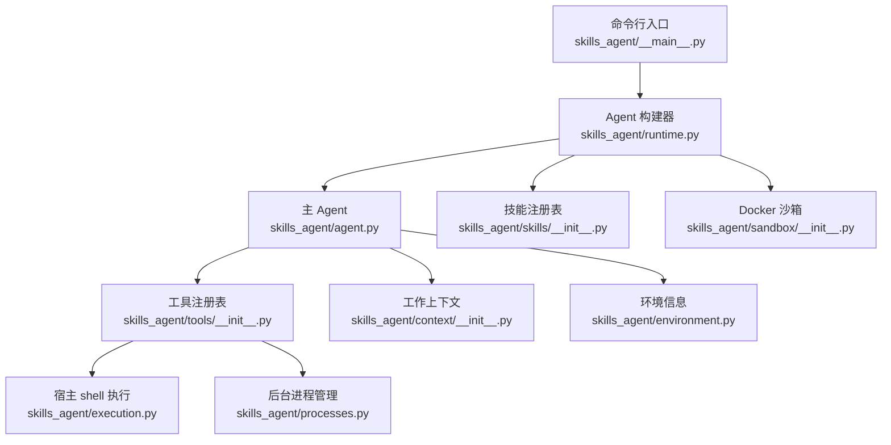
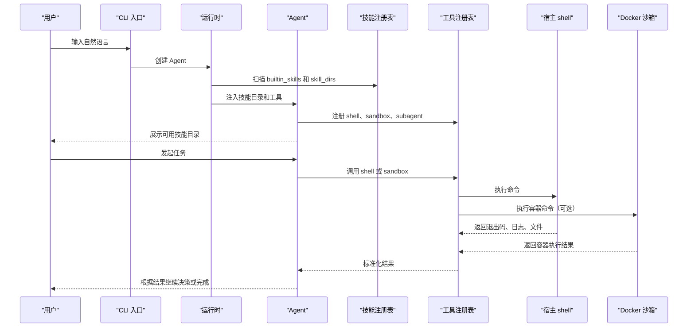
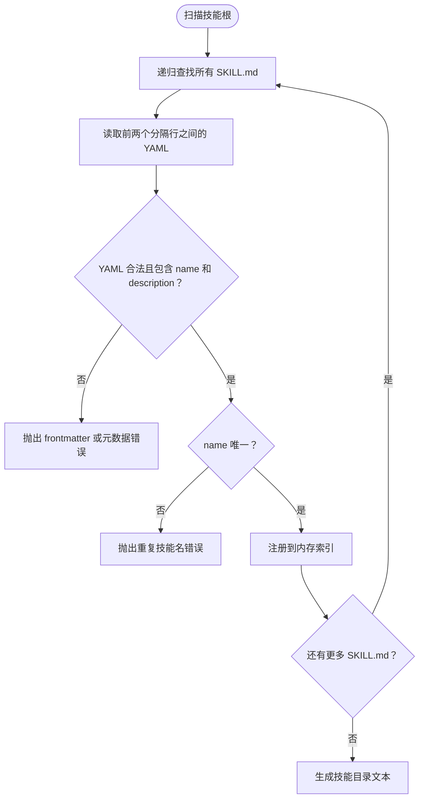
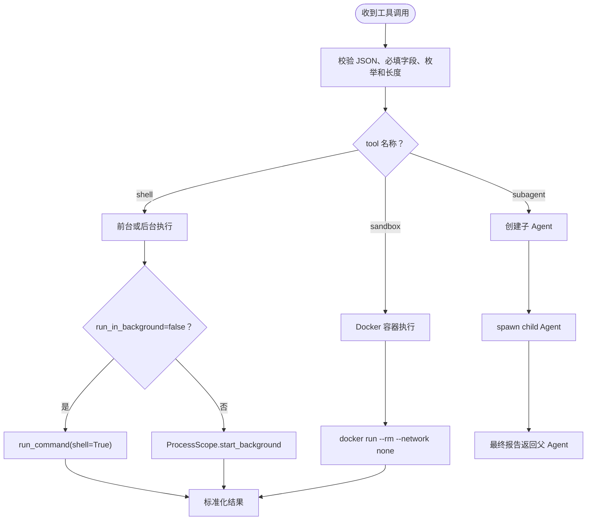
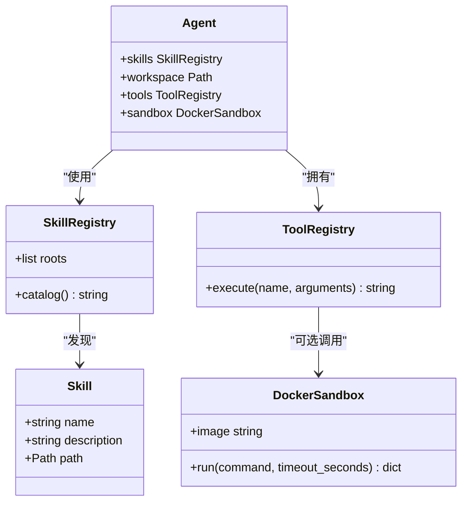

# 技能系统

<cite>
**本文引用的文件**   
- [README.md](file://README.md)
- [pyproject.toml](file://pyproject.toml)
- [skills-agent.toml](file://skills-agent.toml)
- [skills_agent/__main__.py](file://skills_agent/__main__.py)
- [skills_agent/cli.py](file://skills_agent/cli.py)
- [skills_agent/runtime.py](file://skills_agent/runtime.py)
- [skills_agent/agent.py](file://skills_agent/agent.py)
- [skills_agent/environment.py](file://skills_agent/environment.py)
- [skills_agent/execution.py](file://skills_agent/execution.py)
- [skills_agent/processes.py](file://skills_agent/processes.py)
- [skills_agent/sandbox/__init__.py](file://skills_agent/sandbox/__init__.py)
- [skills_agent/tools/__init__.py](file://skills_agent/tools/__init__.py)
- [skills_agent/context/__init__.py](file://skills_agent/context/__init__.py)
- [skills_agent/builtin_skills/workspace/SKILL.md](file://skills_agent/builtin_skills/workspace/SKILL.md)
- [skills_agent/builtin_skills/background-tasks/SKILL.md](file://skills_agent/builtin_skills/background-tasks/SKILL.md)
- [skills_agent/builtin_skills/file-editing/SKILL.md](file://skills_agent/builtin_skills/file-editing/SKILL.md)
- [skills_agent/builtin_skills/feedback/SKILL.md](file://skills_agent/builtin_skills/feedback/SKILL.md)
- [skills_agent/builtin_skills/code-repair/SKILL.md](file://skills_agent/builtin_skills/code-repair/SKILL.md)
- [skills_agent/builtin_skills/images/SKILL.md](file://skills_agent/builtin_skills/images/SKILL.md)
- [skills_agent/builtin_skills/investigation/SKILL.md](file://skills_agent/builtin_skills/investigation/SKILL.md)
- [skills_agent/builtin_skills/process-management/SKILL.md](file://skills_agent/builtin_skills/process-management/SKILL.md)
- [skills_agent/builtin_skills/resource-management/SKILL.md](file://skills_agent/builtin_skills/resource-management/SKILL.md)
</cite>

## 目录
1. [简介](#简介)
2. [项目结构](#项目结构)
3. [核心组件](#核心组件)
4. [架构总览](#架构总览)
5. [详细组件分析](#详细组件分析)
6. [依赖关系分析](#依赖关系分析)
7. [性能与执行边界](#性能与执行边界)
8. [自定义技能编写指南](#自定义技能编写指南)
9. [安全注意事项](#安全注意事项)
10. [故障排查](#故障排查)
11. [结论](#结论)

## 简介
本项目的技能系统以 `SKILL.md` 为扩展契约：每个技能是一个目录，包含元数据、可选参考文档和可复用脚本。模型在任务中读取技能描述，选择合适技能后调用宿主 shell、沙箱或子代理工具执行命令，并依据输出继续决策。系统内置多种通用技能，覆盖工作区读取、后台任务、文件编辑、反馈验证、代码修复、图像附件、调查取证、进程管理、资源规划和历史检索等场景。

## 项目结构
技能相关实现主要位于 `skills_agent/`：
- `runtime.py`：加载配置、创建 Agent、组装 SkillRegistry 和 DockerSandbox。
- `agent.py`：构造系统提示、注册工具、处理结果摘要、委派历史检索子任务。
- `tools/__init__.py`：定义 `shell`、`sandbox`、`subagent` 工具及其参数校验和执行流程。
- `skills/__init__.py`：扫描根目录中的 `SKILL.md`，解析 YAML frontmatter，生成技能目录。
- `context/history_skill/`：作为历史检索专用技能的运行时挂载点。
- `builtin_skills/`：内置技能集合；`pyproject.toml` 将其中关键 `SKILL.md` 和脚本打包进发布包。

**图示来源**
- [skills_agent/__main__.py:1-3](file://skills_agent/__main__.py#L1-L3)
- [skills_agent/runtime.py:1-58](file://skills_agent/runtime.py#L1-L58)
- [skills_agent/agent.py:1-200](file://skills_agent/agent.py#L1-L200)
- [skills_agent/skills/__init__.py:1-54](file://skills_agent/skills/__init__.py#L1-L54)
- [skills_agent/tools/__init__.py:1-191](file://skills_agent/tools/__init__.py#L1-L191)
- [skills_agent/execution.py:1-200](file://skills_agent/execution.py#L1-L200)
- [skills_agent/processes.py:1-200](file://skills_agent/processes.py#L1-L200)
- [skills_agent/context/__init__.py:1-200](file://skills_agent/context/__init__.py#L1-L200)
- [skills_agent/environment.py:1-76](file://skills_agent/environment.py#L1-L76)

**章节来源**
- [README.md:1-68](file://README.md#L1-L68)
- [pyproject.toml:1-23](file://pyproject.toml#L1-L23)
- [skills_agent/runtime.py:1-58](file://skills_agent/runtime.py#L1-L58)

## 核心组件
- **SkillRegistry**：从多个根路径递归查找 `SKILL.md`，解析首行与结束符之间的 YAML frontmatter，要求 `name` 和 `description` 为非空字符串，拒绝重复名称，并提供人类可读的技能目录。
- **Agent**：组合模型、会话、技能目录、工作空间、上下文、工具和沙箱；其系统提示会列出可用技能，并指导如何阅读 `SKILL.md`、选择工具、处理结果、使用图片、后台任务和子代理。
- **ToolRegistry**：暴露三类工具：
  - `shell`：在工作目录执行任意宿主 shell 命令。
  - `sandbox`：在指定 Docker 镜像内执行命令。
  - `subagent`：委派命名子任务，支持历史检索模式。
- **DockerSandbox**：通过 `docker run --rm --network none` 运行容器，仅挂载工作区和只读根；清理失败时抛出明确的清理错误。
- **ProcessScope / BackgroundJobMonitor**：为 `shell run_in_background=true` 提供注册、观察、等待、停止和清理能力。

**章节来源**
- [skills_agent/skills/__init__.py:1-54](file://skills_agent/skills/__init__.py#L1-L54)
- [skills_agent/agent.py:1-200](file://skills_agent/agent.py#L1-L200)
- [skills_agent/tools/__init__.py:1-191](file://skills_agent/tools/__init__.py#L1-L191)
- [skills_agent/sandbox/__init__.py:1-78](file://skills_agent/sandbox/__init__.py#L1-L78)
- [skills_agent/processes.py:1-200](file://skills_agent/processes.py#L1-L200)

## 架构总览
技能系统的工作流不是“按名称直接执行某个脚本”，而是由模型驱动：
1. 启动时构建 SkillRegistry，扫描 `builtin_skills`、工作目录下的 `skills` 以及用户传入的 `--skill-dir`。
2. Agent 的系统提示中包含技能目录，引导模型选择合适技能。
3. 模型通过 `shell`、`sandbox` 或 `subagent` 工具执行具体逻辑；脚本路径应基于当前 `SKILL.md` 所在目录解析。
4. 前台命令默认最多 120 秒，最长 600 秒；后台任务有独立超时和生命周期语义。
5. 可选的沙箱隔离运行在 Docker 容器中，但宿主机 shell 仍具有较高权限。

**图示来源**
- [skills_agent/runtime.py:1-58](file://skills_agent/runtime.py#L1-L58)
- [skills_agent/agent.py:190-250](file://skills_agent/agent.py#L190-L250)
- [skills_agent/tools/__init__.py:1-191](file://skills_agent/tools/__init__.py#L1-L191)
- [skills_agent/sandbox/__init__.py:1-78](file://skills_agent/sandbox/__init__.py#L1-L78)

## 详细组件分析

### SKILL.md 元数据与组织方式
每个技能目录通常包含：
- `SKILL.md`：必须包含 YAML frontmatter，至少定义 `name` 和 `description`。
- `scripts/`：可被模型调用的辅助脚本，例如 Python 或 shell 示例。
- `references/`：补充说明、操作示例或交互协议。

SkillRegistry 会：
- 对每个根路径递归搜索 `SKILL.md`。
- 检查首行为 `---` 且存在闭合 `---`。
- 解析 YAML，要求 `name` 和 `description` 是字符串且非空白。
- 拒绝同名技能。
- 通过 `catalog()` 生成供系统提示使用的列表。

**图示来源**
- [skills_agent/skills/__init__.py:1-54](file://skills_agent/skills/__init__.py#L1-L54)

**章节来源**
- [skills_agent/skills/__init__.py:1-54](file://skills_agent/skills/__init__.py#L1-L54)

### 技能发现路径
SkillRegistry 的根来自以下位置：
1. 内置技能目录：`skills_agent/builtin_skills`。
2. 工作目录下的 `skills`：允许用户在项目里添加本地技能。
3. 命令行 `--skill-dir`：可多次追加外部技能目录。

`runtime.create_agent` 把这些路径传给 SkillRegistry，并把已存在的技能根目录传给 DockerSandbox，使其可作为只读挂载源之一。

**章节来源**
- [skills_agent/runtime.py:1-58](file://skills_agent/runtime.py#L1-L58)
- [skills_agent/skills/__init__.py:1-54](file://skills_agent/skills/__init__.py#L1-L54)

### 工具与执行模型
ToolRegistry 暴露三个工具：

| 工具 | 用途 | 关键参数 |
|---|---|---|
| `shell` | 在工作目录执行宿主 shell 命令 | `name`、`command`、`run_in_background`、`background_lifecycle`、`timeout_seconds`、`result_mode`、`images` |
| `sandbox` | 在 Docker 容器中执行命令 | `name`、`command`、`timeout_seconds`、`result_mode` |
| `subagent` | 委派子任务 | `name`、`task`、`history` |

执行流程：
- 参数先经 JSON 解析和类型校验。
- `shell` 前台执行使用 `subprocess` 并支持进程组清理；后台执行进入 ProcessScope。
- `sandbox` 调用 DockerSandbox，网络默认关闭，仅挂载必要路径。
- `subagent` 创建一个新 Agent，并可携带只读工作上下文快照用于历史检索。

**图示来源**
- [skills_agent/tools/__init__.py:1-191](file://skills_agent/tools/__init__.py#L1-L191)
- [skills_agent/execution.py:1-200](file://skills_agent/execution.py#L1-L200)
- [skills_agent/sandbox/__init__.py:1-78](file://skills_agent/sandbox/__init__.py#L1-L78)
- [skills_agent/processes.py:1-200](file://skills_agent/processes.py#L1-L200)
- [skills_agent/agent.py:250-350](file://skills_agent/agent.py#L250-L350)

**章节来源**
- [skills_agent/tools/__init__.py:1-191](file://skills_agent/tools/__init__.py#L1-L191)
- [skills_agent/execution.py:1-200](file://skills_agent/execution.py#L1-L200)
- [skills_agent/sandbox/__init__.py:1-78](file://skills_agent/sandbox/__init__.py#L1-L78)
- [skills_agent/processes.py:1-200](file://skills_agent/processes.py#L1-L200)

### 内置技能逐项说明

#### workspace：工作区定位与结构化读取
- **用途**：选择性读取大文件或结构化附件，包括 JSON、CSV、DOCX、XLSX、PDF；检查本地可执行文件和模块是否存在。
- **触发条件**：需要定位文件范围、提取结构化内容、探测运行环境，但不适合简单文本读取或纯视觉验证。
- **典型输入**：目标路径、正则或 glob 模式、起止行、JSON Pointer、CSV/PDF 提取选项。
- **典型输出**：文件名、行号、提取值、游标、能力探测结果。
- **关联脚本**：`scripts/workspace.py`、`scripts/extract.py`、`scripts/probe_environment.py`。
- **参考文档**：`references/extraction.md`。
- **使用场景**：从大型仓库中定位问题配置、从 CSV/Excel/PDF 中提取表格、确认依赖是否安装。

**章节来源**
- [skills_agent/builtin_skills/workspace/SKILL.md:1-26](file://skills_agent/builtin_skills/workspace/SKILL.md#L1-L26)

#### background-tasks：后台任务与长耗时计算
- **用途**：让 shell 命令在工具返回后继续运行，并由运行时监督生命周期、超时、日志和完成结果。
- **触发条件**：命令需要在返回控制后持续执行，例如批处理、服务启动、长时间分析。
- **典型输入**：`run_in_background=true`、`background_lifecycle=task|service`、`timeout_seconds`、可选 `images`。
- **典型输出**：启动回执、作业 ID、状态变化、完成结果、日志路径、图片附件。
- **关联脚本**：`scripts/no_children.py`、`scripts/sequential.py`、`scripts/parallel.sh`。
- **使用场景**：构建产物、离线分析、本地预览服务、需要独立截止时间的批处理。

**章节来源**
- [skills_agent/builtin_skills/background-tasks/SKILL.md:1-131](file://skills_agent/builtin_skills/background-tasks/SKILL.md#L1-L131)

#### file-editing：精确文件增量编辑
- **用途**：在不破坏周围内容、换行符和文件权限的前提下修改现有文本或代码。
- **触发条件**：已有文件需要精准替换、插入或删除片段；不适合全新文件或二进制编辑。
- **典型输入**：`create`、`replace`、`insert`、`delete-content`、`delete-file` 及对应锚点、旧文本、新文本。
- **典型输出**：变更片段、位置信息、保存反馈。
- **关联脚本**：`scripts/edit.py`。
- **参考文档**：`references/incremental-editing.md`。
- **使用场景**：修复函数签名、更新配置值、删除废弃代码块。

**章节来源**
- [skills_agent/builtin_skills/file-editing/SKILL.md:1-30](file://skills_agent/builtin_skills/file-editing/SKILL.md#L1-L30)

#### feedback：执行与制品验证
- **用途**：获取实际执行结果、精确文本、JSON 校验、HTML/SVG 截图等证据。
- **触发条件**：下一步决策依赖真实行为、文件内容或视觉结果。
- **典型输入**：`file`、`text`、`run`、`render`、`check` 操作及相关参数。
- **典型输出**：文件元数据、编号文本、退出码、完整日志、截图路径、验收检查结果。
- **关联脚本**：`scripts/feedback.py`、`scripts/check.py`。
- **参考文档**：`references/acceptance-checks.md`、`references/feedback-loop.md`。
- **使用场景**：运行测试、校验输出格式、渲染页面截图、判断文件是否满足验收条件。

**章节来源**
- [skills_agent/builtin_skills/feedback/SKILL.md:1-31](file://skills_agent/builtin_skills/feedback/SKILL.md#L1-L31)

#### code-repair：基于证据的代码修复
- **用途**：诊断并修复已知缺陷，避免无证据的新功能开发或纯样式改动。
- **触发条件**：已有失败报告、观测到的异常行为或缺陷复现路径。
- **典型输入**：期望行为、复现命令、检查脚本、日志路径。
- **典型输出**：最小修复、受影响边界验证、未解决限制。
- **关联脚本**：`scripts/run_check.py`、`scripts/run_check.sh`。
- **使用场景**：单元测试失败、回归缺陷、边界条件错误。

**章节来源**
- [skills_agent/builtin_skills/code-repair/SKILL.md:1-15](file://skills_agent/builtin_skills/code-repair/SKILL.md#L1-L15)

#### review：代码审查
仓库中存在 `skills_agent/builtin_skills/review` 目录，但未发现对应的 `SKILL.md`。因此当前版本没有启用名为 `review` 的内置技能；该目录可能尚未完成或属于未来扩展。

**章节来源**
- [skills_agent/builtin_skills/review](file://skills_agent/builtin_skills/review)

#### images：图片附件与可视化
- **用途**：所有模型请求中的图片附件都必须通过此技能准备和声明。
- **触发条件**：需要发送截图、生成的图、渲染页面或历史图片引用。
- **典型输入**：`images` 数组、`prepare`、`compose`、`save_bounded`。
- **典型输出**：受大小限制的 PNG/JPEG/WebP、组合网格、源 URL、坐标映射。
- **关联脚本**：`scripts/images.py`。
- **使用场景**：流程图、UI 截图、多视图拼合、图表验证。

**章节来源**
- [skills_agent/builtin_skills/images/SKILL.md:1-124](file://skills_agent/builtin_skills/images/SKILL.md#L1-L124)

#### investigation：冲突证据调查与来源抓取
- **用途**：设计区分性实验，或抓取 HTTP(S) 来源并保留出处、完整性记录。
- **触发条件**：证据矛盾、原因不确定、需要可信来源副本。
- **典型输入**：URL、输出目录、最大字符数、最大正文字节数、提取策略。
- **典型输出**：正文、请求/响应 URL、重定向链、状态码、时间戳、SHA-256。
- **关联脚本**：`scripts/fetch.py`。
- **使用场景**：对比不同 API 响应、存档外部规范、排除缓存或代理干扰。

**章节来源**
- [skills_agent/builtin_skills/investigation/SKILL.md:1-24](file://skills_agent/builtin_skills/investigation/SKILL.md#L1-L24)

#### process-management：已注册进程管理
- **用途**：查看状态、等待就绪或完成、读取日志、显式停止由 `shell run_in_background=true` 注册的作业。
- **触发条件**：需要中间观察、健康检查、日志追踪或安全停止。
- **典型输入**：`status`、`logs`、`wait`、`stop` 及 `state_dir`、`name`。
- **典型输出**：监管身份、生命周期状态、日志尾部、清理确认结果。
- **关联脚本**：`scripts/process.py`。
- **参考文档**：`references/across-turns.md`。
- **使用场景**：替代宽泛的 `pkill`，按内部名称精准停止作业，确认清理后再替换。

**章节来源**
- [skills_agent/builtin_skills/process-management/SKILL.md:1-44](file://skills_agent/builtin_skills/process-management/SKILL.md#L1-L44)

#### resource-management：资源规划与并发控制
- **用途**：在执行高资源消耗工作前评估内存、CPU、批大小和并发度。
- **触发条件**：峰值需求未知、输入规模变化、多操作叠加、资源耗尽后需要调整计划。
- **典型输入**：当前预算、样例输入、观测指标、并发计划。
- **典型输出**：更保守的执行方案、分批策略、释放中间结果的计划。
- **使用场景**：大数据批处理、多进程解析、OOM 恢复、并行度调优。

**章节来源**
- [skills_agent/builtin_skills/resource-management/SKILL.md:1-81](file://skills_agent/builtin_skills/resource-management/SKILL.md#L1-L81)

#### history skill：历史检索
历史检索不是普通 `builtin_skills` 下的常规技能，而是在子代理模式下动态挂载的专用技能：
- 当 `subagent` 设置 `history=true` 时，Agent 会把 `skills_agent/context/history_skill` 加入技能根。
- 同时写入只读工作上下文快照，并在指令中强调只检索原始会话记录。
- 历史检索子任务禁止继承父对话，只能返回结论、证据、工件和未决事项。

**章节来源**
- [skills_agent/agent.py:250-350](file://skills_agent/agent.py#L250-L350)
- [skills_agent/context/__init__.py:1-200](file://skills_agent/context/__init__.py#L1-L200)

## 依赖关系分析

**图示来源**
- [skills_agent/skills/__init__.py:1-54](file://skills_agent/skills/__init__.py#L1-L54)
- [skills_agent/agent.py:1-200](file://skills_agent/agent.py#L1-L200)
- [skills_agent/tools/__init__.py:1-191](file://skills_agent/tools/__init__.py#L1-L191)
- [skills_agent/sandbox/__init__.py:1-78](file://skills_agent/sandbox/__init__.py#L1-L78)

**章节来源**
- [skills_agent/skills/__init__.py:1-54](file://skills_agent/skills/__init__.py#L1-L54)
- [skills_agent/agent.py:1-200](file://skills_agent/agent.py#L1-L200)
- [skills_agent/tools/__init__.py:1-191](file://skills_agent/tools/__init__.py#L1-L191)
- [skills_agent/sandbox/__init__.py:1-78](file://skills_agent/sandbox/__init__.py#L1-L78)

## 性能与执行边界
- 前台 shell 命令默认超时 120 秒，最大 600 秒。
- 后台任务的 `timeout_seconds` 可以是任意正有限数；`task` 默认 3600 秒，`service` 无默认截止时间。
- 工具结果支持 `auto`、`direct`、`report` 三种模式：自动模式在较大输出时尝试生成摘要，`direct` 保留原文，`report` 返回结论和证据。
- Agent 会在适当时机对工作上下文进行压缩，并通过 `WorkingContext` 持久化记录。
- 沙箱容器使用 `--network none`，减少网络面，但不会阻止所有逃逸路径。

**章节来源**
- [skills_agent/execution.py:1-200](file://skills_agent/execution.py#L1-L200)
- [skills_agent/tools/__init__.py:1-191](file://skills_agent/tools/__init__.py#L1-L191)
- [skills_agent/agent.py:190-250](file://skills_agent/agent.py#L190-L250)
- [skills_agent/context/__init__.py:1-200](file://skills_agent/context/__init__.py#L1-L200)
- [skills_agent/sandbox/__init__.py:1-78](file://skills_agent/sandbox/__init__.py#L1-L78)

## 自定义技能编写指南

### 步骤一：创建技能目录和 SKILL.md
1. 在工作目录下新建 `skills/你的技能/SKILL.md`，或在外部目录创建并通过 `--skill-dir` 传入。
2. YAML frontmatter 至少包含：
   - `name`：唯一技能名。
   - `description`：清晰说明何时选择该技能。
3. 确保首行为 `---`，并以另一行 `---` 结束 frontmatter。

**章节来源**
- [skills_agent/skills/__init__.py:1-54](file://skills_agent/skills/__init__.py#L1-L54)
- [skills_agent/runtime.py:1-58](file://skills_agent/runtime.py#L1-L58)

### 步骤二：编写 scripts
- 把可复用逻辑放在 `scripts/` 下，例如 Python 或 shell 脚本。
- 在 SKILL.md 中明确脚本的绝对路径解析方式，通常基于当前 `SKILL.md` 所在目录。
- 脚本应：
  - 接收明确参数。
  - 返回结构化或可解析的输出。
  - 保留失败状态。
  - 不隐式依赖全局状态。

**章节来源**
- [skills_agent/agent.py:190-250](file://skills_agent/agent.py#L190-L250)
- [skills_agent/builtin_skills/workspace/SKILL.md:1-26](file://skills_agent/builtin_skills/workspace/SKILL.md#L1-L26)

### 步骤三：编写 references
- 用 `references/` 存放操作示例、输入输出约定、边界条件和反例。
- 参考文档不应被当作固定任务计划，而应帮助模型理解方法。

**章节来源**
- [skills_agent/builtin_skills/file-editing/SKILL.md:1-30](file://skills_agent/builtin_skills/file-editing/SKILL.md#L1-L30)
- [skills_agent/builtin_skills/feedback/SKILL.md:1-31](file://skills_agent/builtin_skills/feedback/SKILL.md#L1-L31)

### 步骤四：测试执行
- 通过 CLI 运行会话，或使用 benchmark 模式执行任务。
- 观察：
  - 技能是否出现在可用技能目录中。
  - shell 或 sandbox 是否成功调用脚本。
  - 输出是否符合预期。
  - 超时、日志、图片和后台任务是否正常。

**章节来源**
- [README.md:1-68](file://README.md#L1-L68)
- [skills_agent/cli.py:1-200](file://skills_agent/cli.py#L1-L200)

### 步骤五：调试输出
- 对于前台命令，优先使用 `result_mode=direct` 获取精确输出。
- 对于大输出，使用 `report` 模式并结合保存的源位置。
- 对于后台任务，使用 `process-management` 查看状态、日志和清理情况。
- 对图片使用 `images` 技能声明，不要只打印路径。

**章节来源**
- [skills_agent/tools/__init__.py:1-191](file://skills_agent/tools/__init__.py#L1-L191)
- [skills_agent/builtin_skills/process-management/SKILL.md:1-44](file://skills_agent/builtin_skills/process-management/SKILL.md#L1-L44)
- [skills_agent/builtin_skills/images/SKILL.md:1-124](file://skills_agent/builtin_skills/images/SKILL.md#L1-L124)

## 安全注意事项
- **shell 在宿主上执行**：它具有工作目录权限，并非强隔离沙箱。
- **sandbox 不等于完全安全边界**：Docker 容器关闭了网络并限制挂载，但进程组清理依赖脚本合作；容器内程序仍可尝试逃逸。
- **下载文件不可信**：系统提示明确要求将下载文件放入新目录，避免在当前目录执行解释器；运行不受信任 Python 时使用 `-I`。
- **后台任务不是完成保证**：启动回执只代表注册成功；必须检查最终状态、日志和清理确认。
- **不要宽泛杀死进程**：应使用 `process-management` 的内部 `state_dir` 和 `name`，避免误杀新作业。
- **权限控制**：API key 仅从环境变量读取；配置文件中的路径相对配置文件所在目录；沙箱镜像需由部署方控制。

**章节来源**
- [skills_agent/agent.py:190-250](file://skills_agent/agent.py#L190-L250)
- [skills_agent/sandbox/__init__.py:1-78](file://skills_agent/sandbox/__init__.py#L1-L78)
- [skills_agent/processes.py:1-200](file://skills_agent/processes.py#L1-L200)
- [skills_agent/builtin_skills/background-tasks/SKILL.md:1-131](file://skills_agent/builtin_skills/background-tasks/SKILL.md#L1-L131)
- [skills_agent/builtin_skills/process-management/SKILL.md:1-44](file://skills_agent/builtin_skills/process-management/SKILL.md#L1-L44)
- [skills-agent.toml:1-18](file://skills-agent.toml#L1-L18)

## 故障排查
| 现象 | 可能原因 | 建议处理 |
|---|---|---|
| 技能未出现 | `SKILL.md` 缺少 YAML frontmatter、缺少 `name` 或 `description`、名称重复 | 检查 frontmatter 格式和技能名唯一性 |
| shell 执行卡住 | 未设置 `timeout_seconds` 或超时不足 | 增大超时或改用后台任务 |
| 后台任务状态为 `unconfirmed` | 监管身份或清理无法确认 | 使用 `process-management status/logs` 诊断，不要盲目重启 |
| 图片未显示 | 未在 shell 的 `images` 中声明，或超过 1 MB | 使用 images 技能准备并声明，注意每请求最多 10 张 |
| sandbox 清理失败 | Docker 容器未正常移除 | 检查清理错误、容器清单和日志目录 |
| 历史记录缺失 | 子任务未使用 `history=true` | 通过 subagent 历史检索模式检索原始会话 |

**章节来源**
- [skills_agent/skills/__init__.py:1-54](file://skills_agent/skills/__init__.py#L1-L54)
- [skills_agent/processes.py:1-200](file://skills_agent/processes.py#L1-L200)
- [skills_agent/sandbox/__init__.py:1-78](file://skills_agent/sandbox/__init__.py#L1-L78)
- [skills_agent/builtin_skills/images/SKILL.md:1-124](file://skills_agent/builtin_skills/images/SKILL.md#L1-L124)
- [skills_agent/agent.py:250-350](file://skills_agent/agent.py#L250-L350)

## 结论
技能系统以 `SKILL.md` 为中心，把“能力描述”和“可复用脚本”交给模型选择，而不是硬编码执行路径。SkillRegistry 负责发现和校验技能；Agent 负责编排；ToolRegistry 负责执行宿主 shell、沙箱和子代理；ProcessScope 负责后台任务的生命周期；DockerSandbox 提供可选的网络受限容器环境。

内置技能覆盖了从文件读取、文件编辑、反馈验证、代码修复、图片附件、外部证据抓取、进程管理、资源规划到历史检索的主要工作流。编写自定义技能时，应重点明确元数据、脚本接口、参考文档、执行边界和安全约束，并通过前台命令、后台任务、日志和图片附件进行充分测试与调试。