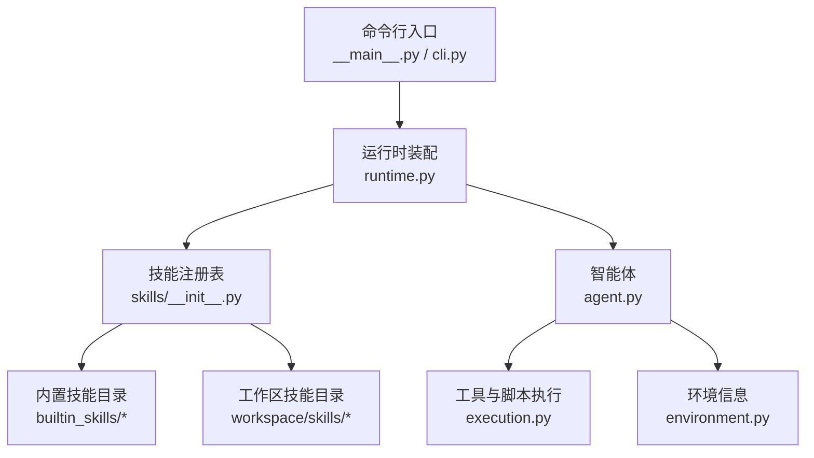
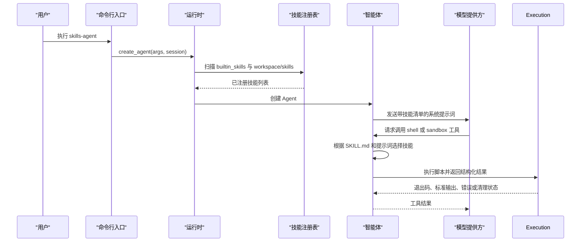
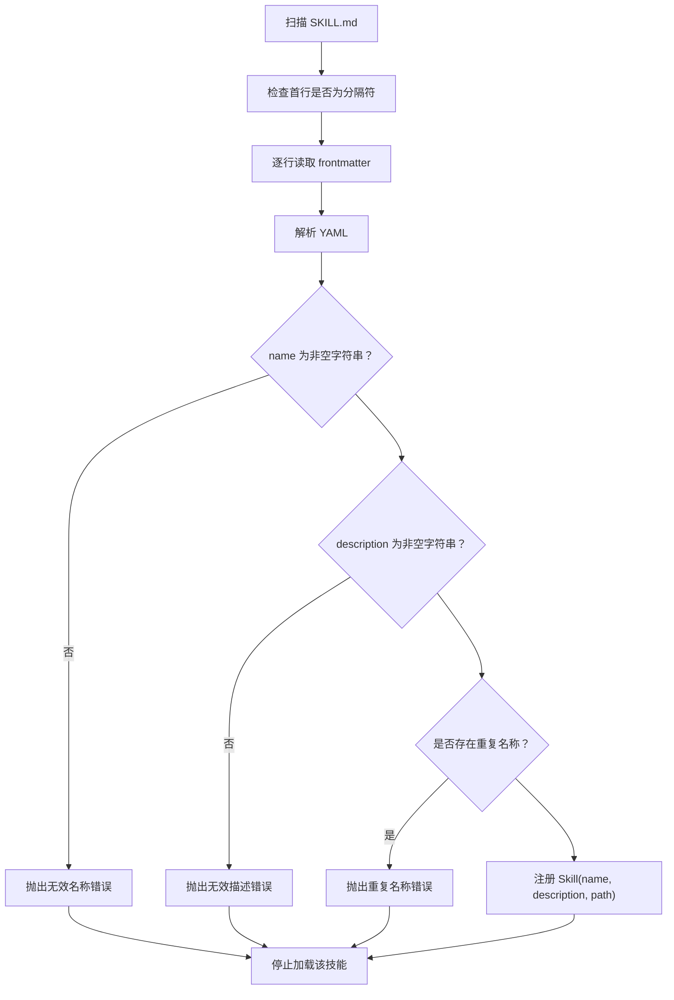
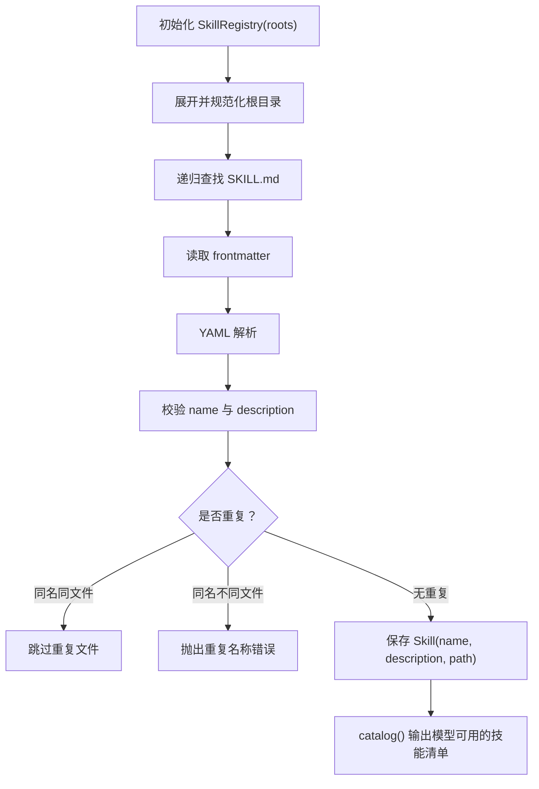
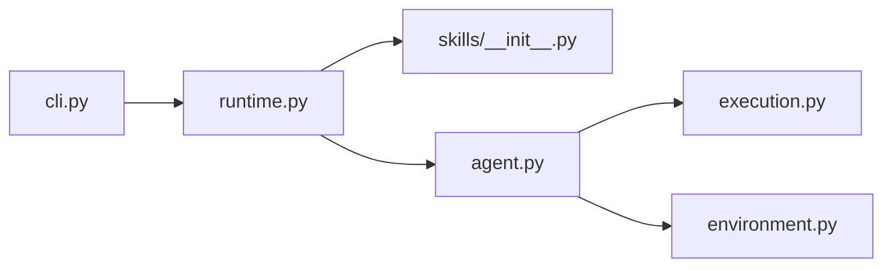
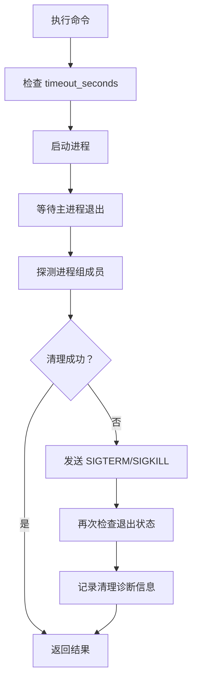

# 技能语法与开发指南

<cite>
**本文引用的文件**   
- [skills_agent/__main__.py](file://skills_agent/__main__.py)
- [skills_agent/cli.py](file://skills_agent/cli.py)
- [skills_agent/runtime.py](file://skills_agent/runtime.py)
- [skills_agent/environment.py](file://skills_agent/environment.py)
- [skills_agent/execution.py](file://skills_agent/execution.py)
- [skills_agent/skills/__init__.py](file://skills_agent/skills/__init__.py)
- [skills_agent/agent.py](file://skills_agent/agent.py)
- [skills_agent/builtin_skills/background-tasks/SKILL.md](file://skills_agent/builtin_skills/background-tasks/SKILL.md)
- [skills_agent/builtin_skills/file-editing/SKILL.md](file://skills_agent/builtin_skills/file-editing/SKILL.md)
- [skills_agent/builtin_skills/images/SKILL.md](file://skills_agent/builtin_skills/images/SKILL.md)
- [skills_agent/builtin_skills/investigation/SKILL.md](file://skills_agent/builtin_skills/investigation/SKILL.md)
- [skills_agent/builtin_skills/process-management/SKILL.md](file://skills_agent/builtin_skills/process-management/SKILL.md)
- [skills_agent/builtin_skills/workspace/SKILL.md](file://skills_agent/builtin_skills/workspace/SKILL.md)
</cite>

## 目录
1. [引言](#引言)
2. [项目结构](#项目结构)
3. [核心组件](#核心组件)
4. [架构总览](#架构总览)
5. [详细组件分析](#详细组件分析)
6. [依赖关系分析](#依赖关系分析)
7. [从零开始编写自定义技能](#从零开始编写自定义技能)
8. [最小可运行示例](#最小可运行示例)
9. [性能与执行特性](#性能与执行特性)
10. [安全注意事项](#安全注意事项)
11. [故障排查与调试日志](#故障排查与调试日志)
12. [结论](#结论)

## 引言
本指南面向希望理解并扩展 SKILL.md 技能体系的开发者。SKILL.md 是技能元数据、模型行为引导和执行路径说明的统一入口；运行时通过 `SkillRegistry` 扫描技能目录，将每个技能的名称、描述和路径注册到系统中，再交给 Agent 的提示词系统驱动模型调用脚本。本文重点解释：
- SKILL.md 的 YAML frontmatter 字段（`name`、`description`、`parameters`、`schema`）如何被解析和使用。
- 描述文本如何影响模型对技能的选用与行为。
- `references` 引用目录的作用。
- `scripts` 目录中 Python 或 shell 脚本的命名约定、执行路径和参数传递方式。
- `SkillRegistry` 加载内置技能与用户自定义技能的完整流程。
- 从零构建一个工具型技能的步骤、测试方法和安全边界。

## 项目结构
仓库中与技能相关的代码集中在 `skills_agent` 包内，关键目录如下：
- `skills_agent/skills/__init__.py`：技能发现、YAML frontmatter 解析、`Skill` 与 `SkillRegistry` 实现。
- `skills_agent/runtime.py`：CLI 参数扩展、Agent 创建、`builtin_skills` 与工作区 `skills` 目录合并注册。
- `skills_agent/agent.py`：系统提示词注入、技能目录清单输出、模型使用技能的整体策略。
- `skills_agent/execution.py`：命令执行、超时、进程组清理与错误诊断。
- `skills_agent/environment.py`：环境信息注入，用于提示模型当前工作目录、Shell 等上下文。
- `skills_agent/builtin_skills/*`：内置技能示例，展示 SKILL.md 结构与脚本组织。



**图表来源**
- [skills_agent/__main__.py:1-3](file://skills_agent/__main__.py#L1-L3)
- [skills_agent/cli.py:1-20](file://skills_agent/cli.py#L1-L20)
- [skills_agent/runtime.py:12-58](file://skills_agent/runtime.py#L12-L58)
- [skills_agent/skills/__init__.py:12-54](file://skills_agent/skills/__init__.py#L12-L54)
- [skills_agent/agent.py:1-60](file://skills_agent/agent.py#L1-L60)
- [skills_agent/execution.py:1-40](file://skills_agent/execution.py#L1-L40)
- [skills_agent/environment.py:1-30](file://skills_agent/environment.py#L1-L30)

**章节来源**
- [skills_agent/__main__.py:1-3](file://skills_agent/__main__.py#L1-L3)
- [skills_agent/runtime.py:12-58](file://skills_agent/runtime.py#L12-L58)
- [skills_agent/skills/__init__.py:12-54](file://skills_agent/skills/__init__.py#L12-L54)

## 核心组件
### Skill 与 SkillRegistry
`Skill` 是一个不可变数据类，包含三个字段：
- `name`：技能唯一名称。
- `description`：面向模型的简要描述。
- `path`：SKILL.md 所在目录路径。

`SkillRegistry` 负责：
1. 接收一组根目录 `roots`。
2. 递归扫描每个根目录下所有 `SKILL.md` 文件。
3. 要求第一行必须是 YAML frontmatter 起始分隔符 `---`。
4. 读取 frontmatter 直到结束分隔符 `---`，并用 YAML 解析。
5. 校验 `name` 和 `description` 必须是非空字符串。
6. 检测重复名称；同名且同文件允许去重，不同文件视为冲突。
7. 暴露 `catalog()` 方法，返回供模型查看的技能清单。

该实现不直接解析 `parameters` 或 `schema` 字段，也不绑定脚本执行逻辑；它只提取名称、描述和路径。实际模型调用策略由 Agent 的系统提示词决定。

**章节来源**
- [skills_agent/skills/__init__.py:12-54](file://skills_agent/skills/__init__.py#L12-L54)

### Agent 与系统提示词
Agent 在构造时注入环境信息、工作上下文、工具注册表和后台任务监控器，并在 `_system()` 中生成系统提示词。提示词明确告诉模型：
- 技能提供方法、决策标准和参考脚本。
- 选择与其描述匹配的技能。
- 使用 `shell result_mode=direct` 读取 SKILL.md 原文后再应用。
- 仅使用所需工具对应的技能。
- 最终输出应包含结果、相关验证和剩余限制。

这意味着 SKILL.md 的 `description` 不仅是人类可读标签，更是模型“是否调用该技能”的关键信号。

**章节来源**
- [skills_agent/agent.py:1-60](file://skills_agent/agent.py#L1-L60)
- [skills_agent/agent.py:120-218](file://skills_agent/agent.py#L120-L218)

### 运行时装配
`create_agent` 完成以下装配：
- 加载配置文件。
- 解析工作目录。
- 创建模型提供者。
- 构建 `SkillRegistry`，根目录包括：
  - 包内 `builtin_skills`。
  - 工作区下的 `skills`。
  - 通过 `--skill-dir` 传入的其他目录。
- 可选地创建 Docker 沙箱。
- 返回 `Agent`。

**章节来源**
- [skills_agent/runtime.py:12-58](file://skills_agent/runtime.py#L12-L58)

## 架构总览
下面的序列图展示了从启动到模型使用技能的典型流程。



**图表来源**
- [skills_agent/__main__.py:1-3](file://skills_agent/__main__.py#L1-L3)
- [skills_agent/cli.py:1-20](file://skills_agent/cli.py#L1-L20)
- [skills_agent/runtime.py:12-58](file://skills_agent/runtime.py#L12-L58)
- [skills_agent/skills/__init__.py:12-54](file://skills_agent/skills/__init__.py#L12-L54)
- [skills_agent/agent.py:120-218](file://skills_agent/agent.py#L120-L218)

## 详细组件分析

### SKILL.md 元数据字段与解析规则
#### 已解析字段
| 字段 | 类型 | 是否必需 | 行为 |
| --- | --- | --- | --- |
| `name` | 非空字符串 | 是 | 技能唯一标识；重复名称会报错。 |
| `description` | 非空字符串 | 是 | 注入模型的系统提示词清单；直接影响模型是否选择该技能。 |
| `path` | 内部字段 | 否 | 由注册表填充，指向 SKILL.md 所在目录。 |

#### 未由注册表直接解析但广泛使用的字段
| 字段 | 常见用途 | 实现现状 |
| --- | --- | --- |
| `parameters` | 描述输入参数、约束和示例。 | 注册表不强制校验；通常作为模型指令的一部分。 |
| `schema` | 描述 JSON 参数结构。 | 注册表不强制校验；通常作为模型指令的一部分。 |

#### 解析流程


**图表来源**
- [skills_agent/skills/__init__.py:16-54](file://skills_agent/skills/__init__.py#L16-L54)

**章节来源**
- [skills_agent/skills/__init__.py:12-54](file://skills_agent/skills/__init__.py#L12-L54)

### 描述文本如何影响模型行为
Agent 的系统提示词会在可用技能清单后附加模型行为指导，核心语义是：
- 当某个需求的描述与技能描述匹配时，才选择该技能。
- 使用 `shell result_mode=direct` 读取 SKILL.md 正文，再按其中方法执行。
- 简单任务可直接用普通命令，不需要引入无关技能。
- 必须遵守技能要求的工具可用性。

因此，`description` 不应只是技术标题，而应表达“这个技能能解决什么问题”。例如：
- 背景任务技能强调异步执行、作业回执、日志与终止。
- 图像技能强调通过 `images` 参数声明图片，而不是只保存路径。
- 工作区技能强调选择必要片段、保留路径和位置。

**章节来源**
- [skills_agent/agent.py:120-218](file://skills_agent/agent.py#L120-L218)
- [skills_agent/builtin_skills/background-tasks/SKILL.md:1-20](file://skills_agent/builtin_skills/background-tasks/SKILL.md#L1-L20)
- [skills_agent/builtin_skills/images/SKILL.md:1-20](file://skills_agent/builtin_skills/images/SKILL.md#L1-L20)
- [skills_agent/builtin_skills/workspace/SKILL.md:1-20](file://skills_agent/builtin_skills/workspace/SKILL.md#L1-L20)

### references 引用目录的作用
`references` 目录不是运行时扫描字段，而是 SKILL.md 文档约定的参考文档集合。其作用包括：
- 向模型提供更详细的操作方法、约束、示例和引用链接。
- 让模型在需要深入理解某项能力时，按需阅读对应 Markdown。
- 与 `scripts` 目录形成互补：`scripts` 是可执行实现，`references` 是方法与规范说明。

现有内置技能中，`feedback`、`file-editing`、`process-management`、`workspace` 均使用 `references` 存放辅助说明。

**章节来源**
- [skills_agent/builtin_skills/feedback/SKILL.md:1-20](file://skills_agent/builtin_skills/feedback/SKILL.md#L1-L20)
- [skills_agent/builtin_skills/file-editing/SKILL.md:1-20](file://skills_agent/builtin_skills/file-editing/SKILL.md#L1-L20)
- [skills_agent/builtin_skills/process-management/SKILL.md:1-20](file://skills_agent/builtin_skills/process-management/SKILL.md#L1-L20)
- [skills_agent/builtin_skills/workspace/SKILL.md:1-20](file://skills_agent/builtin_skills/workspace/SKILL.md#L1-L20)

### scripts 目录中的脚本命名约定与执行路径
从内置技能可见以下约定：
- 脚本放在技能目录下的 `scripts` 子目录中。
- Python 脚本常用 `.py` 后缀，如 `edit.py`、`fetch.py`、`images.py`、`process.py`、`extract.py`。
- Shell 脚本常用 `.sh` 后缀，如 `parallel.sh`。
- SKILL.md 通常要求以绝对路径引用脚本，因为每次 shell 调用都是独立变量环境。
- 脚本通过命令行参数接收输入，而不是依赖跨调用持久化的环境变量。
- 返回值通常写入工作区文件，或通过 stdout/stderr 返回结构化结果。

重要路径规则：
- 脚本路径应从 SKILL.md 所在目录解析为绝对路径。
- 工作区输出应写入任务工作目录，而非技能目录。
- Python 脚本通常需要可用解释器，如 `python3`。

**章节来源**
- [skills_agent/builtin_skills/file-editing/SKILL.md:10-30](file://skills_agent/builtin_skills/file-editing/SKILL.md#L10-L30)
- [skills_agent/builtin_skills/investigation/SKILL.md:10-20](file://skills_agent/builtin_skills/investigation/SKILL.md#L10-L20)
- [skills_agent/builtin_skills/images/SKILL.md:10-20](file://skills_agent/builtin_skills/images/SKILL.md#L10-L20)
- [skills_agent/builtin_skills/background-tasks/SKILL.md:120-127](file://skills_agent/builtin_skills/background-tasks/SKILL.md#L120-L127)
- [skills_agent/builtin_skills/workspace/SKILL.md:14-20](file://skills_agent/builtin_skills/workspace/SKILL.md#L14-L20)

### SkillRegistry 加载技能的流程


**图表来源**
- [skills_agent/skills/__init__.py:16-54](file://skills_agent/skills/__init__.py#L16-L54)

**章节来源**
- [skills_agent/skills/__init__.py:12-54](file://skills_agent/skills/__init__.py#L12-L54)

## 依赖关系分析
- `cli.py` 提供命令行入口，调用 `runtime.create_agent`。
- `runtime.py` 组合模型、会话、技能注册表和可选沙箱。
- `agent.py` 把技能清单注入系统提示词，并指导模型如何使用 `shell`、`sandbox`、图片、后台任务等。
- `execution.py` 提供命令执行的底层保障：超时、进程组清理、信号处理、诊断信息。
- `environment.py` 提供稳定、低开销的环境快照，避免启动失败。



**图表来源**
- [skills_agent/cli.py:1-20](file://skills_agent/cli.py#L1-L20)
- [skills_agent/runtime.py:12-58](file://skills_agent/runtime.py#L12-L58)
- [skills_agent/agent.py:1-60](file://skills_agent/agent.py#L1-L60)
- [skills_agent/execution.py:1-40](file://skills_agent/execution.py#L1-L40)
- [skills_agent/environment.py:1-30](file://skills_agent/environment.py#L1-L30)

**章节来源**
- [skills_agent/cli.py:1-20](file://skills_agent/cli.py#L1-L20)
- [skills_agent/runtime.py:12-58](file://skills_agent/runtime.py#L12-L58)
- [skills_agent/agent.py:1-60](file://skills_agent/agent.py#L1-L60)
- [skills_agent/execution.py:1-40](file://skills_agent/execution.py#L1-L40)
- [skills_agent/environment.py:1-30](file://skills_agent/environment.py#L1-L30)

## 从零开始编写自定义技能

### 第一步：确定技能目标
回答以下问题：
- 这个技能要解决什么具体任务？
- 输入是什么？输出是什么？
- 是否需要 Python 或 shell 脚本？
- 是否需要图片、后台任务、历史检索或工作区搜索？
- 是否需要 `references` 补充说明？

### 第二步：创建目录结构
推荐结构：
```
your-skill/
├── SKILL.md
├── scripts/
│   └── run.py
└── references/
    └── usage.md
```

如果只需要简单命令，可以省略 `scripts` 和 `references`；但如果需要复杂参数、文件或外部依赖，建议显式实现脚本。

### 第三步：编写 SKILL.md
frontmatter 至少包含：
- `name`：简短、唯一的技能名。
- `description`：面向模型的描述，说明它能做什么、适合什么场景。
- `parameters`：可选，描述输入参数。
- `schema`：可选，描述 JSON 参数结构。

正文应说明：
- 何时使用该技能。
- 如何解析相对路径。
- 如何调用 `scripts` 中的脚本。
- 输出格式和结果含义。
- 失败时的处理方式。

### 第四步：实现 scripts 中的脚本
Python 脚本建议：
- 使用命令行参数解析输入。
- 将结构化结果写入工作区文件。
- 在 stdout 或 stderr 返回简要摘要。
- 使用非零退出码表示失败。

Shell 脚本建议：
- 显式处理子进程退出码。
- 支持优雅终止。
- 不要使用脱离父进程组的 `setsid`、`nohup` 或 daemon 模式。

### 第五步：添加 references 参考文档
`references` 用于补充：
- 参数说明。
- 文件格式约束。
- 示例命令。
- 与其他技能的协作方式。
- 安全边界和已知限制。

### 第六步：通过 CLI 或运行时触发
安装并启动 CLI 后，可以通过以下方式测试：
- 使用 `--skill-dir` 指定自定义技能目录。
- 使用 `--config` 指定配置。
- 让模型在工作任务中选择你的技能。
- 通过 `shell` 或 `sandbox` 工具调用脚本。
- 检查结果、日志文件和退出码。

**章节来源**
- [skills_agent/runtime.py:12-58](file://skills_agent/runtime.py#L12-L58)
- [skills_agent/agent.py:120-218](file://skills_agent/agent.py#L120-L218)
- [skills_agent/builtin_skills/workspace/SKILL.md:14-20](file://skills_agent/builtin_skills/workspace/SKILL.md#L14-L20)

## 最小可运行示例
下面给出一个“简单工具型技能”的最小设计，用于接收参数、执行命令并返回结构化结果。

### 目录结构
```
simple-tool/
├── SKILL.md
├── scripts/
│   └── run.py
```

### SKILL.md 要点
- `name`：`simple-tool`。
- `description`：说明这是一个工具型技能，接收参数，执行命令，返回结构化结果。
- `parameters`：描述输入参数，例如目标路径、命令或查询内容。
- `schema`：定义 JSON 参数结构。
- 正文说明：
  - 脚本位于 `scripts/run.py`。
  - 使用绝对路径调用脚本。
  - 输出写入工作区文件。
  - 成功返回退出码 0 和结果摘要。
  - 失败返回非零退出码和错误信息。

### 脚本约定
- `scripts/run.py` 接收必要参数。
- 在执行前校验参数。
- 执行目标命令或业务逻辑。
- 将结构化结果保存到工作区。
- 打印简洁摘要到 stdout。
- 异常时记录错误并返回非零退出码。

### 触发方式
1. 将 `simple-tool` 放入工作区的 `skills/simple-tool` 或通过 `--skill-dir` 指定。
2. 启动 CLI。
3. 让模型选择 `simple-tool`。
4. 模型调用 `shell` 执行 `python3 /absolute/path/to/scripts/run.py ...`。
5. 检查 stdout、stderr、退出码和工作区输出文件。

**章节来源**
- [skills_agent/builtin_skills/file-editing/SKILL.md:10-30](file://skills_agent/builtin_skills/file-editing/SKILL.md#L10-L30)
- [skills_agent/builtin_skills/investigation/SKILL.md:10-20](file://skills_agent/builtin_skills/investigation/SKILL.md#L10-L20)
- [skills_agent/agent.py:120-218](file://skills_agent/agent.py#L120-L218)

## 性能与执行特性
### 默认超时与最大超时
- 前台命令默认超时为固定秒数。
- 最大超时值有上限。
- 可通过 `timeout_seconds` 显式设置。
- 后台任务默认超时更长，服务型任务可能没有默认截止时间。

### 进程组清理
执行层不仅等待主进程退出，还会尝试清理进程组：
- 先发送终止信号。
- 等待进程退出。
- 若失败则升级信号。
- 探测子进程成员。
- 确认清理失败时会抛出清理错误。

### 结果长度控制
- `result_mode=auto` 会限制结果 token 数量。
- `result_mode=direct` 保留精确结果。
- `result_mode=report` 返回结论和证据。
- 超长 direct 结果可能回退为原始来源和可读范围。



**图表来源**
- [skills_agent/execution.py:1-40](file://skills_agent/execution.py#L1-L40)
- [skills_agent/execution.py:302-369](file://skills_agent/execution.py#L302-L369)

**章节来源**
- [skills_agent/execution.py:1-40](file://skills_agent/execution.py#L1-L40)
- [skills_agent/execution.py:302-369](file://skills_agent/execution.py#L302-L369)
- [skills_agent/agent.py:120-218](file://skills_agent/agent.py#L120-L218)

## 安全注意事项

### Shell 命令注入风险
- 不要直接将用户输入拼接到 shell 命令字符串。
- 优先使用脚本参数传递输入。
- 对 URL、路径、文件名进行严格校验。
- 避免把不可信数据作为命令解释器入口。

### Sandbox 隔离边界
- `shell` 在主机上执行，`sandbox` 在配置的 Docker 容器中执行。
- 后台协议是针对主机 shell 的协议，不是短生命周期沙箱容器的逃逸机制。
- 脚本必须等待内部工作，不能通过脱离进程组的方式绕过监督。
- 沙箱镜像和挂载目录会影响权限和数据可见性。

### 文件读写权限
- 脚本应将输出写入工作区，而不是技能目录。
- 下载文件和解压归档被视为不可信数据。
- 应避免从下载目录导入模块或运行任意代码。
- 读取敏感文件前应确认权限和来源。

### 敏感信息泄露防护
- 不要在 stdout 或日志中输出密钥、令牌、凭据。
- 结构化结果应过滤敏感字段。
- 调试日志应区分内部诊断和用户可见信息。
- 沙箱中访问宿主文件系统时要明确只读或最小权限原则。

### 执行日志与审计
- 工具运行日志可保存在会话目录的 `tool-runs` 下。
- 后台任务的日志、状态和清理过程由运行时监控。
- 清理失败会附带诊断信息，便于定位信号、探测或回收问题。

**章节来源**
- [skills_agent/agent.py:120-218](file://skills_agent/agent.py#L120-L218)
- [skills_agent/runtime.py:40-58](file://skills_agent/runtime.py#L40-L58)
- [skills_agent/execution.py:1-40](file://skills_agent/execution.py#L1-L40)
- [skills_agent/execution.py:302-369](file://skills_agent/execution.py#L302-L369)

## 故障排查与调试日志

### 常见问题
| 现象 | 可能原因 | 处理建议 |
| --- | --- | --- |
| 技能未被模型调用 | `description` 太模糊或与需求不匹配 | 重写描述，明确任务目标和适用场景。 |
| SKILL.md 加载失败 | frontmatter 缺少分隔符或 YAML 非法 | 检查首行 `---` 和 YAML 语法。 |
| 重复名称错误 | 多个技能使用相同 `name` | 为每个技能分配唯一名称。 |
| 脚本找不到 | 相对路径未解析为绝对路径 | 从 SKILL.md 目录解析脚本绝对路径。 |
| 命令超时 | 任务时间过长或资源阻塞 | 增加 `timeout_seconds` 或使用后台任务。 |
| 进程未清理 | 子进程脱离进程组或信号失败 | 检查脚本是否正确使用进程组，查看清理诊断。 |
| 结果过长 | auto 模式截断 | 改用 `result_mode=direct` 或拆分输出。 |

### 调试步骤
1. 使用 `--skill-dir` 单独加载自定义技能目录，排除其他技能干扰。
2. 使用 `shell result_mode=direct` 读取 SKILL.md 正文，确认模型能看到完整指令。
3. 手动执行 `scripts` 中的脚本，验证参数、退出码和输出文件。
4. 检查工作区输出，而不是只依赖 stdout。
5. 查看工具运行日志和后台任务日志。
6. 如果涉及沙箱，确认镜像、工作区挂载和只读根目录是否符合预期。

**章节来源**
- [skills_agent/skills/__init__.py:16-54](file://skills_agent/skills/__init__.py#L16-L54)
- [skills_agent/agent.py:120-218](file://skills_agent/agent.py#L120-L218)
- [skills_agent/execution.py:1-40](file://skills_agent/execution.py#L1-L40)
- [skills_agent/runtime.py:40-58](file://skills_agent/runtime.py#L40-L58)

## 结论
SKILL.md 的核心价值在于把“技能元数据 + 模型行为引导 + 脚本执行契约”统一到一份文件中。`SkillRegistry` 负责可靠地发现和注册技能，Agent 负责把技能清单和行为规则注入模型提示词，`execution` 负责命令执行的超时、清理和诊断。开发者编写自定义技能时，应优先保证：
- `name` 唯一、`description` 清晰。
- `scripts` 使用参数化接口，避免命令注入。
- 输出写入工作区，保持可观测性和可恢复性。
- 必要时使用 `references` 补充规范和示例。
- 对长任务使用后台任务，对可视化结果使用图片声明。
- 始终考虑沙箱边界、权限控制和敏感信息保护。