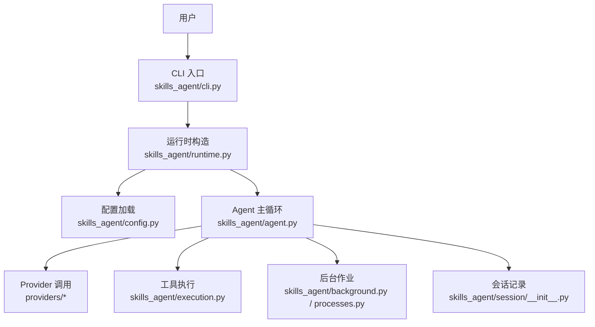
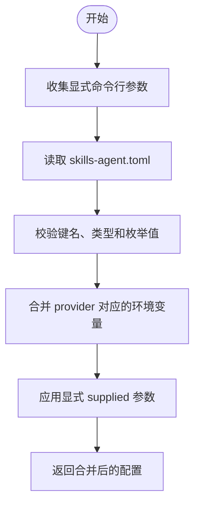
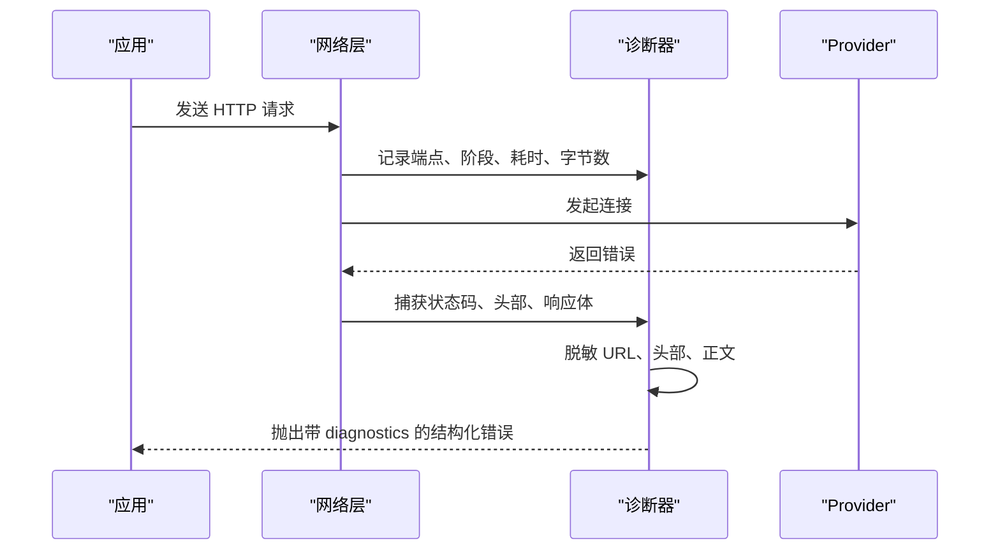
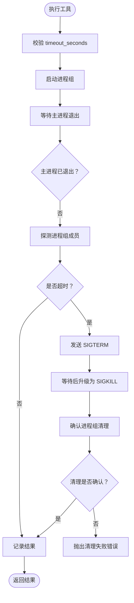
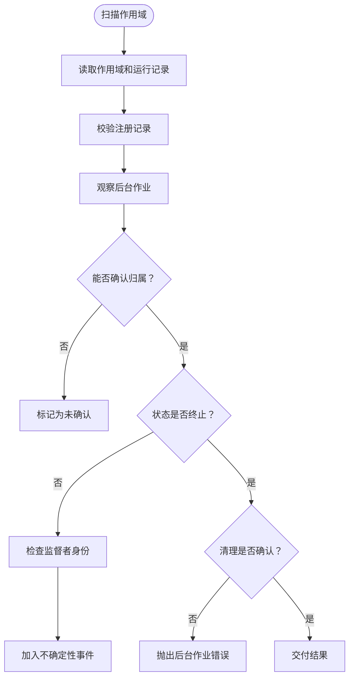
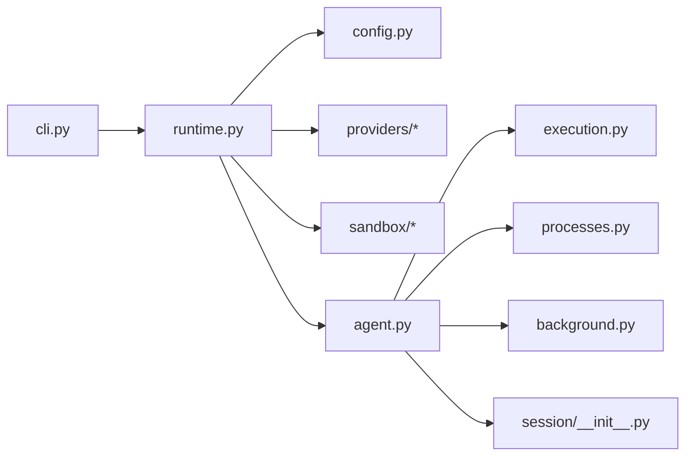

# 故障排除与常见问题

<cite>
**本文引用的文件**   
- [README.md](file://README.md)
- [pyproject.toml](file://pyproject.toml)
- [skills-agent.toml](file://skills-agent.toml)
- [docs/usage.md](file://docs/usage.md)
- [skills_agent/cli.py](file://skills_agent/cli.py)
- [skills_agent/config.py](file://skills_agent/config.py)
- [skills_agent/runtime.py](file://skills_agent/runtime.py)
- [skills_agent/providers/diagnostics.py](file://skills_agent/providers/diagnostics.py)
- [skills_agent/execution.py](file://skills_agent/execution.py)
- [skills_agent/processes.py](file://skills_agent/processes.py)
- [skills_agent/background.py](file://skills_agent/background.py)
- [skills_agent/session/__init__.py](file://skills_agent/session/__init__.py)
- [tests/test_tool_execution_timeout.py](file://tests/test_tool_execution_timeout.py)
</cite>

## 目录
1. [引言](#引言)
2. [项目结构与日志位置](#项目结构与日志位置)
3. [核心排查能力总览](#核心排查能力总览)
4. [按症状分类的故障排除指南](#按症状分类的故障排除指南)
5. [架构与关键流程](#架构与关键流程)
6. [依赖关系分析](#依赖关系分析)
7. [性能与容量注意事项](#性能与容量注意事项)
8. [最佳实践与预防建议](#最佳实践与预防建议)
9. [结论](#结论)

## 引言
本指南面向实际部署、评测和日常使用中出现的问题，将常见症状分组整理，给出原因分析、定位步骤、修复命令和预防措施。内容覆盖安装失败、API Key 未设置、模型不识别、上下文窗口不足、输出被截断、工具执行超时、沙箱镜像拉取失败、后台任务泄漏、会话无法恢复、评测探针失败等场景。同时说明如何使用 `history --full`、日志目录、Provider 诊断、进程列表和容器状态进行排查。

## 项目结构与日志位置
本项目是一个 Python CLI Agent，负责会话管理、上下文压缩、模型调用、工具执行、后台作业与子 Agent。安装后通过 `skills-agent` 命令行启动；`run` 用于交互会话，`benchmark` 用于单次任务运行。



**图表来源**
- [skills_agent/cli.py:1-100](file://skills_agent/cli.py#L1-L100)
- [skills_agent/runtime.py:1-58](file://skills_agent/runtime.py#L1-L58)
- [skills_agent/config.py:1-74](file://skills_agent/config.py#L1-L74)
- [skills_agent/session/__init__.py:1-113](file://skills_agent/session/__init__.py#L1-L113)

**章节来源**
- [README.md:1-68](file://README.md#L1-L68)
- [pyproject.toml:1-23](file://pyproject.toml#L1-L23)
- [docs/usage.md:1-161](file://docs/usage.md#L1-L161)

## 核心排查能力总览
| 排查手段 | 用途 | 典型发现 |
|---|---|---|
| `history --session NAME` | 回放会话摘要 | 用户消息、助手回复、工具调用摘要 |
| `history --session NAME --full` | 展开完整公开记录、命令源码、工具输出 | 原始错误、长输出、图片路径、失败标记 |
| 工作目录下的 `.agent/sessions/NAME` | 查看追加式事件日志、附件、子会话 | `events.jsonl`、`context.json`、`attachments`、`subagents` |
| Provider 诊断 | 脱敏后的 HTTP 状态、请求阶段、异常类型 | `error.diagnostics`、`retry.diagnostics` |
| 进程列表与进程组 | 检查同步命令、后台任务、服务残留 | `ps -e -o pid=,pgid=,stat=` |
| Docker 容器状态 | 检查沙箱镜像是否可用、容器是否退出或卡住 | `docker images`、`docker ps -a` |
| benchmark 日志目录 | 查看单次任务的 session 与清理结果 | 每次任务独立目录，正常结束、失败、中断均清理登记进程 |

**章节来源**
- [README.md:1-68](file://README.md#L1-L68)
- [docs/usage.md:1-161](file://docs/usage.md#L1-L161)
- [skills_agent/session/__init__.py:1-113](file://skills_agent/session/__init__.py#L1-L113)
- [skills_agent/providers/diagnostics.py:1-261](file://skills_agent/providers/diagnostics.py#L1-L261)

## 按症状分类的故障排除指南

### 症状一：安装失败
**可能原因**
- Python 版本低于要求。
- 虚拟环境激活方式不正确。
- 依赖解析失败，例如网络问题或包索引不可用。
- 未使用 editable 模式安装导致 `skills-agent` 命令找不到。

**定位步骤**
1. 确认 Python 版本为 3.11 或更高。
2. 重新创建虚拟环境并激活。
3. 重新安装可编辑版本。
4. 如果仍失败，检查系统依赖和网络。

**修复命令**
```sh
python3 -m venv .venv
.venv/bin/python -m pip install -e .
```

**预防建议**
- 始终使用文档提供的 Python 版本和安装命令。
- 在离线或受限环境中提前准备依赖缓存。
- 不要跳过 `-e`，否则 CLI 脚本可能无法注册。

**章节来源**
- [README.md:1-20](file://README.md#L1-L20)
- [pyproject.toml:1-23](file://pyproject.toml#L1-L23)

### 症状二：提示 API Key 未设置
**可能原因**
- 未设置对应 Provider 的 API Key 环境变量。
- 使用了错误的 Provider，导致读取了错误的变量名。
- 通过 shell 导出密钥后启动了新的终端，但新终端没有继承该变量。
- 误把密钥写进 TOML 配置文件。

**定位步骤**
1. 确认当前使用的 Provider：默认是 OpenAI，也可通过 `--provider anthropic` 切换。
2. 检查对应环境变量：OpenAI 使用 `OPENAI_API_KEY`，Anthropic 使用 `ANTHROPIC_API_KEY`。
3. 检查是否在正确的 shell 会话中导出密钥。
4. 确认密钥没有写入 `skills-agent.toml`；API Key 只从环境变量读取。

**修复命令**
```sh
export OPENAI_API_KEY='你的密钥'
.venv/bin/skills-agent run --session demo
```

或 Anthropic：
```sh
export ANTHROPIC_API_KEY='你的密钥'
.venp/bin/skills-agent run --provider anthropic --session claude
```

**预防建议**
- 将密钥放在安全的环境变量或 `.env` 文件中，不要放入 TOML。
- 在需要鉴权的网关前明确 `base_url`。
- 切换 Provider 时同步检查对应的 `_MODEL` 和 `_API_KEY`。

**章节来源**
- [README.md:10-20](file://README.md#L10-L20)
- [docs/usage.md:1-80](file://docs/usage.md#L1-L80)
- [skills_agent/config.py:1-74](file://skills_agent/config.py#L1-L74)
- [skills_agent/runtime.py:1-58](file://skills_agent/runtime.py#L1-L58)

### 症状三：模型不识别或模型名称无效
**可能原因**
- 未设置 `model`，也没有设置 `{PROVIDER}_MODEL`。
- `OPENAI_MODEL` 或 `ANTHROPIC_MODEL` 指向的服务不支持工具调用。
- 自定义 `base_url` 指向非兼容网关。
- `api_format` 与实际接口不匹配。

**定位步骤**
1. 检查 `--model`、`OPENAI_MODEL`、`ANTHROPIC_MODEL`。
2. 检查 `--base-url` 和 `--api-format`。
3. 使用 `history --full` 回放一次最小任务，观察模型是否返回最终回答。
4. 若使用 DeepSeek 官方 Chat 地址，注意其特殊处理链路。

**修复命令**
```sh
export OPENAI_MODEL='支持工具调用的模型名称'
.venv/bin/skills-agent run --session demo
```

或 Anthropic：
```sh
export ANTHROPIC_MODEL='支持工具调用的模型名称'
.venv/bin/skills-agent run --provider anthropic --session claude
```

**预防建议**
- 先在简单任务上验证模型能返回工具调用和最终回答。
- 对兼容网关显式设置 `api_format` 和 `token_counter`。
- 不要假设所有 OpenAI 兼容服务都完全等价。

**章节来源**
- [skills_agent/runtime.py:1-58](file://skills_agent/runtime.py#L1-L58)
- [docs/usage.md:1-161](file://docs/usage.md#L1-L161)

### 症状四：上下文窗口不足
**可能原因**
- `context_tokens` 过小。
- `model_context_window` 小于实际消息总量。
- `max_output_tokens` 过大，导致输入加输出超出模型窗口。
- 大量附件、工具输出、历史压缩摘要占用上下文。

**定位步骤**
1. 查看 `skills-agent.toml` 中的四项 token 配置。
2. 确认 `context_tokens` 与 `model_context_window` 与实际模型一致。
3. 检查 `max_output_tokens` 是否合理。
4. 使用 `history --full` 查看是否有超长工具输出或大量附件。

**修复命令**
在 `skills-agent.toml` 中调整：
```toml
context_tokens = 524000
model_context_window = 524000
max_output_tokens = 131072
summary_output_tokens = 8192
```

或通过命令行覆盖：
```sh
skills-agent run --session demo --context-tokens 1000000 --model-context-window 1000000 --max-output-tokens 65536
```

**预防建议**
- 先在小上下文窗口验证逻辑正确性，再逐步扩大配置。
- 避免一次性传入过多图片和大文件。
- 让模型选择合适技能处理长文本，而不是把所有材料塞进用户消息。

**章节来源**
- [skills-agent.toml:1-18](file://skills-agent.toml#L1-L18)
- [docs/usage.md:1-161](file://docs/usage.md#L1-L161)
- [skills_agent/config.py:1-74](file://skills_agent/config.py#L1-L74)

### 症状五：输出被截断
**可能原因**
- `max_output_tokens` 太小。
- 思考模式消耗了部分输出额度。
- 辅助生成摘要超过 `summary_output_tokens`。
- 工具报告生成达到上限。

**定位步骤**
1. 检查 `max_output_tokens` 和 `summary_output_tokens`。
2. 使用 `history --full` 查看助手正文末尾是否出现截断相关错误。
3. 检查是否存在长时间思考过程。
4. 对工具报告类任务，检查工具配置是否为 `report` 模式。

**修复命令**
```toml
max_output_tokens = 131072
summary_output_tokens = 8192
```

**预防建议**
- 为含思考的模型预留足够输出空间。
- 不要把复杂报告全部交给主模型一次性输出，拆分为工具和子 Agent。
- 优先让工具直接产出结构化结果，再由模型总结。

**章节来源**
- [skills-agent.toml:1-18](file://skills-agent.toml#L1-L18)
- [docs/usage.md:1-161](file://docs/usage.md#L1-L161)

### 症状六：工具执行超时
**可能原因**
- 命令本身运行过慢。
- 管道中存在阻塞的子进程。
- 父进程提前退出但子进程仍持有输出管道。
- 超时时间设置过小。

**定位步骤**
1. 查看工具执行结果中的 `timed_out`、`exit_code`、`stdout_truncated`、`stderr_truncated`。
2. 查看会话目录中的工具运行日志。
3. 使用进程列表检查是否存在残留进程组。
4. 复现命令，单独在 shell 中运行并计时。

**修复命令**
根据任务复杂度调整超时：
```json
{
  "name": "Inspect analysis inputs",
  "command": "python3 analyze.py",
  "run_in_background": false,
  "timeout_seconds": 30
}
```

**预防建议**
- 同步命令设置有限 `timeout_seconds`，默认 120 秒，最多 600 秒。
- 避免让工具进入无界等待；必要时改用后台任务并设置执行期限。
- 对管道命令确保所有子进程都能退出。

**章节来源**
- [skills_agent/execution.py:1-200](file://skills_agent/execution.py#L1-L200)
- [docs/usage.md:162-282](file://docs/usage.md#L162-L282)
- [tests/test_tool_execution_timeout.py:1-200](file://tests/test_tool_execution_timeout.py#L1-L200)

### 症状七：沙箱镜像拉取失败
**可能原因**
- Docker 未安装或未登录仓库。
- 镜像名称错误或私有仓库认证失败。
- 网络无法访问远程镜像仓库。
- 本地已存在损坏镜像。

**定位步骤**
1. 检查 `sandbox_image` 是否配置。
2. 手动执行镜像拉取命令。
3. 检查 Docker 登录状态和镜像清单。
4. 查看最近一次工具调用或 Agent 初始化时的错误。

**修复命令**
```sh
docker pull your-sandbox-image
docker images
docker login
```

在配置中启用沙箱：
```toml
sandbox_image = "your-sandbox-image"
```

**预防建议**
- 在评测前预拉取镜像。
- 对离线环境准备本地镜像。
- 不要在公共机器上使用未受控的私有镜像。

**章节来源**
- [skills_agent/runtime.py:1-58](file://skills_agent/runtime.py#L1-L58)
- [skills-agent.toml:1-18](file://skills-agent.toml#L1-L18)

### 症状八：后台任务泄漏
**可能原因**
- 工具进程退出码异常，但未完成进程组清理。
- 父进程意外退出，子进程仍存活。
- 后台任务状态文件损坏或所有权不一致。
- 评测中保留了跨任务服务。

**定位步骤**
1. 查看会话目录中的 `process-scopes`、`subagents` 及后台任务状态文件。
2. 使用进程列表查找可疑进程组。
3. 检查 supervisor 身份探测是否成功。
4. 确认 benchmark 是否拒绝 `background_lifecycle=service`。

**修复命令**
```sh
ps -e -o pid=,pgid=,stat=
kill -TERM <pid>
docker rm -f <container-id>
```

**预防建议**
- 只在确实需要长期运行的任务中使用 service，并明确生命周期。
- 普通任务使用 task 模式，由运行时回收。
- 在 benchmark 中禁止保留服务，避免污染下一次任务。

**章节来源**
- [skills_agent/processes.py:1-200](file://skills_agent/processes.py#L1-L200)
- [skills_agent/background.py:1-200](file://skills_agent/background.py#L1-L200)
- [docs/usage.md:1-161](file://docs/usage.md#L1-L161)
- [README.md:40-68](file://README.md#L40-L68)

### 症状九：会话无法恢复
**可能原因**
- 会话 ID 非法。
- 会话目录权限不足或被删除。
- `events.jsonl` 损坏或丢失。
- 工具调用在响应之间被强制中断，导致记录组不完整。

**定位步骤**
1. 确认会话名符合规则：字母、数字、点、下划线、短横线。
2. 检查工作目录下 `.agent/sessions/NAME` 是否存在。
3. 使用 `history --session NAME` 尝试摘要回放。
4. 使用 `history --session NAME --full` 查看原始事件。
5. 检查是否有 recovered 记录。

**修复命令**
```sh
.venv/bin/skills-agent history --session demo
.venv/bin/skills-agent history --session demo --full
```

**预防建议**
- 不要在外部程序直接修改 `events.jsonl`。
- 备份整个会话目录，而不是只复制 `context.json`。
- 对异常中断后的会话，先用 `--full` 确认工具调用是否可补记。

**章节来源**
- [skills_agent/session/__init__.py:1-113](file://skills_agent/session/__init__.py#L1-L113)
- [docs/usage.md:1-80](file://docs/usage.md#L1-L80)
- [README.md:10-20](file://README.md#L10-L20)

### 症状十：评测探针失败
**可能原因**
- 工作目录不存在。
- 日志目录已存在，benchmark 会报错。
- 任务提示文件缺失。
- Provider 鉴权失败、限流或余额不足。
- 沙箱镜像不可用。
- 工具执行超时或进程清理失败。

**定位步骤**
1. 检查 prompt 文件和 workspace。
2. 确认 `--log-dir` 是全新目录。
3. 查看 `events.jsonl` 中的 `error.diagnostics` 或 `retry.diagnostics`。
4. 检查网络、API Key、base_url 和模型。
5. 检查 Docker 镜像和容器状态。
6. 查看 benchmark 退出码：成功 0、失败 1、中断 130。

**修复命令**
```sh
.venv/bin/python -m skills_agent.benchmark \
  --prompt-file /path/to/prompt.txt \
  --workspace /path/to/task \
  --log-dir /path/to/run-logs
```

**预防建议**
- 每次评测使用独立日志目录。
- 在真实任务、容器隔离和评分验收之前，先用小任务验证模型和工具链。
- 不要把测试环境的临时服务当作稳定依赖。

**章节来源**
- [README.md:40-68](file://README.md#L40-L68)
- [docs/usage.md:1-161](file://docs/usage.md#L1-L161)
- [skills_agent/providers/diagnostics.py:1-261](file://skills_agent/providers/diagnostics.py#L1-L261)

## 架构与关键流程

### 配置加载与参数优先级
配置加载遵循“显式命令行参数 > TOML 配置文件 > 环境变量 > 内置默认值”。API Key 始终从环境变量读取。



**图表来源**
- [skills_agent/config.py:1-74](file://skills_agent/config.py#L1-L74)

**章节来源**
- [skills_agent/config.py:1-74](file://skills_agent/config.py#L1-L74)
- [docs/usage.md:1-80](file://docs/usage.md#L1-L80)

### Provider 错误诊断流程
Provider 的错误诊断会对敏感信息进行脱敏，包括 URL、Authorization、Cookie、JSON 字段和密钥片段。



**图表来源**
- [skills_agent/providers/diagnostics.py:1-261](file://skills_agent/providers/diagnostics.py#L1-L261)

**章节来源**
- [skills_agent/providers/diagnostics.py:1-261](file://skills_agent/providers/diagnostics.py#L1-L261)
- [tests/test_provider_diagnostics.py:1-200](file://tests/test_provider_diagnostics.py#L1-L200)

### 工具执行与超时清理流程
同步工具执行具有明确的超时、信号升级、进程组检查和清理边界。



**图表来源**
- [skills_agent/execution.py:1-200](file://skills_agent/execution.py#L1-L200)

**章节来源**
- [skills_agent/execution.py:1-200](file://skills_agent/execution.py#L1-L200)
- [tests/test_tool_execution_timeout.py:1-200](file://tests/test_tool_execution_timeout.py#L1-L200)

### 后台任务不确定性恢复流程
后台任务通过会话事件、作用域元数据和监督者状态共同确认归属和完成状态；无法确认的状态不会伪造退出码。



**图表来源**
- [skills_agent/processes.py:1-200](file://skills_agent/processes.py#L1-L200)
- [skills_agent/background.py:1-200](file://skills_agent/background.py#L1-L200)

**章节来源**
- [skills_agent/processes.py:1-200](file://skills_agent/processes.py#L1-L200)
- [skills_agent/background.py:1-200](file://skills_agent/background.py#L1-L200)

## 依赖关系分析
- CLI 入口负责参数解析、摘要显示和完整回放。
- 运行时负责加载配置、创建 Provider、SkillRegistry、DockerSandbox 和 Agent。
- Provider 模块封装 OpenAI 与 Anthropic 协议转换、重试、用量计量和诊断。
- 执行模块负责前台命令、超时、进程组和清理。
- 进程模块负责后台作业注册、监督者探测、作用域校验和不确定性传播。
- 会话模块负责追加式事件日志、附件副本和用户消息构建。



**图表来源**
- [skills_agent/cli.py:1-100](file://skills_agent/cli.py#L1-L100)
- [skills_agent/runtime.py:1-58](file://skills_agent/runtime.py#L1-L58)
- [skills_agent/config.py:1-74](file://skills_agent/config.py#L1-L74)

**章节来源**
- [skills_agent/cli.py:1-200](file://skills_agent/cli.py#L1-L200)
- [skills_agent/runtime.py:1-58](file://skills_agent/runtime.py#L1-L58)
- [skills_agent/execution.py:1-200](file://skills_agent/execution.py#L1-L200)
- [skills_agent/processes.py:1-200](file://skills_agent/processes.py#L1-L200)
- [skills_agent/background.py:1-200](file://skills_agent/background.py#L1-L200)
- [skills_agent/session/__init__.py:1-113](file://skills_agent/session/__init__.py#L1-L113)

## 性能与容量注意事项
- 上下文压缩阈值通常为配置预算与实际模型窗口的较小值的 80%。
- `usage` 模式依赖最近一次有效的主模型返回用量，不估算新增消息长度。
- 其他计数模式会在请求前计量完整输入，并在有效输入预算更小时提前触发。
- 工具报告生成关闭思考，并使用保守预算限制输出。
- 大量图片、PDF 和长工具输出会显著增加上下文和输出压力。
- 交互式界面每秒最多处理约 10 批显示事件，渲染期间不阻塞执行线程。

**章节来源**
- [docs/usage.md:1-161](file://docs/usage.md#L1-L161)
- [docs/usage.md:162-282](file://docs/usage.md#L162-L282)

## 最佳实践与预防建议
1. **先在小上下文窗口验证**  
   先用较小的 `context_tokens` 和 `model_context_window` 验证任务逻辑，再逐步扩大到真实模型能力范围。

2. **逐步扩大配置**  
   不要一次性把 1M 上下文、超大输出额度和大量附件同时启用；分批验证模型、工具和服务稳定性。

3. **避免在 benchmark 中保留服务**  
   benchmark 明确拒绝 `background_lifecycle=service`，防止跨任务污染。如需长期服务，应在评测外单独管理。

4. **及时清理会话目录**  
   每个任务使用独立工作目录和日志目录；旧会话不再使用时统一清理，避免磁盘占满和路径冲突。

5. **优先使用 `history --full` 定位原始问题**  
   摘要不包含命令源码或工具 JSON；需要证据时使用 `--full`，但仍需注意其中可能包含公开信息。

6. **保存并审查 Provider 诊断**  
   诊断已脱敏，适合内部共享；不要公开完整请求头、Authorization、Cookie 或密钥片段。

7. **为工具命令设置合理超时**  
   同步命令默认 120 秒，最长 600 秒；后台任务可使用独立执行期限，但应避免无限等待。

8. **区分“工具超时”和“Provider 超时”**  
   工具超时反映命令执行问题；Provider 超时、限流、5xx 或 524 可能触发自动重试，需分别查看工具日志和事件诊断。

9. **备份整个会话目录**  
   只复制 `context.json` 不足以恢复完整状态；应备份 `events.jsonl`、`attachments`、`subagents` 和进程作用域。

10. **在真实环境和隔离容器中验证**  
    单元测试通过不能替代真实任务、容器隔离及评分验收。

**章节来源**
- [README.md:40-68](file://README.md#L40-L68)
- [docs/usage.md:1-161](file://docs/usage.md#L1-L161)
- [skills_agent/providers/diagnostics.py:1-261](file://skills_agent/providers/diagnostics.py#L1-L261)
- [skills_agent/execution.py:1-200](file://skills_agent/execution.py#L1-L200)

## 结论
大多数故障可以通过“先看现象、再看会话、最后看诊断”的顺序定位。安装和配置问题通常集中在 Python 版本、环境变量、Provider 名称和模型名称；上下文和输出问题集中在 `context_tokens`、`model_context_window`、`max_output_tokens` 与附件大小；执行问题集中在超时、进程组和后台任务生命周期；网络和鉴权问题则依赖 `error.diagnostics` 与 `retry.diagnostics`。配合 `history --full`、日志目录、进程列表和容器状态，可以覆盖绝大多数安装、运行、评测和排障场景。