# 架构总览

<cite>
**本文引用的文件**   
- [__main__.py](file://skills_agent/__main__.py)
- [cli.py](file://skills_agent/cli.py)
- [runtime.py](file://skills_agent/runtime.py)
- [agent.py](file://skills_agent/agent.py)
- [config.py](file://skills_agent/config.py)
- [environment.py](file://skills_agent/environment.py)
- [input.py](file://skills_agent/input.py)
- [display.py](file://skills_agent/display.py)
- [execution.py](file://skills_agent/execution.py)
- [session/__init__.py](file://skills_agent/session/__init__.py)
- [skills/__init__.py](file://skills_agent/skills/__init__.py)
- [tools/__init__.py](file://skills_agent/tools/__init__.py)
- [background.py](file://skills_agent/background.py)
- [providers/base.py](file://skills_agent/providers/base.py)
- [providers/openai.py](file://skills_agent/providers/openai.py)
- [providers/anthropic.py](file://skills_agent/providers/anthropic.py)
- [providers/responses.py](file://skills_agent/providers/responses.py)
- [providers/retry.py](file://skills_agent/providers/retry.py)
- [pyproject.toml](file://pyproject.toml)
</cite>

## 目录
1. [引言](#引言)
2. [项目结构](#项目结构)
3. [核心组件](#核心组件)
4. [架构总览](#架构总览)
5. [端到端数据流：从用户输入到工具执行](#端到端数据流从用户输入到工具执行)
6. [详细组件分析](#详细组件分析)
7. [依赖关系与外部边界](#依赖关系与外部边界)
8. [可扩展点](#可扩展点)
9. [性能与可靠性特征](#性能与可靠性特征)
10. [故障排查指南](#故障排查指南)
11. [结论](#结论)

## 引言
本文件为 `skills-agent` 的架构总览文档。它面向两类读者：
- 初学者：帮助理解 CLI、Agent、Provider、工具、会话、后台任务等模块如何协作；
- 有经验的开发者：帮助定位装配入口、错误分类策略、重试机制、注册表扩展点和持久化边界。

该项目的目标是把自然语言输入转化为可观测的 Agent 工作流：模型提供响应，Agent 调用工具（Shell、沙箱、子代理），结果通过追加式会话日志和后台投递机制回写，最终由 CLI 渲染给用户。

## 项目结构
仓库采用按职责分层的 Python 包结构：
- `skills_agent/`：应用主代码，包含 CLI、运行时装配器、Agent、上下文、工具、技能、会话、提供者、后台任务、显示队列和执行器等；
- `adapters/`：评测与部署适配器相关资产；
- `docs/`：提示词规范、评测计划与示例证据；
- `tests/`：单元测试与集成测试；
- `pyproject.toml`：包名、Python 版本、依赖项和命令行入口。

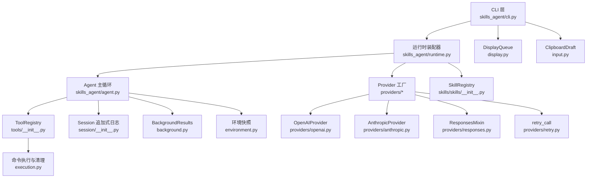

**图表来源**
- [cli.py:1-200](file://skills_agent/cli.py#L1-L200)
- [runtime.py:1-58](file://skills_agent/runtime.py#L1-L58)
- [agent.py:1-200](file://skills_agent/agent.py#L1-L200)
- [tools/__init__.py:1-191](file://skills_agent/tools/__init__.py#L1-L191)
- [session/__init__.py:1-113](file://skills_agent/session/__init__.py#L1-L113)
- [background.py:1-200](file://skills_agent/background.py#L1-L200)
- [environment.py:1-76](file://skills_agent/environment.py#L1-L76)
- [display.py:1-110](file://skills_agent/display.py#L1-L110)
- [input.py:1-54](file://skills_agent/input.py#L1-L54)
- [providers/openai.py:1-200](file://skills_agent/providers/openai.py#L1-L200)
- [providers/anthropic.py:1-200](file://skills_agent/providers/anthropic.py#L1-L200)
- [providers/responses.py:1-191](file://skills_agent/providers/responses.py#L1-L191)
- [providers/retry.py:1-86](file://skills_agent/providers/retry.py#L1-L86)
- [execution.py:1-200](file://skills_agent/execution.py#L1-L200)

**章节来源**
- [pyproject.toml:1-23](file://pyproject.toml#L1-L23)
- [__main__.py:1-3](file://skills_agent/__main__.py#L1-L3)

## 核心组件
| 组件 | 主要职责 | 关键设计点 |
|---|---|---|
| CLI | 解析参数、构建 UI 输出、启动 `create_agent`、渲染模型与工具结果 | 使用 `rich` 渲染 Markdown；支持 `append_line` / `append_body` 等输出接口 |
| 运行时装配器 | 加载配置、创建 Provider、SkillRegistry、DockerSandbox、Agent | 单一装配函数 `create_agent`，屏蔽多 Provider 差异 |
| Agent | 维护工作上下文、工具注册表、后台结果投递、系统提示与指令 | 组合模式：持有 model、session、skills、workspace、sandbox、tools |
| SkillRegistry | 扫描 `SKILL.md`，生成技能目录 | YAML frontmatter 校验；重复名称报错 |
| ToolRegistry | 声明 shell、sandbox、subagent 工具 Schema，执行并返回 JSON 结果 | 严格参数校验；区分前台命令、后台任务、沙箱、子代理 |
| Provider | 将消息转换为 OpenAI 或 Anthropic 请求，流式返回文本、思考、工具调用 | 统一 `ProviderError` 分类与重试策略 |
| Session | 追加式事件日志，保存消息和附件 | `append_event` 追加 JSONL；`iter_events` 只读恢复 |
| BackgroundResults | 在 Agent 同步边界投递后台任务结果 | 基于会话事件和进程状态去重投递 |
| DisplayQueue | 线程安全的 UI 事件队列 | 合并相邻文本增量，避免 UI 阻塞主流程 |
| ClipboardDraft | prompt-toolkit 剪贴板粘贴标记 | 支持图片和文件占位符 |

**章节来源**
- [cli.py:1-200](file://skills_agent/cli.py#L1-L200)
- [runtime.py:1-58](file://skills_agent/runtime.py#L1-L58)
- [agent.py:1-200](file://skills_agent/agent.py#L1-L200)
- [skills/__init__.py:1-54](file://skills_agent/skills/__init__.py#L1-L54)
- [tools/__init__.py:1-191](file://skills_agent/tools/__init__.py#L1-L191)
- [session/__init__.py:1-113](file://skills_agent/session/__init__.py#L1-L113)
- [background.py:1-200](file://skills_agent/background.py#L1-L200)
- [display.py:1-110](file://skills_agent/display.py#L1-L110)
- [input.py:1-54](file://skills_agent/input.py#L1-L54)

## 架构总览
系统分为四层：
1. **交互层**：CLI、prompt-toolkit 输入、剪贴板草稿、`rich` 渲染；
2. **编排层**：运行时装配器、Agent 主循环、工作上下文；
3. **能力层**：SkillRegistry、ToolRegistry、背景任务投递、命令执行；
4. **模型层**：Provider 抽象、OpenAI/Anthropic 实现、Responses 适配、错误分类与重试。

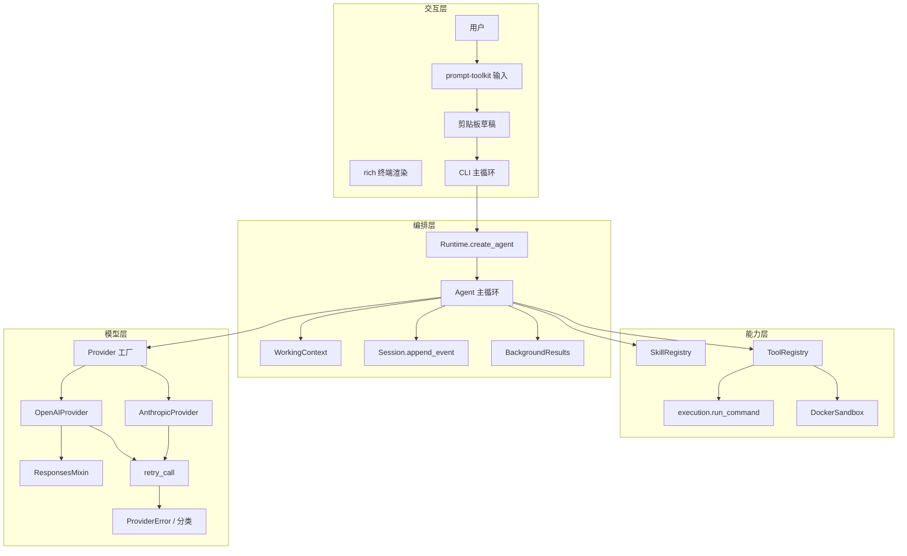

**图表来源**
- [cli.py:1-200](file://skills_agent/cli.py#L1-L200)
- [runtime.py:1-58](file://skills_agent/runtime.py#L1-L58)
- [agent.py:1-200](file://skills_agent/agent.py#L1-L200)
- [tools/__init__.py:1-191](file://skills_agent/tools/__init__.py#L1-L191)
- [execution.py:1-200](file://skills_agent/execution.py#L1-L200)
- [providers/base.py:1-200](file://skills_agent/providers/base.py#L1-L200)
- [providers/openai.py:1-200](file://skills_agent/providers/openai.py#L1-L200)
- [providers/anthropic.py:1-200](file://skills_agent/providers/anthropic.py#L1-L200)
- [providers/responses.py:1-191](file://skills_agent/providers/responses.py#L1-L191)
- [providers/retry.py:1-86](file://skills_agent/providers/retry.py#L1-L86)

## 端到端数据流：从用户输入到工具执行
一次典型用户输入的数据流如下：

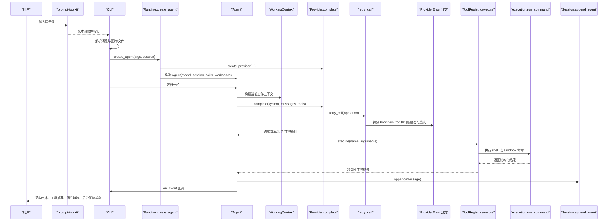

**图表来源**
- [cli.py:1-200](file://skills_agent/cli.py#L1-L200)
- [runtime.py:1-58](file://skills_agent/runtime.py#L1-L58)
- [agent.py:1-200](file://skills_agent/agent.py#L1-L200)
- [providers/retry.py:1-86](file://skills_agent/providers/retry.py#L1-L86)
- [providers/base.py:1-200](file://skills_agent/providers/base.py#L1-L200)
- [tools/__init__.py:1-191](file://skills_agent/tools/__init__.py#L1-L191)
- [execution.py:1-200](file://skills_agent/execution.py#L1-L200)
- [session/__init__.py:1-113](file://skills_agent/session/__init__.py#L1-L113)

### 数据流阶段说明
1. **输入阶段**：CLI 通过 `input.ClipboardDraft` 接收剪贴板粘贴的文件和图片标记，再由 `Session.make_user_message` 转为不可变消息。
2. **装配阶段**：`Runtime.create_agent` 读取 TOML、环境变量和 CLI 参数，创建 Provider、SkillRegistry、可选 DockerSandbox，再构造 Agent。
3. **模型阶段**：Agent 通过 Provider 发起流式请求；Provider 内部用 `retry_call` 包装，对可重试错误进行延迟重试。
4. **工具阶段**：模型返回工具调用时，Agent 交给 `ToolRegistry.execute`；ToolRegistry 根据名称选择 shell、sandbox 或 subagent。
5. **结果投递阶段**：工具结果写入 Session；后台任务通过 `BackgroundResults` 在 Agent 同步边界投递；CLI 通过 `on_event` 渲染。

**章节来源**
- [input.py:1-54](file://skills_agent/input.py#L1-L54)
- [session/__init__.py:1-113](file://skills_agent/session/__init__.py#L1-L113)
- [runtime.py:1-58](file://skills_agent/runtime.py#L1-L58)
- [providers/retry.py:1-86](file://skills_agent/providers/retry.py#L1-L86)
- [tools/__init__.py:1-191](file://skills_agent/tools/__init__.py#L1-L191)
- [background.py:1-200](file://skills_agent/background.py#L1-L200)
- [cli.py:1-200](file://skills_agent/cli.py#L1-L200)

## 详细组件分析

### 运行时装配器：工厂与装配边界
`create_agent` 是系统装配的核心入口。它完成以下工作：
- 通过 `load_agent_config` 合并 CLI、TOML、环境变量和默认值；
- 通过 `create_provider` 实例化模型提供者；
- 通过 `SkillRegistry` 发现内置技能和用户技能；
- 可选构造 DockerSandbox；
- 返回 `Agent` 实例。

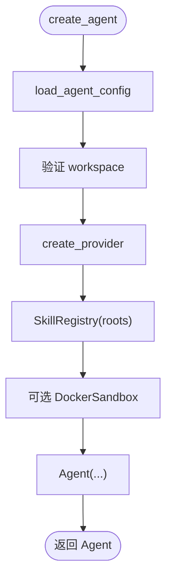

**图表来源**
- [runtime.py:1-58](file://skills_agent/runtime.py#L1-L58)
- [config.py:1-74](file://skills_agent/config.py#L1-L74)

**章节来源**
- [runtime.py:1-58](file://skills_agent/runtime.py#L1-L58)
- [config.py:1-74](file://skills_agent/config.py#L1-L74)

### Agent 主循环与工作上下文
Agent 不是简单的一次性调用者，而是组合了多个子系统：
- `model`：Provider 抽象；
- `session`：追加式事件日志；
- `skills`：SkillRegistry；
- `context`：`WorkingContext`，负责消息压缩、Token 预算和辅助生成；
- `auxiliary`：辅助内容生成器；
- `tools`：ToolRegistry；
- `background_results`：后台任务投递器；
- `process_scope`：进程作用域与后台任务所有权。

Agent 的系统提示中明确指导模型如何使用技能、工具、图片、后台任务和子代理。这些提示构成了 Agent 的行为契约，而不是直接可执行的代码。

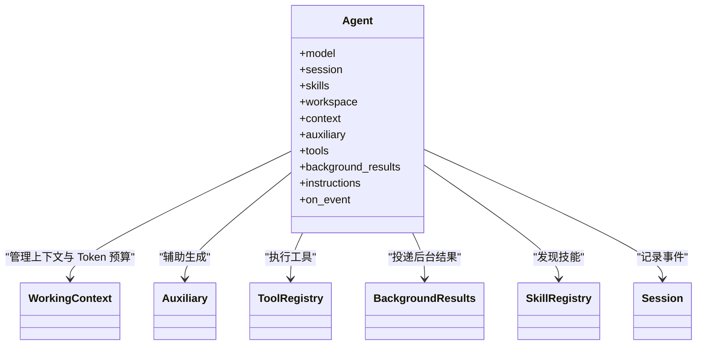

**图表来源**
- [agent.py:1-200](file://skills_agent/agent.py#L1-L200)
- [tools/__init__.py:1-191](file://skills_agent/tools/__init__.py#L1-L191)
- [background.py:1-200](file://skills_agent/background.py#L1-L200)
- [skills/__init__.py:1-54](file://skills_agent/skills/__init__.py#L1-L54)
- [session/__init__.py:1-113](file://skills_agent/session/__init__.py#L1-L113)

**章节来源**
- [agent.py:1-200](file://skills_agent/agent.py#L1-L200)

### 工具注册表：Schema 驱动的执行边界
`ToolRegistry` 定义三类工具：
1. **shell**：在工作目录执行任意 Shell 命令；
2. **sandbox**：在 Docker 镜像中执行命令；
3. **subagent**：委托命名子任务。

其关键行为包括：
- 按工具名查找 Schema；
- 解析并校验 JSON 参数；
- 校验枚举、必填字段、超时、图片数量；
- 前台命令调用 `execution.run_command`；
- 后台命令通过进程作用域注册；
- 返回 JSON 字符串供模型消费。

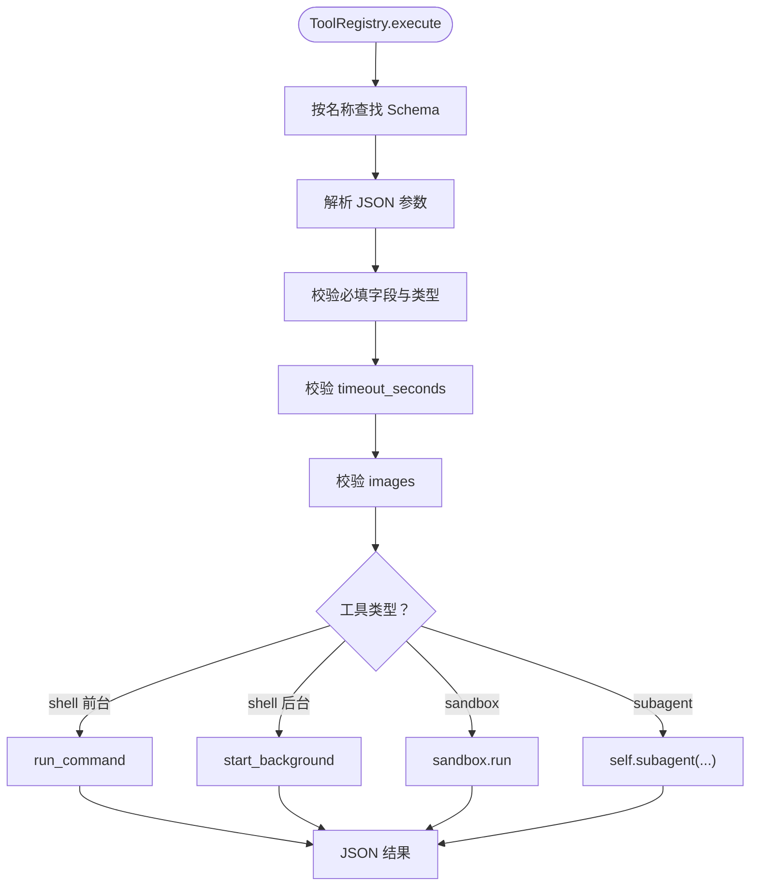

**图表来源**
- [tools/__init__.py:1-191](file://skills_agent/tools/__init__.py#L1-L191)
- [execution.py:1-200](file://skills_agent/execution.py#L1-L200)

**章节来源**
- [tools/__init__.py:1-191](file://skills_agent/tools/__init__.py#L1-L191)
- [execution.py:1-200](file://skills_agent/execution.py#L1-L200)

### 模型提供者：工厂、策略与错误分类
Provider 体系围绕三个核心思想组织：
1. **工厂模式**：`create_provider` 根据 provider 名称创建具体实例；
2. **策略模式**：不同 Provider 实现不同的消息转换、流式解析和 Token 计数策略；
3. **错误分类策略**：所有网络与协议异常统一归入 `ProviderError`，并通过 HTTP 状态码、结构化错误字段和 finish reason 推导 category，从而决定能否重试。

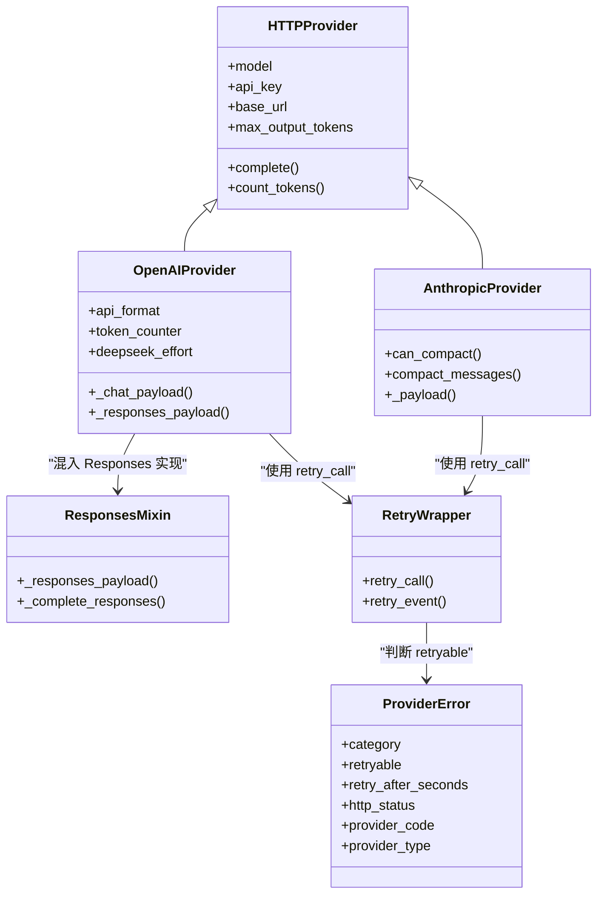

**图表来源**
- [providers/base.py:1-200](file://skills_agent/providers/base.py#L1-L200)
- [providers/openai.py:1-200](file://skills_agent/providers/openai.py#L1-L200)
- [providers/anthropic.py:1-200](file://skills_agent/providers/anthropic.py#L1-L200)
- [providers/responses.py:1-191](file://skills_agent/providers/responses.py#L1-L191)
- [providers/retry.py:1-86](file://skills_agent/providers/retry.py#L1-L86)

**章节来源**
- [providers/base.py:1-200](file://skills_agent/providers/base.py#L1-L200)
- [providers/openai.py:1-200](file://skills_agent/providers/openai.py#L1-L200)
- [providers/anthropic.py:1-200](file://skills_agent/providers/anthropic.py#L1-L200)
- [providers/responses.py:1-191](file://skills_agent/providers/responses.py#L1-L191)
- [providers/retry.py:1-86](file://skills_agent/providers/retry.py#L1-L86)

### 追加式日志与会话存储
`Session` 是系统的持久化边界之一：
- `append_event` 以 JSONL 形式追加事件；
- `iter_events` 支持从偏移量恢复读取；
- `make_user_message` 在写入前验证图片和附件；
- 附件保存在 `attachments` 目录，并生成 URI。

这种设计保证：
- 历史记录不可被覆盖；
- 崩溃后可恢复未消费事件；
- 工具输出、后台不确定性、子代理报告均可作为事件回放。

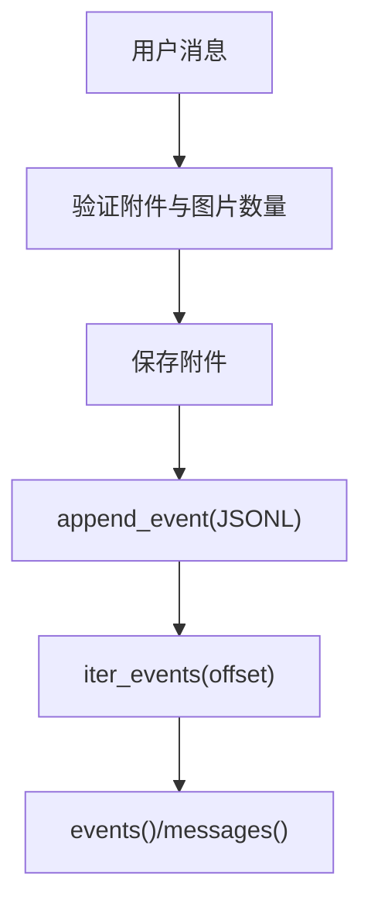

**图表来源**
- [session/__init__.py:1-113](file://skills_agent/session/__init__.py#L1-L113)

**章节来源**
- [session/__init__.py:1-113](file://skills_agent/session/__init__.py#L1-L113)

### 后台任务与结果投递
后台任务的生命周期由三部分协作：
1. **ToolRegistry.shell**：根据 `run_in_background` 决定是否注册后台任务；
2. **BackgroundResults**：扫描会话事件和进程状态，识别已注册但未确认的任务；
3. **Agent 同步边界**：在适当时机调用 `drain`，将结果注入会话。

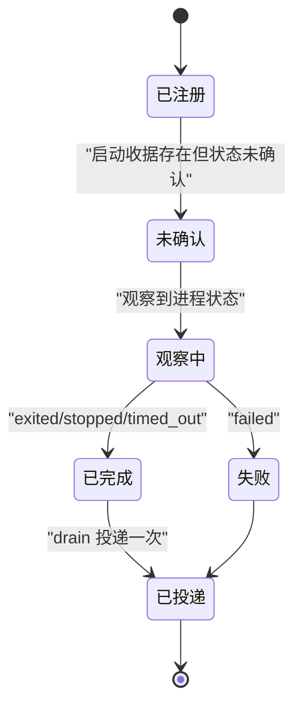

**图表来源**
- [tools/__init__.py:1-191](file://skills_agent/tools/__init__.py#L1-L191)
- [background.py:1-200](file://skills_agent/background.py#L1-L200)

**章节来源**
- [tools/__init__.py:1-191](file://skills_agent/tools/__init__.py#L1-L191)
- [background.py:1-200](file://skills_agent/background.py#L1-L200)

### 错误分类与重试策略
Provider 的错误处理遵循“分类优先于猜测”的原则：
- HTTP 状态码映射到基础类别；
- 结构化错误字段如 `code`、`type` 映射到更细粒度类别；
- finish reason 中的长度限制、内容过滤、中止信号也有独立类别；
- 只有属于可重试集合的错误才会进入 `retry_call`；
- 重试受尝试次数、总耗时预算和服务器 `retry-after` 头约束。

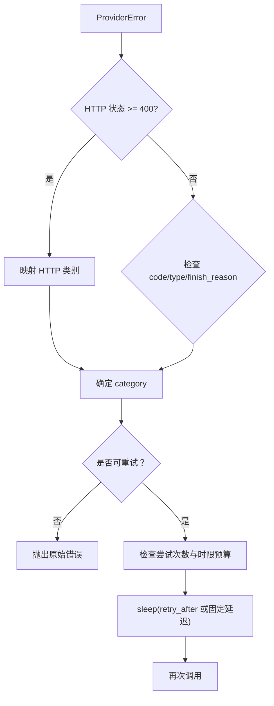

**图表来源**
- [providers/base.py:1-200](file://skills_agent/providers/base.py#L1-L200)
- [providers/retry.py:1-86](file://skills_agent/providers/retry.py#L1-L86)

**章节来源**
- [providers/base.py:1-200](file://skills_agent/providers/base.py#L1-L200)
- [providers/retry.py:1-86](file://skills_agent/providers/retry.py#L1-L86)

### CLI、显示队列与输入
CLI 承担界面协调职责：
- 使用 `rich` 渲染 Markdown 和彩色输出；
- 支持富输出接口 `append_line`、`append_body`、`append_image_link`、`upsert_tool`；
- 使用 `DisplayQueue` 解耦模型流式输出与 UI 渲染；
- 使用 `ClipboardDraft` 处理 prompt-toolkit 剪贴板粘贴。

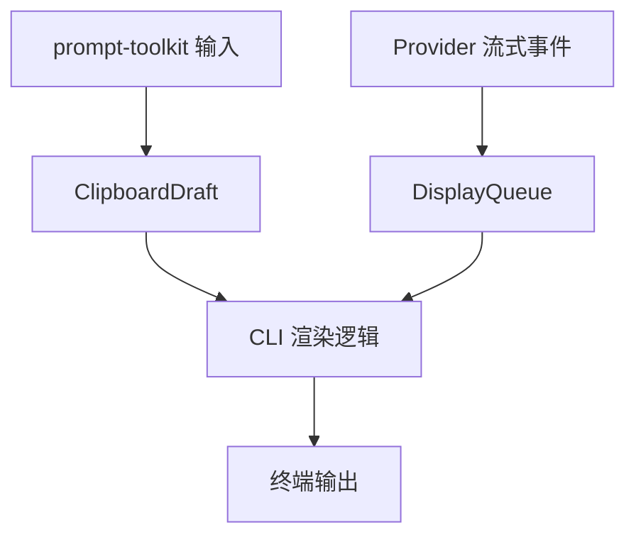

**图表来源**
- [cli.py:1-200](file://skills_agent/cli.py#L1-L200)
- [display.py:1-110](file://skills_agent/display.py#L1-L110)
- [input.py:1-54](file://skills_agent/input.py#L1-L54)

**章节来源**
- [cli.py:1-200](file://skills_agent/cli.py#L1-L200)
- [display.py:1-110](file://skills_agent/display.py#L1-L110)
- [input.py:1-54](file://skills_agent/input.py#L1-L54)

## 依赖关系与外部边界
### 包依赖
项目通过 `pyproject.toml` 声明四个关键外部依赖：
- `PyYAML`：解析 `SKILL.md` 的 YAML frontmatter；
- `rich`：终端 Markdown 与文本渲染；
- `prompt-toolkit`：交互式输入与剪贴板粘贴；
- `Pillow`：图片字节处理。

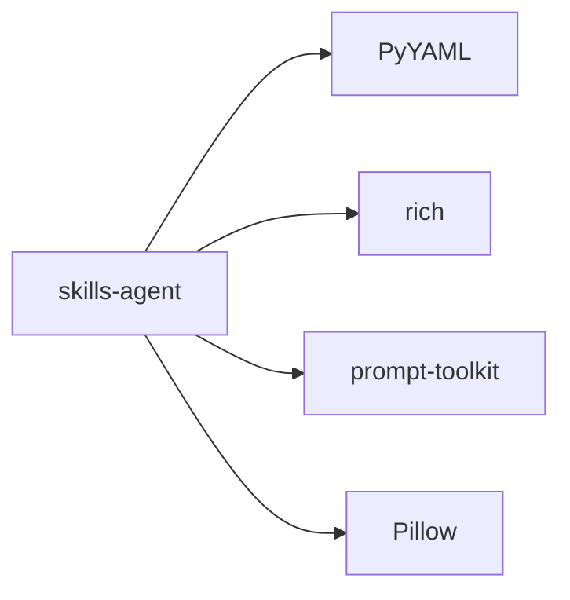

**图表来源**
- [pyproject.toml:1-23](file://pyproject.toml#L1-L23)
- [skills/__init__.py:1-54](file://skills_agent/skills/__init__.py#L1-L54)
- [cli.py:1-200](file://skills_agent/cli.py#L1-L200)
- [input.py:1-54](file://skills_agent/input.py#L1-L54)

### 系统边界
- **外部 API 边界**：OpenAI `/chat/completions`、`/responses`、Anthropic `/messages`；
- **文件系统边界**：工作目录、会话目录、附件目录、工具运行日志；
- **进程边界**：Shell 命令、Docker 容器、后台任务进程组；
- **网络边界**：Provider HTTP 请求、流式响应、重试等待；
- **UI 边界**：终端、Markdown、图片链接、工具面板。

**章节来源**
- [pyproject.toml:1-23](file://pyproject.toml#L1-L23)
- [execution.py:1-200](file://skills_agent/execution.py#L1-L200)
- [providers/openai.py:1-200](file://skills_agent/providers/openai.py#L1-L200)
- [providers/anthropic.py:1-200](file://skills_agent/providers/anthropic.py#L1-L200)

## 可扩展点
### 1. SKILL.md 技能
新增技能只需在 `builtin_skills` 或用户 `skills/` 目录下添加 `SKILL.md`，并在 YAML frontmatter 中提供 `name` 和 `description`。SkillRegistry 会递归扫描并生成模型可用的技能目录。

扩展建议：
- 保持 frontmatter 简洁；
- 在 `scripts/` 中实现可复用的脚本；
- 在 `references/` 中保留方法说明；
- 避免在 SKILL.md 中嵌入过长正文，优先引用脚本和参考文档。

**章节来源**
- [skills/__init__.py:1-54](file://skills_agent/skills/__init__.py#L1-L54)

### 2. Provider 插件
当前支持 `openai` 和 `anthropic`。若需新增 Provider：
- 继承 `HTTPProvider` 或复用 `ResponsesMixin`；
- 实现消息转换、流式事件处理和 Token 计数；
- 使用现有 `ProviderError` 和 `retry_call`；
- 在 Provider 工厂中注册新名称。

**章节来源**
- [providers/base.py:1-200](file://skills_agent/providers/base.py#L1-L200)
- [providers/openai.py:1-200](file://skills_agent/providers/openai.py#L1-L200)
- [providers/anthropic.py:1-200](file://skills_agent/providers/anthropic.py#L1-L200)
- [providers/responses.py:1-191](file://skills_agent/providers/responses.py#L1-L191)

### 3. Tool 插件
当前工具集中在 `ToolRegistry`。若需新增工具：
- 在 `schemas` 中添加新的 JSON Schema；
- 在 `execute` 中按名称分发执行逻辑；
- 使用 `on_activity` 上报活动；
- 使用 `execution.validate_timeout` 或自定义校验规则。

注意：新增工具不应绕过 JSON 参数校验和超时限制。

**章节来源**
- [tools/__init__.py:1-191](file://skills_agent/tools/__init__.py#L1-L191)
- [execution.py:1-200](file://skills_agent/execution.py#L1-L200)

### 4. Adapter 插件
`adapters/` 下包含 ALE、Harbor、Terminal Bench 4 等评测与部署适配资源。它们通常不直接修改 Agent 核心，而是通过：
- 提供评测任务清单；
- 提供预检脚本；
- 提供评估证据；
- 控制运行环境和部署产物。

**章节来源**
- [adapters/harbor/tb4_agents/skills/IMAGE-SKILL.md](file://adapters/harbor/tb4_agents/skills/IMAGE-SKILL.md)
- [adapters/harbor/tb4_agents/skills/MCP-SKILL.md](file://adapters/harbor/tb4_agents/skills/MCP-SKILL.md)

## 性能与可靠性特征
### 性能特征
- **流式输出**：Provider 通过流式事件逐步产生文本、思考和工具调用；
- **UI 非阻塞**：`DisplayQueue` 合并相邻文本增量，避免渲染阻塞主流程；
- **Token 预算**：`WorkingContext` 控制上下文窗口和压缩阈值；
- **命令超时**：前台命令默认 120 秒，最大 600 秒；后台任务可设置独立执行截止时间；
- **图片限制**：单次请求最多若干张图片，每张图片限制大小。

### 可靠性特征
- **追加式会话日志**：事件不可覆盖，便于恢复；
- **后台任务去重投递**：同一 job ID 的 terminal 结果只投递一次；
- **错误分类与重试**：仅对连接、限流、服务端错误、网关超时等可重试错误重试；
- **进程组清理**：命令结束或超时时尝试 SIGTERM/SIGKILL，并探测进程组；
- **诊断信息**：Provider 错误携带 HTTP 状态、结构化错误、原始事件和 partial content。

**章节来源**
- [display.py:1-110](file://skills_agent/display.py#L1-L110)
- [execution.py:1-200](file://skills_agent/execution.py#L1-L200)
- [background.py:1-200](file://skills_agent/background.py#L1-L200)
- [providers/base.py:1-200](file://skills_agent/providers/base.py#L1-L200)
- [providers/retry.py:1-86](file://skills_agent/providers/retry.py#L1-L86)

## 故障排查指南
### 常见问题与定位路径
| 现象 | 可能原因 | 定位文件 |
|---|---|---|
| 启动时报模型未配置 | 未设置 `--model` 或对应环境变量 | [runtime.py:1-58](file://skills_agent/runtime.py#L1-L58), [config.py:1-74](file://skills_agent/config.py#L1-L74) |
| 工作目录不存在 | `workspace` 不是有效目录 | [runtime.py:1-58](file://skills_agent/runtime.py#L1-L58) |
| 技能 YAML 报错 | `SKILL.md` frontmatter 缺失或无效 | [skills/__init__.py:1-54](file://skills_agent/skills/__init__.py#L1-L54) |
| 工具参数错误 | JSON 格式、必填字段、枚举或类型不匹配 | [tools/__init__.py:1-191](file://skills_agent/tools/__init__.py#L1-L191) |
| 命令卡住或残留进程 | 超时或进程组清理失败 | [execution.py:1-200](file://skills_agent/execution.py#L1-L200) |
| 模型频繁中断 | 输出长度限制或内容过滤 | [providers/base.py:1-200](file://skills_agent/providers/base.py#L1-L200) |
| 网络错误自动重试 | 连接、限流、网关超时等可重试错误 | [providers/retry.py:1-86](file://skills_agent/providers/retry.py#L1-L86) |
| 后台任务状态未确认 | 启动收据存在但进程尚未确认完成 | [background.py:1-200](file://skills_agent/background.py#L1-L200) |
| UI 卡顿 | 渲染过慢或大量文本增量 | [display.py:1-110](file://skills_agent/display.py#L1-L110) |

### 调试建议
1. 检查会话目录下的 `events.jsonl`，确认用户消息、工具调用和后台事件是否按顺序追加；
2. 查看 Provider 错误中的 `category`、`http_status`、`provider_code` 和 `diagnostics`；
3. 对长时间运行的命令，显式设置 `timeout_seconds`；
4. 对需要持续服务的任务，使用 `background_lifecycle=service`，并确保 readiness 验证；
5. 对模型重试问题，可通过环境变量限制最大尝试次数和总耗时预算。

**章节来源**
- [session/__init__.py:1-113](file://skills_agent/session/__init__.py#L1-L113)
- [providers/base.py:1-200](file://skills_agent/providers/base.py#L1-L200)
- [providers/retry.py:1-86](file://skills_agent/providers/retry.py#L1-L86)
- [tools/__init__.py:1-191](file://skills_agent/tools/__init__.py#L1-L191)
- [execution.py:1-200](file://skills_agent/execution.py#L1-L200)
- [background.py:1-200](file://skills_agent/background.py#L1-L200)
- [display.py:1-110](file://skills_agent/display.py#L1-L110)

## 结论
`skills-agent` 的核心架构可以概括为：
- **CLI 层**负责输入、渲染和用户交互；
- **运行时装配器**负责配置、Provider、技能、沙箱和 Agent 的统一装配；
- **Agent** 是工作流中心，协调上下文、工具、后台任务和会话日志；
- **SkillRegistry 和 ToolRegistry** 分别暴露技能目录和工具 Schema；
- **Provider 层**封装模型差异，并通过错误分类与重试提升鲁棒性；
- **Session 与 BackgroundResults** 共同构成可靠的结果持久化和投递机制。

该系统通过明确的边界和可扩展点，使技能、Provider、工具和评测适配器可以在不侵入核心逻辑的前提下扩展。对于初学者，建议先从 CLI 和 Session 入手；对于有经验开发者，应重点关注 Provider 错误分类、ToolRegistry 参数校验、后台任务所有权和 UI 非阻塞渲染。