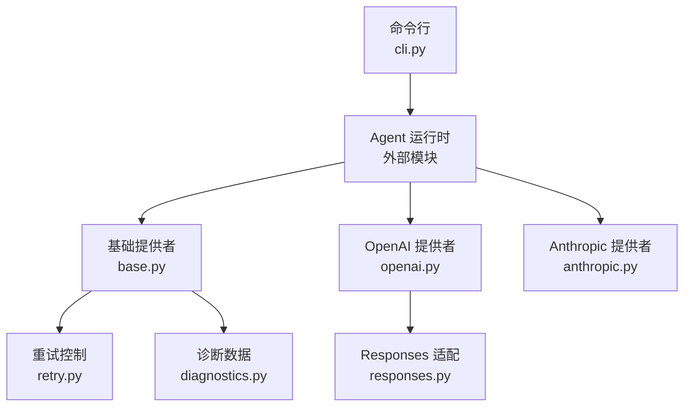
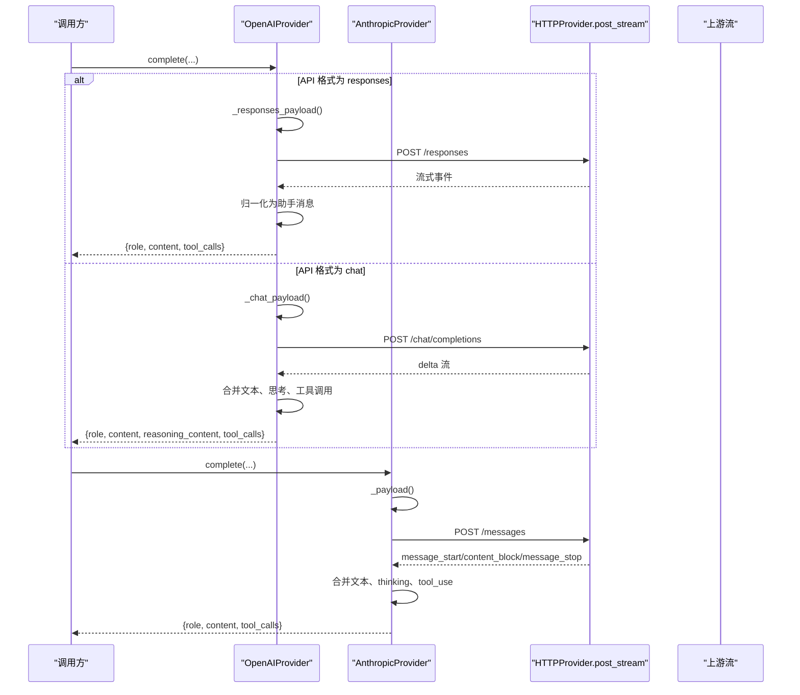
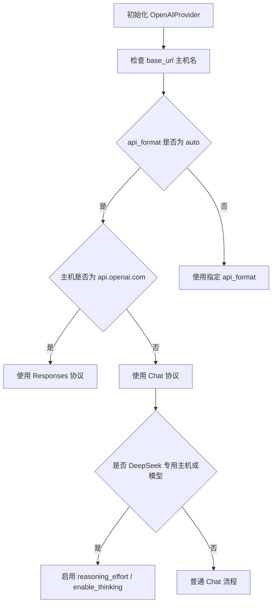
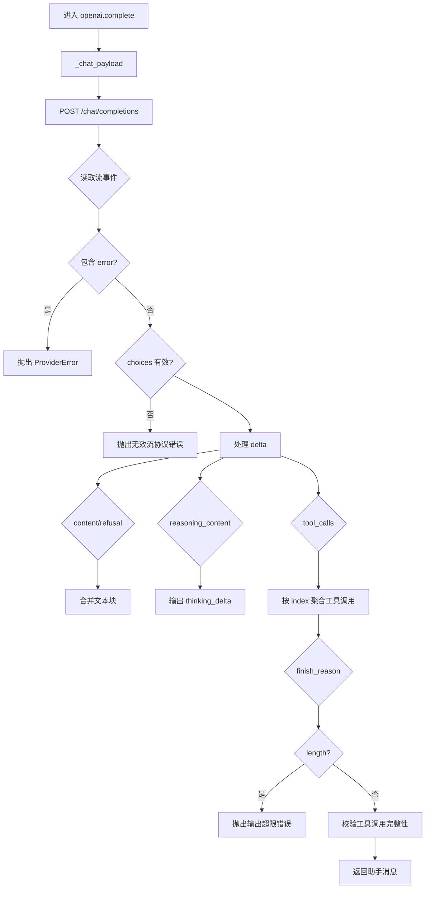
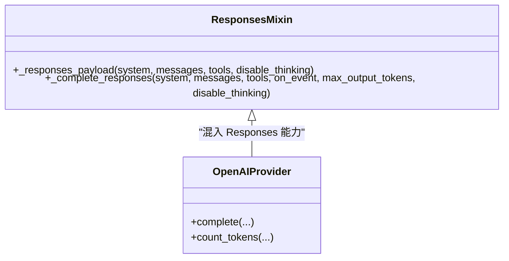
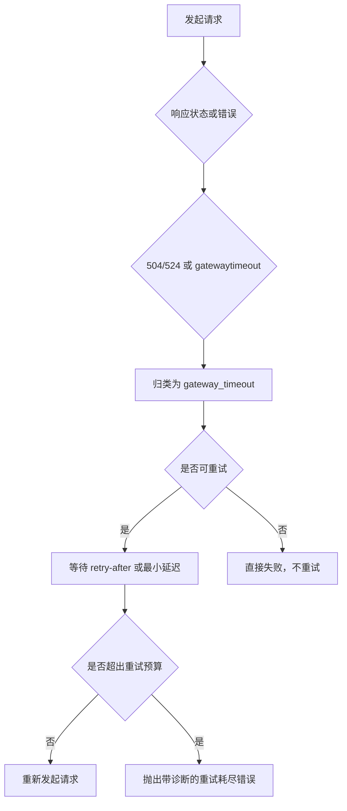
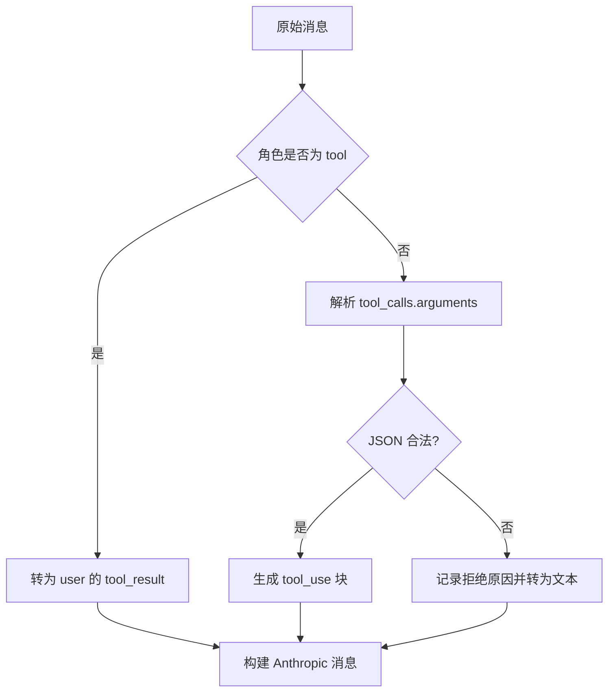
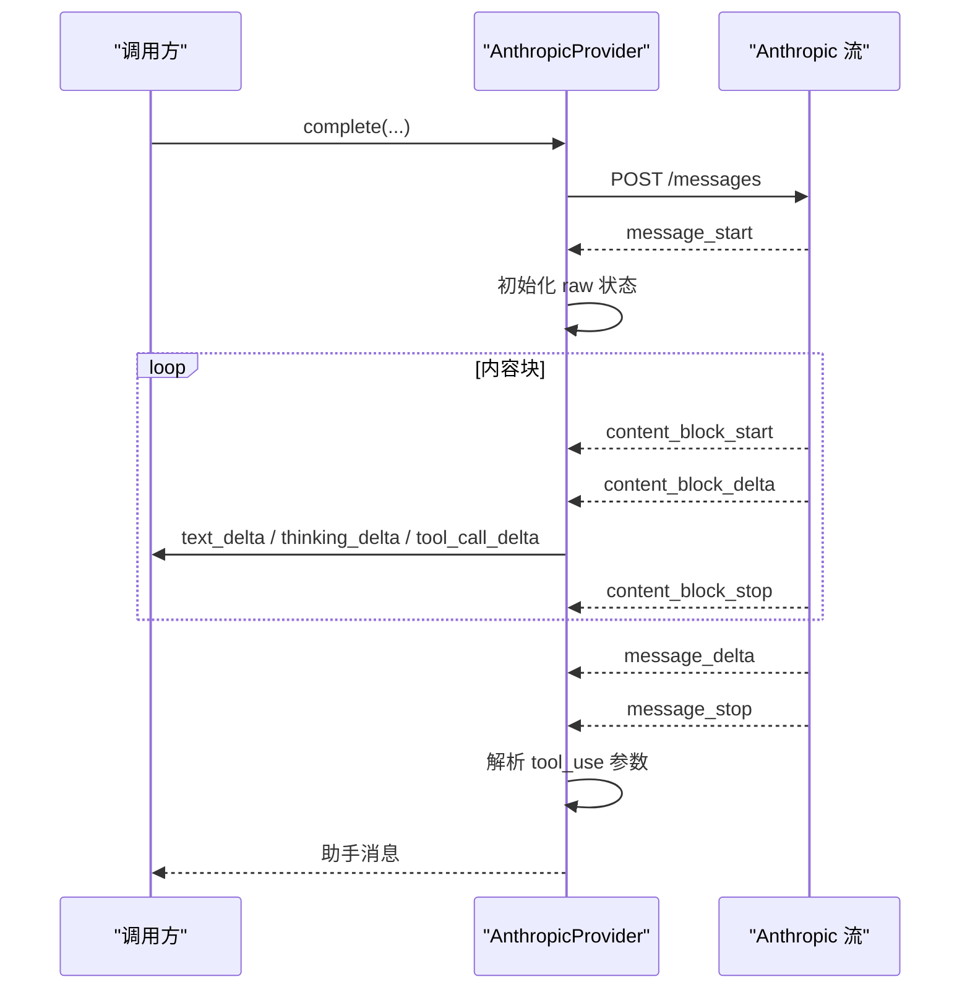
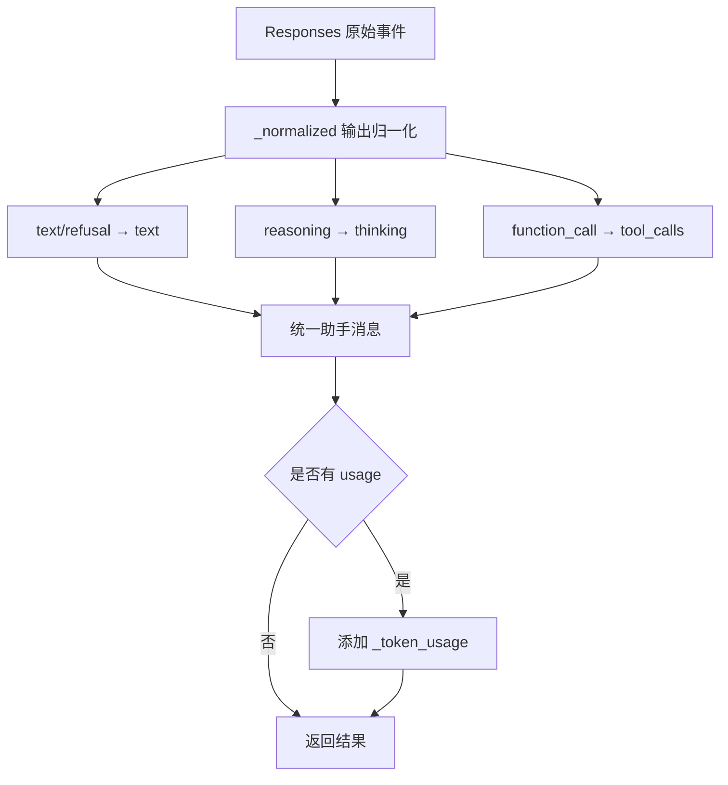
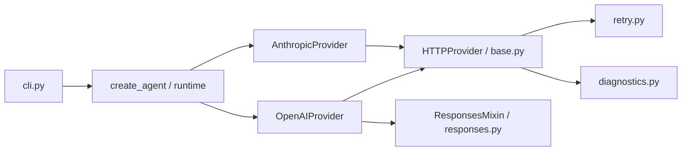

# OpenAI / Anthropic 集成细节

<cite>
**本文引用的文件**   
- [skills_agent/providers/openai.py](file://skills_agent/providers/openai.py)
- [skills_agent/providers/anthropic.py](file://skills_agent/providers/anthropic.py)
- [skills_agent/providers/responses.py](file://skills_agent/providers/responses.py)
- [skills_agent/providers/base.py](file://skills_agent/providers/base.py)
- [skills_agent/providers/retry.py](file://skills_agent/providers/retry.py)
- [skills_agent/cli.py](file://skills_agent/cli.py)
- [README.md](file://README.md)
</cite>

## 目录
1. [引言](#引言)
2. [项目结构](#项目结构)
3. [核心组件](#核心组件)
4. [架构总览](#架构总览)
5. [详细组件分析](#详细组件分析)
6. [依赖关系分析](#依赖关系分析)
7. [性能注意事项](#性能注意事项)
8. [故障排查指南](#故障排查指南)
9. [结论](#结论)

## 引言
本文聚焦 `OpenAIProvider` 与 `AnthropicProvider` 的具体实现，并说明它们如何把不同提供商的原始响应统一成 Agent 可消费的消息格式。重点覆盖：消息格式、工具定义、流式事件、思考强度参数、模型命名约定、`base_url` 重写方式、User-Agent 注入行为；同时解释 `responses.py` 中的 Responses 适配逻辑、网关超时与重试边界、结构化输出处理、工具调用解析和可用性探测策略。最后给出典型使用示例和生产环境常见问题及修复建议。

## 项目结构
Provider 相关代码集中在 `skills_agent/providers/` 下：
- `base.py`：统一的 Provider 抽象、错误分类、HTTP 工具函数、Token 计数接口。
- `openai.py`：OpenAI Chat 协议与 Responses 协议两种路径。
- `anthropic.py`：Anthropic Messages 协议。
- `responses.py`：OpenAI Responses 协议的请求构造与响应归一化。
- `retry.py`：基于 `ProviderError.retryable` 的重试控制器。
- `cli.py`：CLI 参数解析与交互渲染，间接体现 Provider 配置入口。



**图示来源**
- [skills_agent/providers/openai.py:1-20](file://skills_agent/providers/openai.py#L1-L20)
- [skills_agent/providers/anthropic.py:1-20](file://skills_agent/providers/anthropic.py#L1-L20)
- [skills_agent/providers/responses.py:1-20](file://skills_agent/providers/responses.py#L1-L20)
- [skills_agent/providers/base.py:1-20](file://skills_agent/providers/base.py#L1-L20)
- [skills_agent/providers/retry.py:1-20](file://skills_agent/providers/retry.py#L1-L20)

**章节来源**
- [skills_agent/providers/openai.py:1-20](file://skills_agent/providers/openai.py#L1-L20)
- [skills_agent/providers/anthropic.py:1-20](file://skills_agent/providers/anthropic.py#L1-L20)
- [skills_agent/providers/responses.py:1-20](file://skills_agent/providers/responses.py#L1-L20)
- [skills_agent/providers/base.py:1-20](file://skills_agent/providers/base.py#L1-L20)
- [README.md:1-20](file://README.md#L1-L20)

## 核心组件
- **OpenAIProvider**：继承 `ResponsesMixin` 与 `HTTPProvider`，默认 `base_url` 为 `https://api.openai.com/v1`。根据主机名自动选择 `responses` 或 `chat` 协议，支持 DeepSeek 专用字段与 effort 参数。
- **AnthropicProvider**：继承 `HTTPProvider`，默认 `base_url` 为 `https://api.anthropic.com/v1`，固定使用 Messages 协议，通过 `x-api-key` 与 `anthropic-version` 头认证。
- **ResponsesMixin**：封装 OpenAI `/responses` 的请求载荷、流式事件映射、输出归一化和 token 用量快照。
- **Retry 控制器**：依据 `ProviderError.category` 判断是否可重试，结合 `retry-after` 头和预算限制执行延迟重试。

**章节来源**
- [skills_agent/providers/openai.py:20-60](file://skills_agent/providers/openai.py#L20-L60)
- [skills_agent/providers/anthropic.py:20-60](file://skills_agent/providers/anthropic.py#L20-L60)
- [skills_agent/providers/responses.py:80-191](file://skills_agent/providers/responses.py#L80-L191)
- [skills_agent/providers/retry.py:1-86](file://skills_agent/providers/retry.py#L1-L86)

## 架构总览
两个 Provider 都暴露相同的 `complete(system, messages, tools, on_event, max_output_tokens, disable_thinking)` 契约，但内部协议差异很大：



**图示来源**
- [skills_agent/providers/openai.py:60-120](file://skills_agent/providers/openai.py#L60-L120)
- [skills_agent/providers/openai.py:120-200](file://skills_agent/providers/openai.py#L120-L200)
- [skills_agent/providers/openai.py:201-305](file://skills_agent/providers/openai.py#L201-L305)
- [skills_agent/providers/responses.py:110-191](file://skills_agent/providers/responses.py#L110-L191)
- [skills_agent/providers/anthropic.py:60-140](file://skills_agent/providers/anthropic.py#L60-L140)
- [skills_agent/providers/anthropic.py:140-283](file://skills_agent/providers/anthropic.py#L140-L283)

## 详细组件分析

### 统一契约与差异对比

| 维度 | OpenAI 实现 | Anthropic 实现 |
|---|---|---|
| 消息角色 | `system`、`user`、`assistant`、`tool` | 仅 `user`、`assistant`；`tool` 角色被转换为 `user` 的 `tool_result` |
| 输入内容块 | `text`、`image_url`、`file`(PDF)、其他文件转为提示文本；跳过 `thinking`/`redacted_thinking` | `text`、`image`、`document`(PDF)、其他文件转为提示文本；未签名 thinking 保留，已签名或 `redacted_thinking` 特殊处理 |
| 工具定义 | Chat：`{type: "function", function}`；Responses：`{type: "function", name, description, parameters, strict: false}` | `{name, description, input_schema}` |
| 工具结果 | Chat：`{role: "tool", content, tool_call_id}`；Responses：`{type: "function_call_output", call_id, output}` | 将 `tool` 角色转为 `user`，携带 `tool_result` 块 |
| 流式事件 | Chat：delta 流，按 `choices[0].delta` 增量拼接；Responses：`response.output_text.delta`、`response.reasoning_summary_text.delta` 等 | `message_start`、`content_block_start/delta/stop`、`message_delta`、`message_stop` |
| 思考参数 | Chat：`disable_thinking` 时设置 `thinking.type=disabled` 或 `enable_thinking=False`；DeepSeek effort 走 `reasoning_effort`；Responses：`reasoning.effort=none` | `_payload` 中 `disable_thinking` 设置 `thinking.type=disabled`；无 effort 字段 |
| 模型命名约定 | 自动检测 `api.deepseek.com` 或 deepseek 模型名称以启用 DeepSeek 专用逻辑；Responses 仅在 `api.openai.com` 自动启用 | 未内置 Claude 模型白名单；由上层传入模型名称 |
| `base_url` 重写 | 默认 `https://api.openai.com/v1`；任意自定义 `base_url` 会改变协议自动选择 | 默认 `https://api.anthropic.com/v1`；自定义地址用于代理或非标准部署 |
| User-Agent 注入 | 依赖基类 `post_json`/`post_stream`；源码未显式设置 `User-Agent` | 同上；只显式设置 `x-api-key`、`anthropic-version` |
| Token 计数 | `auto` 会根据协议选择 `official` 或 `usage`；Chat 不支持 official 计数 | 仅支持 `official`，调用 `/messages/count_tokens` |

**章节来源**
- [skills_agent/providers/openai.py:20-120](file://skills_agent/providers/openai.py#L20-L120)
- [skills_agent/providers/openai.py:120-200](file://skills_agent/providers/openai.py#L120-L200)
- [skills_agent/providers/openai.py:201-305](file://skills_agent/providers/openai.py#L201-L305)
- [skills_agent/providers/anthropic.py:20-140](file://skills_agent/providers/anthropic.py#L20-L140)
- [skills_agent/providers/anthropic.py:140-283](file://skills_agent/providers/anthropic.py#L140-L283)
- [skills_agent/providers/responses.py:1-80](file://skills_agent/providers/responses.py#L1-L80)

### OpenAI 实现：流式响应、结构化输出、网关超时、重试边界、工具调用解析、可用性探测

#### 协议选择与 base_url
- 默认 `default_base_url = "https://api.openai.com/v1"`。
- `api_format="auto"` 时，若主机名为 `api.openai.com`，则选择 `responses`；否则选择 `chat`。
- 当 `api_format="chat"` 且主机名以 `.maas.aliyuncs.com` 结尾且模型名以 `deepseek` 开头时，标记为百炼 DeepSeek Chat 模式。
- 对 `api.deepseek.com` 或模型名含 `deepseek` 的情况，使用 DeepSeek 专用输出键 `max_tokens` 而非 `max_completion_tokens`。



**图示来源**
- [skills_agent/providers/openai.py:20-60](file://skills_agent/providers/openai.py#L20-L60)
- [skills_agent/providers/openai.py:60-120](file://skills_agent/providers/openai.py#L60-L120)

#### Chat 流式处理
- 调用 `/chat/completions`，开启 `stream=True` 与 `stream_options.include_usage=true`。
- 维护一个 `choices[0]` 的增量状态，依次处理 `content`、`refusal`、`reasoning_content`、`tool_calls`。
- 文本增量按通道合并，避免重复换行；thinking 增量独立输出。
- 工具调用按 `index` 聚合，校验类型必须为 `function`，并在结束时验证 finish reason 与工具调用一致性。
- 完成状态允许 `stop` 或 `tool_calls`；`length` 转换为 `ProviderOutputLimitError`。



**图示来源**
- [skills_agent/providers/openai.py:120-200](file://skills_agent/providers/openai.py#L120-L200)
- [skills_agent/providers/openai.py:201-305](file://skills_agent/providers/openai.py#L201-L305)

#### Responses 结构化输出与归一化
- `ResponsesMixin._responses_payload` 将消息转换为 `input` 列表，系统提示放入 `instructions`，工具声明带 `strict=false`，thinking 关闭时设置 `reasoning.effort=none`。
- 流式事件包括 `response.created`、`response.in_progress`、`response.output_text.delta`、`response.refusal.delta`、`response.reasoning_summary_text.delta`、`response.output_item.added`、`response.function_call_arguments.delta`、`response.completed`、`response.failed`、`response.incomplete`。
- `_normalized` 将 Responses 输出统一为：
  - `message` → `text` 或 `refusal` 文本块。
  - `reasoning` → `thinking` 块。
  - `function_call` → `tool_calls`。
- 失败事件中，`response.incomplete` 且 `status=incomplete` 且原因为 `max_output_tokens` 时升级为 `ProviderOutputLimitError`。
- 最终结果包含 `_raw`、可选 `_responses_output`、可选 `_token_usage`。



**图示来源**
- [skills_agent/providers/responses.py:110-191](file://skills_agent/providers/responses.py#L110-L191)
- [skills_agent/providers/openai.py:20-60](file://skills_agent/providers/openai.py#L20-L60)

#### 网关超时、重试边界与错误分类
- `base.py` 将 HTTP 状态码映射到类别，其中 `504`、`524` 属于 `gateway_timeout`。
- 结构化错误从 `error.code`、`error.type`、`response.error`、顶层 `error` 事件中提取。
- `ProviderError.category` 优先使用 HTTP 状态，再回退到 provider code/type；`retryable` 允许 `connection`、`rate_limited`、`server_error`、`bad_gateway`、`service_unavailable`、`gateway_timeout`。
- `retry.py` 在每次重试前计算延迟，至少 `RETRY_DELAY_SECONDS=5`，并尊重 `retry-after` 头；可通过环境变量 `SKILLS_AGENT_PROVIDER_MAX_ATTEMPTS` 和 `SKILLS_AGENT_PROVIDER_RETRY_BUDGET_SECONDS` 控制上限。
- 最新提交记录显示存在针对结构化 `GatewayTimeout` 流错误的重试修复，表明该场景在生产中需要特别关注。



**图示来源**
- [skills_agent/providers/base.py:20-120](file://skills_agent/providers/base.py#L20-L120)
- [skills_agent/providers/retry.py:1-86](file://skills_agent/providers/retry.py#L1-L86)

#### Tool 调用解析与可用性
- Chat 模式按 `tool_calls[index]` 增量拼装 `id`、`type`、`function.name`、`function.arguments`，并在结束前校验索引连续性与 finish reason。
- Responses 模式在 `response.output_item.added` 中发送工具调用初始信息，再通过 `response.function_call_arguments.delta` 追加参数。
- 所有工具调用最终调用 `validate_calls` 做边界校验，防止空 ID、非法 JSON 或非法参数结构进入 Agent 执行层。

**章节来源**
- [skills_agent/providers/openai.py:120-200](file://skills_agent/providers/openai.py#L120-L200)
- [skills_agent/providers/openai.py:201-305](file://skills_agent/providers/openai.py#L201-L305)
- [skills_agent/providers/responses.py:110-191](file://skills_agent/providers/responses.py#L110-L191)
- [skills_agent/providers/base.py:20-120](file://skills_agent/providers/base.py#L20-L120)
- [skills_agent/providers/retry.py:1-86](file://skills_agent/providers/retry.py#L1-L86)

### Anthropic 实现：系统提示、工具块、流式输出、thinking 参数与上游差异

#### 消息与工具转换
- 输入消息经 `request_messages` 后：
  - `tool` 角色被转为 `user`，并以 `tool_result` 块承载结果。
  - 工具调用先尝试用 `parse_arguments` 解析为对象；解析失败则记录为“拒绝的工具调用”，并以文本形式保留，避免向上游发送非法 `tool_use.input`。
  - 若助手消息包含 `_anthropic_content`，会在本地重建 Claude 风格的 content 块，使 rejected 调用能以文本形式透传。
- 工具定义使用 `input_schema` 而非通用 `parameters`。
- 系统提示通过 `system` 字段传递。



**图示来源**
- [skills_agent/providers/anthropic.py:20-120](file://skills_agent/providers/anthropic.py#L20-L120)

#### 流式输出与 thinking
- 流事件顺序：`message_start` → 多个 `content_block_start`/`content_block_delta`/`content_block_stop` → `message_delta` → `message_stop`。
- 文本块输出 `text_delta`，thinking 块输出 `thinking_delta`，工具调用块输出 `tool_call_delta`。
- `input_json_delta` 累积后在 `content_block_stop` 处拼接为完整 JSON，并通过 `parse_arguments` 解析；若仍失败，丢弃 `input` 字段，交由外层工具边界校验。
- 完成状态允许 `end_turn`、`tool_use`、`stop_sequence`、`refusal`；`max_tokens` 或 `model_context_window_exceeded` 转为 `ProviderOutputLimitError`。
- 结果中包含 `_anthropic_content`，用于后续压缩与 thinking 保持。



**图示来源**
- [skills_agent/providers/anthropic.py:120-283](file://skills_agent/providers/anthropic.py#L120-L283)

#### Thinking 与 effort 相关参数
- Anthropic 实现仅支持 `disable_thinking`，对应 `thinking.type=disabled`。
- 不存在 `effort` 或 `reasoning_effort` 字段；这些字段属于 DeepSeek/OpenAI 上下文。
- Claude 风格的 `thinking` 和 `redacted_thinking` 作为内容块保留，但未签名 thinking 在压缩时会过滤，以保持 Claude 原生推理状态不被误判。

**章节来源**
- [skills_agent/providers/anthropic.py:20-140](file://skills_agent/providers/anthropic.py#L20-L140)
- [skills_agent/providers/anthropic.py:140-283](file://skills_agent/providers/anthropic.py#L140-L283)

### `responses.py` 响应适配逻辑
`responses.py` 的核心职责是把 OpenAI Responses 协议的原始流式输出统一为 Agent 可消费的格式：

1. 输入转换：
   - `text` → `input_text`
   - `image` → `input_image`
   - PDF `file` → `input_file`
   - 其他 `file` → `input_text` 提示
   - 跳过 `thinking`/`redacted_thinking`
2. 输出归一化：
   - `message.content` 中的 `output_text` → `text`
   - `refusal` → `text`
   - `reasoning.summary` → `thinking`
   - `function_call` → `tool_calls`
3. 流式事件映射：
   - 文本与拒绝输出映射为 `text_delta`
   - reasoning 文本映射为 `thinking_delta`
   - 工具调用新增与参数增量映射为 `tool_call_delta`
4. 错误处理：
   - `response.completed` 非 `completed` 状态视为错误
   - `response.failed`/`response.incomplete` 按原因区分普通错误或输出超限
   - 其他 `error` 事件直接抛错
5. 结果结构：
   - `role=assistant`
   - `content` 为统一后的文本与 thinking 块
   - `_raw` 保存原始 Responses 响应
   - `_responses_output` 保留加密 reasoning 与精确顺序
   - 可选 `_token_usage` 来自 usage snapshot



**图示来源**
- [skills_agent/providers/responses.py:1-80](file://skills_agent/providers/responses.py#L1-L80)
- [skills_agent/providers/responses.py:110-191](file://skills_agent/providers/responses.py#L110-L191)

**章节来源**
- [skills_agent/providers/responses.py:1-191](file://skills_agent/providers/responses.py#L1-L191)

### 配置与典型使用示例

#### 支持的配置项
- `--provider=openai|anthropic`：选择 Provider。
- `--model=gpt-*|claude-*`：传入模型名称；OpenAI 会自动识别 DeepSeek 专用路径。
- `--base-url`：重写上游地址；对 OpenAI 可能改变协议自动选择。
- `--api-format=auto|responses|chat`：OpenAI 专用，强制或自动选择 Responses/Chat。
- `--token-counter=auto|official|usage`：OpenAI 专用，控制 token 计数来源。
- `--deepseek-effort=none|low|high|max`：DeepSeek 专用，控制思考强度。

#### 典型命令
- 使用 OpenAI Chat 协议：
  ```sh
  export OPENAI_API_KEY="你的密钥"
  skills-agent run --provider openai --model gpt-4o --base-url "https://custom-openai-proxy.example/v1"
  ```
- 使用 OpenAI Responses 协议：
  ```sh
  skills-agent run --provider openai --model o3-mini --api-format responses
  ```
- 使用 Anthropic Messages 协议：
  ```sh
  export ANTHROPIC_API_KEY="你的密钥"
  skills-agent run --provider anthropic --model claude-sonnet-4-20250514
  ```
- 使用百炼 DeepSeek Chat：
  ```sh
  skills-agent run --provider openai --model deepseek-v3 --base-url "https://dashscope.aliyuncs.com/compatible-mode" --api-format chat --deepseek-effort high
  ```

**章节来源**
- [skills_agent/providers/openai.py:20-60](file://skills_agent/providers/openai.py#L20-L60)
- [skills_agent/providers/anthropic.py:40-60](file://skills_agent/providers/anthropic.py#L40-L60)
- [README.md:20-40](file://README.md#L20-L40)

## 依赖关系分析



**图示来源**
- [skills_agent/providers/openai.py:1-20](file://skills_agent/providers/openai.py#L1-L20)
- [skills_agent/providers/anthropic.py:1-20](file://skills_agent/providers/anthropic.py#L1-L20)
- [skills_agent/providers/responses.py:1-20](file://skills_agent/providers/responses.py#L1-L20)
- [skills_agent/providers/base.py:1-20](file://skills_agent/providers/base.py#L1-L20)
- [skills_agent/providers/retry.py:1-20](file://skills_agent/providers/retry.py#L1-L20)
- [skills_agent/cli.py:580-798](file://skills_agent/cli.py#L580-L798)

**章节来源**
- [skills_agent/providers/openai.py:1-20](file://skills_agent/providers/openai.py#L1-L20)
- [skills_agent/providers/anthropic.py:1-20](file://skills_agent/providers/anthropic.py#L1-L20)
- [skills_agent/providers/responses.py:1-20](file://skills_agent/providers/responses.py#L1-L20)
- [skills_agent/providers/base.py:1-20](file://skills_agent/providers/base.py#L1-L20)
- [skills_agent/providers/retry.py:1-20](file://skills_agent/providers/retry.py#L1-L20)
- [skills_agent/cli.py:580-798](file://skills_agent/cli.py#L580-L798)

## 性能注意事项
- **流式读取延迟**：两个 Provider 都依赖逐事件流式处理。Anthropic 的 `message_start` → `content_block_*` → `message_stop` 阶段较多，网络抖动或代理缓冲会增加首字延迟。
- **大响应体内存占用**：
  - OpenAI Chat 模式会累积 `message["content"]` 和 `reasoning_content`，并保留 `raw["stream_events"]`。
  - Anthropic 模式保留 `raw["content"]` 和 `_anthropic_content`，便于后续压缩和 thinking 恢复。
  - Responses 模式保留 `_responses_output` 以维持加密 reasoning 和精确顺序。
- **重试对吞吐的影响**：
  - 每次重试至少等待 5 秒，加上可能的 `retry-after` 延迟。
  - 如果上游频繁返回 `gateway_timeout`，重试会显著降低吞吐，应优先排查代理或上游稳定性。
  - 可通过 `SKILLS_AGENT_PROVIDER_MAX_ATTEMPTS` 和 `SKILLS_AGENT_PROVIDER_RETRY_BUDGET_SECONDS` 限制重试次数与总耗时。
- **日志与诊断数据定位问题**：
  - 关注 `ProviderError.diagnostics`、`http_status`、`provider_code`、`provider_type`、`category`。
  - 流式错误会附带 `_raw`、`partial_content`，有助于还原中断前的输出。
  - 重试事件包含 `attempt`、`next_delay_seconds`、`exhausted`、`reason`。

[本节为通用性能指导，不直接分析具体代码行]

## 故障排查指南

### 模型不支持函数调用
- **现象**：上游返回工具调用字段缺失、finish reason 与工具调用不一致、或工具参数解析失败。
- **诊断**：
  - 检查 `_raw.stream_events` 或 `raw["content"]` 是否包含期望的工具块。
  - 查看 `validate_calls` 是否在最终阶段报错。
  - 确认模型名称是否匹配实际能力。
- **修复建议**：
  - 切换到支持函数调用的模型。
  - Anthropic 模式下确保工具参数可被 `parse_arguments` 解析。
  - OpenAI Chat 模式下检查 `finish_reason` 是否为 `tool_calls`。

**章节来源**
- [skills_agent/providers/openai.py:201-305](file://skills_agent/providers/openai.py#L201-L305)
- [skills_agent/providers/anthropic.py:140-283](file://skills_agent/providers/anthropic.py#L140-L283)

### 非标准 base_url 导致协议不匹配
- **现象**：OpenAI 自定义地址未走 Responses 而走了 Chat，或 DeepSeek effort 未生效。
- **诊断**：
  - 检查 `api_format` 自动选择逻辑是否因主机名变化而切换。
  - 确认 `--api-format` 是否显式指定。
- **修复建议**：
  - 对非 `api.openai.com` 地址，显式设置 `--api-format chat`。
  - 对百炼 DeepSeek，显式设置 `--api-format chat` 并配置 `--deepseek-effort`。

**章节来源**
- [skills_agent/providers/openai.py:20-60](file://skills_agent/providers/openai.py#L20-L60)
- [skills_agent/providers/openai.py:60-120](file://skills_agent/providers/openai.py#L60-L120)

### 代理拦截与 TLS 根证书问题
- **现象**：连接失败、证书验证错误、代理返回非标准响应。
- **诊断**：
  - 检查 `ProviderConnectionError`、`http_status`、`diagnostics.response.headers`。
  - 确认代理是否修改了 Content-Type、Transfer-Encoding 或流终止行为。
- **修复建议**：
  - 配置正确的 CA 证书路径或信任链。
  - 确保代理透传 SSE 流，不提前关闭连接。
  - 对非标准代理，优先使用 `--api-format chat` 并增加日志。

**章节来源**
- [skills_agent/providers/base.py:20-120](file://skills_agent/providers/base.py#L20-L120)

### 响应字段缺失
- **现象**：`choices`、`delta`、`content_block_start`、`message_stop` 缺失。
- **诊断**：
  - 查看 `_raw.stream_events` 或 `raw["content"]`。
  - 检查是否发生流提前结束。
- **修复建议**：
  - 更换上游模型版本。
  - 调整代理配置，确保完整流事件。
  - 对于 Anthropic，确保 `message_stop` 之前所有 `content_block_stop` 都已到达。

**章节来源**
- [skills_agent/providers/openai.py:120-200](file://skills_agent/providers/openai.py#L120-L200)
- [skills_agent/providers/anthropic.py:140-283](file://skills_agent/providers/anthropic.py#L140-L283)

### 流式事件顺序异常
- **现象**：thinking 与文本交错混乱、工具调用参数乱序、Claude 的 `thinking` 丢失。
- **诊断**：
  - OpenAI Chat：检查 `reasoning_content` 是否与文本交替出现。
  - Anthropic：检查 `content_block_start/delta/stop` 的 index 是否与 `active` 集合一致。
  - Responses：检查 `response.output_text.delta`、`response.reasoning_summary_text.delta`、`response.function_call_arguments.delta` 的顺序。
- **修复建议**：
  - 不要假设上游事件绝对稳定，依赖实现中的 channel/index 合并逻辑。
  - 对 Claude，使用 `_anthropic_content` 保持 thinking 块顺序。

**章节来源**
- [skills_agent/providers/openai.py:120-200](file://skills_agent/providers/openai.py#L120-L200)
- [skills_agent/providers/anthropic.py:140-283](file://skills_agent/providers/anthropic.py#L140-L283)
- [skills_agent/providers/responses.py:110-191](file://skills_agent/providers/responses.py#L110-L191)

### 网关超时与重试
- **现象**：大量 `gateway_timeout`、重试耗尽、下游服务不可用。
- **诊断**：
  - 查看 `ProviderError.category` 是否为 `gateway_timeout`。
  - 查看 `retry.diagnostics` 中的 `attempts`、`elapsed_seconds`、`exhausted`、`reason`。
- **修复建议**：
  - 优化上游网关容量与缓存。
  - 合理设置 `SKILLS_AGENT_PROVIDER_MAX_ATTEMPTS` 与 `SKILLS_AGENT_PROVIDER_RETRY_BUDGET_SECONDS`。
  - 对持续失败的端点，暂时降级为非流式请求或切换到更稳定的模型。

**章节来源**
- [skills_agent/providers/base.py:20-120](file://skills_agent/providers/base.py#L20-L120)
- [skills_agent/providers/retry.py:1-86](file://skills_agent/providers/retry.py#L1-L86)

## 结论
OpenAI 与 Anthropic Provider 通过统一的 `complete` 契约对外暴露一致的 Agent 消息格式，但在内部协议、消息语义、工具定义、流式事件和思考参数上存在显著差异。OpenAI 提供 Chat 与 Responses 两条路径，并根据主机名自动选择；Anthropic 固定使用 Messages 协议并严格遵循 Claude 的内容块语义。生产环境中应重点关注：模型函数调用能力、`base_url` 与 `api_format` 的组合、代理与 TLS 配置、流事件完整性、思考参数映射、以及网关超时与重试预算。通过 `_raw`、`partial_content`、`diagnostics` 和重试元数据，可以较准确地定位上游差异导致的兼容性问题。