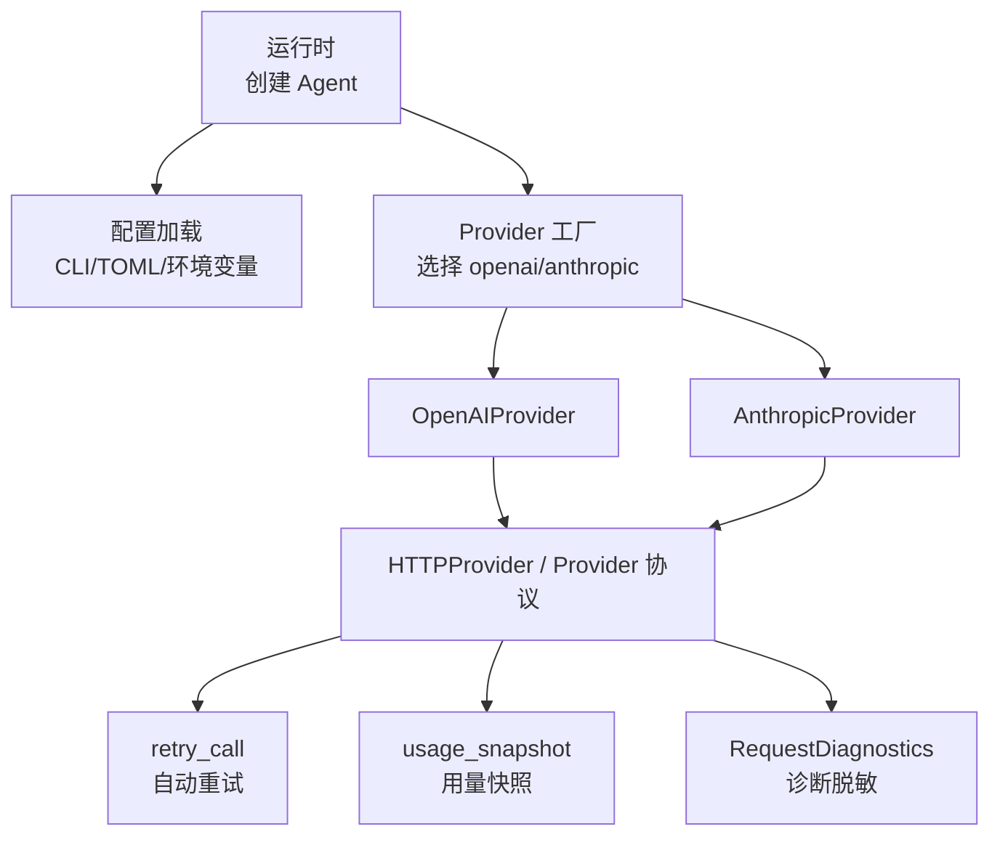
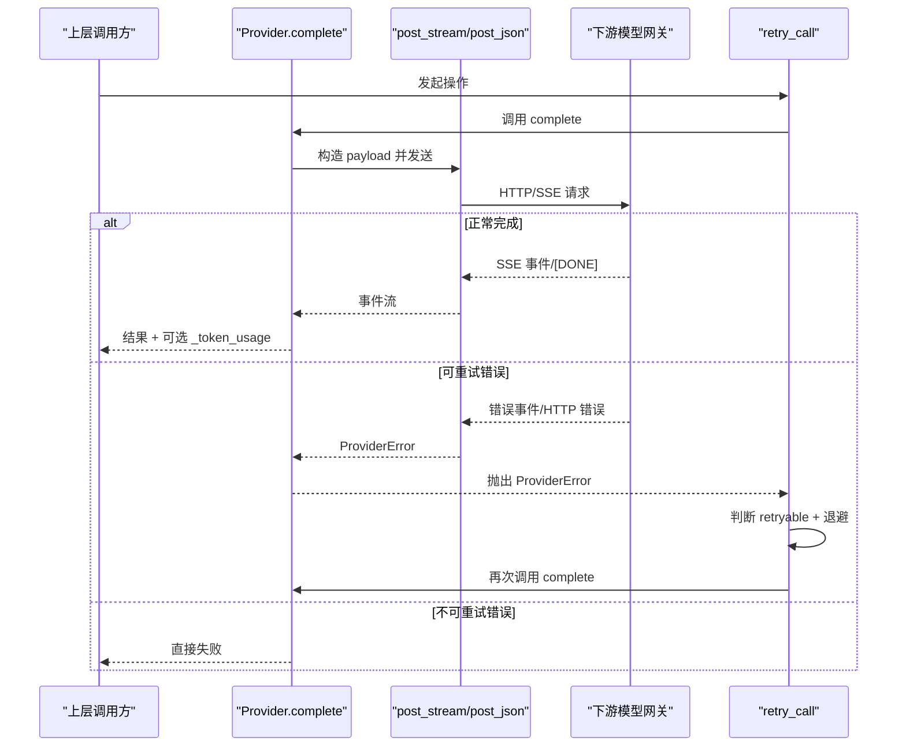
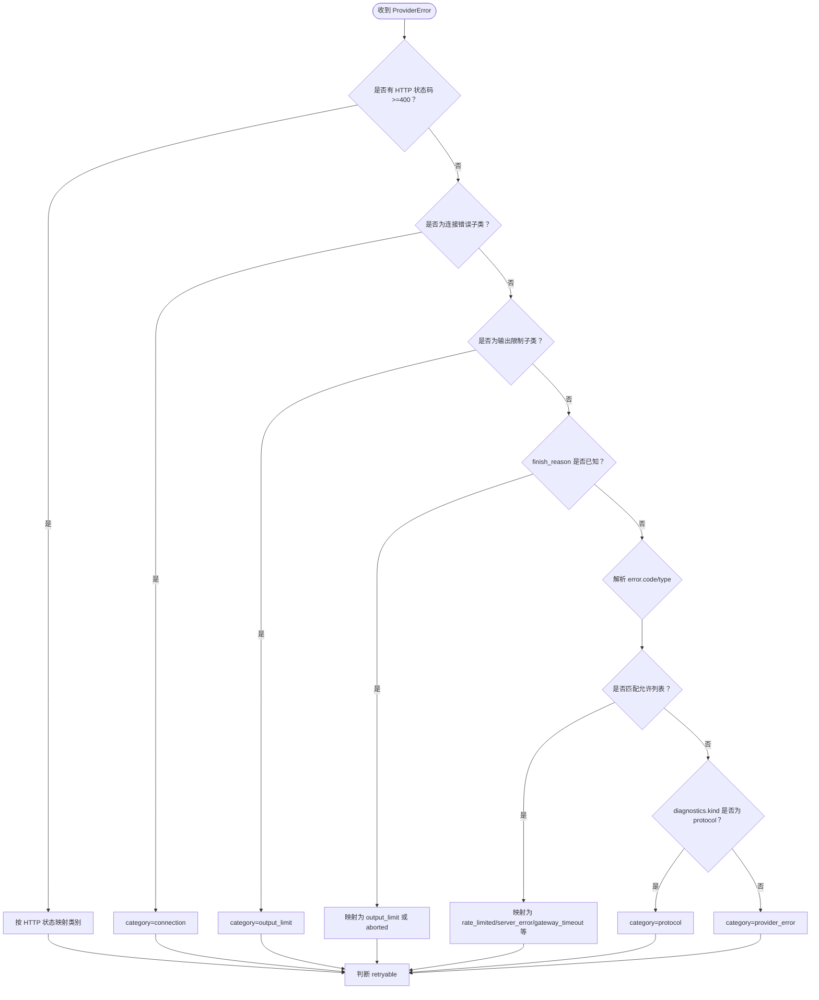
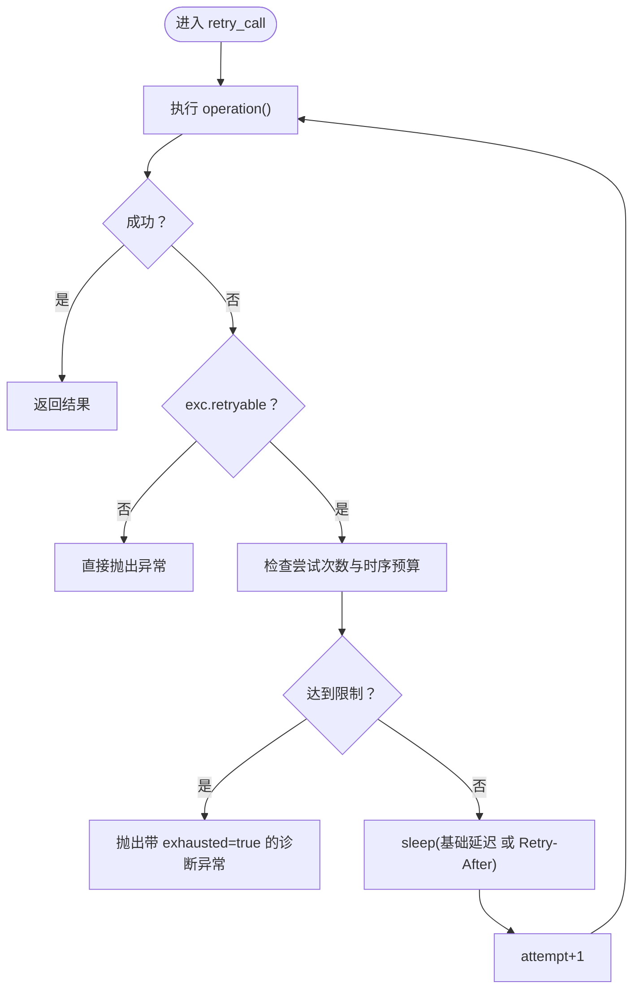
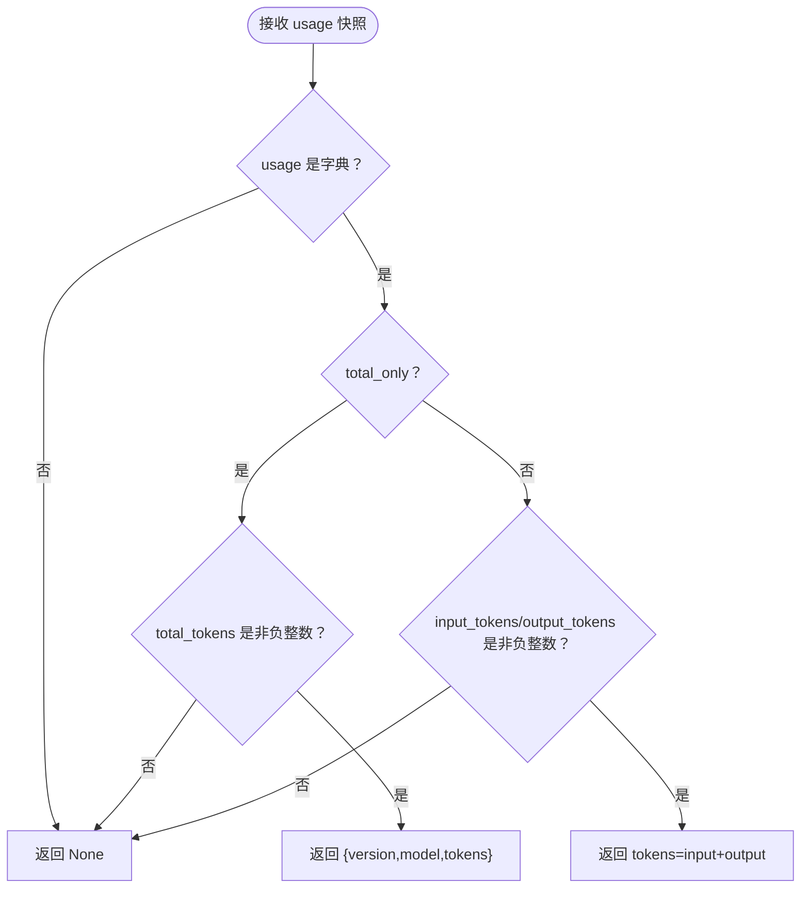
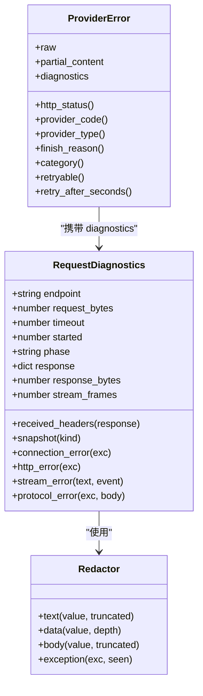
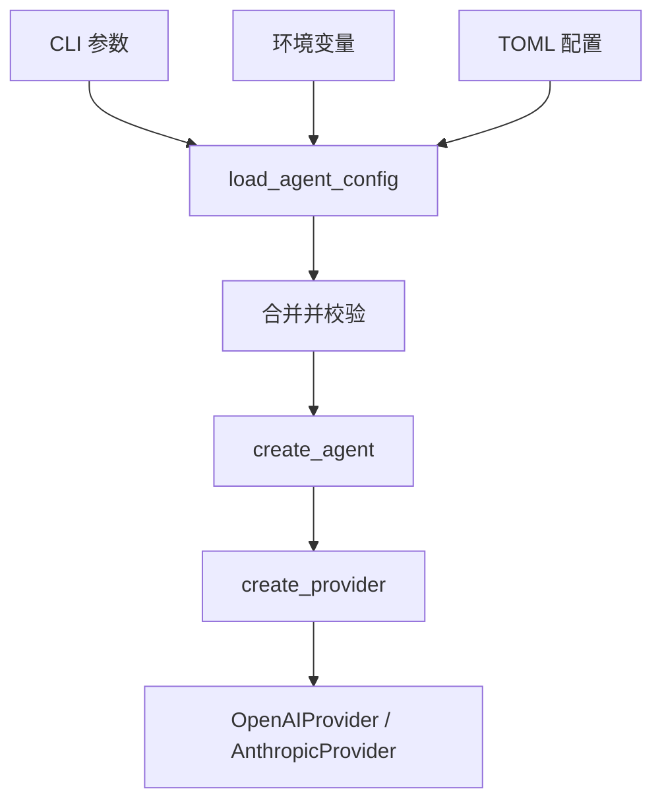
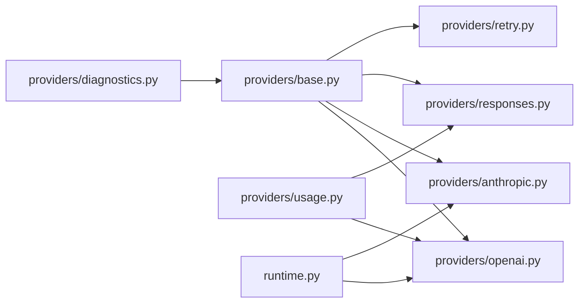
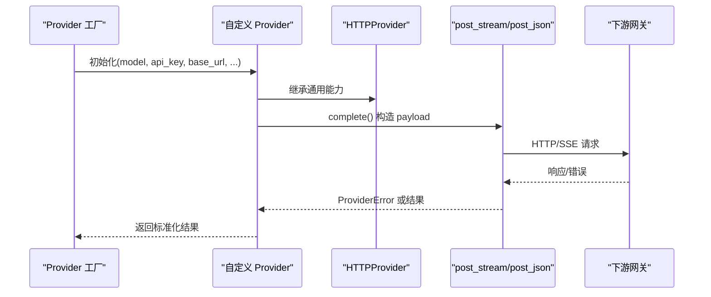

# Provider 抽象接口与通用能力

<cite>
**本文引用的文件**   
- [skills_agent/providers/base.py](file://skills_agent/providers/base.py)
- [skills_agent/providers/openai.py](file://skills_agent/providers/openai.py)
- [skills_agent/providers/anthropic.py](file://skills_agent/providers/anthropic.py)
- [skills_agent/providers/responses.py](file://skills_agent/providers/responses.py)
- [skills_agent/providers/retry.py](file://skills_agent/providers/retry.py)
- [skills_agent/providers/usage.py](file://skills_agent/providers/usage.py)
- [skills_agent/providers/diagnostics.py](file://skills_agent/providers/diagnostics.py)
- [skills_agent/runtime.py](file://skills_agent/runtime.py)
- [skills_agent/config.py](file://skills_agent/config.py)
- [tests/test_provider_classification.py](file://tests/test_provider_classification.py)
- [tests/test_provider_retry.py](file://tests/test_provider_retry.py)
</cite>

## 目录
1. [引言](#引言)
2. [项目结构](#项目结构)
3. [核心组件](#核心组件)
4. [架构总览](#架构总览)
5. [详细组件分析](#详细组件分析)
6. [依赖关系分析](#依赖关系分析)
7. [性能考量](#性能考量)
8. [故障排查指南](#故障排查指南)
9. [结论](#结论)
10. [附录：自定义 Provider 实现指南](#附录自定义-provider-实现指南)

## 引言
本文面向需要理解、扩展或维护 `Provider` 抽象层与通用能力的开发者。文档说明统一协议边界，包括对话调用、流式调用、工具参数校验、错误分类、重试决策、用量统计和诊断信息上报；解释自动重试如何驱动结构化重试；说明用量计数器如何跟踪 token、请求数和费用估算；并给出新增自定义 Provider 的实现步骤、常见问题排查方法和性能调优建议。

## 项目结构
Provider 相关代码集中在 `skills_agent/providers` 目录中：

- `base.py`：定义 `Provider` 协议、`HTTPProvider` 基类、通用 HTTP/SSE 封装、错误分类体系、工具消息校验等。
- `openai.py`：OpenAI Provider，支持 Chat 与 Responses 两种 API 格式。
- `anthropic.py`：Anthropic Provider，使用 Messages API。
- `responses.py`：Responses 流式处理混入类，供 OpenAI Responses 复用。
- `retry.py`：通用重试封装，负责退避、预算控制和重试事件。
- `usage.py`：基于下游返回的 usage 快照计算上下文长度。
- `diagnostics.py`：敏感信息脱敏、请求/响应元数据记录、诊断快照。
- `runtime.py`：CLI 参数注入 Provider 实例化所需模型、API 格式、token 计数器等。
- `config.py`：TOML、环境变量与 CLI 参数的优先级合并及校验。

**图表来源**
- [skills_agent/runtime.py:1-58](file://skills_agent/runtime.py#L1-L58)
- [skills_agent/config.py:1-74](file://skills_agent/config.py#L1-L74)
- [skills_agent/providers/base.py:201-515](file://skills_agent/providers/base.py#L201-L515)
- [skills_agent/providers/openai.py:1-305](file://skills_agent/providers/openai.py#L1-L305)
- [skills_agent/providers/anthropic.py:1-283](file://skills_agent/providers/anthropic.py#L1-L283)
- [skills_agent/providers/retry.py:1-86](file://skills_agent/providers/retry.py#L1-L86)
- [skills_agent/providers/usage.py:1-29](file://skills_agent/providers/usage.py#L1-L29)
- [skills_agent/providers/diagnostics.py:1-261](file://skills_agent/providers/diagnostics.py#L1-L261)

**章节来源**
- [skills_agent/providers/base.py:201-515](file://skills_agent/providers/base.py#L201-L515)
- [skills_agent/providers/openai.py:1-305](file://skills_agent/providers/openai.py#L1-L305)
- [skills_agent/providers/anthropic.py:1-283](file://skills_agent/providers/anthropic.py#L1-L283)
- [skills_agent/providers/retry.py:1-86](file://skills_agent/providers/retry.py#L1-L86)
- [skills_agent/providers/usage.py:1-29](file://skills_agent/providers/usage.py#L1-L29)
- [skills_agent/providers/diagnostics.py:1-261](file://skills_agent/providers/diagnostics.py#L1-L261)
- [skills_agent/runtime.py:1-58](file://skills_agent/runtime.py#L1-L58)
- [skills_agent/config.py:1-74](file://skills_agent/config.py#L1-L74)

## 核心组件
### 统一协议与职责边界
- `Provider` 协议定义了统一接口：
  - `complete`：同步或流式完成一次对话，可设置输出上限、是否禁用思考。
  - `count_tokens`：估算输入 token，可能走官方接口或用量快照。
  - `count_text`：对纯文本做最小包装后估算 token。
  - `compact_messages` / `can_compact`：压缩历史消息的能力与判断。
- `HTTPProvider` 是具体实现基类，负责：
  - 存储 model、api_key、base_url、max_output_tokens、model_context_window。
  - 默认 `count_text` 行为。
  - 默认可压缩与不改变消息的压缩实现。
- 通用 HTTP/SSE 封装：
  - `post_json`：发送 JSON 请求，解析 JSON，处理 HTTP 错误、连接错误、协议错误。
  - `post_stream`：SSE 流式读取，逐帧解析，遇到 `[DONE]` 结束。
  - `stream_error`：将流中的错误事件转化为带诊断信息的 `ProviderError`。
  - `stream_ended`：流提前结束时转为连接错误。
- 工具参数与消息校验：
  - `parse_arguments`：校验工具参数必须是合法 JSON 对象。
  - `validate_calls`：校验 tool call id/name 非空且唯一。
  - `validate_tool_pairs`：保证 tool call 与 tool result 成对出现。
  - `request_messages`：图片投影、工具反馈观察、消息规范化。

**章节来源**
- [skills_agent/providers/base.py:201-515](file://skills_agent/providers/base.py#L201-L515)

## 架构总览
Provider 抽象层位于业务 Agent 与具体 LLM 网关之间。上层只关心 `complete`、`count_tokens`、工具消息、错误类型和诊断数据；底层负责具体协议差异、SSE 流、错误映射和诊断脱敏。

**图表来源**
- [skills_agent/providers/base.py:201-515](file://skills_agent/providers/base.py#L201-L515)
- [skills_agent/providers/retry.py:1-86](file://skills_agent/providers/retry.py#L1-L86)
- [tests/test_provider_retry.py:1-142](file://tests/test_provider_retry.py#L1-L142)

## 详细组件分析

### 错误分类体系
错误分类的核心目标是把网络异常、认证失败、配额耗尽、网关超时、内容过滤、输出限制、协议错误等归入稳定类别，并据此决定是否可以重试。

#### 分类优先级
1. **HTTP 状态码优先**：401→authentication，402→insufficient_balance，403→permission，429→rate_limited，500→server_error，502→bad_gateway，503→service_unavailable，504/524→gateway_timeout。
2. **子类语义**：
   - `ProviderConnectionError`→connection（可重试）。
   - `ProviderOutputLimitError`→output_limit（不可重试）。
3. **finish_reason**：length/max_tokens/model_context_window_exceeded/refusal 等映射到 output_limit 或 aborted/content_filter。
4. **结构化错误字段**：从 `error.code` 或 `error.type` 精确匹配，例如 rate_limit_error、GatewayTimeout、overloaded_error、context_length_exceeded、invalid_api_key、insufficient_quota。
5. **协议标记**：diagnostics.kind=protocol 时归类为 protocol。
6. **兜底**：provider_error。

**图表来源**
- [skills_agent/providers/base.py:1-200](file://skills_agent/providers/base.py#L1-L200)
- [tests/test_provider_classification.py:1-200](file://tests/test_provider_classification.py#L1-L200)

#### 关键规则
- 结构化 code/type 必须精确匹配，不能根据人类可读消息推断重试。
- 已知永久错误如 invalid_api_key、insufficient_quota、context_length_exceeded 不会因 broader type 而变成可重试。
- 未知错误不会通过消息片段猜测重试，而是保持 provider_error 且不可重试。
- 诊断中 response.status 优先于 body 中的 code/type。

**章节来源**
- [skills_agent/providers/base.py:1-200](file://skills_agent/providers/base.py#L1-L200)
- [tests/test_provider_classification.py:1-200](file://tests/test_provider_classification.py#L1-L200)

### 自动重试策略
`retry_call` 是对单个模型操作的通用重试封装，不重放已完成的工具调用，也不合并部分响应。

#### 触发条件
- 仅当 `ProviderError.retryable` 为真时重试。
- retryable 由 category 决定：connection、rate_limited、server_error、bad_gateway、service_unavailable、gateway_timeout。

#### 退避方式
- 基础延迟至少 5 秒。
- 若响应头包含 `Retry-After`，则将其解析为秒数或时间戳，并与基础延迟取最大值。
- 每次重试前调用 `on_retry(exc, attempt)`，用于上报重试事件。

#### 预算控制
- `SKILLS_AGENT_PROVIDER_MAX_ATTEMPTS`：最大尝试次数。
- `SKILLS_AGENT_PROVIDER_RETRY_BUDGET_SECONDS`：总耗时预算。
- 如果下一次等待会超过剩余预算，立即停止并重试耗尽。
- 当前阻塞操作保留自身传输超时；取消信号 KeyboardInterrupt/SystemExit 不会被吞掉。

#### 结构化重试在流式响应中的行为
- 流中断后，上游 provider 会把原始事件、部分文本、partial_content 附加到异常上。
- 重试是“重新发起同一个完整请求”，而不是继续消费旧流。
- 测试验证了相同请求体被重复发送，并在成功恢复后得到完整响应。

**图表来源**
- [skills_agent/providers/retry.py:1-86](file://skills_agent/providers/retry.py#L1-L86)
- [tests/test_provider_retry.py:1-142](file://tests/test_provider_retry.py#L1-L142)

**章节来源**
- [skills_agent/providers/retry.py:1-86](file://skills_agent/providers/retry.py#L1-L86)
- [tests/test_provider_retry.py:1-142](file://tests/test_provider_retry.py#L1-L142)

### 用量统计
用量统计分为两类：
- **官方 token 计数**：通过专用接口获取 input_tokens，适用于 OpenAI Responses 和部分 provider 官方计数路径。
- **用量快照**：从下游返回的 usage 中抽取 total_tokens、input_tokens、output_tokens。

`usage_snapshot` 的行为：
- 如果传入 usage 不是 dict，返回 None。
- 如果 total_only=True，只校验 total_tokens 为非负整数。
- 否则校验 input_tokens/output_tokens 均为非负整数，并返回 tokens 总和。

`count_from_usage`：
- 反向遍历消息，寻找最近一个 assistant 消息上的 `_token_usage`。
- 要求 version=2 且 model 匹配。
- 新消息不会改变最近一次上报的上下文长度。

**图表来源**
- [skills_agent/providers/usage.py:1-29](file://skills_agent/providers/usage.py#L1-L29)

**章节来源**
- [skills_agent/providers/usage.py:1-29](file://skills_agent/providers/usage.py#L1-L29)
- [skills_agent/providers/openai.py:1-305](file://skills_agent/providers/openai.py#L1-L305)
- [skills_agent/providers/responses.py:1-191](file://skills_agent/providers/responses.py#L1-L191)

### 诊断信息上报
诊断信息围绕 `RequestDiagnostics` 和 `Redactor`：
- 记录 endpoint、phase、elapsed_seconds、timeout_seconds、request_bytes、response_bytes、stream_frames。
- 记录响应 status 和受信任响应头：content-type、date、retry-after、request-id、x-request-id、x-amzn-requestid、x-amz-request-id、cf-ray。
- 对 URL、Authorization、Cookie、API Key、Bearer Token、Basic 凭证、查询参数等进行脱敏。
- 对异常链进行有限深度序列化，避免递归爆炸。
- ProviderError 暴露 http_status、provider_code、provider_type、finish_reason、category、retryable、retry_after_seconds。
- 诊断快照可用于流提前结束、HTTP 错误、协议错误、连接错误等场景。

**图表来源**
- [skills_agent/providers/diagnostics.py:1-261](file://skills_agent/providers/diagnostics.py#L1-L261)
- [skills_agent/providers/base.py:1-200](file://skills_agent/providers/base.py#L1-L200)

**章节来源**
- [skills_agent/providers/diagnostics.py:1-261](file://skills_agent/providers/diagnostics.py#L1-L261)
- [skills_agent/providers/base.py:1-200](file://skills_agent/providers/base.py#L1-L200)

### CLI 选项与 Provider 行为
`add_agent_arguments` 提供以下与 Provider 相关的选项：
- `--provider`：选择 openai 或 anthropic。
- `--model`：指定模型名称，也可通过 `{PROVIDER}_MODEL` 环境变量。
- `--base-url`：覆盖默认 base_url，也支持 `{PROVIDER}_BASE_URL`。
- `--api-format`：auto、responses、chat。
- `--token-counter`：auto、official、usage。
- `--max-output-tokens`：单次输出上限。
- `--model-context-window`：模型实际窗口。

优先级顺序：显式 CLI > TOML > 环境变量 > 内置默认值。

`create_agent` 会根据 provider 构造对应 Provider，并传入 base_url、max_output_tokens、api_format、token_counter、model_context_window 等。

**图表来源**
- [skills_agent/runtime.py:1-58](file://skills_agent/runtime.py#L1-L58)
- [skills_agent/config.py:1-74](file://skills_agent/config.py#L1-L74)

**章节来源**
- [skills_agent/runtime.py:1-58](file://skills_agent/runtime.py#L1-L58)
- [skills_agent/config.py:1-74](file://skills_agent/config.py#L1-L74)

## 依赖关系分析
Provider 模块内部依赖如下：
- `openai.py` 依赖 `base.py`、`responses.py`、`usage.py`。
- `anthropic.py` 依赖 `base.py`。
- `retry.py` 仅依赖 `base.py` 的 `ProviderError`。
- `usage.py` 无内部依赖。
- `diagnostics.py` 是独立诊断工具。
- `runtime.py` 通过 `create_provider` 选择具体 Provider，并把 CLI/配置值注入。

**图表来源**
- [skills_agent/providers/base.py:201-515](file://skills_agent/providers/base.py#L201-L515)
- [skills_agent/providers/openai.py:1-305](file://skills_agent/providers/openai.py#L1-L305)
- [skills_agent/providers/anthropic.py:1-283](file://skills_agent/providers/anthropic.py#L1-L283)
- [skills_agent/providers/responses.py:1-191](file://skills_agent/providers/responses.py#L1-L191)
- [skills_agent/providers/retry.py:1-86](file://skills_agent/providers/retry.py#L1-L86)
- [skills_agent/providers/usage.py:1-29](file://skills_agent/providers/usage.py#L1-L29)
- [skills_agent/providers/diagnostics.py:1-261](file://skills_agent/providers/diagnostics.py#L1-L261)
- [skills_agent/runtime.py:1-58](file://skills_agent/runtime.py#L1-L58)

**章节来源**
- [skills_agent/providers/base.py:201-515](file://skills_agent/providers/base.py#L201-L515)
- [skills_agent/providers/openai.py:1-305](file://skills_agent/providers/openai.py#L1-L305)
- [skills_agent/providers/anthropic.py:1-283](file://skills_agent/providers/anthropic.py#L1-L283)
- [skills_agent/providers/responses.py:1-191](file://skills_agent/providers/responses.py#L1-L191)
- [skills_agent/providers/retry.py:1-86](file://skills_agent/providers/retry.py#L1-L86)
- [skills_agent/providers/usage.py:1-29](file://skills_agent/providers/usage.py#L1-L29)
- [skills_agent/providers/diagnostics.py:1-261](file://skills_agent/providers/diagnostics.py#L1-L261)
- [skills_agent/runtime.py:1-58](file://skills_agent/runtime.py#L1-L58)

## 性能考量
- **减少不必要的重试**：只有 connection、rate_limited、server_error、bad_gateway、service_unavailable、gateway_timeout 才重试；认证失败、权限不足、配额耗尽、内容过滤、输出限制等不应重试。
- **合理设置重试预算**：通过 `SKILLS_AGENT_PROVIDER_MAX_ATTEMPTS` 和 `SKILLS_AGENT_PROVIDER_RETRY_BUDGET_SECONDS` 控制总尝试次数和总耗时，避免重试风暴。
- **避免流式中断后重复请求**：重试是重新发起完整请求，不是续传旧流；因此不要在上层自行拼接部分响应，应让 Provider 重新生成。
- **合理使用 token 计数策略**：
  - official 计数会额外请求 `/responses/input_tokens`，适合 Responses 模式。
  - usage 计数依赖下游返回的 usage，适合 Chat 或第三方网关。
  - auto 会根据 api_format 和目标 host 自动选择。
- **控制 max_output_tokens 和 model_context_window**：避免频繁触发 output_limit，降低重试和无意义往返。
- **避免在流式回调中执行昂贵逻辑**：on_event 会在大量 text_delta/thinking_delta/tool_call_delta 时被调用，应避免阻塞或重复 I/O。

[本节为通用指导，不直接分析具体文件]

## 故障排查指南

### 连接失败
- 现象：`ProviderConnectionError`，category=connection，通常伴随连接阶段诊断。
- 排查要点：
  - 检查 DNS、TLS、代理、防火墙、base_url 是否正确。
  - 查看 diagnostics.phase 是否为 connection 或 open_request。
  - 确认不是 4xx 认证/权限问题被误判为连接错误。
- 相关实现：
  - `post_json` 和 `post_stream` 将 URLError/OSError/HTTPException 转换为 `ProviderConnectionError`。
  - `stream_ended` 将未到达终止事件的流视为连接错误。

**章节来源**
- [skills_agent/providers/base.py:201-515](file://skills_agent/providers/base.py#L201-L515)

### 认证失败
- 现象：HTTP 401 或 structured code=invalid_api_key，category=authentication，不可重试。
- 排查要点：
  - 检查 API Key、环境变量 `{PROVIDER}_API_KEY`。
  - 检查 Authorization/Bearer Token 是否被正确传递。
  - 查看 diagnostics.response.headers 和脱敏后的 body。
- 相关实现：
  - HTTP 401 映射为 authentication。
  - structured error invalid_api_key 映射为 authentication。

**章节来源**
- [skills_agent/providers/base.py:1-200](file://skills_agent/providers/base.py#L1-L200)

### 配额耗尽
- 现象：HTTP 402 或 structured code=insufficient_quota/insufficient_balance，category=insufficient_balance，不可重试。
- 排查要点：
  - 联系提供方提升配额或更换账户。
  - 不要依赖重试解决配额问题。
- 相关实现：
  - 402→insufficient_balance。
  - insufficient_quota/insufficient_balance→insufficient_balance。

**章节来源**
- [skills_agent/providers/base.py:1-200](file://skills_agent/providers/base.py#L1-L200)

### 模型不支持工具调用
- 现象：工具调用缺失、tool result 没有匹配的 pending call、或下游返回的工具调用不完整。
- 排查要点：
  - 检查 `validate_calls` 和 `validate_tool_pairs`。
  - 检查 Anthropic 工具参数解析失败时是否被降级为文本。
  - 检查 OpenAI/Responses 流中 tool_calls 是否与 finish_reason 一致。
- 相关实现：
  - Anthropic 无法解析工具参数时会保留 rejected 调用并作为文本回传。
  - OpenAI/Responses 会校验 tool_calls 数量、类型和 finish_reason。

**章节来源**
- [skills_agent/providers/base.py:201-515](file://skills_agent/providers/base.py#L201-L515)
- [skills_agent/providers/anthropic.py:1-283](file://skills_agent/providers/anthropic.py#L1-L283)
- [skills_agent/providers/openai.py:1-305](file://skills_agent/providers/openai.py#L1-L305)
- [skills_agent/providers/responses.py:1-191](file://skills_agent/providers/responses.py#L1-L191)

### 重试风暴
- 现象：短时间内多次重试，导致下游进一步限流。
- 排查要点：
  - 检查是否对所有错误都启用了重试。
  - 检查 `SKILLS_AGENT_PROVIDER_MAX_ATTEMPTS` 和 `SKILLS_AGENT_PROVIDER_RETRY_BUDGET_SECONDS`。
  - 确认 `retry_after_seconds` 是否被正确解析。
- 缓解措施：
  - 限制最大尝试次数。
  - 设置总预算，使等待时间超过预算时立即停止。
  - 区分临时服务错误和永久错误。

**章节来源**
- [skills_agent/providers/retry.py:1-86](file://skills_agent/providers/retry.py#L1-L86)

### 用量未上报
- 现象：缺少 `_token_usage` 或上下文长度未更新。
- 排查要点：
  - 确认使用的 token_counter 是否允许 usage 快照。
  - 确认下游返回了 usage，且字段类型为整数。
  - 确认 assistant 消息上保存了 version=2 的快照。
- 相关实现：
  - OpenAI Chat 模式下 token_counter=usage 会从 raw.usage 提取 total_only 快照。
  - Responses 模式会尝试保存完整 usage 快照。
  - count_from_usage 只接受最近 assistant 消息上的有效快照。

**章节来源**
- [skills_agent/providers/openai.py:1-305](file://skills_agent/providers/openai.py#L1-L305)
- [skills_agent/providers/responses.py:1-191](file://skills_agent/providers/responses.py#L1-L191)
- [skills_agent/providers/usage.py:1-29](file://skills_agent/providers/usage.py#L1-L29)

## 结论
Provider 抽象层通过 `Provider` 协议和 `HTTPProvider` 基类统一了对话调用、流式响应、工具校验、错误分类、重试、用量统计和诊断上报。错误分类严格依赖 HTTP 状态、结构化 code/type、finish_reason 和子类语义，避免根据人类可读消息误判重试。自动重试以 retryable 为基础，结合 Retry-After、尝试次数和时序预算控制退避。用量统计兼顾官方计数和下游 usage 快照。诊断系统对敏感信息进行脱敏，并记录请求阶段、字节数、响应头和异常链。新增 Provider 时应继承基类、实现必要方法、声明支持的模型和功能、正确处理 HTTP 层异常、映射下游错误、上报用量和诊断数据，并通过 CLI 与配置选项控制实例化行为。

[本节为总结性内容，不直接分析具体文件]

## 附录：自定义 Provider 实现指南

### 1. 继承基类
- 如果走标准 HTTP/SSE，继承 `HTTPProvider`。
- 如果只需协议接口，可实现 `Provider` 协议。

### 2. 实现必要方法
- `complete(system, messages, tools, *, on_event=None, max_output_tokens=None, disable_thinking=False)`：
  - 构造请求 payload。
  - 使用 `post_stream` 或 `post_json` 发送请求。
  - 处理流事件，产出 text_delta、thinking_delta、tool_call_delta。
  - 校验 finish_reason、tool_calls、响应结构。
  - 可选保存 `_token_usage`。
- `count_tokens(system, messages, tools, *, disable_thinking=False)`：
  - 可选择 official 计数或 usage 快照。
- `count_text(text)`：
  - 可复用 `HTTPProvider.count_text`。
- `compact_messages` / `can_compact`：
  - 如需压缩历史消息，实现去重、丢弃无关 thinking 等逻辑。

### 3. 声明支持的模型和功能
- 在 `__init__` 中校验 model、base_url、api_format、token_counter。
- 根据 host 或 model 名启用特定行为，例如 DeepSeek effort、Responses 模式、官方计数。

### 4. 处理 HTTP 层异常
- 使用 `post_json` / `post_stream`，它们会自动把 HTTP 错误、连接错误、协议错误转换为 `ProviderError` / `ProviderConnectionError`。
- 不要在高层吞掉这些异常，应让 `retry_call` 判断 retryable。

### 5. 映射下游错误
- 对于流式错误，使用 `stream_error` 构造诊断化异常。
- 对于 finish_reason，明确区分 output_limit、aborted、content_filter 等。
- 对于结构化 code/type，依赖 `ProviderError.category` 的分类逻辑，不要自行根据消息字符串判断。

### 6. 上报用量和诊断数据
- 在成功响应中附加 `_token_usage`，使用 `usage_snapshot`。
- 确保 diagnostics 包含 endpoint、phase、status、headers、bytes、exception 等。
- 不要手动写入敏感字段；使用 `Redactor` 和诊断系统自动脱敏。

### 7. 示例：新增 Provider 的关键流程

**图表来源**
- [skills_agent/providers/base.py:201-515](file://skills_agent/providers/base.py#L201-L515)
- [skills_agent/providers/openai.py:1-305](file://skills_agent/providers/openai.py#L1-L305)
- [skills_agent/providers/anthropic.py:1-283](file://skills_agent/providers/anthropic.py#L1-L283)

**章节来源**
- [skills_agent/providers/base.py:201-515](file://skills_agent/providers/base.py#L201-L515)
- [skills_agent/providers/openai.py:1-305](file://skills_agent/providers/openai.py#L1-L305)
- [skills_agent/providers/anthropic.py:1-283](file://skills_agent/providers/anthropic.py#L1-L283)
- [skills_agent/providers/responses.py:1-191](file://skills_agent/providers/responses.py#L1-L191)
- [skills_agent/providers/retry.py:1-86](file://skills_agent/providers/retry.py#L1-L86)
- [skills_agent/providers/usage.py:1-29](file://skills_agent/providers/usage.py#L1-L29)
- [skills_agent/providers/diagnostics.py:1-261](file://skills_agent/providers/diagnostics.py#L1-L261)
- [skills_agent/runtime.py:1-58](file://skills_agent/runtime.py#L1-L58)
- [skills_agent/config.py:1-74](file://skills_agent/config.py#L1-L74)