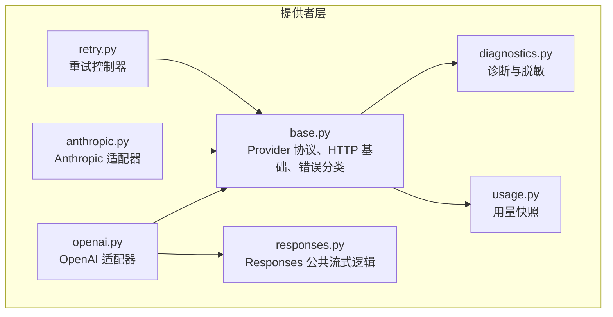
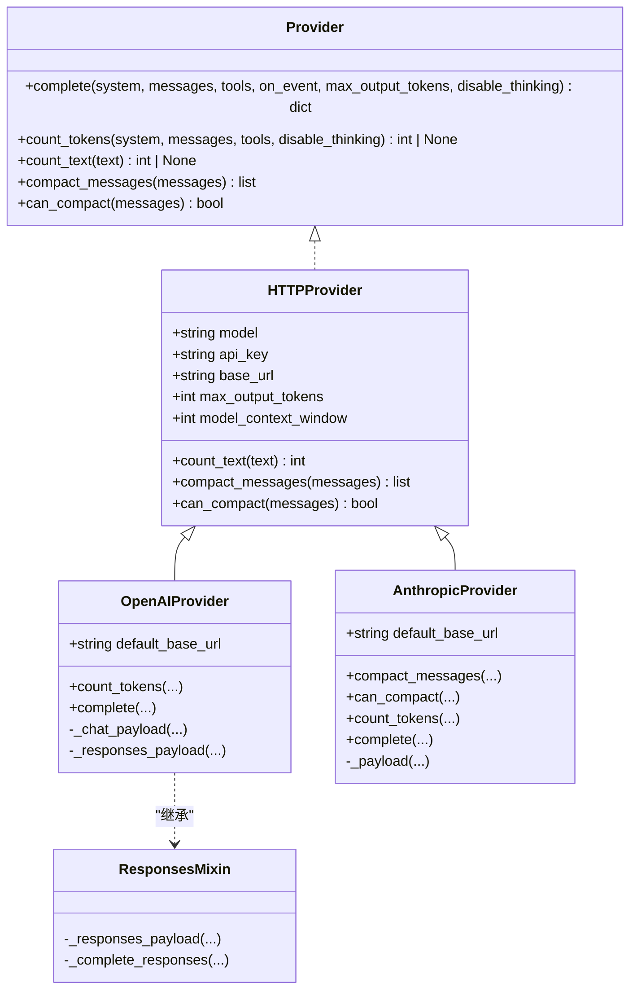
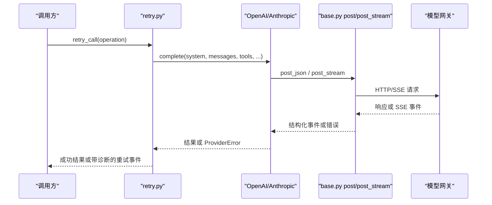
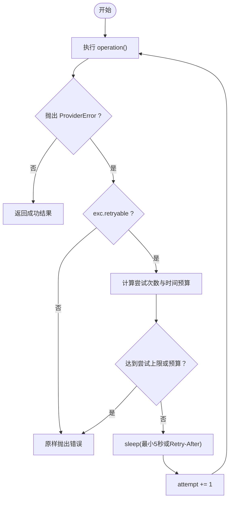
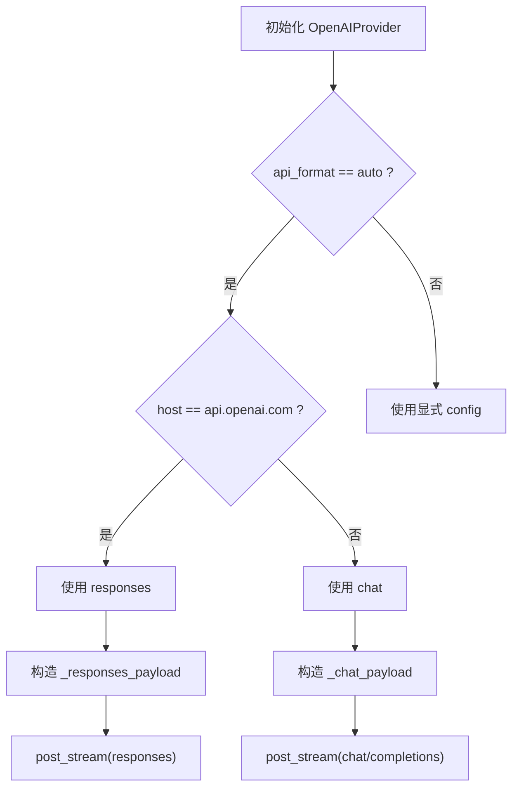
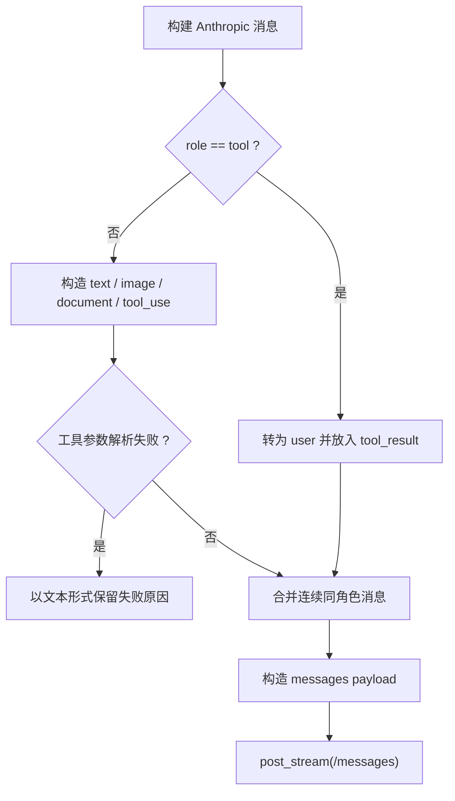
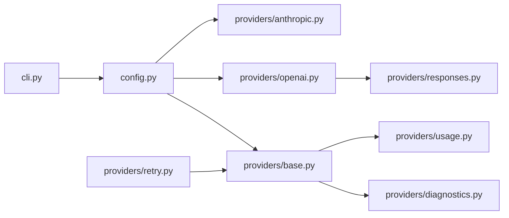
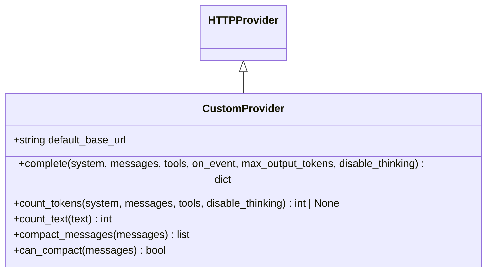

# 模型提供者集成

<cite>
**本文引用的文件**
- [base.py](file://skills_agent/providers/base.py)
- [openai.py](file://skills_agent/providers/openai.py)
- [anthropic.py](file://skills_agent/providers/anthropic.py)
- [retry.py](file://skills_agent/providers/retry.py)
- [usage.py](file://skills_agent/providers/usage.py)
- [diagnostics.py](file://skills_agent/providers/diagnostics.py)
- [responses.py](file://skills_agent/providers/responses.py)
- [config.py](file://skills_agent/config.py)
- [cli.py](file://skills_agent/cli.py)
- [test_providers.py](file://tests/test_providers.py)
- [test_provider_classification.py](file://tests/test_provider_classification.py)
- [test_provider_retry.py](file://tests/test_provider_retry.py)
- [test_stream_openai.py](file://tests/test_stream_openai.py)
- [test_stream_anthropic.py](file://tests/test_stream_anthropic.py)
- [test_usage_counting.py](file://tests/test_usage_counting.py)
</cite>

## 目录
1. [简介](#简介)
2. [项目结构](#项目结构)
3. [核心组件](#核心组件)
4. [架构总览](#架构总览)
5. [详细组件分析](#详细组件分析)
6. [依赖关系分析](#依赖关系分析)
7. [性能与行为特性](#性能与行为特性)
8. [故障排查指南](#故障排查指南)
9. [新增自定义 Provider 实现指南](#新增自定义-provider-实现指南)
10. [结论](#结论)

## 简介
本文面向需要在系统中接入或扩展模型提供者的工程师，说明 `Provider` 抽象、OpenAI 与 Anthropic 的具体实现差异、统一错误分类、自动重试策略、用量统计、诊断信息、User-Agent 行为，以及命令行参数如何影响 Provider 选择。文档同时给出新增自定义 Provider 的实操步骤和常见故障排查方法。

## 项目结构
模型提供者相关代码集中在 `skills_agent/providers` 目录下：
- `base.py`：定义 `Provider` 协议、HTTP 基础能力、错误分类、流式传输封装、工具调用校验、User-Agent 等通用逻辑。
- `openai.py`：OpenAI 的 Chat 与 Responses 两种接口适配，支持自动格式选择、DeepSeek effort、token 计数策略。
- `anthropic.py`：Anthropic Messages API 适配，处理消息压缩、thinking 保留、工具输入校验。
- `responses.py`：OpenAI Responses 流式协议的公共实现，供 OpenAI 使用。
- `retry.py`：单次请求重试控制器，基于 `ProviderError.category` 决定是否重试。
- `usage.py`：从网关返回的用量快照中读取上下文长度，用于上下文压缩。
- `diagnostics.py`：敏感字段脱敏、请求阶段记录、异常链诊断。

**图示来源**
- [base.py:201-515](file://skills_agent/providers/base.py#L201-L515)
- [openai.py:1-305](file://skills_agent/providers/openai.py#L1-L305)
- [anthropic.py:1-283](file://skills_agent/providers/anthropic.py#L1-L283)
- [responses.py:1-191](file://skills_agent/providers/responses.py#L1-L191)
- [retry.py:1-86](file://skills_agent/providers/retry.py#L1-L86)
- [usage.py:1-29](file://skills_agent/providers/usage.py#L1-L29)
- [diagnostics.py:1-261](file://skills_agent/providers/diagnostics.py#L1-L261)

**章节来源**
- [base.py:201-515](file://skills_agent/providers/base.py#L201-L515)
- [openai.py:1-305](file://skills_agent/providers/openai.py#L1-L305)
- [anthropic.py:1-283](file://skills_agent/providers/anthropic.py#L1-L283)
- [responses.py:1-191](file://skills_agent/providers/responses.py#L1-L191)
- [retry.py:1-86](file://skills_agent/providers/retry.py#L1-L86)
- [usage.py:1-29](file://skills_agent/providers/usage.py#L1-L29)
- [diagnostics.py:1-261](file://skills_agent/providers/diagnostics.py#L1-L261)

## 核心组件
### Provider 抽象协议
`Provider` 是一个 Python Protocol，定义了所有模型提供者必须实现的最小接口：
- `complete(system, messages, tools, on_event, max_output_tokens, disable_thinking)`：发起一次多轮对话生成，可流式回调事件，并返回结构化结果。
- `count_tokens(system, messages, tools, disable_thinking)`：估算或上报本次请求的 token 用量。
- `count_text(text)`：估算单条文本对应的 token 数。
- `compact_messages(messages)`：按需对消息做内部压缩。
- `can_compact(messages)`：判断当前消息是否允许压缩。

基类 `HTTPProvider` 提供默认 base URL、最大输出 token、模型上下文窗口校验，并提供默认的 `count_text`、`compact_messages`、`can_compact` 实现。

**图示来源**
- [base.py:201-515](file://skills_agent/providers/base.py#L201-L515)
- [openai.py:1-305](file://skills_agent/providers/openai.py#L1-L305)
- [anthropic.py:1-283](file://skills_agent/providers/anthropic.py#L1-L283)
- [responses.py:1-191](file://skills_agent/providers/responses.py#L1-L191)

**章节来源**
- [base.py:201-515](file://skills_agent/providers/base.py#L201-L515)

## 架构总览
系统通过统一的 `Provider.complete` 接口屏蔽不同模型的协议差异。上层调用方只关心：
- 用户消息与工具定义；
- 流式事件；
- 最终 assistant 消息；
- 工具调用及其参数；
- 可选的思考内容。

**图示来源**
- [retry.py:1-86](file://skills_agent/providers/retry.py#L1-L86)
- [base.py:201-515](file://skills_agent/providers/base.py#L201-L515)
- [openai.py:1-305](file://skills_agent/providers/openai.py#L1-L305)
- [anthropic.py:1-283](file://skills_agent/providers/anthropic.py#L1-L283)

## 详细组件分析

### 错误分类与重试策略
#### 错误分类
`ProviderError` 是模型错误的统一载体，其 `category` 属性决定错误性质和是否可重试。分类优先级如下：
1. HTTP 状态码大于等于 400 时，直接映射到固定类别，例如：
   - 400/422 → `invalid_request`
   - 401 → `authentication`
   - 402 → `insufficient_balance`
   - 403 → `permission`
   - 404 → `not_found`
   - 429 → `rate_limited`
   - 500 → `server_error`
   - 502 → `bad_gateway`
   - 503 → `service_unavailable`
   - 504/524 → `gateway_timeout`
2. 子类优先：`ProviderConnectionError` 为 `connection`，`ProviderOutputLimitError` 为 `output_limit`。
3. finish_reason 映射：如 `length`、`max_tokens`、`max_output_tokens`、`model_context_window_exceeded` 归为 `output_limit`；`content_filter`、`refusal` 归为 `content_filter`；中止类原因归为 `aborted`。
4. 结构化错误字段：按 `code` 或 `type` 精确匹配白名单，例如：
   - `context_length_exceeded` → `output_limit`
   - `insufficient_quota` → `insufficient_balance`
   - `rate_limit_exceeded` → `rate_limited`
   - `GatewayTimeout` → `gateway_timeout`
   - `upstream_stream_read_error` → `connection`
5. 未命中任何已知字段时，归类为 `provider_error`，并且不重试。

可重试类别集合包括：`connection`、`rate_limited`、`server_error`、`bad_gateway`、`service_unavailable`、`gateway_timeout`。

#### 重试控制器
`retry_call` 负责：
- 仅对 `exc.retryable` 为真时重试。
- 最小等待时间为 5 秒，也可取服务端 `Retry-After` 头。
- 支持环境变量限制重试次数和总耗时：
  - `SKILLS_AGENT_PROVIDER_MAX_ATTEMPTS`
  - `SKILLS_AGENT_PROVIDER_RETRY_BUDGET_SECONDS`
- 在每次失败时向 `exc.diagnostics["retry"]` 写入尝试次数、已耗时、剩余预算、下次延迟等信息。
- 不捕获 `KeyboardInterrupt` 和 `SystemExit`，保证中断可传播。

**图示来源**
- [retry.py:1-86](file://skills_agent/providers/retry.py#L1-L86)
- [base.py:1-200](file://skills_agent/providers/base.py#L1-L200)

**章节来源**
- [base.py:1-200](file://skills_agent/providers/base.py#L1-L200)
- [retry.py:1-86](file://skills_agent/providers/retry.py#L1-L86)
- [test_provider_classification.py:1-297](file://tests/test_provider_classification.py#L1-L297)
- [test_provider_retry.py:1-142](file://tests/test_provider_retry.py#L1-L142)

### User-Agent 与诊断信息
- 所有 JSON 请求和 SSE 请求都会携带由 `_user_agent()` 生成的 `User-Agent`，包含包版本、操作系统、CPU 架构和 Python 版本。
- 诊断信息由 `RequestDiagnostics` 收集：
  - 请求端点（URL 凭据、查询参数、片段被脱敏）；
  - 请求字节数；
  - 超时配置；
  - 启动时间、当前阶段；
  - 响应头、响应字节数、SSE 帧数；
  - 网络错误、HTTP 错误、协议解析错误的结构化快照。
- `Redactor` 会识别敏感头部、Bearer/Basic 凭据、Cookie、API Key、令牌形如 `sk-`、`ant-` 开头的密钥，并在日志中替换为 `[REDACTED]`。
- 流式错误会通过 `stream_error` 将 provider 返回的错误体标准化，并标记来源。

**章节来源**
- [base.py:201-515](file://skills_agent/providers/base.py#L201-L515)
- [diagnostics.py:1-261](file://skills_agent/providers/diagnostics.py#L1-L261)

### OpenAI 实现
OpenAI 支持两种协议：
- `chat`：使用 `/v1/chat/completions`，默认开启流式并启用 `stream_options.include_usage`。
- `responses`：使用 `/responses`，通过 `ResponsesMixin` 统一处理 `response.output_text.delta`、`reasoning`、`function_call` 等事件。

关键行为：
- `api_format="auto"` 时，如果 host 是 `api.openai.com`，则选择 `responses`；否则默认 `chat`。
- DeepSeek 兼容：当 host 是 `api.deepseek.com` 或阿里云百炼 `*.maas.aliyuncs.com` 且模型名含 `deepseek` 时，Chat payload 可能使用 `enable_thinking` 和 `reasoning_effort`。
- 思考强度控制：
  - `disable_thinking=True` 时，Chat 使用 `thinking.type=disabled`，Responses 使用 `reasoning.effort=none`。
  - DeepSeek 的 `deepseek_effort` 支持 `none`、`low`、`high`、`max`。
- Token 计数：
  - `token_counter="official"`：调用 `/responses/input_tokens` 获取输入 token。
  - `token_counter="usage"`：从最近一条 assistant 消息的 `_token_usage` 快照复用上下文长度。
  - `token_counter="auto"`：Chat 或非官方 Responses host 默认 `usage`；官方 Responses host 默认 `official`。
- 流式文本、拒绝消息、tool_calls 均按顺序累积，并支持中间断流后恢复。

**图示来源**
- [openai.py:1-305](file://skills_agent/providers/openai.py#L1-L305)
- [responses.py:1-191](file://skills_agent/providers/responses.py#L1-L191)

**章节来源**
- [openai.py:1-305](file://skills_agent/providers/openai.py#L1-L305)
- [responses.py:1-191](file://skills_agent/providers/responses.py#L1-L191)
- [test_providers.py:1-454](file://tests/test_providers.py#L1-L454)
- [test_stream_openai.py:1-265](file://tests/test_stream_openai.py#L1-L265)

### Anthropic 实现
Anthropic 只支持 Messages API，并强制要求：
- `api_format` 只能是 `auto` 或 `messages`；
- `token_counter` 只能是 `auto` 或 `official`。

关键行为：
- 消息构造时将 `tool` 角色转换为 `user`，并将 `tool_use` 与 `tool_result` 放入同一消息块。
- 工具参数解析失败时，不会伪造可执行 input，而是把失败原因作为文本保留，便于后续继续生成。
- 并行工具结果会被排序，使原生 tool result 排在普通用户文本之前。
- thinking 行为：
  - 正常 thinking 块会流式发送 `thinking_delta`；
  - `redacted_thinking` 或带签名字段时，作为原始内容保留但不显示；
  - `disable_thinking=True` 时在 payload 中加入 `thinking.type=disabled`。
- 消息压缩：
  - `compact_messages` 会移除 assistant 的 thinking/redacted_thinking 块；
  - `can_compact` 会在最新 assistant 仍有 tool_calls 且包含 thinking 时返回 `False`，避免打断 Claude 的续写流程。

**图示来源**
- [anthropic.py:1-283](file://skills_agent/providers/anthropic.py#L1-L283)

**章节来源**
- [anthropic.py:1-283](file://skills_agent/providers/anthropic.py#L1-L283)
- [test_providers.py:1-454](file://tests/test_providers.py#L1-L454)
- [test_stream_anthropic.py:1-182](file://tests/test_stream_anthropic.py#L1-L182)

### 流式响应差异
| 维度 | OpenAI Chat | OpenAI Responses | Anthropic |
|---|---|---|---|
| 接口路径 | `/chat/completions` | `/responses` | `/messages` |
| 主要事件 | `choices[].delta`、`usage`、`[DONE]` | `response.output_text.delta`、`response.reasoning_summary_text.delta`、`response.function_call_arguments.delta`、`response.completed` | `message_start`、`content_block_start`、`content_block_delta`、`message_delta`、`message_stop` |
| 文本事件 | `text_delta` | `text_delta` | `text_delta` |
| 思考事件 | `thinking_delta`（reasoning_content） | `thinking_delta`（reasoning summary） | `thinking_delta`（thinking block） |
| 工具事件 | `tool_call_delta` | `tool_call_delta` | `tool_call_delta` |
| 完成信号 | `[DONE]` 或 finish_reason | `response.completed` | `message_stop` |
| 未完成/限制 | 需要显式检查 finish_reason | `response.incomplete` 且 reason 为 `max_output_tokens` 时转为 `ProviderOutputLimitError` | `max_tokens` 等 finish_reason 会触发连接结束或错误处理 |

**章节来源**
- [openai.py:1-305](file://skills_agent/providers/openai.py#L1-L305)
- [responses.py:1-191](file://skills_agent/providers/responses.py#L1-L191)
- [anthropic.py:1-283](file://skills_agent/providers/anthropic.py#L1-L283)
- [test_stream_openai.py:1-265](file://tests/test_stream_openai.py#L1-L265)
- [test_stream_anthropic.py:1-182](file://tests/test_stream_anthropic.py#L1-L182)

### 用量统计与上下文长度
- `usage_snapshot` 从 provider 返回的 `usage` 中提取 `input_tokens`、`output_tokens`、`total_tokens`，并生成版本为 2 的快照。
- `count_from_usage` 从最近一条 assistant 消息中查找匹配的 `_token_usage`，从而避免重复估算。
- 当 `token_counter="usage"` 且 Responses 返回有效 usage 时，assistant 消息会附带 `_token_usage`，后续 `count_tokens` 直接使用该值。
- 若 usage 缺失、模型名称不匹配、版本号不是 2、或数值非法，则回退为未知，不再估算。

**章节来源**
- [usage.py:1-29](file://skills_agent/providers/usage.py#L1-L29)
- [responses.py:1-191](file://skills_agent/providers/responses.py#L1-L191)
- [test_usage_counting.py:1-516](file://tests/test_usage_counting.py#L1-L516)

### 命令行参数如何影响 Provider 选择
配置加载优先级为：显式命令行参数 > TOML 配置 > 环境变量 > 内置默认值。

| 参数 | 作用 | 默认值 | 可选值 |
|---|---|---:|---|
| `--provider` | 选择模型提供者 | `openai` | `openai`、`anthropic` |
| `--model` | 指定模型名称 | 无 | 字符串 |
| `--base-url` | 覆盖 provider 默认 base URL | 无 | 字符串 |
| `--api-format` | 选择 OpenAI 接口协议 | `auto` | `auto`、`responses`、`chat` |
| `--token-counter` | 选择 token 计数方式 | `auto` | `auto`、`official`、`usage` |

环境变量补充：
- `{PROVIDER}_MODEL`：按当前 provider 选择对应环境变量中的模型。
- `{PROVIDER}_BASE_URL`：按当前 provider 选择对应环境变量中的 base URL。
- `SKILLS_AGENT_API_FORMAT`：覆盖 `api_format`。
- `SKILLS_AGENT_TOKEN_COUNTER`：覆盖 `token_counter`。

注意：`api_format` 只在 OpenAI 上有 `responses` 与 `chat` 语义；Anthropic 只接受 `auto` 或 `messages`。`token_counter` 在 Anthropic 上只接受 `auto` 或 `official`。

**章节来源**
- [config.py:1-74](file://skills_agent/config.py#L1-L74)
- [openai.py:1-305](file://skills_agent/providers/openai.py#L1-L305)
- [anthropic.py:1-283](file://skills_agent/providers/anthropic.py#L1-L283)

## 依赖关系分析

**图示来源**
- [cli.py:600-798](file://skills_agent/cli.py#L600-L798)
- [config.py:1-74](file://skills_agent/config.py#L1-L74)
- [base.py:201-515](file://skills_agent/providers/base.py#L201-L515)
- [openai.py:1-305](file://skills_agent/providers/openai.py#L1-L305)
- [anthropic.py:1-283](file://skills_agent/providers/anthropic.py#L1-L283)
- [responses.py:1-191](file://skills_agent/providers/responses.py#L1-L191)
- [retry.py:1-86](file://skills_agent/providers/retry.py#L1-L86)
- [diagnostics.py:1-261](file://skills_agent/providers/diagnostics.py#L1-L261)
- [usage.py:1-29](file://skills_agent/providers/usage.py#L1-L29)

**章节来源**
- [config.py:1-74](file://skills_agent/config.py#L1-L74)
- [base.py:201-515](file://skills_agent/providers/base.py#L201-L515)

## 性能与行为特性
- 默认最大输出 token 为 32768，可通过构造函数或每次 `complete` 调用覆盖。
- 所有 HTTP 请求默认超时为 120 秒；重试等待受 `Retry-After` 和预算控制。
- SSE 流按行解析，遇到 `[DONE]`、`message_stop`、`response.completed` 后停止读取。
- 诊断日志有体积限制，敏感字段统一脱敏，避免泄露密钥。
- Tool call ID 必须唯一且非空，否则立即报错，防止下游重试风暴。
- 图片读取失败会包装为 `ProviderImageError`，便于区分本地资源问题与远端网络问题。

[本节为通用行为总结，不直接分析具体代码段]

## 故障排查指南

### 连接失败
**现象**：DNS、TLS、Socket、HTTP 连接建立失败。  
**分类**：`ProviderConnectionError`，category 为 `connection`，通常可重试。  
**排查要点**：
- 检查 `--base-url` 是否正确；
- 检查代理、证书、防火墙；
- 查看诊断中的 `phase`、`elapsed_seconds`、`timeout_seconds`；
- 确认是否被 `SKILLS_AGENT_PROVIDER_RETRY_BUDGET_SECONDS` 提前终止。

**章节来源**
- [base.py:201-515](file://skills_agent/providers/base.py#L201-L515)
- [retry.py:1-86](file://skills_agent/providers/retry.py#L1-L86)
- [diagnostics.py:1-261](file://skills_agent/providers/diagnostics.py#L1-L261)

### 配额耗尽
**现象**：返回 402、`insufficient_quota`、`insufficient_balance`。  
**分类**：`insufficient_balance`，不可重试。  
**排查要点**：
- 检查账户余额或订阅额度；
- 不要调整重试策略，因为这类错误不应重试；
- 查看 `http_status`、`provider_code`、`provider_type`。

**章节来源**
- [base.py:1-200](file://skills_agent/providers/base.py#L1-L200)
- [test_provider_classification.py:1-297](file://tests/test_provider_classification.py#L1-L297)

### 模型不支持工具调用
**现象**：模型返回无效 tool_calls、缺少 id/name、重复 id、或参数无法解析为对象。  
**分类**：`invalid_request` 或 provider 自定义错误，通常不可重试。  
**排查要点**：
- 确认模型声明了工具 schema；
- 检查 `parameters` 是否为 JSON object；
- 对于 Anthropic，参数解析失败会被保留为文本，而不是丢弃；
- 检查 `validate_calls` 与 `parse_arguments` 抛出的错误。

**章节来源**
- [base.py:201-515](file://skills_agent/providers/base.py#L201-L515)
- [anthropic.py:1-283](file://skills_agent/providers/anthropic.py#L1-L283)
- [test_providers.py:1-454](file://tests/test_providers.py#L1-L454)

### 网关超时与结构化重试
**现象**：出现 502、504、524、`GatewayTimeout`、`upstream_stream_read_error`。  
**分类**：`bad_gateway` 或 `gateway_timeout`，属于可重试类别。  
**排查要点**：
- 确认重试是否被 `max_attempts` 或 `max_elapsed_seconds` 限制；
- 检查 `retry_after_seconds` 是否来自 `Retry-After`；
- 验证结构化错误 `code`/`type` 是否被正确识别；
- 观察测试中“同一个中断流 + 成功流”是否能被重试恢复。

**章节来源**
- [base.py:1-200](file://skills_agent/providers/base.py#L1-L200)
- [retry.py:1-86](file://skills_agent/providers/retry.py#L1-L86)
- [test_provider_retry.py:1-142](file://tests/test_provider_retry.py#L1-L142)

### 重试风暴
**现象**：大量重复重试、长时间阻塞、终端不断打印重试事件。  
**排查要点**：
- 设置 `SKILLS_AGENT_PROVIDER_MAX_ATTEMPTS` 限制尝试次数；
- 设置 `SKILLS_AGENT_PROVIDER_RETRY_BUDGET_SECONDS` 限制总耗时；
- 确认错误确实可重试；永久错误不应重试；
- 检查 `on_retry` 回调是否产生额外负载；
- 确保中断不会被吞掉，`KeyboardInterrupt` 应向上抛出。

**章节来源**
- [retry.py:1-86](file://skills_agent/providers/retry.py#L1-L86)
- [test_provider_retry.py:1-142](file://tests/test_provider_retry.py#L1-L142)

### 流式响应不完整
**现象**：SSE 在 `[DONE]`、`message_stop`、`response.completed` 之前结束，或收到 error 事件。  
**分类**：可能是 `connection` 或 provider 特定错误；OpenAI Responses 中 `response.incomplete` 且 reason 为 `max_output_tokens` 会归类为 `output_limit`。  
**排查要点**：
- 查看 `raw.stream_events`；
- 查看 `partial_content` 中已收到的文本；
- 确认下游是否过早关闭流；
- 对 Anthropic，检查是否在 `message_stop` 前发生 EOF。

**章节来源**
- [openai.py:1-305](file://skills_agent/providers/openai.py#L1-L305)
- [responses.py:1-191](file://skills_agent/providers/responses.py#L1-L191)
- [anthropic.py:1-283](file://skills_agent/providers/anthropic.py#L1-L283)
- [test_stream_openai.py:1-265](file://tests/test_stream_openai.py#L1-L265)
- [test_stream_anthropic.py:1-182](file://tests/test_stream_anthropic.py#L1-L182)

### 诊断日志泄漏密钥
**现象**：日志中出现 Bearer token、API key、Cookie。  
**排查要点**：
- 确认使用了 `Redactor`；
- 检查 URL、Header、Body 是否被脱敏；
- 确认敏感键名是否匹配脱敏规则；
- 确认诊断输出没有绕过 redaction。

**章节来源**
- [diagnostics.py:1-261](file://skills_agent/providers/diagnostics.py#L1-L261)

## 新增自定义 Provider 实现指南

### 第一步：创建 Provider 类
新建一个模块，例如 `skills_agent/providers/custom.py`，并继承 `HTTPProvider`。

必要职责：
- 设置 `default_base_url`；
- 在 `__init__` 中调用 `super().__init__(model, api_key, base_url, max_output_tokens, model_context_window=model_context_window)`；
- 根据需要校验 `api_format`、`token_counter` 和其他特有参数；
- 实现 `complete`，调用 `post_stream` 或 `post_json`，并将 provider 返回的结构化数据转换为统一的 assistant 消息。

**图示来源**
- [base.py:201-515](file://skills_agent/providers/base.py#L201-L515)

**章节来源**
- [base.py:201-515](file://skills_agent/providers/base.py#L201-L515)

### 第二步：实现必要方法
- `complete`：
  - 构造 provider 专属 payload；
  - 调用 `post_stream` 或 `post_json`；
  - 处理流式事件，产出 `text_delta`、`thinking_delta`、`tool_call_delta`；
  - 结束时组装 `role=assistant`、`content`、可选 `tool_calls`、可选 `_raw`；
  - 遇到错误时使用 `stream_error` 或 `ProviderError`，并尽量保留 `raw` 和 `partial_content`。
- `count_tokens`：
  - 如果 provider 支持官方 token 计数，调用其专用接口；
  - 如果支持 gateway 用量上报，可使用 `usage_snapshot`；
  - 否则可委托 `count_text` 或返回 `None`。
- `count_text`：
  - 默认实现会调用 `count_tokens("", [{"role":"user","content":text}], [])`；
  - 如需优化，可直接实现轻量估算。
- `compact_messages` 与 `can_compact`：
  - 如果 provider 对 assistant 消息中的思考内容、冗余历史有特殊要求，实现压缩与判断逻辑，类似 Anthropic。

### 第三步：处理错误
- 网络错误：使用 `ProviderConnectionError`；
- 输出限制：使用 `ProviderOutputLimitError`；
- 业务错误：使用 `ProviderError`，并通过 `diagnostics` 传入结构化错误体；
- 流式错误：优先使用 `stream_error`，以便统一提取 `code`、`type`、`status`；
- 工具参数错误：使用 `parse_arguments` 和 `validate_calls` 保持与其他 provider 一致。

**章节来源**
- [base.py:1-200](file://skills_agent/providers/base.py#L1-L200)
- [base.py:201-515](file://skills_agent/providers/base.py#L201-L515)

### 第四步：上报用量
- 如果 provider 返回 `usage.input_tokens`、`usage.output_tokens`、`usage.total_tokens`，使用 `usage_snapshot(model, usage)` 生成快照；
- 将快照放入 assistant 消息的 `_token_usage`；
- 当 `token_counter="usage"` 时，`count_tokens` 应优先使用最近匹配快照。

**章节来源**
- [usage.py:1-29](file://skills_agent/providers/usage.py#L1-L29)
- [responses.py:1-191](file://skills_agent/providers/responses.py#L1-L191)

### 第五步：注册 Provider
如果需要在 `--provider` 中选择自定义 provider：
- 在配置层的 `CHOICES` 中添加新的 provider 名称；
- 在创建 provider 的位置根据 `args.provider` 实例化对应类；
- 确保 `api_format`、`token_counter` 的校验与默认行为与新 provider 语义一致。

当前仓库中：
- `config.py` 的 `CHOICES["provider"]` 仅包含 `openai` 和 `anthropic`；
- `config.py` 的 `CHOICES["api_format"]` 包含 `auto`、`responses`、`chat`；
- `config.py` 的 `CHOICES["token_counter"]` 包含 `auto`、`official`、`usage`。

**章节来源**
- [config.py:1-74](file://skills_agent/config.py#L1-L74)

## 结论
本项目的 Provider 抽象通过 `base.py` 统一了 HTTP 请求、SSE 流、错误分类、诊断脱敏和重试边界；OpenAI 和 Anthropic 在此基础上分别实现各自的消息协议、流式事件和 thinking 语义。`--provider`、`--model`、`--base-url`、`--api-format`、`--token-counter` 共同决定运行时选择哪个 Provider 和哪种协议。新增自定义 Provider 时，应严格遵循 `Provider` 协议、复用 `HTTPProvider` 的基础能力、正确处理错误分类与用量快照，并通过 `retry_call` 暴露可控的重试行为。