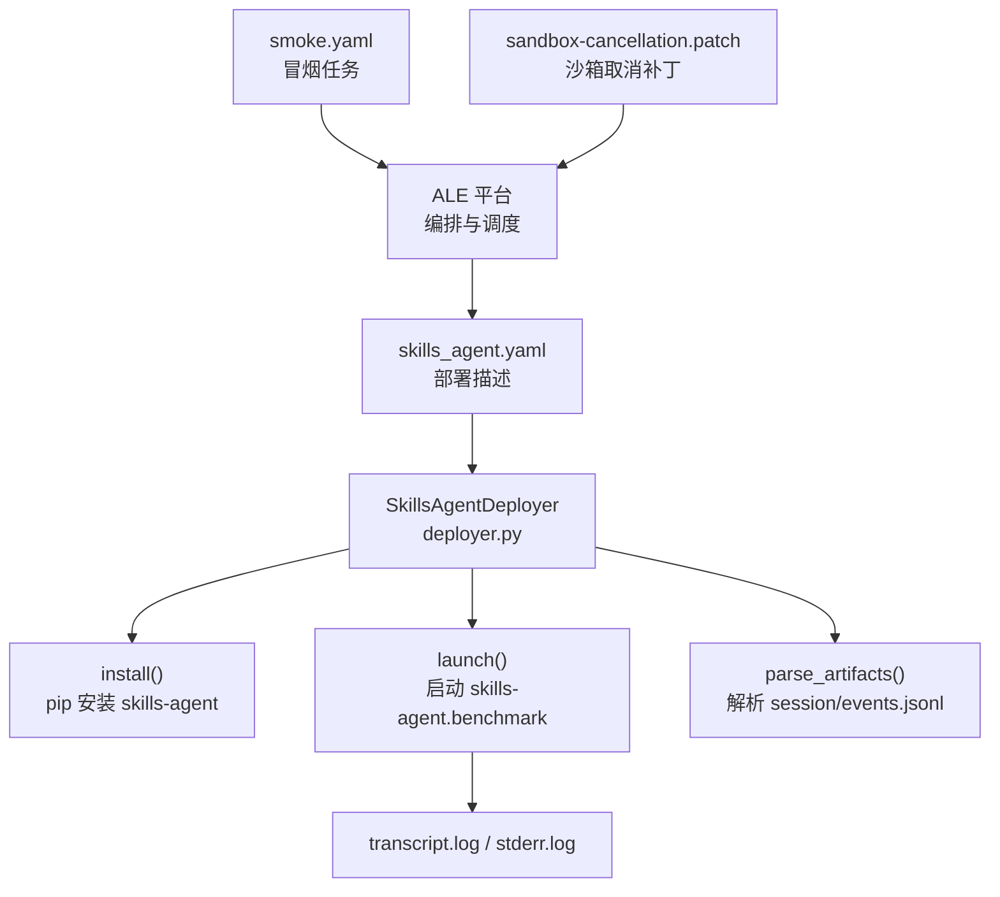
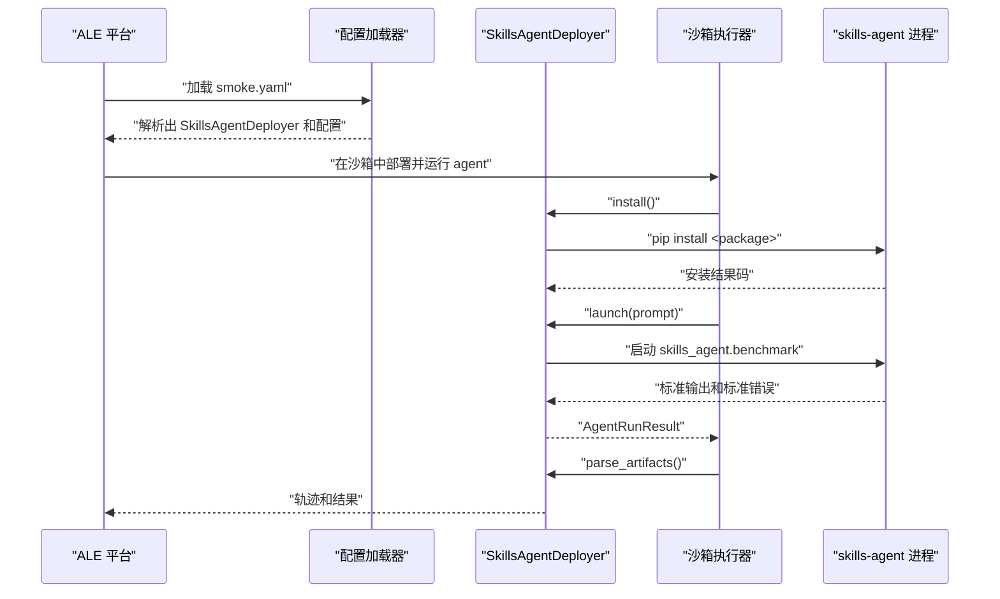
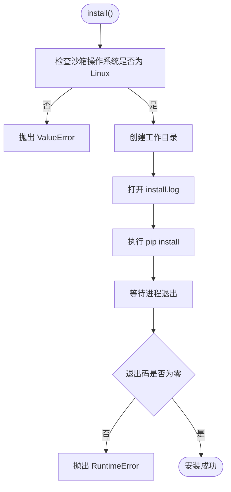
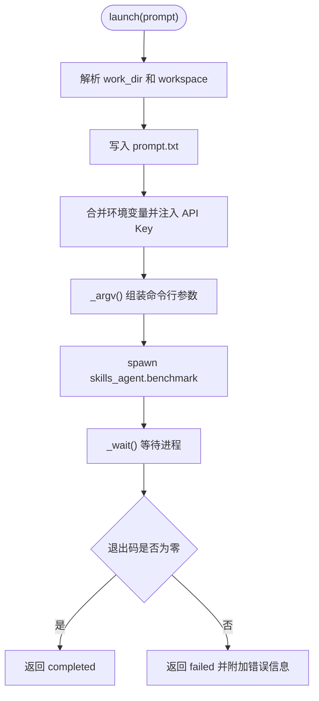
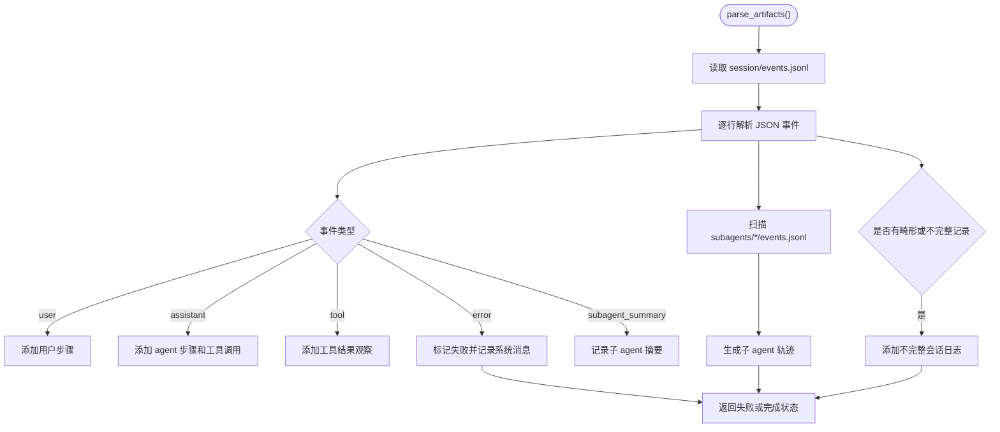
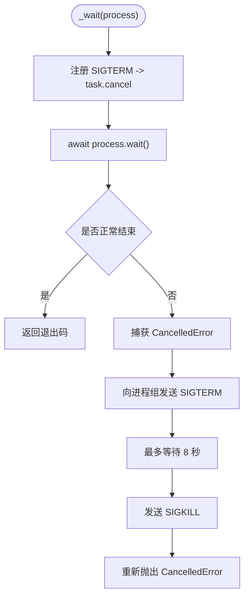
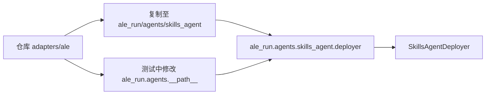
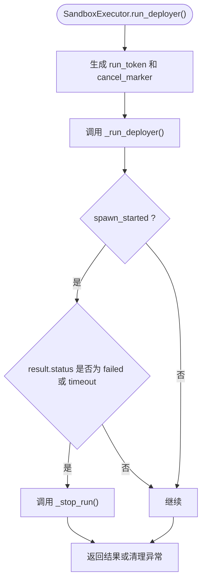

# ALE 评测适配器

<cite>
**本文引用的文件**   
- [deployer.py](file://adapters/ale/skills_agent/deployer.py)
- [config.py](file://adapters/ale/skills_agent/config.py)
- [pyproject.toml](file://adapters/ale/skills_agent/pyproject.toml)
- [__init__.py](file://adapters/ale/skills_agent/__init__.py)
- [skills_agent.yaml](file://adapters/ale/skills_agent.yaml)
- [smoke.yaml](file://adapters/ale/smoke.yaml)
- [sandbox-cancellation.patch](file://adapters/ale/patches/sandbox-cancellation.patch)
- [test_ale_adapter.py](file://tests/test_ale_adapter.py)
</cite>

## 目录
1. [引言](#引言)
2. [项目结构](#项目结构)
3. [核心组件](#核心组件)
4. [架构总览](#架构总览)
5. [详细组件分析](#详细组件分析)
6. [依赖与集成关系](#依赖与集成关系)
7. [从平台触发到结果验证的完整流程](#从平台触发到结果验证的完整流程)
8. [沙箱取消、容器隔离与重试策略](#沙箱取消容器隔离与重试策略)
9. [性能考量](#性能考量)
10. [故障排查指南](#故障排查指南)
11. [结论](#结论)

## 引言
本仓库中的 `adapters/ale` 目录是一个 ALE 评测适配器，用于把 skills-agent 作为可部署技能接入 ALE 评测体系。它通过一个自定义 Agent 部署器完成三件事：在 ALE 的沙箱环境中安装 skills-agent Python 包、启动 skills-agent 进程执行任务提示词、并把 skills-agent 产出的会话日志解析为 ALE 轨迹数据。适配器的行为由 YAML 描述和运行时配置驱动；冒烟测试则通过 `smoke.yaml` 调用 ALE 的任务系统对 skills-agent 做端到端验证。

该适配器面向 ALE 的 `BaseAgentDeployer` 抽象，因此 ALE 负责调度、沙箱生命周期、超时控制、日志采集等基础设施，而 skills-agent 只关注模型调用、工具执行和会话记录。

**章节来源**
- [__init__.py:1-1](file://adapters/ale/skills_agent/__init__.py#L1-L1)

## 项目结构
`adapters/ale` 目录采用“适配器 + 被适配包”的组织方式：

| 路径 | 职责 |
|---|---|
| `adapters/ale/skills_agent/deployer.py` | ALE Agent 部署器实现，负责安装、启动、日志解析和退出状态映射 |
| `adapters/ale/skills_agent/config.py` | skills-agent 在 ALE 中的配置数据结构及校验逻辑 |
| `adapters/ale/skills_agent/pyproject.toml` | 适配器自身的 Python 包元数据，定义包名、构建后端和空依赖 |
| `adapters/ale/skills_agent/__init__.py` | 标记该包应被复制到 ALE 的 agents 搜索路径下 |
| `adapters/ale/skills_agent.yaml` | ALE 部署描述：选择部署器类、执行器、模型和运行时环境变量 |
| `adapters/ale/smoke.yaml` | ALE 冒烟测试任务：指定 agent 配置、环境、任务、并发和清理策略 |
| `adapters/ale/patches/sandbox-cancellation.patch` | 对 ALE 沙箱执行器的补丁，增强取消、清理、幂等启动和取消信号传播 |

**图表来源**
- [skills_agent.yaml:1-9](file://adapters/ale/skills_agent.yaml#L1-L9)
- [deployer.py:1-256](file://adapters/ale/skills_agent/deployer.py#L1-L256)
- [smoke.yaml:1-13](file://adapters/ale/smoke.yaml#L1-L13)
- [sandbox-cancellation.patch:1-200](file://adapters/ale/patches/sandbox-cancellation.patch#L1-L200)

**章节来源**
- [deployer.py:1-256](file://adapters/ale/skills_agent/deployer.py#L1-L256)
- [config.py:1-35](file://adapters/ale/skills_agent/config.py#L1-L35)
- [pyproject.toml:1-14](file://adapters/ale/skills_agent/pyproject.toml#L1-L14)
- [skills_agent.yaml:1-9](file://adapters/ale/skills_agent.yaml#L1-L9)
- [smoke.yaml:1-13](file://adapters/ale/smoke.yaml#L1-L13)
- [sandbox-cancellation.patch:1-200](file://adapters/ale/patches/sandbox-cancellation.patch#L1-L200)

## 核心组件
### SkillsAgentConfig：运行时配置
`SkillsAgentConfig` 是 ALE 加载 skills-agent 运行时参数的入口。关键字段包括：

| 字段 | 默认值或说明 | 约束 |
|---|---|---|
| `package` | 必填 | 通过 pip 安装的 skills-agent 包名 |
| `model` | 必填 | 模型名称 |
| `provider` | `openai` | 仅允许 `openai` 或 `anthropic` |
| `base_url` | 可选 | 用于覆盖模型提供方 API 地址 |
| `api_key` | 可选 | 注入为 `{PROVIDER}_API_KEY` 环境变量 |
| `workspace` | 可选 | 工作空间目录；未设置时使用 ALE 沙箱任务数据根目录 |
| `context_tokens` | `1_000_000` | 必须为正整数 |
| `api_format` | `auto` | 允许 `auto`、`responses`、`chat` |
| `token_counter` | `auto` | 允许 `auto`、`official`、`usage` |
| `model_context_window` | 可选 | 正整数时启用模型上下文窗口限制 |
| `max_output_tokens` | `32768` | 必须为正整数 |
| `summary_output_tokens` | `8192` | 必须为正整数 |
| `skill_dirs` | 空列表 | 额外 skill 目录参数 |

构造后会在 `__post_init__` 中校验必填字段、枚举值和正值约束。如果缺少 `package` 或 `model`，或者 provider、token 相关字段不合法，会抛出 `ValueError`。

**章节来源**
- [config.py:1-35](file://adapters/ale/skills_agent/config.py#L1-L35)

### SkillsAgentDeployer：部署器
`SkillsAgentDeployer` 继承自 ALE 的 `BaseAgentDeployer`，声明：

- `default_executor = "sandbox"`
- `supported_executors = frozenset({"sandbox"})`

这意味着 ALE 只能使用沙箱执行器运行该 agent，且如果没有显式配置其他执行器，默认也走沙箱。

部署器暴露三个关键阶段：

1. **安装阶段**：`install()` 检查沙箱操作系统必须是 Linux，然后在 work_dir 中通过 `pip install <package>` 安装 skills-agent。
2. **启动阶段**：`launch(prompt)` 写入 prompt、准备环境变量、以子进程方式运行 `skills_agent.benchmark`，并返回 `AgentRunResult`。
3. **结果解析阶段**：`parse_artifacts(work_dir, config, run_result, builder)` 读取 `session/events.jsonl`，把消息、工具调用、工具结果、错误和子 agent 摘要转换为 ALE 轨迹。

**章节来源**
- [deployer.py:1-256](file://adapters/ale/skills_agent/deployer.py#L1-L256)

### 适配器包元数据
`pyproject.toml` 定义包名为 `ale-skills-agent`，要求 Python 3.11+，使用 hatchling 构建，但 wheel 打包不包含任何源码（`only-include = []`）。这说明该目录主要作为 ALE 的适配器代码和配置文件存在，而不是直接作为一个独立发布包。

**章节来源**
- [pyproject.toml:1-14](file://adapters/ale/skills_agent/pyproject.toml#L1-L14)

### ALE 部署描述
`skills_agent.yaml` 定义：

- `id: skills_agent`
- `class: ale_run.agents.skills_agent.deployer.SkillsAgentDeployer`
- `executor: sandbox`
- `model: ${env:SKILLS_AGENT_MODEL}`
- `config.package: ${env:SKILLS_AGENT_PACKAGE}`
- `config.provider: openai`
- `config.base_url: ${env:OPENAI_BASE_URL}`
- `config.api_key: ${env:OPENAI_API_KEY}`

这些值会被 ALE 的配置加载器解析，并传入 `SkillsAgentConfig`。模型和包名来自环境变量，因此部署时可通过外部配置注入不同模型和包版本。

**章节来源**
- [skills_agent.yaml:1-9](file://adapters/ale/skills_agent.yaml#L1-L9)

### 冒烟测试任务
`smoke.yaml` 定义：

- `name: skills_agent_smoke`
- `agents` 引用 `configs/agents/skills_agent.yaml`
- `environment` 引用 `configs/environments/docker.local.yaml`
- `tasks` 使用 `computing_math/os_log_permission_guard_v1`，变体 `[0]`
- `output.root: .logs/skills_agent`
- `concurrency: 1`
- `auto_resume: false`
- `max_attempts: 1`
- `cleanup_mode: delete`

这表示 ALE 会加载冒烟实验，找到 skills-agent agent，用 Docker 本地环境执行一个数学日志权限相关的任务，并在 `.logs/skills_agent` 输出结果。

**章节来源**
- [smoke.yaml:1-13](file://adapters/ale/smoke.yaml#L1-L13)

## 架构总览
下图展示 ALE 平台、适配器、skills-agent 进程以及日志之间的交互关系：

**图表来源**
- [deployer.py:1-256](file://adapters/ale/skills_agent/deployer.py#L1-L256)
- [skills_agent.yaml:1-9](file://adapters/ale/skills_agent.yaml#L1-L9)
- [smoke.yaml:1-13](file://adapters/ale/smoke.yaml#L1-L13)

## 详细组件分析

### 安装流程
`install()` 的执行顺序如下：

1. 校验 `executor.sandbox.os == "linux"`，否则抛出 `ValueError("skills_agent requires a Linux sandbox")`。
2. 创建 work_dir。
3. 打开 `install.log`。
4. 通过 `asyncio.create_subprocess_exec` 执行 `python -m pip install <package>`。
5. 使用 `_wait(process)` 等待进程结束。
6. 非零退出码时抛出 `RuntimeError("skills_agent installation failed ...; see install.log")`。

这里的关键点是：安装命令使用的是当前 Python 解释器，而不是硬编码系统 Python；日志写入 `work_dir/install.log`；失败信息包含进程退出码和日志文件路径。

**图表来源**
- [deployer.py:1-256](file://adapters/ale/skills_agent/deployer.py#L1-L256)

**章节来源**
- [deployer.py:1-256](file://adapters/ale/skills_agent/deployer.py#L1-L256)

### 启动流程
`launch(prompt)` 的工作流如下：

1. 解析 work_dir 和 workspace。
2. 将 prompt 写入 `prompt.txt`。
3. 合并宿主环境变量和 executor.env。
4. 如果配置中有 `api_key`，则注入 `{PROVIDER.upper()}_API_KEY`。
5. 打开 `transcript.log` 和 `stderr.log`。
6. 使用 `_argv()` 组装命令行参数，并通过 `create_subprocess_exec` 启动 `skills_agent.benchmark`。
7. 再次通过 `_wait(process)` 等待进程。
8. 根据退出码生成 `AgentRunResult`：
   - 零退出码：`status="completed"`
   - 非零退出码：`status="failed"`，并附带错误信息和日志路径

`_argv()` 会把 provider、model、context_tokens、api_format、token_counter、max_output_tokens、summary_output_tokens、可选 base_url、可选 model_context_window 和所有 skill_dirs 转为命令行参数。

**图表来源**
- [deployer.py:1-256](file://adapters/ale/skills_agent/deployer.py#L1-L256)

**章节来源**
- [deployer.py:1-256](file://adapters/ale/skills_agent/deployer.py#L1-L256)

### 结果解析流程
`parse_artifacts()` 会：

1. 读取 `session/events.jsonl`。
2. 遍历每行 JSON 事件：
   - `message.user`：添加用户步骤；如果是主会话第一个 user 消息，可选择跳过。
   - `message.assistant`：添加 agent 步骤，并提取 tool_calls 和 metrics。
   - `message.tool`：添加 environment observation，并把 tool result 解析为 ToolResult。
   - `error`：标记会话失败，可能包含 partial content。
   - `subagent_summary`：记录子 agent 摘要。
3. 对于 `session/subagents/*/events.jsonl`，每个子 agent 生成独立的 `TrajectoryBuilder`。
4. 如果会话未完成、存在畸形记录或未解析记录，会在系统步骤中追加“不完整会话日志”提示。

辅助函数：

- `_text(content)`：把字符串或多块文本内容归一化为纯文本。
- `_tool_content(content, session_dir)`：处理 text 和 image 内容；图片会尝试从 `session/attachments` 读取并转为 base64。
- `_metrics(raw)`：从 `_raw.usage` 中提取输入 token、输出 token 和缓存 token。

**图表来源**
- [deployer.py:1-256](file://adapters/ale/skills_agent/deployer.py#L1-L256)

**章节来源**
- [deployer.py:1-256](file://adapters/ale/skills_agent/deployer.py#L1-L256)

### 进程取消与等待
`_wait(process)` 是适配器侧的安全等待逻辑：

1. 保存当前线程的 SIGTERM 处理器。
2. 注册新的 SIGTERM 处理器：当收到 SIGTERM 时，调用 asyncio event loop 的 `call_soon_threadsafe(task.cancel)`。
3. 正常等待 `process.wait()`。
4. 如果捕获到 `CancelledError`：
   - 向进程组发送 `SIGTERM`。
   - 最多等待 8 秒。
   - 最后强制 `SIGKILL` 进程组。
   - 重新抛出 `CancelledError`。
5. finally 中恢复原始 SIGTERM 处理器。

这个设计对应 ALE 的主线程可能直接收到 SIGTERM 的场景，而不是通过 `asyncio.wait_for()` 取消协程。

**图表来源**
- [deployer.py:1-256](file://adapters/ale/skills_agent/deployer.py#L1-L256)

**章节来源**
- [deployer.py:1-256](file://adapters/ale/skills_agent/deployer.py#L1-L256)

## 依赖与集成关系

### ALE 如何加载该适配器
适配器包注释明确指出：需要将该包复制到 ALE 的 `ale_run/agents/skills_agent` 目录中。单元测试也展示了另一种集成方式：当设置 `ALE_SOURCE_DIR` 指向上游 ALE 源码时，测试会把 `adapters/ale` 插入到 `ale_run.agents.__path__`，从而让 ALE 通过 `ale_run.agents.skills_agent.deployer.SkillsAgentDeployer` 导入部署器。

**图表来源**
- [__init__.py:1-1](file://adapters/ale/skills_agent/__init__.py#L1-L1)
- [test_ale_adapter.py:1-200](file://tests/test_ale_adapter.py#L1-L200)

**章节来源**
- [__init__.py:1-1](file://adapters/ale/skills_agent/__init__.py#L1-L1)
- [test_ale_adapter.py:1-200](file://tests/test_ale_adapter.py#L1-L200)

### ALE 配置与工厂
单元测试验证了 ALE 配置加载链：

1. 通过 `load_experiment(smoke.yaml)` 加载冒烟实验。
2. 通过 `resolve_agent(...)` 解析出 deployer 类和 config 类。
3. 通过 `build_config(config_cls, agent.config)` 构造 `SkillsAgentConfig`。
4. 验证 executor 只能为 `sandbox`，否则会抛出不支持执行器的错误。
5. 验证环境变量注入、并发数、自动续跑、最大尝试次数和任务数量。

**章节来源**
- [test_ale_adapter.py:100-200](file://tests/test_ale_adapter.py#L100-L200)

## 从平台触发到结果验证的完整流程

### 前置条件
1. 已有 ALE 源码或 ALE 运行环境。
2. 已把 `adapters/ale/skills_agent` 放入 ALE 的 agents 搜索路径。
3. 设置以下环境变量：
   - `SKILLS_AGENT_MODEL`
   - `SKILLS_AGENT_PACKAGE`
   - `OPENAI_BASE_URL`
   - `OPENAI_API_KEY`
4. 确保 ALE 的 `configs/environments/docker.local.yaml` 可用。

### 步骤一：触发部署
在 ALE 平台中，部署描述由 `skills_agent.yaml` 决定：

- `class` 指向 `ale_run.agents.skills_agent.deployer.SkillsAgentDeployer`。
- `executor` 为 `sandbox`。
- `model` 和 `config.package` 来自环境变量。
- provider、base_url、api_key 由配置和环境变量共同决定。

当 ALE 加载冒烟实验时，它会识别该 agent 并实例化部署器。

**章节来源**
- [skills_agent.yaml:1-9](file://adapters/ale/skills_agent.yaml#L1-L9)
- [test_ale_adapter.py:100-200](file://tests/test_ale_adapter.py#L100-L200)

### 步骤二：安装依赖
部署器调用 `install()`：

- 检查沙箱操作系统为 Linux。
- 在当前 Python 环境下执行 `pip install <SKILLS_AGENT_PACKAGE>`。
- 安装日志写入 `work_dir/install.log`。
- 非零退出码抛出 `RuntimeError`。

**章节来源**
- [deployer.py:1-256](file://adapters/ale/skills_agent/deployer.py#L1-L256)

### 步骤三：启动 agent
部署器调用 `launch(prompt)`：

- 将任务提示词写入 `prompt.txt`。
- 将 provider 对应的 API key 注入环境变量。
- 启动 `skills_agent.benchmark`，并传入模型、token 上限、skill 目录等参数。
- 输出写入 `transcript.log` 和 `stderr.log`。
- 返回 `AgentRunResult`。

**章节来源**
- [deployer.py:1-256](file://adapters/ale/skills_agent/deployer.py#L1-L256)

### 步骤四：查看日志
关键日志位置：

| 日志 | 含义 |
|---|---|
| `install.log` | pip 安装依赖的输出 |
| `transcript.log` | skills-agent 的标准输出，包含会话事件 |
| `stderr.log` | skills-agent 的错误输出 |
| `session/events.jsonl` | ALE 轨迹解析的主要输入 |
| `session/attachments/*` | 工具产生的图片附件 |
| `session/subagents/*/events.jsonl` | 子 agent 会话日志 |

**章节来源**
- [deployer.py:1-256](file://adapters/ale/skills_agent/deployer.py#L1-L256)

### 步骤五：验证结果
ALE 调用 `parse_artifacts()` 把 `events.jsonl` 解析为轨迹。验证重点：

- 是否存在用户、agent、工具调用和工具结果步骤。
- 是否有 `error` 事件导致会话标记为失败。
- 子 agent 轨迹是否正确生成。
- 图片附件是否能被还原。
- 是否有“不完整会话日志”警告。

**章节来源**
- [deployer.py:1-256](file://adapters/ale/skills_agent/deployer.py#L1-L256)

## 沙箱取消、容器隔离与重试策略

### 补丁的作用
`sandbox-cancellation.patch` 修改的是 ALE 的沙箱执行器。其核心目标不是改变 skills-agent 的业务逻辑，而是增强 ALE 在取消、清理、幂等启动方面的行为：

1. 引入 `SandboxCleanupError`，表示“清理未确认”，评估不应继续。
2. 引入 `_SandboxRun`，携带 `run_token`、`cancel_marker`、`pid_file` 和 `spawn_started`。
3. 在部署前生成唯一 token 和取消标记文件路径。
4. 如果部署过程中出现异常，并且已经启动过进程，则执行 `_stop_run(state)`。
5. 如果 spawn 成功但结果为 `failed` 或 `timeout`，也执行清理。
6. Linux 上调用 `_sandbox_stop.py` 辅助脚本；Windows 上写入 cancel marker 并终止进程树。
7. Launcher 中加入锁文件和 cancel marker 检查，防止重复启动或已被取消的实例继续运行。
8. 导出 `ALE_SANDBOX_RUN_ID`，便于关联运行实例。

**图表来源**
- [sandbox-cancellation.patch:1-200](file://adapters/ale/patches/sandbox-cancellation.patch#L1-L200)

### 与适配器协作
适配器侧的 `_wait()` 和 ALE 沙箱取消机制形成双层保护：

- ALE 沙箱层负责取消运行、停止进程树、写 cancel marker、保证清理不可中断。
- 适配器侧在收到 SIGTERM 时取消等待协程，并向进程组发送 SIGTERM，然后优雅等待，最后强制杀死进程组。

单元测试中也覆盖了取消场景，例如期望 `SandboxCleanupError` 能阻止后续评估，以及在 POSIX 环境下能回收进程并杀死后代进程。

**章节来源**
- [sandbox-cancellation.patch:1-200](file://adapters/ale/patches/sandbox-cancellation.patch#L1-L200)
- [deployer.py:1-256](file://adapters/ale/skills_agent/deployer.py#L1-L256)
- [test_ale_adapter.py:1-200](file://tests/test_ale_adapter.py#L1-L200)

### 容器隔离
`launch()` 使用 `start_new_session=True` 启动新进程组，并以 workspace 为当前工作目录。结合 ALE 的沙箱执行器，skills-agent 实际运行在受控环境中：

- pip 安装发生在沙箱内。
- skills-agent 子进程拥有独立 PID 和进程组。
- 日志、工作空间和附件都位于 ALE 管理的 work_dir。
- 取消时优先使用进程组信号，避免残留子进程。

**章节来源**
- [deployer.py:1-256](file://adapters/ale/skills_agent/deployer.py#L1-L256)

### 重试策略
`smoke.yaml` 明确设置：

- `concurrency: 1`：串行执行。
- `auto_resume: false`：不自动续跑。
- `max_attempts: 1`：最多一次尝试。
- `cleanup_mode: delete`：完成后删除清理。

因此，本次冒烟测试不会因失败而自动重试；如果需要重试，应调整 `max_attempts` 或在更高层的 ALE 编排中配置重试。

**章节来源**
- [smoke.yaml:1-13](file://adapters/ale/smoke.yaml#L1-L13)

## 性能考量
- **安装阶段**：每次部署都会执行 pip install，依赖网络、包索引和依赖解析速度。建议使用稳定版本或预构建镜像减少安装时间。
- **启动阶段**：skills-agent 会调用外部模型 API，延迟主要来自网络和模型提供方，而非适配器本身。
- **日志解析阶段**：`events.jsonl` 按行流式处理，复杂度近似 O(n)，n 为事件行数。图片附件会增加 I/O 开销。
- **取消阶段**：适配器最多等待 8 秒优雅退出，随后强制杀死进程组，避免长时间阻塞。

[本节为通用指导，不直接分析具体文件]

## 故障排查指南

### 部署失败
**现象**：A LE 报告部署或安装失败。

**排查要点**：
1. 检查 `install.log`，确认 pip 能否解析 `SKILLS_AGENT_PACKAGE`。
2. 确认 `SKILLS_AGENT_PACKAGE` 指向真实可用的 Python 包。
3. 确认当前 Python 版本满足 requirements（pyproject 要求 Python 3.11+）。
4. 检查网络、私有源、认证和依赖冲突。

**相关代码**
- [deployer.py:1-256](file://adapters/ale/skills_agent/deployer.py#L1-L256)
- [pyproject.toml:1-14](file://adapters/ale/skills_agent/pyproject.toml#L1-L14)

### 依赖解析错误
**现象**：pip 安装时报依赖冲突、包不存在或版本不兼容。

**排查要点**：
1. 固定 `SKILLS_AGENT_PACKAGE` 版本。
2. 确认基础镜像或沙箱环境包含所需系统依赖。
3. 如果使用私有源，确认 pip 配置和凭据正确。
4. 在本地复现 `pip install <package>` 命令。

**相关代码**
- [deployer.py:1-256](file://adapters/ale/skills_agent/deployer.py#L1-L256)

### 配置校验失败
**现象**：启动前报错，如 provider 不支持、token 配置非法或缺少必填字段。

**排查要点**：
1. 检查 `config.py` 的校验规则。
2. 确认 `provider` 为 `openai` 或 `anthropic`。
3. 确认 `context_tokens`、`max_output_tokens`、`summary_output_tokens` 为正数。
4. 确认 `api_format` 和 `token_counter` 取合法值。
5. 确认 `package` 和 `model` 不为空。

**相关代码**
- [config.py:1-35](file://adapters/ale/skills_agent/config.py#L1-L35)

### API Key 未注入
**现象**：skills-agent 无法调用模型提供方。

**排查要点**：
1. 确认 `config.provider` 和 `config.api_key` 已配置。
2. 确认 ALE 已将 `{PROVIDER}_API_KEY` 注入到子进程环境变量。
3. 不要依赖命令行传递敏感信息；适配器会将 key 放入 env，而不是 argv。
4. 检查 `stderr.log` 中的认证错误。

**相关代码**
- [deployer.py:1-256](file://adapters/ale/skills_agent/deployer.py#L1-L256)

### 沙箱取消异常
**现象**：任务被取消，但进程未完全退出，或 ALE 报告清理未确认。

**排查要点**：
1. 检查 ALE 沙箱是否应用了 `sandbox-cancellation.patch`。
2. 确认 Linux 沙箱中存在 `_sandbox_stop.py` 辅助脚本。
3. 确认 cancel marker 文件能被写入。
4. 如果抛出 `SandboxCleanupError`，表示清理未确认，不应继续评估。
5. 检查 `_wait()` 是否在 SIGTERM 后尝试优雅退出并强制杀死进程组。

**相关代码**
- [sandbox-cancellation.patch:1-200](file://adapters/ale/patches/sandbox-cancellation.patch#L1-L200)
- [deployer.py:1-256](file://adapters/ale/skills_agent/deployer.py#L1-L256)

### 冒烟测试不通过
**现象**：`smoke.yaml` 执行失败，或任务结果不符合预期。

**排查要点**：
1. 确认 `smoke.yaml` 指向正确的 agent 配置、环境和任务。
2. 检查 `concurrency`、`auto_resume`、`max_attempts`、`cleanup_mode`。
3. 查看 `.logs/skills_agent` 下的 transcript 和 stderr。
4. 检查 `session/events.jsonl` 是否包含完整的 message、tool 和 error 事件。
5. 如果图片附件缺失，检查 `session/attachments` 是否可读。
6. 如果子 agent 失败，检查 `session/subagents/*/events.jsonl`。

**相关代码**
- [smoke.yaml:1-13](file://adapters/ale/smoke.yaml#L1-L13)
- [deployer.py:1-256](file://adapters/ale/skills_agent/deployer.py#L1-L256)

### 轨迹解析不完整
**现象**：ALE 显示“不完整会话日志”，或最终状态不正确。

**排查要点**：
1. 检查 `events.jsonl` 是否包含有效的 `message`、`error` 或 `subagent_summary`。
2. 检查是否有畸形 JSON 行。
3. 检查最后一个 assistant 消息是否没有 tool_calls，否则会被视为未完成。
4. 检查图片附件路径和 MIME 类型。
5. 确认子 agent 事件文件存在且可读。

**相关代码**
- [deployer.py:1-256](file://adapters/ale/skills_agent/deployer.py#L1-L256)

### 测试无法连接上游 ALE
**现象**：单元测试跳过或无法导入 ALE 模块。

**排查要点**：
1. 设置 `ALE_SOURCE_DIR` 指向上游 ALE 源码。
2. 确认测试会临时修改 `ale_run.agents.__path__`。
3. 确认 `adapters/ale` 能被导入为 `ale_run.agents.skills_agent.*`。
4. 确认冒烟实验路径和 `docker.local.yaml` 已复制到临时目录。

**相关代码**
- [test_ale_adapter.py:1-200](file://tests/test_ale_adapter.py#L1-L200)

## 结论
`adapters/ale` 通过 `SkillsAgentDeployer` 把 skills-agent 封装成 ALE 可部署技能。它承担安装、启动、日志解析和退出状态映射的职责；`skills_agent.yaml` 提供部署描述；`smoke.yaml` 提供端到端冒烟任务；`sandbox-cancellation.patch` 增强 ALE 沙箱在取消、清理和幂等启动方面的健壮性。

在实际使用中，应重点关注：

- 环境变量是否正确注入模型、包名和 API key。
- pip 安装是否能在沙箱中成功解析依赖。
- skills-agent 的 transcript、stderr 和 session 日志是否完整。
- 沙箱取消是否由 ALE 层和适配器层协同完成。
- 冒烟测试是否按预期串行执行且不自动重试。

通过这些组件配合，ALE 平台可以可靠地部署、运行和评估 skills-agent，同时保留足够的诊断信息用于排障和审计。