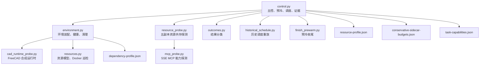
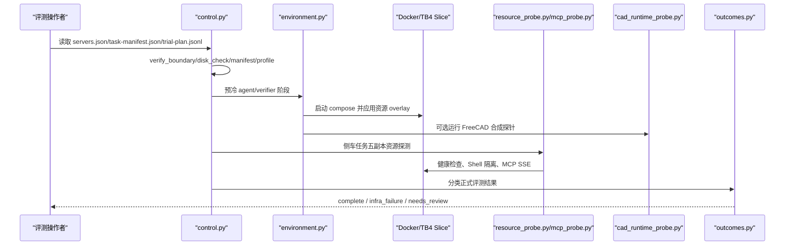
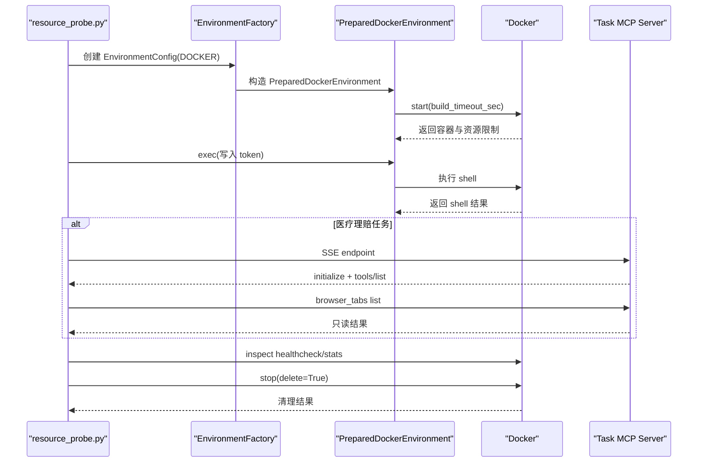
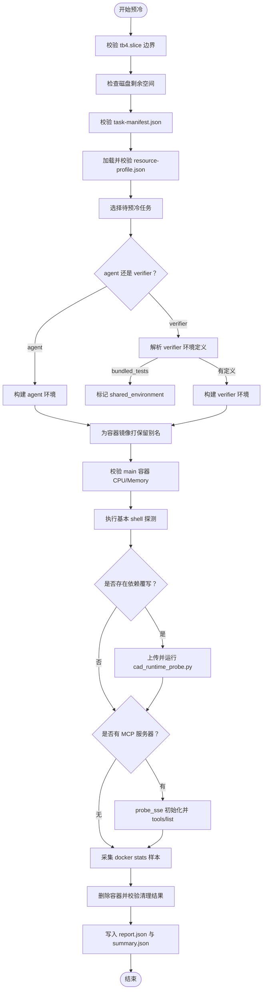
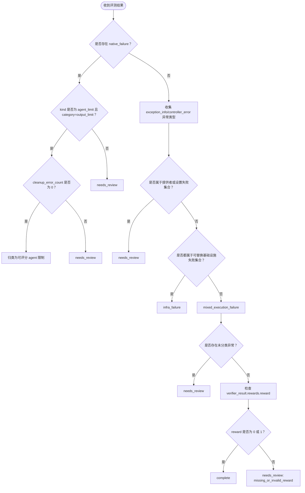
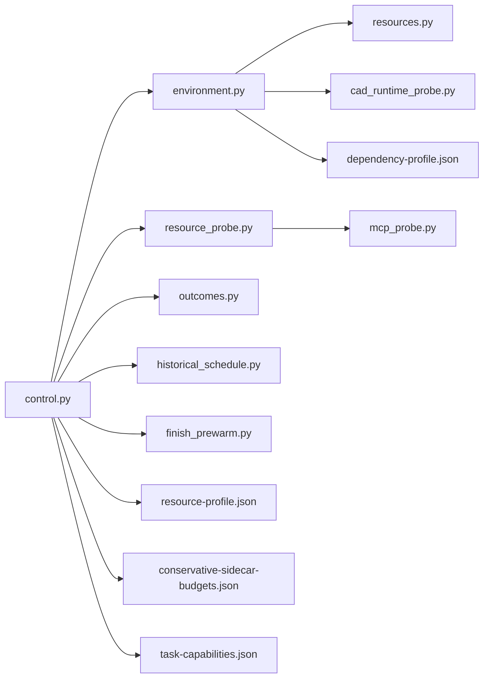
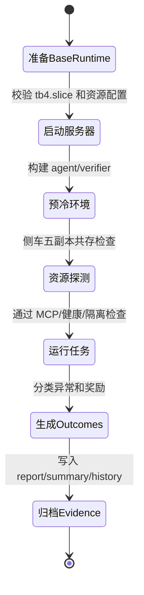

# Harbor TB4 评测控制器

<cite>
**本文引用的文件**   
- [control.py](file://adapters/harbor/tb4_control/control.py)
- [environment.py](file://adapters/harbor/tb4_control/environment.py)
- [resource_probe.py](file://adapters/harbor/tb4_control/resource_probe.py)
- [mcp_probe.py](file://adapters/harbor/tb4_control/mcp_probe.py)
- [cad_runtime_probe.py](file://adapters/harbor/tb4_control/cad_runtime_probe.py)
- [resources.py](file://adapters/harbor/tb4_control/resources.py)
- [synthetic_agent.py](file://adapters/harbor/tb4_control/synthetic_agent.py)
- [outcomes.py](file://adapters/harbor/tb4_control/outcomes.py)
- [historical_schedule.py](file://adapters/harbor/tb4_control/historical_schedule.py)
- [finish_prewarm.py](file://adapters/harbor/tb4_control/finish_prewarm.py)
- [conservative-sidecar-budgets.json](file://adapters/harbor/tb4_control/conservative-sidecar-budgets.json)
- [dependency-profile.json](file://adapters/harbor/tb4_control/dependency-profile.json)
- [resource-profile.json](file://adapters/harbor/tb4_control/resource-profile.json)
- [task-capabilities.json](file://adapters/harbor/tb4_control/task-capabilities.json)
</cite>

## 目录
1. [引言](#引言)
2. [项目结构](#项目结构)
3. [核心组件](#核心组件)
4. [架构总览](#架构总览)
5. [详细组件分析](#详细组件分析)
6. [依赖关系分析](#依赖关系分析)
7. [性能与调度特性](#性能与调度特性)
8. [评测生命周期示例](#评测生命周期示例)
9. [配置说明](#配置说明)
10. [故障排查指南](#故障排查指南)
11. [结论](#结论)

## 引言
Harbor TB4 评测控制器 `tb4_control` 负责在受控的 cgroup 边界内，对 Terminal-Bench-4 的 56 个任务进行资源受限的环境准备、预冷、资源探测、合成 Agent 验证、正式评测调度以及结果归档。它不是模型调用入口：评测控制层只驱动环境构建、容器健康检查、MCP 能力探测、历史调度重放和结果分类；真正的 Agent 运行由上层 Harbor 框架承担。

本模块的核心约束是“保守、可审计、可回滚”：
- 使用固定五槽 CPU/RAM 资源策略。
- 通过冻结的资源配置文件校验任务声明。
- 用独立探针验证 Docker 隔离、服务资源上限、网络隔离、MCP SSE 能力和 FreeCAD ABI/渲染能力。
- 将结果分类为可评分、基础设施故障或需要人工审查。
- 用证据文件记录依赖补丁、镜像保留、资源限制、清理状态和历史调度假设。

## 项目结构
`tb4_control` 位于 Harbor 适配器的 TB4 控制子模块中，主要职责按文件拆分：

| 文件 | 职责 |
|---|---|
| `control.py` | 主控流程：读取清单、边界检查、预冷、并发调度、侧车共存探测、结果汇总 |
| `environment.py` | 扩展 Harbor 的 Docker 环境装配、依赖覆写、运行时健康检查和清理守卫 |
| `resource_probe.py` | 启动 5 个隔离副本执行资源共存探测、健康请求、Shell 文件和 MCP 探测 |
| `mcp_probe.py` | 纯标准库实现 SSE MCP 初始化、工具列表和只读浏览器标签探测 |
| `cad_runtime_probe.py` | 不运行真实任务的 FreeCAD/VTK/PyVista 合成运行时探针 |
| `resources.py` | 资源模型、资源配置文件校验、Docker 项目巡检、健康与清理断言 |
| `synthetic_agent.py` | 确定性 Shell 传输探针，仅允许用于合成预检任务 |
| `outcomes.py` | 根据异常类型和结构化失败信息分类 Agent 结果 |
| `historical_schedule.py` | 基于公开运行记录的 CPU×内存回溯调度模拟 |
| `finish_prewarm.py` | 预冷收尾：补齐镜像标签、校验覆盖度和依赖一致性 |
| `conservative-sidecar-budgets.json` | 标记必须独占整个 28 CPU/107 GiB 预算的侧车任务 |
| `dependency-profile.json` | 冻结 FreeCAD 验证器及 VTK/PyVista 版本，生成 verifier 依赖覆写 |
| `resource-profile.json` | 56 个任务的 CPU/RAM/storage/超时/网络模式/侧车容量冻结表 |
| `task-capabilities.json` | 已选任务数、唯一 MCP 任务和 9 个侧车任务清单 |

**图表来源**
- [control.py:1-200](file://adapters/harbor/tb4_control/control.py#L1-L200)
- [environment.py:1-126](file://adapters/harbor/tb4_control/environment.py#L1-L126)
- [resource_probe.py:1-177](file://adapters/harbor/tb4_control/resource_probe.py#L1-L177)
- [mcp_probe.py:1-62](file://adapters/harbor/tb4_control/mcp_probe.py#L1-L62)
- [cad_runtime_probe.py:1-34](file://adapters/harbor/tb4_control/cad_runtime_probe.py#L1-L34)
- [resources.py:1-226](file://adapters/harbor/tb4_control/resources.py#L1-L226)
- [finish_prewarm.py:1-44](file://adapters/harbor/tb4_control/finish_prewarm.py#L1-L44)
- [historical_schedule.py:1-89](file://adapters/harbor/tb4_control/historical_schedule.py#L1-L89)

**章节来源**
- [control.py:1-200](file://adapters/harbor/tb4_control/control.py#L1-L200)
- [environment.py:1-126](file://adapters/harbor/tb4_control/environment.py#L1-L126)
- [resource_probe.py:1-177](file://adapters/harbor/tb4_control/resource_probe.py#L1-L177)

## 核心组件
### control.py：主控流程
`control.py` 是整个评测控制器的编排中心。它的主要职责包括：
- 定义宿主级 CPU/RAM 预算、并发度、槽位大小和依赖任务集合。
- 校验运行边界：必须在 `/tb4.slice` 下，并限制内存上限、CPU 配额和可用 CPU 范围。
- 校验磁盘空间：剩余空间低于 20% 时暂停新任务准入。
- 解析 `task-manifest.json`，要求恰好 56 个唯一任务，且每个任务的主资源和验证器资源不超过审计阈值。
- 加载 `resource-profile.json`，强制使用五槽均匀固定槽策略，并禁止超出 slot 的整体包络。
- 以进程锁保护输出目录，避免同一主机上多个控制器同时抢占资源。
- 并行预冷 agent 和 verifier 阶段，保留成功镜像别名，跳过已满足身份和清理条件的报告。
- 对侧车任务执行九项共存探测，验证 5 个独立项目、私有网络、健康检查、Shell 隔离和 MCP。
- 将正式评测结果交给 `outcomes.py` 分类，区分可评分、基础设施故障和需人工审查。
- 支持历史调度重放，作为规划依据而非当前评估指标。

关键入口函数与常量：
- `manifest(path)`：校验 56 任务清单。
- `verify_boundary()`：校验 cgroup、内存上限、CPU 集和 CPU 配额。
- `disk_check(root)` / `disk_fits(...)`：磁盘空间硬下限和预留估算。
- `prewarm(args)`：预冷主循环。
- `prewarm_phase(task_dir, phase, output, sample_seconds)`：单个任务单阶段预冷。
- `fits(active, candidate)`：按 CPU/RAM 预算判断是否可调度。
- `project_containers(session)`：列出并校验容器 cgroup 归属。
- `verify_retained_image_readiness(summary, task_names)`：校验预冷镜像别名仍存在。

**章节来源**
- [control.py:1-200](file://adapters/harbor/tb4_control/control.py#L1-L200)
- [control.py:201-475](file://adapters/harbor/tb4_control/control.py#L201-L475)

### environment.py：环境装配与清理守卫
`environment.py` 继承 Harbor 的 Docker 环境类，增加三层控制：
1. **依赖覆写**：对三个 FreeCAD verifier 任务，注入冻结的 PyVista/VTK 依赖，使 Dockerfile 安装被精确 pin。
2. **资源覆写**：调用 `resources.resource_overlay` 生成 compose overlay，把 CPU、内存、swap 和 cgroup parent 写入临时 compose。
3. **生命周期守卫**：注册 `PHASE_GUARD`，确保 verifier 不会与失败的 cleanup 重叠，并在 stop 后检测残留容器、网络和卷。

重要行为：
- `build_overlay(environment_dir, environment_name)` 返回 compose overlay 和元数据，包含原始/Dockerfile 摘要、overlay 摘要和 pins。
- `PreparedDockerEnvironment.start(force_build)` 启动环境并记录 `startup_health_verified`、`live_caps_verified`。
- `stop_service(service)` 先采样健康状态，再停止服务，并记录 operator 显式停止的服务名。
- `stop(delete)` 先记录健康错误，再清理环境，最后抛出之前捕获的健康错误，保证失败可见。
- `assert_trial_clean(output)` 在发布控制器结果前再次检查 trial 目录是否干净。

**章节来源**
- [environment.py:1-126](file://adapters/harbor/tb4_control/environment.py#L1-L126)
- [resources.py:201-226](file://adapters/harbor/tb4_control/resources.py#L201-L226)

### resource_probe.py：资源共存探针
该模块启动九个侧车任务中的每一个的五个隔离副本，但不调用模型，也不执行正式评分。其目的是证明：
- 五个同任务项目可以并行启动。
- 每个项目拥有独立的 Docker 网络。
- 每个项目的长驻 sidecar 健康检查能通过。
- 文件写入/读取具备进程隔离。
- 某些任务（如医疗理赔）的 MCP SSE 端点能正确响应。
- 父 cgroup 没有 OOM 事件。
- 最终全部项目都能完整清理。

探针流程要点：
- 先检查磁盘是否能容纳五个副本的存储声明。
- 依次创建 `TrialPaths`，并通过 `EnvironmentFactory` 使用 `PreparedDockerEnvironment` 启动。
- 校验每个项目网络 ID 非空且互不相交。
- 在每个项目中写入 token 文件并读取校验哈希。
- 对医疗理赔任务，根据 `task_config.mcp_servers` 构造容器内可达 URL，调用 `mcp_probe.probe_sse`。
- 统计 cgroup memory events，若出现 oom/oom_kill/oom_group_kill 则失败。
- finally 块中逆序清理所有环境，并将清理结果写入 `report.json`。

**章节来源**
- [resource_probe.py:1-177](file://adapters/harbor/tb4_control/resource_probe.py#L1-L177)

### mcp_probe.py：SSE MCP 能力探测
这是一个最小化、无模型调用的 MCP 客户端：
- 使用标准库发起 HTTP 请求，接受 `text/event-stream`。
- 解析第一个 `endpoint` 事件，拿到 JSON-RPC 消息端点。
- 发送 `initialize` 和 `notifications/initialized`。
- 调用 `tools/list`，要求至少有一个工具。
- 如果工具列表包含 `browser_tabs`，则调用 `tools/call` 的只读 `list` 动作，确认浏览器标签功能存在但只读。

超时参数默认为 45 秒；连接关闭、缺少 endpoint、缺少工具或 MCP 返回错误都会抛出异常。

**章节来源**
- [mcp_probe.py:1-62](file://adapters/harbor/tb4_control/mcp_probe.py#L1-L62)

### cad_runtime_probe.py：FreeCAD 运行时探针
该脚本不读取任务指令、参考资料或评分器，只做合成 ABI/渲染验证：
- 断言 `gnucleus-freecad-validator` 版本、PyVista 版本、VTK 版本。
- 执行 numpy 到 VTK 再到 numpy 的数据往返。
- 创建 FreeCAD 立方体并验证体积。
- 在无头模式下渲染图片，保存图片并检查文件大小和像素方差。
- 输出 JSON，标记 `passed`、`synthetic_only`、`no_model_calls` 及各依赖版本。

这个探针用于验证 FreeCAD 依赖覆写后的 ABI 兼容性。

**章节来源**
- [cad_runtime_probe.py:1-34](file://adapters/harbor/tb4_control/cad_runtime_probe.py#L1-L34)

### resources.py：资源模型与容器巡检
`resources.py` 提供：
- 自定义异常：`ResourceConfigurationError`、`EnvironmentHealthError`、`EnvironmentCleanupError`。
- `load_profile` / `validate_profile`：校验 v5 五槽策略、56 个任务、20 个侧车 cap、phase envelope 和 slot 上限。
- `phase_caps(profile, task, phase, helper)`：计算 main 和 sidecar 的 CPU/RAM 容量。
- `resource_overlay(environment_dir, task, task_config, helper)`：生成 compose overlay，禁止未审计 Compose，限制整体 slot。
- `inspect_project(session)`：列出项目容器，仅读取安全字段，不暴露 Docker Config.Env。
- `project_residuals(session)`：检查容器、网络、卷残留。
- `validate_live_caps(records, caps)`：校验 nano_cpus、memory、memory_swap、cgroup_parent 和进程 cgroup。
- `validate_health(records, operator_stopped)`：拒绝 OOM、重启、unhealthy 和非预期自然退出。
- `PhaseGuard`：防止 verifier 阶段在失败 cleanup 后继续运行。

**章节来源**
- [resources.py:1-226](file://adapters/harbor/tb4_control/resources.py#L1-L226)

### synthetic_agent.py：合成 Agent
`ShellTransportProbe` 是一个确定性 Agent 探针：
- 名称固定为 `tb4-shell-transport-check`。
- 仅接受以特定前缀开头的指令，拒绝真实基准任务。
- 在环境中执行 shell 命令：检查输入文件、读取内容、写出答案并计算哈希。
- 将结果写入 `logs_dir/transport-probe.json`。
- 重置 token 计数，表示不产生模型用量。

该探针用于验证合成任务的 Agent-Environment 传输路径，而不是真实评测。

**章节来源**
- [synthetic_agent.py:1-33](file://adapters/harbor/tb4_control/synthetic_agent.py#L1-L33)

### outcomes.py：结果聚合与分类
`outcomes.py` 把 Harbor 返回的结果映射为控制器可理解的三类状态：
- `complete`：验证器返回 0 或 1 的二元奖励。
- `infra_failure`：单一类型的基础设施/环境传输失败，允许替换重试。
- `needs_review`：其他情况，包括提供者失败、混合失败、原生失败、未知执行失败或缺失奖励。

分类规则重点：
- 优先检查结构化 `native_failure`，除非它是明确的 agent output limit 且无 cleanup error。
- 检查 `exception_info` 和 `controller_error` 中的异常类型。
- 基础设施故障必须是同一组可替换异常，否则降级为混合失败。
- 非零退出码可能隐藏网关或工具缺失问题，默认进入 `needs_review`。
- 不搜索工具输出、提示词或异常消息中的 HTTP 状态码。

**章节来源**
- [outcomes.py:1-87](file://adapters/harbor/tb4_control/outcomes.py#L1-L87)

### historical_schedule.py：历史调度重放
该模块读取公开的 Harbor 运行记录，对 sol、opus5、sonnet5 三组模型做 100 次随机种子重排，模拟 56 个任务在 28 CPU/107 GiB 预算下的调度时间。它：
- 从 manifest 提取任务集合和侧车任务集合。
- 对每个任务采样 3 条公开运行记录。
- 按 CPU×内存降序、任务升序、采样重复升序排队。
- 最多同时运行 14 个任务，但侧车任务独占整个池。
- 输出中位数、p10、p90 和独占试验小时均值。
- 明确声明这不是 Flash/max 计时校准，也不是对新 Agent 评估结果的预测。

**章节来源**
- [historical_schedule.py:1-89](file://adapters/harbor/tb4_control/historical_schedule.py#L1-L89)

### finish_prewarm.py：预冷收尾
这是预冷服务完成后的单次补录步骤：
- 等待 `tb4-prewarm.service` 不再活跃。
- 读取预冷 summary，只有当已完成 112 个阶段或失败阶段属于可修复 FreeCAD 依赖问题时才继续。
- 重新调用 `prewarm` 补齐缺失镜像标签。
- 校验最终镜像阶段数为 112。
- 校验依赖覆写摘要、Dockerfile 摘要和运行时验证结果与当前代码一致。

**章节来源**
- [finish_prewarm.py:1-44](file://adapters/harbor/tb4_control/finish_prewarm.py#L1-L44)

## 架构总览
下图展示控制器如何组织服务器集群、资源探测、预冷、Agent 运行和证据归档：

**图表来源**
- [control.py:201-475](file://adapters/harbor/tb4_control/control.py#L201-L475)
- [environment.py:1-126](file://adapters/harbor/tb4_control/environment.py#L1-L126)
- [resource_probe.py:1-177](file://adapters/harbor/tb4_control/resource_probe.py#L1-L177)
- [mcp_probe.py:1-62](file://adapters/harbor/tb4_control/mcp_probe.py#L1-L62)
- [cad_runtime_probe.py:1-34](file://adapters/harbor/tb4_control/cad_runtime_probe.py#L1-L34)
- [outcomes.py:1-87](file://adapters/harbor/tb4_control/outcomes.py#L1-L87)

## 详细组件分析

### 资源探测与 MCP 能力探测序列

**图表来源**
- [resource_probe.py:40-177](file://adapters/harbor/tb4_control/resource_probe.py#L40-L177)
- [mcp_probe.py:1-62](file://adapters/harbor/tb4_control/mcp_probe.py#L1-L62)
- [environment.py:1-126](file://adapters/harbor/tb4_control/environment.py#L1-L126)

### 预冷阶段流程图

**图表来源**
- [control.py:201-475](file://adapters/harbor/tb4_control/control.py#L201-L475)
- [environment.py:1-126](file://adapters/harbor/tb4_control/environment.py#L1-L126)
- [cad_runtime_probe.py:1-34](file://adapters/harbor/tb4_control/cad_runtime_probe.py#L1-L34)
- [mcp_probe.py:1-62](file://adapters/harbor/tb4_control/mcp_probe.py#L1-L62)

### 结果分类决策流程

**图表来源**
- [outcomes.py:1-87](file://adapters/harbor/tb4_control/outcomes.py#L1-L87)

## 依赖关系分析

**图表来源**
- [control.py:1-200](file://adapters/harbor/tb4_control/control.py#L1-L200)
- [environment.py:1-126](file://adapters/harbor/tb4_control/environment.py#L1-L126)
- [resource_probe.py:1-177](file://adapters/harbor/tb4_control/resource_probe.py#L1-L177)
- [mcp_probe.py:1-62](file://adapters/harbor/tb4_control/mcp_probe.py#L1-L62)
- [resources.py:1-226](file://adapters/harbor/tb4_control/resources.py#L1-L226)

### 耦合与内聚
- `control.py` 是高内聚的编排器，但直接依赖多个子模块和外部 Docker/cgroup 状态。
- `environment.py` 与 `resources.py` 强耦合，形成“环境装配 + 资源断言”的内聚单元。
- `resource_probe.py` 复用 `control.py` 的边界、磁盘和容器查询逻辑，降低自身重复成本。
- `outcomes.py` 是纯函数式分类器，不访问文件系统，便于测试和回放。
- 配置文件均不可变校验，降低运行时配置漂移风险。

### 潜在循环依赖
当前代码通过延迟导入避免循环：
- `resource_probe.py` 在 `probe_task` 内部导入 Harbor 工厂和模型类。
- `control.py` 在 `prewarm_phase` 内部导入 MCP 探针。
- `environment.py` 通过相对路径引用 `control.dependency_identity`，但只在依赖覆写分支使用。

这种设计减少了模块间直接循环导入，但应谨慎修改相对引用。

**章节来源**
- [control.py:201-475](file://adapters/harbor/tb4_control/control.py#L201-L475)
- [resource_probe.py:1-177](file://adapters/harbor/tb4_control/resource_probe.py#L1-L177)
- [environment.py:1-126](file://adapters/harbor/tb4_control/environment.py#L1-L126)

## 性能与调度特性
### 资源预算
- 宿主分配给 TB4 的 cgroup 最多 30 CPU，控制器保留 2 个 CPU，留给系统和其他进程。
- 控制器实际使用 28 CPU、约 107 GiB 内存。
- 每个 slot 固定为 5 CPU、21 GiB。
- 最大并发任务数为 5。
- 预冷构建阶段额外为每个任务预留约 4 CPU 和 8 GiB，因此两个构建 worker 更稳妥。

### 调度策略
- 预冷阶段使用线程池，按磁盘快照和 slot 预算决定是否提交下一个任务。
- 资源探测阶段对九个侧车任务分别串行运行五副本探测。
- 历史调度重放采用 100 个随机种子，按 CPU×内存降序排队，最多 14 个并发，但侧车任务独占整个池。

### 性能注意事项
- 预冷会采集 `docker stats` 样本，不应长时间休眠。
- 资源探测会多次执行 `docker inspect/exec/stats`，应避免频繁重启环境。
- MCP SSE 探测使用标准库阻塞 I/O，超时较长，不适合高频轮询。
- FreeCAD 合成探针包含离线渲染，可能耗时超过普通 shell 探测。

[本节为通用性能说明，不直接分析具体代码片段]

## 评测生命周期示例
以下是一个完整的 TB4 评测生命周期，涵盖准备 base/runtime、启动服务器、探测资源、运行任务、生成 outcomes 和归档 evidence：

1. **准备 base/runtime**
   - 确保运行在 `/usr/local/sbin/tb4-exec` 内，cgroup 为 `/tb4.slice`。
   - 校验 `resource-profile.json` 的 profile_id、benchmark_commit、slot 策略和 56 个任务。
   - 校验磁盘剩余空间不低于 20%。

2. **启动服务器与环境**
   - 读取 `servers.json`，确定目标服务器、数据集路径和输出目录。
   - 读取 `task-manifest.json`，校验 56 个任务与冻结 benchmark commit。
   - 读取 `trial-plan.jsonl`，决定本轮要执行的 trial 计划。
   - 预冷 agent 和 verifier 阶段，保留镜像别名，记录 `preparation_identity`。

3. **资源探测**
   - 对九个侧车任务分别运行 `resource_probe.py`。
   - 每个任务启动 5 个隔离项目，校验私有网络、健康检查、Shell 隔离、MCP SSE 和 cgroup OOM 事件。
   - 所有项目清理后写入 `summary.json` 和每个任务的 `report.json`。

4. **运行任务**
   - 由上层 Harbor 调度器根据 `trial-plan.jsonl` 执行 Agent 和 verifier。
   - 控制器通过 `environment.py` 的 `PHASE_GUARD` 阻止 verifier 在失败 cleanup 后运行。
   - 对 FreeCAD 相关 verifier，运行 `cad_runtime_probe.py` 验证 ABI 和渲染。

5. **生成 outcomes**
   - 将每条 trial 的结果交给 `outcomes.assess_outcome`。
   - 二元评分结果为 `complete`。
   - 环境/网络/daemon 连接失败为 `infra_failure`。
   - 提供者失败、原生失败、混合失败或未分类失败为 `needs_review`。

6. **归档 evidence**
   - 预冷输出包含每个任务/阶段的 `report.json`、`build.log`、`summary.json`。
   - 资源探测输出包含每个侧车任务的五副本 `report.json`。
   - 依赖覆写包含 original/effective/overlay Dockerfile 摘要和 pins。
   - 历史调度输出包含模型 key、时间统计和调度假设。
   - 收尾阶段校验 112 个镜像阶段和依赖一致性。

[此图为概念性生命周期图，不直接对应单一源码文件，因此不附加图表来源]

**章节来源**
- [control.py:201-475](file://adapters/harbor/tb4_control/control.py#L201-L475)
- [environment.py:1-126](file://adapters/harbor/tb4_control/environment.py#L1-L126)
- [resource_probe.py:1-177](file://adapters/harbor/tb4_control/resource_probe.py#L1-L177)
- [outcomes.py:1-87](file://adapters/harbor/tb4_control/outcomes.py#L1-L87)
- [finish_prewarm.py:1-44](file://adapters/harbor/tb4_control/finish_prewarm.py#L1-L44)

## 配置说明

### conservative-sidecar-budgets.json
该文件列出必须独占整个 28 CPU/107 GiB 资源的侧车任务。标注 `exclusive: true` 的任务在评估期间不能与其他任务共享预算，因为缺乏工作负载峰值证据，只能保守地保留整池资源并保留官方容器设置。

适用任务包括：
- `ctr-optimization`
- `cumulative-layout-shift`
- `freight-dispatch-shift`
- `heat-pump-warranty`
- `intrastat-meldung`
- `kv-live-surgery`
- `legacy-utility-triage`
- `medical-claims-processing`
- `nextjs-performance`

**章节来源**
- [conservative-sidecar-budgets.json:1-47](file://adapters/harbor/tb4_control/conservative-sidecar-budgets.json#L1-L47)

### dependency-profile.json
该文件冻结 FreeCAD 验证器依赖：
- 验证器：`gnucleus-freecad-validator[render]==0.1.3`
- pins：`pyvista==0.48.4`、`vtk==9.2.6`
- 任务：`freecad-impeller`、`freecad-platform-drawing`、`freecad-spring-clip`
- 阶段：`verifier`
- 原因：保持 FreeCAD conda VTK 9.2 ABI，避免 PyVista 0.49+ 引入的新 VTK 导致 pip 无法安全卸载 conda 的 distutils VTK。

`environment.py` 据此在 verifier Dockerfile 中追加 pinned 依赖，并生成 overlay metadata。

**章节来源**
- [dependency-profile.json:1-16](file://adapters/harbor/tb4_control/dependency-profile.json#L1-L16)
- [environment.py:1-126](file://adapters/harbor/tb4_control/environment.py#L1-L126)

### resource-profile.json
该文件是 TB4 评测的核心冻结资源表，包含：
- schema_version、profile_id、benchmark_commit。
- parent cgroup 上限和 host_reserved。
- admission：28 CPU、约 107 GiB、slot 5 CPU/21 GiB、max_concurrent 5、uniform_fixed_slots。
- harbor_egress_helper：Harbor egress sidecar 的 CPU/RAM。
- storage：声明最大存储、不支持 Docker storage limit、磁盘空闲下限 20%。
- tasks：56 个任务的 agent/verifier cpus、memory_mb、storage_mb、gpus、build_timeout_sec、network_mode、compose、sidecars、phase_envelope。

`resources.validate_profile` 会严格校验这些值，不允许超 slot、GPU、负数或无穷大 CPU/RAM。

**章节来源**
- [resources.py:1-200](file://adapters/harbor/tb4_control/resources.py#L1-L200)
- [resource-profile.json:1-200](file://adapters/harbor/tb4_control/resource-profile.json#L1-L200)

### task-capabilities.json
该文件描述当前评测的能力边界：
- `benchmark_commit` 与冻结基准一致。
- `selected_tasks` 为 56。
- `task_mcp_count` 为 1。
- `mcp` 列表中只有 `medical-claims-processing`，使用 SSE transport，URL 指向 `playwright-mcp:3080/sse`。
- `sidecar_tasks` 列出九个必须执行资源共存探测的任务。
- `audit_method` 说明是通过解析 pinned Harbor Task 的 `task.config.environment.mcp_servers` 得到。

**章节来源**
- [task-capabilities.json:1-29](file://adapters/harbor/tb4_control/task-capabilities.json#L1-L29)

## 故障排查指南

### 探针超时
**现象**
- 预冷阶段报 build 超时。
- 资源探测中 shell/exec/healthcheck 超时。
- MCP SSE 探测报连接或流关闭。

**排查方法**
- 检查 `config.build_timeout_sec` 是否与 `resource-profile.json` 中对应任务的超时一致。
- 查看预冷 `report.json` 中的 `error_type`、`error` 和 `elapsed_sec`。
- 检查 Docker daemon 是否响应缓慢，或容器仍在拉取镜像。
- 对于 MCP 探测，确认 `playwright-mcp` 服务可达、端口 3080 正常、SSE endpoint 返回 `endpoint` 事件。
- 注意 `mcp_probe.py` 默认 45 秒超时；`resource_probe.py` 中 shell 和 healthcheck 通常为 30 秒。

**章节来源**
- [control.py:201-475](file://adapters/harbor/tb4_control/control.py#L201-L475)
- [resource_probe.py:1-177](file://adapters/harbor/tb4_control/resource_probe.py#L1-L177)
- [mcp_probe.py:1-62](file://adapters/harbor/tb4_control/mcp_probe.py#L1-L62)

### 服务器不可达
**现象**
- Docker inspect/exec/stats 失败。
- MCP SSE 连接失败。
- 预冷阶段找不到 running containers。

**排查方法**
- 确认运行环境是 `/tb4.slice`，并由 `tb4-exec` 启动。
- 检查 Docker socket 权限和 Docker daemon 状态。
- 使用 `docker ps --filter label=com.docker.compose.project=<session>` 查找项目容器。
- 对 MCP 任务，确认服务名解析到容器 IP，且 Docker 网络 IP 不为空。
- 查看 `project_containers` 抛出的“容器逃逸 tb4.slice”或“无运行容器”错误。

**章节来源**
- [control.py:201-475](file://adapters/harbor/tb4_control/control.py#L201-L475)
- [resources.py:1-200](file://adapters/harbor/tb4_control/resources.py#L1-L200)

### MCP 能力缺失
**现象**
- MCP SSE 未返回 `endpoint`。
- `tools/list` 返回空工具列表。
- `browser_tabs` 只读列表失败。

**排查方法**
- 确认任务配置中 MCP transport 是 `sse`，非 SSE 会触发显式预冷探测报错。
- 检查 `task-capabilities.json` 中 `medical-claims-processing` 的 server URL。
- 使用 `mcp_probe.probe_sse` 的返回值确认 `listed_tools` 和 `read_only_browser_tabs_succeeded`。
- 如果是资源探测阶段失败，查看 `resource_probe.py` 中医疗理赔任务的 `mcp_checks` 列表。

**章节来源**
- [mcp_probe.py:1-62](file://adapters/harbor/tb4_control/mcp_probe.py#L1-L62)
- [resource_probe.py:80-140](file://adapters/harbor/tb4_control/resource_probe.py#L80-L140)
- [task-capabilities.json:1-29](file://adapters/harbor/tb4_control/task-capabilities.json#L1-L29)

### 资源预算不足
**现象**
- 预冷阶段拒绝新任务。
- 资源探测报磁盘预留不足。
- 资源配置文件校验失败。

**排查方法**
- 检查 `resource-profile.json` 的 admission 是否为 28 CPU、107 GiB、5 slot、uniform_fixed_slots。
- 检查磁盘剩余空间是否低于 20%。
- 确认 slot 总和不超过 5 CPU/21 GiB。
- 检查 `conservative-sidecar-budgets.json` 中标记独占的侧车任务是否正在运行。
- 查看 `disk_check`、`disk_fits` 和 `fits` 相关的错误信息。

**章节来源**
- [resources.py:1-200](file://adapters/harbor/tb4_control/resources.py#L1-L200)
- [control.py:1-200](file://adapters/harbor/tb4_control/control.py#L1-L200)
- [conservative-sidecar-budgets.json:1-47](file://adapters/harbor/tb4_control/conservative-sidecar-budgets.json#L1-L47)

### 历史调度不一致
**现象**
- 历史重放结果与预期 median/p10/p90 不同。
- 侧车任务独占时间异常。
- 输出中 limitation 字段被误读为预测准确率。

**排查方法**
- 确认输入是公开运行记录，不是新 Agent 评测结果。
- 检查 manifest 中的 56 个任务集合和侧车任务集合。
- 确认模型 key 是 sol、opus5、sonnet5 之一。
- 理解重放只比较公共运行时长，不包含冷启动、本地 API 网关延迟和当前模型 token 生成速度。
- 查看 `historical_schedule.main` 输出的 source_input_sha256 和 manifest_sha256，确保输入未被篡改。

**章节来源**
- [historical_schedule.py:1-89](file://adapters/harbor/tb4_control/historical_schedule.py#L1-L89)

### evidence 不完整
**现象**
- 预冷缺少某个任务/阶段报告。
- 预冷镜像别名不存在。
- 依赖覆写摘要不一致。
- 资源探测未完成五个副本或清理失败。
- 收尾阶段报告未覆盖 112 个镜像阶段。

**排查方法**
- 检查 `runs/<output>/summary.json` 中 passed/failed/results 数量。
- 检查每个任务/阶段目录下是否存在 `report.json` 和 `attempt-history`。
- 使用 `verify_retained_image_readiness` 检查当前 Docker 中镜像别名是否仍匹配。
- 使用 `verify_dependency_readiness` 检查依赖 profile、adapter、probe 摘要与当前代码一致。
- 对 FreeCAD 依赖问题，可使用 `finish_prewarm.py` 的 `--repair-reviewed-freecad-dependency` 标志，但仅适用于已知可修复场景。
- 检查 `resource_probe.py` 的 `cleaned_up` 和 `cleanup_errors`。

**章节来源**
- [control.py:201-475](file://adapters/harbor/tb4_control/control.py#L201-L475)
- [finish_prewarm.py:1-44](file://adapters/harbor/tb4_control/finish_prewarm.py#L1-L44)
- [resource_probe.py:1-177](file://adapters/harbor/tb4_control/resource_probe.py#L1-L177)

## 结论
Harbor TB4 评测控制器通过 `control.py` 统一编排，将环境装配、资源探测、MCP 能力验证、FreeCAD 运行时验证、历史调度重放和结果分类整合到一个保守、可审计的流程中。它不替代模型评测，而是确保评测运行在固定资源预算、可验证隔离和完整证据链之上。

关键设计原则是：
- 所有资源上限由冻结配置和运行时 Docker inspection 双重校验。
- 所有变更通过 SHA256 摘要追踪。
- 所有失败要么可自动替换，要么进入人工审查。
- 所有证据文件都标明 no_model_calls、preparation_identity 和清理状态。
- 任何偏离 56 任务、28 CPU、107 GiB、五 slot 策略的配置都会被拒绝。

这使得 TB4 评测能够在多服务器、多任务、多阶段场景中保持可复现性和可审计性。

[本节为总结性内容，不直接分析具体代码片段]