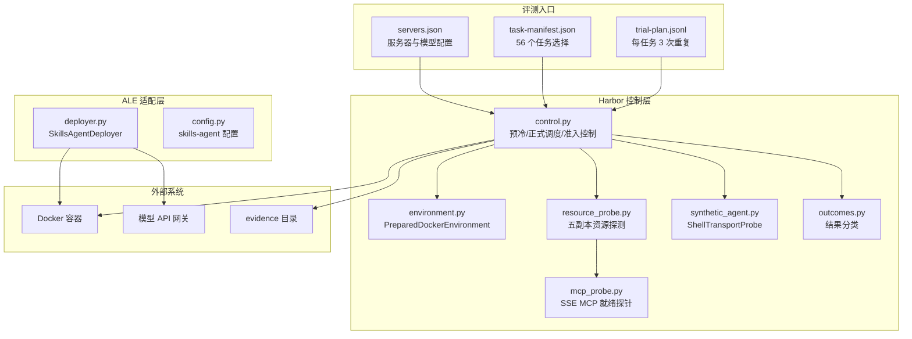
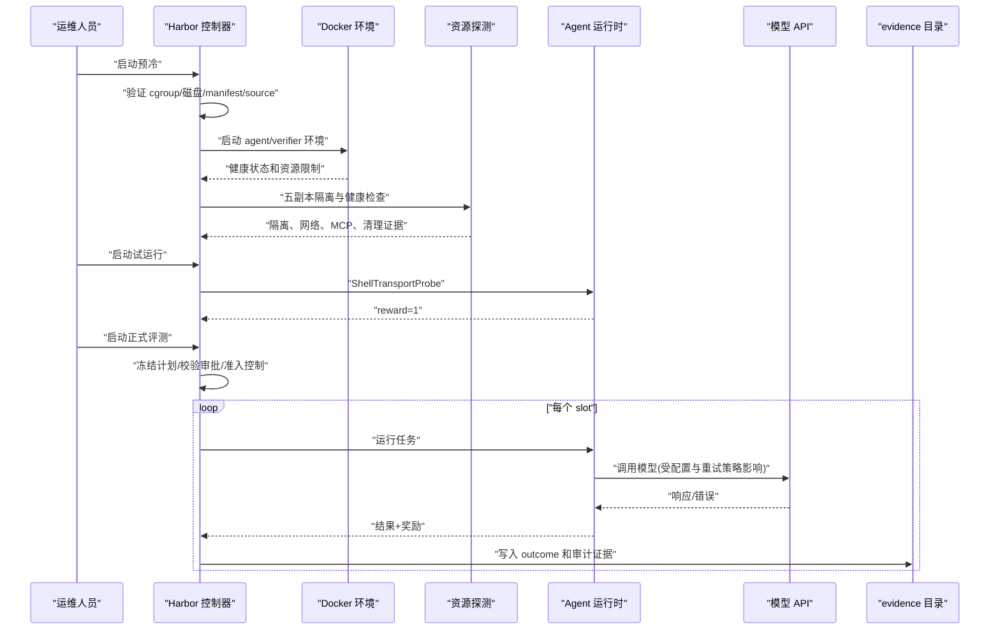
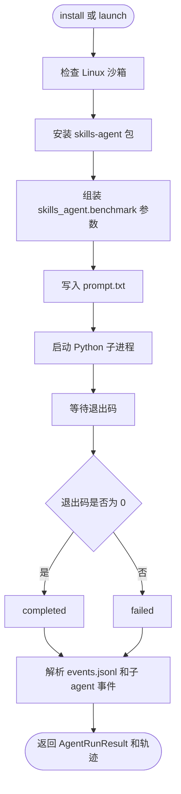
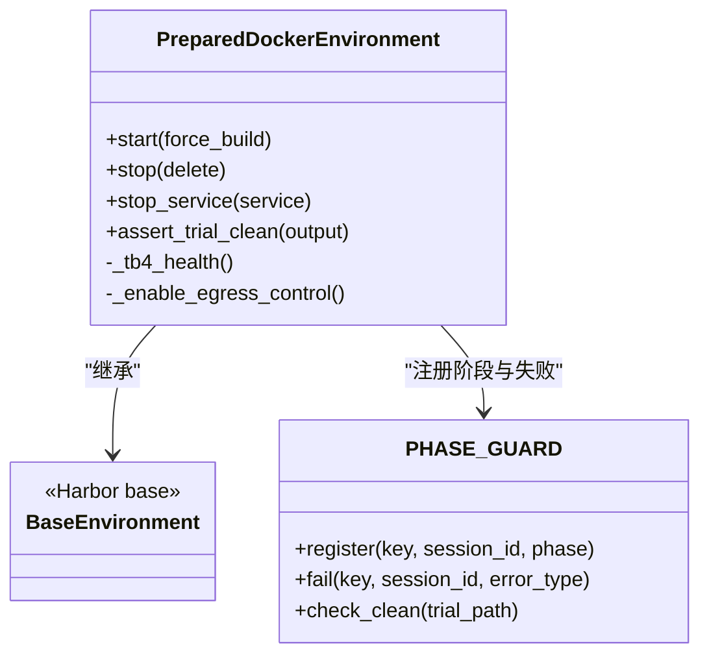
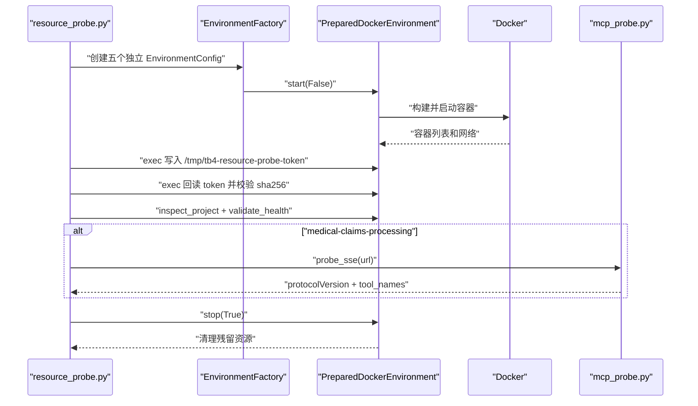
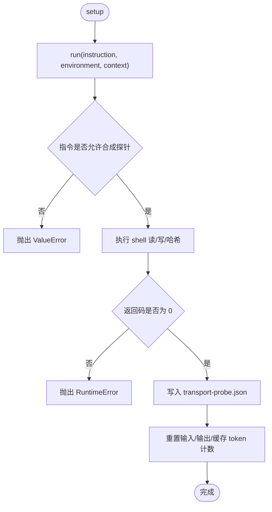
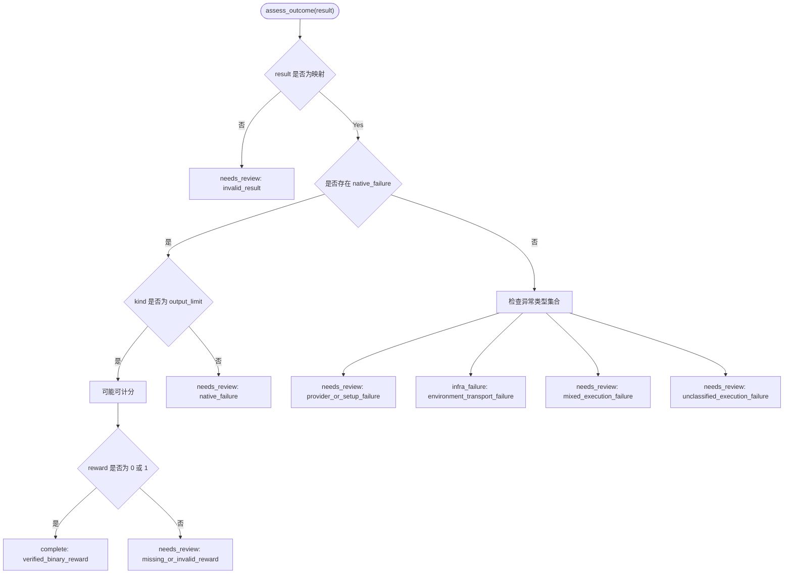
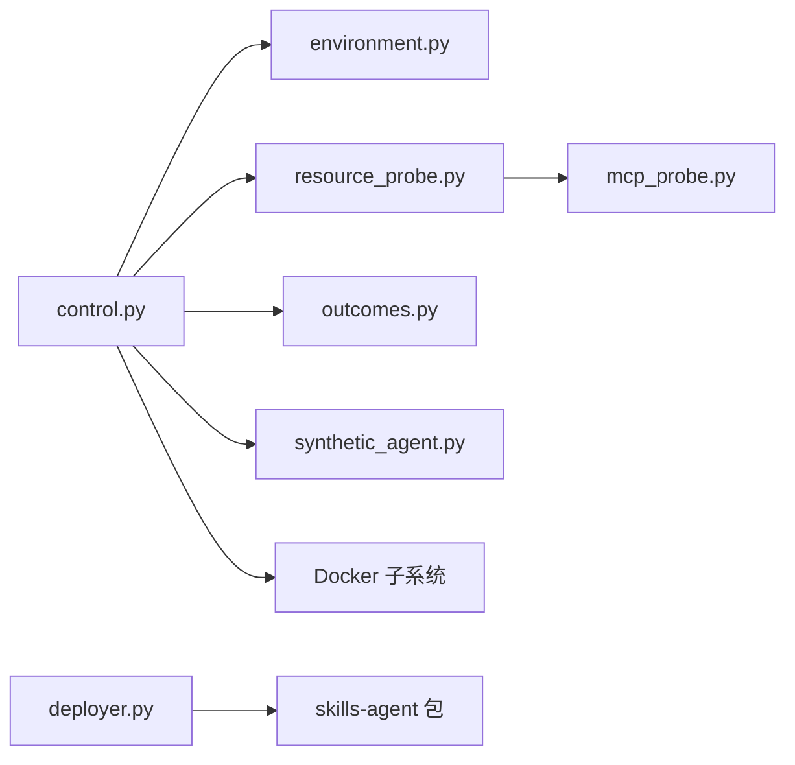

# 评测适配器

<cite>
**本文引用的文件**   
- [adapters/ale/skills_agent/deployer.py](file://adapters/ale/skills_agent/deployer.py)
- [adapters/ale/skills_agent/config.py](file://adapters/ale/skills_agent/config.py)
- [adapters/harbor/tb4_control/control.py](file://adapters/harbor/tb4_control/control.py)
- [adapters/harbor/tb4_control/environment.py](file://adapters/harbor/tb4_control/environment.py)
- [adapters/harbor/tb4_control/resource_probe.py](file://adapters/harbor/tb4_control/resource_probe.py)
- [adapters/harbor/tb4_control/mcp_probe.py](file://adapters/harbor/tb4_control/mcp_probe.py)
- [adapters/harbor/tb4_control/synthetic_agent.py](file://adapters/harbor/tb4_control/synthetic_agent.py)
- [adapters/harbor/tb4_control/outcomes.py](file://adapters/harbor/tb4_control/outcomes.py)
- [adapters/harbor/tb4_control/__main__.py](file://adapters/harbor/tb4_control/__main__.py)
- [docs/terminal-bench-4-evaluation/current-run.json](file://docs/terminal-bench-4-evaluation/current-run.json)
- [docs/terminal-bench-4-evaluation/servers.json](file://docs/terminal-bench-4-evaluation/servers.json)
- [docs/terminal-bench-4-evaluation/task-manifest.json](file://docs/terminal-bench-4-evaluation/task-manifest.json)
- [docs/terminal-bench-4-evaluation/trial-plan.jsonl](file://docs/terminal-bench-4-evaluation/trial-plan.jsonl)
- [docs/terminal-bench-4-evaluation/v5/servers.json](file://docs/terminal-bench-4-evaluation/v5/servers.json)
- [docs/terminal-bench-4-evaluation/v5/task-manifest.json](file://docs/terminal-bench-4-evaluation/v5/task-manifest.json)
- [docs/terminal-bench-4-evaluation/v5/trial-plan.jsonl](file://docs/terminal-bench-4-evaluation/v5/trial-plan.jsonl)
- [docs/terminal-bench-4-evaluation/v5/environment-validation.json](file://docs/terminal-bench-4-evaluation/v5/environment-validation.json)
</cite>

## 目录
1. [引言](#引言)
2. [项目结构](#项目结构)
3. [核心组件与职责边界](#核心组件与职责边界)
4. [架构总览](#架构总览)
5. [关键流程示例](#关键流程示例)
6. [数据文件说明](#数据文件说明)
7. [详细组件分析](#详细组件分析)
8. [依赖关系分析](#依赖关系分析)
9. [离线镜像、TLS、容器隔离与审计证据要求](#离线镜像tls容器隔离与审计证据要求)
10. [性能与并发特征](#性能与并发特征)
11. [故障排查指南](#故障排查指南)
12. [结论](#结论)

## 引言
本仓库中的评测适配器用于把 skills-agent 接入 Terminal-Bench-4 评测环境。整体由两部分组成：
- ALE 适配器：在任务沙箱内安装并运行 skills-agent，将 agent 的会话事件转换为标准轨迹。
- Harbor TB4 控制器：负责环境预冷、资源探测、MCP probe、合成 Agent 校验、正式任务调度、结果分类、证据归档和审计边界检查。

评测不直接修改业务代码，而是通过 Harbor 的环境构建能力启动 Docker 侧车服务，使用固定资源预算、cgroup 边界、磁盘保留和可复现的证据目录完成端到端评测。

## 项目结构
仓库中与评测适配器相关的主要路径如下：
- `adapters/ale/skills_agent/`：ALE 适配器和 skills-agent 部署器。
- `adapters/harbor/tb4_control/`：Harbor TB4 控制逻辑，包括预冷、资源探测、MCP probe、合成 Agent、结果分类和正式评测调度。
- `adapters/harbor/tb4_agents/`：TB4 Agent 适配器和 Skills 运行时资产，例如 MCP bridge、runtime bundle 和 tokenizer source。
- `docs/terminal-bench-4-evaluation/`：评测配置、服务器清单、任务清单、试验计划和证据记录。

**图表来源**
- [adapters/harbor/tb4_control/control.py:201-475](file://adapters/harbor/tb4_control/control.py#L201-L475)
- [adapters/harbor/tb4_control/environment.py:1-126](file://adapters/harbor/tb4_control/environment.py#L1-L126)
- [adapters/harbor/tb4_control/resource_probe.py:1-177](file://adapters/harbor/tb4_control/resource_probe.py#L1-L177)
- [adapters/harbor/tb4_control/mcp_probe.py:1-62](file://adapters/harbor/tb4_control/mcp_probe.py#L1-L62)
- [adapters/harbor/tb4_control/synthetic_agent.py:1-33](file://adapters/harbor/tb4_control/synthetic_agent.py#L1-L33)
- [adapters/harbor/tb4_control/outcomes.py:1-87](file://adapters/harbor/tb4_control/outcomes.py#L1-L87)
- [adapters/ale/skills_agent/deployer.py:1-200](file://adapters/ale/skills_agent/deployer.py#L1-L200)
- [docs/terminal-bench-4-evaluation/servers.json:1-69](file://docs/terminal-bench-4-evaluation/servers.json#L1-L69)

**章节来源**
- [adapters/harbor/tb4_control/control.py:1-200](file://adapters/harbor/tb4_control/control.py#L1-L200)
- [docs/terminal-bench-4-evaluation/servers.json:1-69](file://docs/terminal-bench-4-evaluation/servers.json#L1-L69)

## 核心组件与职责边界

| 组件 | 主要职责 | 不负责范围 |
|---|---|---|
| ALE 部署器 | 在 Linux 沙箱中安装 skills-agent 包；构造命令行参数；写入 prompt；启动进程；解析 transcript、stderr、子 agent 事件。 | 不负责模型请求重试策略、评测准入控制、容器资源配额、Harbor 生命周期管理。 |
| skills-agent 配置 | 声明 provider、model、base_url、api_key、context_tokens、max_output_tokens、summary_output_tokens、skill_dirs 等。 | 不负责评测任务选择、容器编排或证据归档。 |
| Harbor 控制器 | 验证 cgroup 边界、磁盘空间、manifest 和 trial plan；执行环境预冷、资源探测、合成 Agent；调度正式任务；分类结果；写入证据。 | 不直接实现 skills-agent 内部推理逻辑。 |
| 环境适配器 | 封装 Docker 环境生命周期；注入依赖 overlay；强制 CPU/Memory 限制；校验健康状态；清理残留资源。 | 不判断业务评测是否成功，只保证环境与资源约束正确。 |
| 资源探测 | 创建五个独立 sidecar 任务副本；验证网络隔离、shell 读写、健康检查和 MCP SSE。 | 不是真实负载峰值校准，也不是最终评分。 |
| MCP probe | 通过标准库发起 SSE MCP initialize/tools/list/browser_tabs list 等最小就绪检查。 | 不加载业务工具，只做协议与可读性验证。 |
| 合成 Agent | 用 ShellTransportProbe 做无模型 shell 读写字节级传输校验。 | 不调用任何模型，也不代表完整评测任务。 |
| 结果分类 | 根据异常类型和 native_failure 元数据判定 complete、infra_failure 或 needs_review。 | 不读取自然语言提示词或 HTTP 正文。 |
| evidence 目录 | 保存 readiness、prewarm、resource-probe、formal-launch、final-audit、current-run 等不可变证据。 | 不存储用户密钥值。 |

**章节来源**
- [adapters/ale/skills_agent/deployer.py:1-200](file://adapters/ale/skills_agent/deployer.py#L1-L200)
- [adapters/ale/skills_agent/config.py:1-35](file://adapters/ale/skills_agent/config.py#L1-L35)
- [adapters/harbor/tb4_control/environment.py:1-126](file://adapters/harbor/tb4_control/environment.py#L1-L126)
- [adapters/harbor/tb4_control/resource_probe.py:1-177](file://adapters/harbor/tb4_control/resource_probe.py#L1-L177)
- [adapters/harbor/tb4_control/mcp_probe.py:1-62](file://adapters/harbor/tb4_control/mcp_probe.py#L1-L62)
- [adapters/harbor/tb4_control/synthetic_agent.py:1-33](file://adapters/harbor/tb4_control/synthetic_agent.py#L1-L33)
- [adapters/harbor/tb4_control/outcomes.py:1-87](file://adapters/harbor/tb4_control/outcomes.py#L1-L87)

## 架构总览
评测分为三个阶段：
1. **准备阶段**：验证 cgroup、磁盘、manifest、source commit；执行 environment prewarm；执行 resource probe；生成 retained image alias。
2. **试运行阶段**：使用合成 Agent 或 transport-only 模式验证 shell 传输和 verifier reward。
3. **正式阶段**：冻结 trial plan；校验 approval；按 slot 并发运行任务；收集 outcomes；必要时暂停准入。

**图表来源**
- [adapters/harbor/tb4_control/control.py:201-475](file://adapters/harbor/tb4_control/control.py#L201-L475)
- [adapters/harbor/tb4_control/control.py:501-773](file://adapters/harbor/tb4_control/control.py#L501-L773)
- [adapters/harbor/tb4_control/environment.py:1-126](file://adapters/harbor/tb4_control/environment.py#L1-L126)
- [adapters/harbor/tb4_control/resource_probe.py:1-177](file://adapters/harbor/tb4_control/resource_probe.py#L1-L177)
- [adapters/harbor/tb4_control/synthetic_agent.py:1-33](file://adapters/harbor/tb4_control/synthetic_agent.py#L1-L33)

## 关键流程示例

### 启动评测
1. 准备 `servers.json`、`task-manifest.json`、`trial-plan.jsonl` 和模型凭证。
2. 通过 `/usr/local/sbin/tb4-exec` 进入 `tb4.slice` 环境运行控制器。
3. 先执行环境预冷，再执行资源探测，最后执行试运行。
4. 满足所有前置条件后，提交显式 approval 文件启动正式评测。

参考入口：
- 控制器主入口：[adapters/harbor/tb4_control/__main__.py:1-3](file://adapters/harbor/tb4_control/__main__.py#L1-L3)
- 正式评测入口：[adapters/harbor/tb4_control/control.py:501-773](file://adapters/harbor/tb4_control/control.py#L501-L773)
- 当前运行上下文：[docs/terminal-bench-4-evaluation/current-run.json:1-200](file://docs/terminal-bench-4-evaluation/current-run.json#L1-L200)

### 检查 readiness
- 确认 `servers.json` 中三个服务器、模型、CPU 保留、内存上限、docker root 和凭证路径一致。
- 确认 v5 环境验证已通过，包含 prewarm、resource probe、no model calls、parent boundary 和 residual resources。
- 确认控制器没有未关闭的 formal 数据库尝试。

参考：
- [docs/terminal-bench-4-evaluation/servers.json:1-69](file://docs/terminal-bench-4-evaluation/servers.json#L1-L69)
- [docs/terminal-bench-4-evaluation/v5/environment-validation.json:1-200](file://docs/terminal-bench-4-evaluation/v5/environment-validation.json#L1-L200)

### 探测资源
- 对带 sidecar 的任务创建五个独立项目。
- 检查 Docker 私有网络互不重叠。
- 在每个项目中执行 shell 写 token 并回读校验。
- 对 medical-claims-processing 任务执行 MCP SSE initialize/tools/list/browser_tabs list。
- 检查父 cgroup 的 OOM 事件。

参考：
- [adapters/harbor/tb4_control/resource_probe.py:1-177](file://adapters/harbor/tb4_control/resource_probe.py#L1-L177)
- [adapters/harbor/tb4_control/mcp_probe.py:1-62](file://adapters/harbor/tb4_control/mcp_probe.py#L1-L62)

### 运行任务
- 控制器从 trial-plan.jsonl 中筛选出指定 server 和 agent 的 168 个 slot。
- 每个 slot 最多尝试三次，仅当分类为基础设施失败时才重试。
- 并发受最大活动数、CPU 预算、内存预算和磁盘预留限制。
- 每个 worker 输出 controller-result.json 和 worker.log。

参考：
- [adapters/harbor/tb4_control/control.py:501-773](file://adapters/harbor/tb4_control/control.py#L501-L773)

### 收集 outcomes
- 控制器读取 worker result。
- 使用 `assess_outcome` 分类为 complete、infra_failure 或 needs_review。
- 需要人工审查时写入 ADMISSION_PAUSED.json 并停止新增 slot。
- 二进制奖励 0 或 1 被视为已验证结果。

参考：
- [adapters/harbor/tb4_control/outcomes.py:1-87](file://adapters/harbor/tb4_control/outcomes.py#L1-L87)
- [adapters/harbor/tb4_control/control.py:501-773](file://adapters/harbor/tb4_control/control.py#L501-L773)

## 数据文件说明

### 评测任务清单 task-manifest.json
该文件定义 Terminal-Bench-4 的选定任务集：
- 基准版本、commit、source audit sha256。
- 选择策略：56 个任务，主环境 CPU 不超过 4，无 GPU。
- 每个任务的 main_resources 和 verifier_effective_resources。
- 是否含 sidecars、sidecar_budget、agent_timeout_sec、verifier_timeout_sec。
- 计数信息：66 源任务、56 选中、10 排除、每任务每 Agent 3 次重复、总计 504 slot。

控制器会校验任务数量、唯一性、资源上限和 profile 一致性。

参考：
- [docs/terminal-bench-4-evaluation/task-manifest.json:1-200](file://docs/terminal-bench-4-evaluation/task-manifest.json#L1-L200)
- [docs/terminal-bench-4-evaluation/v5/task-manifest.json:1-200](file://docs/terminal-bench-4-evaluation/v5/task-manifest.json#L1-L200)
- [adapters/harbor/tb4_control/control.py:1-200](file://adapters/harbor/tb4_control/control.py#L1-L200)

### 服务器配置 servers.json
该文件描述评测站点、模型、硬件资源、三个服务器和凭证位置：
- site_url、model、reasoning_effort。
- reserved_cpus、benchmark_allowed_cpus、benchmark_memory_limit_gib。
- maximum_active_trials、data_mount、docker_data_root、containerd_root。
- servers 列表包含 serverA/codex、serverB/claude-code、serverC/skills-agent。
- api_gateway、credential_remote_path、credential_file_mode。
- prewarm_complete、formal_evaluation_state、formal_service、formal_output。

注意：仓库中记录凭证路径和权限模式，但不记录凭证值。

参考：
- [docs/terminal-bench-4-evaluation/servers.json:1-69](file://docs/terminal-bench-4-evaluation/servers.json#L1-L69)
- [docs/terminal-bench-4-evaluation/v5/servers.json:1-88](file://docs/terminal-bench-4-evaluation/v5/servers.json#L1-L88)

### 试验计划 trial-plan.jsonl
该文件是每行一个 JSON 对象的流式计划：
- slot_id、agent、server、task、repeat。
- benchmark_version、benchmark_commit、model、reasoning_effort。
- status 初始值为 pending。
- 控制器要求单 server 下 56 任务 × 3 重复 = 168 slot，且 model 统一。

参考：
- [docs/terminal-bench-4-evaluation/trial-plan.jsonl:1-42](file://docs/terminal-bench-4-evaluation/trial-plan.jsonl#L1-L42)
- [docs/terminal-bench-4-evaluation/v5/trial-plan.jsonl:1-42](file://docs/terminal-bench-4-evaluation/v5/trial-plan.jsonl#L1-L42)
- [adapters/harbor/tb4_control/control.py:501-773](file://adapters/harbor/tb4_control/control.py#L501-L773)

### evidence 目录
evidence 目录保存各阶段不可变审计证据，包括：
- readiness、environment-validation、formal-launch、formal-stop-status。
- resource-probe summary。
- skills bundle install、release、repair、tests。
- final-audit-serverA/B/C。
- current-run、diagnostics、evidence-provenance。

证据的作用是提供可复核的运行快照，而不是替换原始 outcome。

参考：
- [docs/terminal-bench-4-evaluation/current-run.json:1-200](file://docs/terminal-bench-4-evaluation/current-run.json#L1-L200)
- [docs/terminal-bench-4-evaluation/v5/environment-validation.json:1-200](file://docs/terminal-bench-4-evaluation/v5/environment-validation.json#L1-L200)

## 详细组件分析

### ALE 部署器 SkillsAgentDeployer
ALE 部署器是 skills-agent 在 ALE sandbox executor 中的包装。它负责：
- 校验 executor 操作系统为 Linux。
- 在 work_dir 安装 skills-agent 包。
- 构造 `skills_agent.benchmark` 命令行参数，包括 prompt-file、workspace、log-dir、provider、model、context-tokens、api-format、token-counter、max-output-tokens、summary-output-tokens、base-url、model-context-window、skill-dir。
- 通过环境变量注入 provider API key。
- 启动进程并等待退出码，返回 completed 或 failed。
- 解析 session/events.jsonl 和 subagents 事件，生成 TrajectoryBuilder 步骤。
- 处理 message、tool、error、subagent_summary 事件。

**图表来源**
- [adapters/ale/skills_agent/deployer.py:1-200](file://adapters/ale/skills_agent/deployer.py#L1-L200)

**章节来源**
- [adapters/ale/skills_agent/deployer.py:1-200](file://adapters/ale/skills_agent/deployer.py#L1-L200)
- [adapters/ale/skills_agent/config.py:1-35](file://adapters/ale/skills_agent/config.py#L1-L35)

### Harbor 环境适配器 PreparedDockerEnvironment
环境适配器继承 Harbor 的 Docker 环境，并在启动前后增加评测保护：
- 对 FreeCAD 相关 verifier 构建依赖进行 overlay 替换。
- 注入固定资源 compose overlay。
- 注册 phase guard，区分 agent 和 verifier 阶段。
- start() 后校验健康状态和服务能力。
- stop_service() 前捕获健康快照，防止后续操作掩盖失败。
- stop() 后检查残留容器、网络和卷。
- 在正式结果发布前再次检查 trial 是否干净。

**图表来源**
- [adapters/harbor/tb4_control/environment.py:1-126](file://adapters/harbor/tb4_control/environment.py#L1-L126)

**章节来源**
- [adapters/harbor/tb4_control/environment.py:1-126](file://adapters/harbor/tb4_control/environment.py#L1-L126)

### 资源探测与 MCP probe
资源探测对九个 reviewed sidecar 任务分别创建五个独立副本，确保：
- 每个项目有独立 Docker 网络。
- 每个项目能执行 shell 写入并回读 token。
- 长寿命 sidecar 的健康检查通过。
- medical-claims-processing 的 MCP SSE 可列出 tools。
- 父 cgroup 没有 OOM 事件。
- 结束后全部清理。

MCP probe 使用标准库发起 SSE 连接，完成 initialize、notifications/initialized、tools/list，并在存在 browser_tabs 时执行只读 list。

**图表来源**
- [adapters/harbor/tb4_control/resource_probe.py:1-177](file://adapters/harbor/tb4_control/resource_probe.py#L1-L177)
- [adapters/harbor/tb4_control/mcp_probe.py:1-62](file://adapters/harbor/tb4_control/mcp_probe.py#L1-L62)

**章节来源**
- [adapters/harbor/tb4_control/resource_probe.py:1-177](file://adapters/harbor/tb4_control/resource_probe.py#L1-L177)
- [adapters/harbor/tb4_control/mcp_probe.py:1-62](file://adapters/harbor/tb4_control/mcp_probe.py#L1-L62)

### 合成 Agent ShellTransportProbe
合成 Agent 是一个确定性 shell 传输探针：
- 名称固定为 tb4-shell-transport-check。
- 仅在指令以特定前缀开头时运行，禁止用于普通 benchmark 任务。
- 执行命令：读取 /app/input.txt，写入 /app/answer.txt，并计算 sha256sum。
- 输出 transport-probe.json，包含 no_model_calls、synthetic_task_only、stdout、return_code。
- 设置 context token 计数为零，表示无模型调用。

**图表来源**
- [adapters/harbor/tb4_control/synthetic_agent.py:1-33](file://adapters/harbor/tb4_control/synthetic_agent.py#L1-L33)

**章节来源**
- [adapters/harbor/tb4_control/synthetic_agent.py:1-33](file://adapters/harbor/tb4_control/synthetic_agent.py#L1-L33)

### 结果分类 assess_outcome
结果分类不搜索文本中的 HTTP 状态码，只基于结构化字段：
- native_failure.kind 决定原生失败语义。
- exception_info/controller_error.exception_type 决定框架失败语义。
- PROVIDER_OR_SETUP_FAILURES 标记为 needs_review。
- REPLACEABLE_INFRA_FAILURES 全匹配时为 infra_failure。
- SCORABLE_AGENT_LIMITS 属于可计分限制。
- 二元奖励 0 或 1 标记为 complete。
- 其他情况标记为 needs_review。

**图表来源**
- [adapters/harbor/tb4_control/outcomes.py:1-87](file://adapters/harbor/tb4_control/outcomes.py#L1-L87)

**章节来源**
- [adapters/harbor/tb4_control/outcomes.py:1-87](file://adapters/harbor/tb4_control/outcomes.py#L1-L87)

## 依赖关系分析
- control.py 是主控模块，聚合 manifest、profile、disk、boundary、prewarm、resource probe、formal scheduling 和 outcome classification。
- environment.py 扩展 Harbor 的 Docker 环境，加入资源覆盖、健康检查和清理验证。
- resource_probe.py 依赖 environment.py、mcp_probe.py 和 control.py 的公共函数。
- mcp_probe.py 是轻量级标准库依赖，避免引入额外模型客户端。
- synthetic_agent.py 依赖 Harbor 的 BaseAgent/BaseEnvironment，但明确拒绝非合成指令。
- outcomes.py 被 control.py 在正式调度循环中调用。
- ALE deployer.py 依赖 ale_run 接口和 skills_agent 包，不耦合 Harbor 控制器。

**图表来源**
- [adapters/harbor/tb4_control/control.py:1-200](file://adapters/harbor/tb4_control/control.py#L1-L200)
- [adapters/harbor/tb4_control/environment.py:1-126](file://adapters/harbor/tb4_control/environment.py#L1-L126)
- [adapters/harbor/tb4_control/resource_probe.py:1-177](file://adapters/harbor/tb4_control/resource_probe.py#L1-L177)
- [adapters/harbor/tb4_control/mcp_probe.py:1-62](file://adapters/harbor/tb4_control/mcp_probe.py#L1-L62)
- [adapters/harbor/tb4_control/synthetic_agent.py:1-33](file://adapters/harbor/tb4_control/synthetic_agent.py#L1-L33)
- [adapters/ale/skills_agent/deployer.py:1-200](file://adapters/ale/skills_agent/deployer.py#L1-L200)

**章节来源**
- [adapters/harbor/tb4_control/control.py:1-200](file://adapters/harbor/tb4_control/control.py#L1-L200)
- [adapters/harbor/tb4_control/environment.py:1-126](file://adapters/harbor/tb4_control/environment.py#L1-L126)
- [adapters/harbor/tb4_control/resource_probe.py:1-177](file://adapters/harbor/tb4_control/resource_probe.py#L1-L177)

## 离线镜像、TLS、容器隔离与审计证据要求

### 离线镜像
- 预冷阶段使用 `force_build=False`，优先复用已有镜像。
- 启动后为每个容器的 main 服务创建 `tb4-prewarm/{task}-{phase}-{service}:{image_short}` 别名。
- 删除容器和卷后，仍可通过 retained_image_alias 验证镜像是否仍存在。
- 正式评测要求 prewarm summary 中有 112 个 passed 阶段和 112 个 retained image phases。

参考：
- [adapters/harbor/tb4_control/control.py:201-475](file://adapters/harbor/tb4_control/control.py#L201-L475)

### TLS 认证
- servers.json 和 current-run.json 显示 api_gateway、site_binding_status、credential_remote_path、credential_file_mode。
- 当前运行记录中包含 ordinary_http_probe_history，记录了 models 端点和消息端点的 HTTP 状态。
- 控制器不直接读取凭证值，凭证通过外部 secret 文件加载。
- TLS 问题表现为 HTTP 探针失败，但控制器更关注 native client 行为、verifier reward 和 outcome 分类。

参考：
- [docs/terminal-bench-4-evaluation/servers.json:1-69](file://docs/terminal-bench-4-evaluation/servers.json#L1-L69)
- [docs/terminal-bench-4-evaluation/current-run.json:1-200](file://docs/terminal-bench-4-evaluation/current-run.json#L1-L200)

### 容器隔离
- 控制器要求运行在 `/tb4.slice/` cgroup 下。
- 容器必须位于 tb4.slice，否则抛出逃逸错误。
- 每个 project 使用独立 Compose project label 和私有 Docker 网络。
- 资源探测要求五个副本的网络 ID 互不重叠。
- 环境适配器在 stop() 后检查残留容器、网络和卷。

参考：
- [adapters/harbor/tb4_control/control.py:1-200](file://adapters/harbor/tb4_control/control.py#L1-L200)
- [adapters/harbor/tb4_control/control.py:201-475](file://adapters/harbor/tb4_control/control.py#L201-L475)
- [adapters/harbor/tb4_control/resource_probe.py:1-177](file://adapters/harbor/tb4_control/resource_probe.py#L1-L177)
- [adapters/harbor/tb4_control/environment.py:1-126](file://adapters/harbor/tb4_control/environment.py#L1-L126)

### 审计证据
- 预冷、资源探测、formal launch、formal stop、environment validation、final audit 均写入 evidence。
- 证据包含 no_model_calls、preparation_identity、controller_tree_sha256、dataset_commit、frozen plan 等。
- 证据目录中的 legacy paths 被禁止直接覆盖。
- current-run.json 记录实验、gateway、model、credentials metadata、independent_startup_audit 和 previous_blocker。

参考：
- [docs/terminal-bench-4-evaluation/v5/environment-validation.json:1-200](file://docs/terminal-bench-4-evaluation/v5/environment-validation.json#L1-L200)
- [docs/terminal-bench-4-evaluation/current-run.json:1-200](file://docs/terminal-bench-4-evaluation/current-run.json#L1-L200)
- [adapters/harbor/tb4_control/resource_probe.py:1-177](file://adapters/harbor/tb4_control/resource_probe.py#L1-L177)

## 性能与并发特征
- 预冷阶段使用线程池执行多任务，同时维护 active 队列和 disk_check。
- 构建工作槽占用固定 slot CPU 和内存，并预留构建开销。
- 正式评测默认 MAX_CONCURRENT=5，CPU_BUDGET=28.0，MEMORY_MB_BUDGET=107 GiB。
- 每个 slot 分配 SLOT_CPUS=5，SLOT_MEMORY_MB=21 GiB。
- 磁盘保留按 task 的 main_resources.storage_mb 和 verifier_effective_resources.storage_mb 最大值计算。
- 空闲采样仅用于 admission 参考，不声称 workload peak calibration。

参考：
- [adapters/harbor/tb4_control/control.py:1-200](file://adapters/harbor/tb4_control/control.py#L1-L200)
- [adapters/harbor/tb4_control/control.py:201-475](file://adapters/harbor/tb4_control/control.py#L201-L475)
- [adapters/harbor/tb4_control/control.py:501-773](file://adapters/harbor/tb4_control/control.py#L501-L773)

## 故障排查指南

### 评测失败
- 查看 controller-result.json 和 worker.log。
- 使用 classify_result 或 assess_outcome 判断是 complete、infra_failure 还是 needs_review。
- 如果是 infrastructure failure，最多重试一次（attempt 从 0 开始，next_slot_status 允许第三次尝试）。
- 如果 pause_admission 为真，检查 ADMISSION_PAUSED.json 中的 reason、slot_id、attempt、error_type。

参考：
- [adapters/harbor/tb4_control/outcomes.py:1-87](file://adapters/harbor/tb4_control/outcomes.py#L1-L87)
- [adapters/harbor/tb4_control/control.py:501-773](file://adapters/harbor/tb4_control/control.py#L501-L773)

### 镜像不可用
- 检查 prewarm report.json 中 status 是否为 passed 或 shared_environment。
- 检查 retained_image_alias 是否存在于 docker image inspect。
- 如果 retained images 缺失，需要重新执行 environment preparation。
- 不要覆盖 legacy runs/prewarm 或 runs/formal 目录。

参考：
- [adapters/harbor/tb4_control/control.py:201-475](file://adapters/harbor/tb4_control/control.py#L201-L475)

### 探针超时
- 预冷 build_timeout_sec 控制环境构建超时。
- shell/exec 探针使用 30 秒超时。
- MCP probe 默认 45 秒超时。
- ALE deployer 的 _wait 在 SIGTERM 时尝试优雅终止并最多等待 8 秒，然后强制 kill 进程组。

参考：
- [adapters/harbor/tb4_control/resource_probe.py:1-177](file://adapters/harbor/tb4_control/resource_probe.py#L1-L177)
- [adapters/harbor/tb4_control/mcp_probe.py:1-62](file://adapters/harbor/tb4_control/mcp_probe.py#L1-L62)
- [adapters/ale/skills_agent/deployer.py:1-200](file://adapters/ale/skills_agent/deployer.py#L1-L200)

### 服务器状态不一致
- 对比 servers.json 中的 serverA/serverB/serverC、agent、address、api_key_ref、formal_evaluation_state。
- 对照 current-run.json 中的 installed_servers、formal_started、independent_startup_audit.all_three_running。
- 检查 formal service 是否处于 inactive 或 running，以及 credential file mode 是否为 0600。

参考：
- [docs/terminal-bench-4-evaluation/servers.json:1-69](file://docs/terminal-bench-4-evaluation/servers.json#L1-L69)
- [docs/terminal-bench-4-evaluation/current-run.json:1-200](file://docs/terminal-bench-4-evaluation/current-run.json#L1-L200)

### 证据缺失
- 检查对应阶段的 report.json、summary.json、formal-launch-status.json、final-audit-server*.json。
- 检查 environment-validation.json 是否包含 prewarm、resource probe、no model calls、parent boundary。
- 若 evidence 指向的路径不存在，应先恢复对应 run 目录，而不是手动伪造 JSON。

参考：
- [docs/terminal-bench-4-evaluation/v5/environment-validation.json:1-200](file://docs/terminal-bench-4-evaluation/v5/environment-validation.json#L1-L200)
- [docs/terminal-bench-4-evaluation/current-run.json:1-200](file://docs/terminal-bench-4-evaluation/current-run.json#L1-L200)

## 结论
评测适配器的设计目标是把 skills-agent 安全、可审计地接入 Terminal-Bench-4。其核心思想是：
- 用 ALE 部署器隔离 skills-agent 的安装和执行。
- 用 Harbor 控制器管理 Docker 环境、资源预算和正式调度。
- 用预冷、资源探测、MCP probe、合成 Agent 建立无模型调用的基础设施就绪证据。
- 用 frozen manifest、frozen trial plan、approval file 和 cgroup/disk/Docker 边界保证正式评测可复现。
- 用 outcomes 分类和 evidence 目录区分“可计分结果”“基础设施失败”和“需要人工审查”。

在实际操作中，应优先检查 servers.json、task-manifest.json、trial-plan.jsonl 的一致性，再检查 prewarm、resource probe 和 evidence 完整性，最后才观察正式运行的 outcome 和 worker 日志。