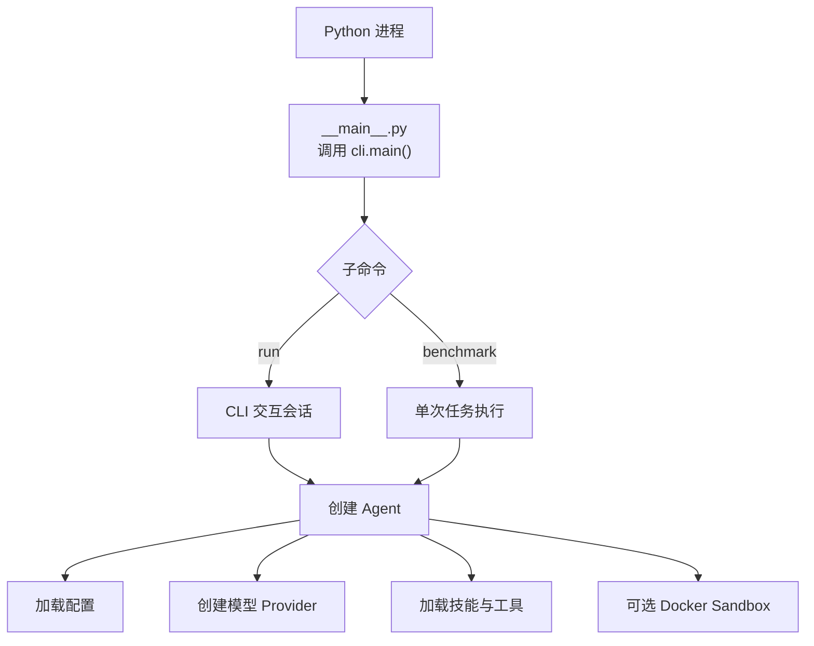
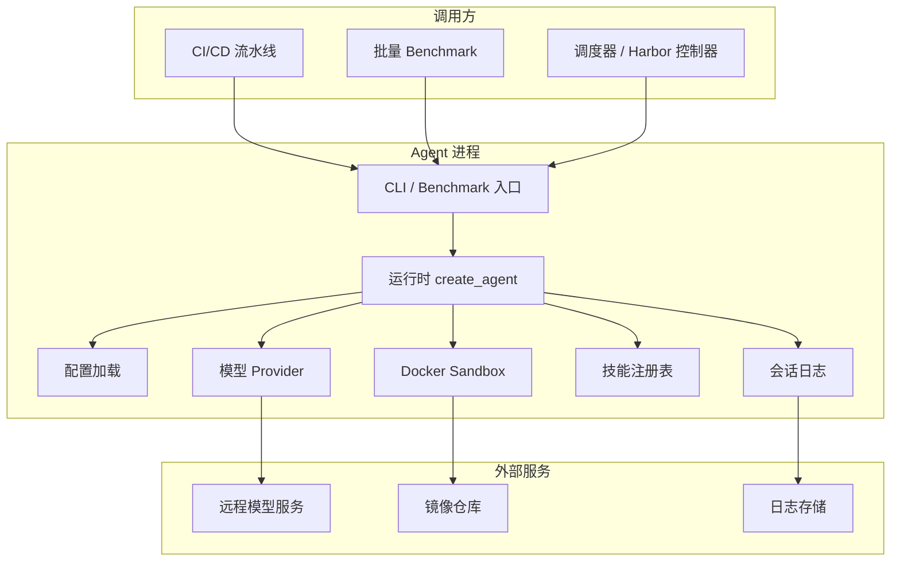
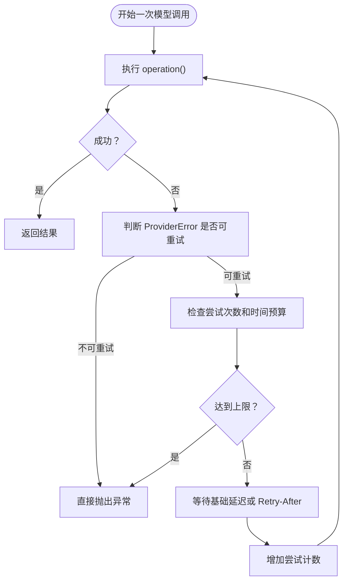
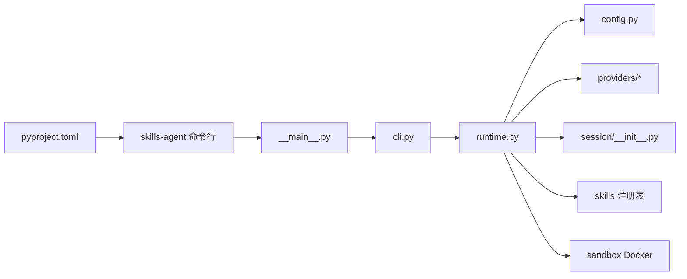
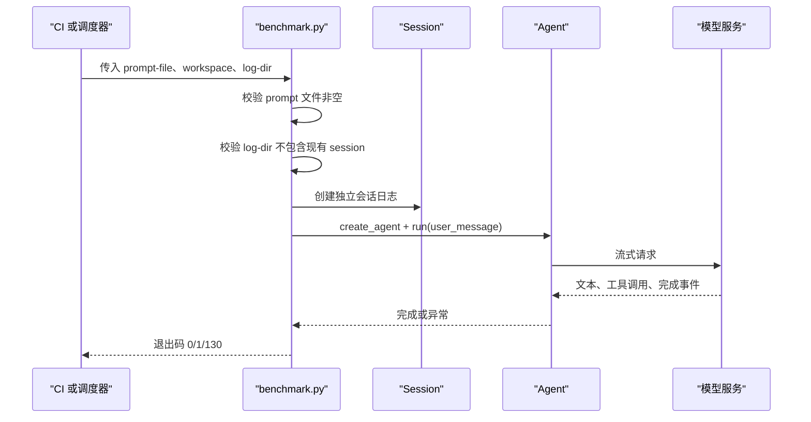
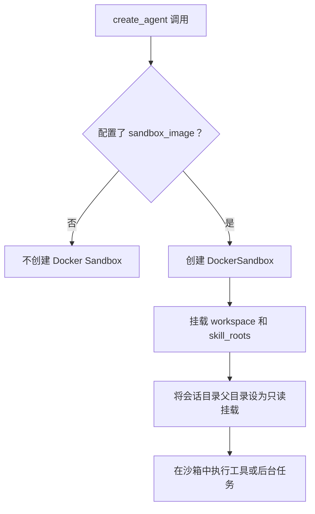

# 部署与生产环境

<cite>
**本文引用的文件**   
- [README.md](file://README.md)
- [skills-agent.toml](file://skills-agent.toml)
- [pyproject.toml](file://pyproject.toml)
- [docs/usage.md](file://docs/usage.md)
- [skills_agent/__main__.py](file://skills_agent/__main__.py)
- [skills_agent/cli.py](file://skills_agent/cli.py)
- [skills_agent/config.py](file://skills_agent/config.py)
- [skills_agent/runtime.py](file://skills_agent/runtime.py)
- [skills_agent/benchmark.py](file://skills_agent/benchmark.py)
- [skills_agent/environment.py](file://skills_agent/environment.py)
- [skills_agent/session/__init__.py](file://skills_agent/session/__init__.py)
- [skills_agent/images.py](file://skills_agent/images.py)
- [skills_agent/providers/base.py](file://skills_agent/providers/base.py)
- [skills_agent/providers/retry.py](file://skills_agent/providers/retry.py)
- [adapters/harbor/tb4_control/resource-profile.json](file://adapters/harbor/tb4_control/resource-profile.json)
- [adapters/harbor/tb4_control/conservative-sidecar-budgets.json](file://adapters/harbor/tb4_control/conservative-sidecar-budgets.json)
- [adapters/harbor/tb4_control/resources.py](file://adapters/harbor/tb4_control/resources.py)
</cite>

## 目录
1. [引言](#引言)
2. [项目结构与运行入口](#项目结构与运行入口)
3. [核心组件](#核心组件)
4. [架构总览](#架构总览)
5. [详细组件分析](#详细组件分析)
6. [依赖关系分析](#依赖关系分析)
7. [资源配置最佳实践](#资源配置最佳实践)
8. [最小生产配置模板](#最小生产配置模板)
9. [非交互式环境与批量基准测试](#非交互式环境与批量基准测试)
10. [容器化与沙箱镜像管理](#容器化与沙箱镜像管理)
11. [密钥、日志与会话隔离](#密钥日志与会话隔离)
12. [网络安全要求](#网络安全要求)
13. [常见问题排查清单](#常见问题排查清单)
14. [结论](#结论)

## 引言
本指导文档面向 CI/CD 流水线、批量 benchmark、远程模型服务和容器化生产环境。目标是在不依赖交互终端的情况下稳定运行 skills-agent，并给出 context_tokens、model_context_window、max_output_tokens、summary_output_tokens 以及 sidecar 资源预算的选型建议，同时覆盖密钥管理、日志留存、会话目录隔离、sandbox 镜像管理和网络安全要求。

## 项目结构与运行入口
skills-agent 是一个 Python CLI Agent，通过 `python -m skills_agent` 或安装后的 `skills-agent` 命令启动。主入口调用命令行模块，再根据子命令进入交互运行或 benchmark 模式。

**图表来源**
- [skills_agent/__main__.py:1-3](file://skills_agent/__main__.py#L1-L3)
- [skills_agent/cli.py:1-200](file://skills_agent/cli.py#L1-L200)
- [skills_agent/runtime.py:1-58](file://skills_agent/runtime.py#L1-L58)

**章节来源**
- [README.md:1-68](file://README.md#L1-L68)
- [pyproject.toml:1-23](file://pyproject.toml#L1-L23)
- [skills_agent/__main__.py:1-3](file://skills_agent/__main__.py#L1-L3)

## 核心组件
- **命令行与渲染层**：负责解析参数、处理交互输入、输出摘要和完整历史回放。
- **配置层**：合并命令行参数、TOML 配置文件、环境变量和内置默认值，并校验 token 类配置为正整数。
- **运行时层**：创建工作目录、模型 Provider、技能注册表和可选 sandbox。
- **会话层**：追加式 JSONL 事件日志，保存附件副本，限制请求图片数量。
- **Provider 层**：封装 OpenAI/Anthropic 等模型接口、错误分类、重试和用量计量。
- **基准测试入口**：从 prompt 文件读取任务，创建独立 session 日志，失败时返回明确退出码。
- **环境信息**：在初始化时采集工作目录、Git 仓库状态、平台、shell 和操作系统版本。

**章节来源**
- [skills_agent/cli.py:1-200](file://skills_agent/cli.py#L1-L200)
- [skills_agent/config.py:1-74](file://skills_agent/config.py#L1-L74)
- [skills_agent/runtime.py:1-58](file://skills_agent/runtime.py#L1-L58)
- [skills_agent/session/__init__.py:1-113](file://skills_agent/session/__init__.py#L1-L113)
- [skills_agent/providers/base.py:1-200](file://skills_agent/providers/base.py#L1-L200)
- [skills_agent/benchmark.py:1-59](file://skills_agent/benchmark.py#L1-L59)
- [skills_agent/environment.py:1-76](file://skills_agent/environment.py#L1-L76)

## 架构总览
下图展示生产环境中各组件的关系：外部调用者（CI、批处理任务、调度器）通过 CLI 或 benchmark 入口启动 agent；agent 加载配置后连接远程模型服务，必要时拉取 sandbox 镜像并在受限容器中执行 shell 或后台任务；所有消息写入会话目录，日志由上层系统收集。

**图表来源**
- [skills_agent/cli.py:1-200](file://skills_agent/cli.py#L1-L200)
- [skills_agent/runtime.py:1-58](file://skills_agent/runtime.py#L1-L58)
- [skills_agent/session/__init__.py:1-113](file://skills_agent/session/__init__.py#L1-L113)
- [skills_agent/providers/base.py:1-200](file://skills_agent/providers/base.py#L1-L200)

## 详细组件分析

### 配置与优先级
配置加载遵循“显式命令行参数 > TOML 配置文件 > 已支持环境变量 > 内置默认值”。API key 只从环境变量读取，不写入 TOML。token 相关字段必须为正整数，provider、api_format、token_counter 等字段有枚举校验。

关键行为：
- 默认 provider 为 openai，默认 context_tokens 使用上下文模块中的默认值，默认 max_output_tokens 使用 Provider 默认值。
- environment 中支持 provider 上层的 model、base_url，以及 SKILLS_AGENT_API_FORMAT、SKILLS_AGENT_TOKEN_COUNTER。
- skill_dirs 是相对配置文件所在目录解析的路径列表。
- sandbox_image 用于启用可选的 Docker sandbox。

**章节来源**
- [skills_agent/config.py:1-74](file://skills_agent/config.py#L1-L74)
- [skills_agent/runtime.py:1-58](file://skills_agent/runtime.py#L1-L58)
- [skills-agent.toml:1-18](file://skills-agent.toml#L1-L18)

### 模型 Provider 与错误分类
Provider 层统一处理不同模型的流式响应、错误分类、重试策略和用量计量。它定义可重试类别，如连接失败、限流、服务端错误、网关超时；也区分输出限制、内容过滤、认证失败等不可重试或需要业务处理的错误。

重要特性：
- 结构化错误提取 HTTP 状态、provider code/type、finish reason。
- retry_after_seconds 支持 Retry-After 头部数值或时间戳。
- 分类结果决定 retry_call 是否继续重试。

**章节来源**
- [skills_agent/providers/base.py:1-200](file://skills_agent/providers/base.py#L1-L200)

### 重试机制
retry_call 对单个模型操作进行重试，不重放已完成工具调用，也不合并部分响应。默认基础延迟为固定秒数，并可结合服务器 Retry-After 头。可通过环境变量控制最大尝试次数和重试时间预算。

重试决策流程如下：

**图表来源**
- [skills_agent/providers/retry.py:1-86](file://skills_agent/providers/retry.py#L1-L86)
- [skills_agent/providers/base.py:1-200](file://skills_agent/providers/base.py#L1-L200)

**章节来源**
- [skills_agent/providers/retry.py:1-86](file://skills_agent/providers/retry.py#L1-L86)

### 会话与会话目录隔离
Session 以追加方式写入 events.jsonl，每个会话拥有独立目录。附件会被复制到会话目录，图片最多允许 10 张，单张图片最大字节数受限制。会话 ID 仅允许字母、数字、点、下划线和连字符。

生产要点：
- 每次 benchmark 使用独立日志目录，若目录已存在则报错。
- 会话恢复通过同一 session_id 读取已有 events.jsonl。
- 附件路径和 URL 会投影到模型请求中，但不会无限制放大请求体。

**章节来源**
- [skills_agent/session/__init__.py:1-113](file://skills_agent/session/__init__.py#L1-L113)
- [skills_agent/images.py:1-109](file://skills_agent/images.py#L1-L109)
- [skills_agent/benchmark.py:1-59](file://skills_agent/benchmark.py#L1-L59)

### 环境信息采集
Agent 初始化时会采集工作目录、是否为 Git 仓库、平台、实际执行 shell 和操作系统版本，并将这些信息加入系统提示词。采集过程是尽力而为，失败字段回退为 unknown，且不阻止会话启动。

**章节来源**
- [skills_agent/environment.py:1-76](file://skills_agent/environment.py#L1-L76)
- [docs/usage.md:1-161](file://docs/usage.md#L1-L161)

## 依赖关系分析
- 构建与依赖：Python >= 3.11，依赖 PyYAML、Rich、prompt-toolkit、Pillow。
- CLI 脚本：通过 pyproject 暴露 `skills-agent` 入口。
- 运行时依赖：Agent、Provider、Session、SkillRegistry、DockerSandbox。
- Harbor 适配器侧的资源配置、sidecar 预算和资源审计属于评测/调度基础设施，与 agent 自身代码解耦，但影响生产部署时的资源分配。

**图表来源**
- [pyproject.toml:1-23](file://pyproject.toml#L1-L23)
- [skills_agent/__main__.py:1-3](file://skills_agent/__main__.py#L1-L3)
- [skills_agent/cli.py:1-200](file://skills_agent/cli.py#L1-L200)
- [skills_agent/runtime.py:1-58](file://skills_agent/runtime.py#L1-L58)

**章节来源**
- [pyproject.toml:1-23](file://pyproject.toml#L1-L23)
- [skills_agent/runtime.py:1-58](file://skills_agent/runtime.py#L1-L58)

## 资源配置最佳实践

### Token 配置原则
- **context_tokens**：工作上下文预算。当接近 min(context_tokens, model_context_window) × 80% 时触发上下文压缩。
- **model_context_window**：模型实际总窗口。发送输入加输出额度必须能装进该窗口。
- **max_output_tokens**：单次输出额度，包含思考。
- **summary_output_tokens**：辅助生成输出上限，摘要调用关闭思考。

推荐规则：
1. 将 model_context_window 设置为所用模型官方支持的最大上下文窗口。
2. 将 context_tokens 设置为略小于或等于 model_context_window，留出输出空间。
3. 将 max_output_tokens 设置为模型官方支持的最大输出上限。
4. 将 summary_output_tokens 设为较小值，避免辅助调用再次占满上下文。
5. 若使用 usage 计量模式，注意有效输入预算为 min(context_tokens, model_context_window - max_output_tokens)，压缩阈值取该预算与 80% 阈值的较小值。

参考示例值：
- 小模型或低延迟场景：context_tokens 约 32768 至 65536，max_output_tokens 约 8192 至 32768。
- 大模型 1M 上下文：context_tokens 和 model_context_window 设为 1000000 左右，max_output_tokens 设为 128000 至 384000，summary_output_tokens 保持 8192 左右。

**章节来源**
- [docs/usage.md:1-161](file://docs/usage.md#L1-L161)
- [skills-agent.toml:1-18](file://skills-agent.toml#L1-L18)
- [skills_agent/config.py:1-74](file://skills_agent/config.py#L1-L74)
- [skills_agent/providers/base.py:1-200](file://skills_agent/providers/base.py#L1-L200)

### Sidecar 预算与资源 Profile
Harbor 评测环境使用冻结的 resource-profile.json 和 resources.py 验证 sidecar 资源。其特点包括：
- 固定 slot 容量，例如 5 个并发 slot，每个 slot 限制 CPU 和内存。
- 父级 admission pool 和 host_reserved 预留主机资源。
- sidecar 服务数量和 CPU/Memory 上限被审计，不允许随意扩大 phase envelope。
- conservative-sidecar-budgets.json 中对缺乏峰值证据的任务采用保守策略，保留整个 admission pool，并保留官方容器设置。

生产建议：
- 不要直接把 agent 与大量 sidecar 放在同一高并发 slot；优先为 long-lived 服务分配独占资源。
- 对没有真实负载峰值数据的 sidecar，采用保守预算，避免挤占 agent 主任务。
- 使用 profile 中定义的 slot_cpus 和 slot_memory_mb 作为单任务上限，而不是无限叠加。
- 对网络 egress helper 这类常驻 sidecar，单独评估 CPU 和内存，并纳入整体 admission 预算。

**章节来源**
- [adapters/harbor/tb4_control/resource-profile.json:1-200](file://adapters/harbor/tb4_control/resource-profile.json#L1-L200)
- [adapters/harbor/tb4_control/conservative-sidecar-budgets.json:1-47](file://adapters/harbor/tb4_control/conservative-sidecar-budgets.json#L1-L47)
- [adapters/harbor/tb4_control/resources.py:1-200](file://adapters/harbor/tb4_control/resources.py#L1-L200)

## 最小生产配置模板
以下模板适合非交互环境。请将密钥放入环境变量，不要把 API key 写进 TOML。

环境变量：
- OPENAI_API_KEY 或 ANTHROPIC_API_KEY
- OPENAI_MODEL 或 ANTHROPIC_MODEL
- OPENAI_BASE_URL 或 ANTHROPIC_BASE_URL（可选）
- SKILLS_AGENT_PROVIDER_MAX_ATTEMPTS（可选）
- SKILLS_AGENT_PROVIDER_RETRY_BUDGET_SECONDS（可选）

TOML 配置示例：
- provider：openai 或 anthropic
- model：对应模型名称
- base_url：兼容服务根地址
- api_format：auto、responses 或 chat
- token_counter：auto、official 或 usage
- context_tokens：工作上下文预算
- model_context_window：模型实际窗口
- max_output_tokens：单次输出上限
- summary_output_tokens：辅助生成上限
- sandbox_image：可选 Docker 镜像

注意事项：
- 所有 *_tokens 和 model_context_window 必须是正整数。
- 如果 gateway 返回 structured GatewayTimeout，应确保重试逻辑能识别该类错误。
- 若使用 responses 协议且 gateway 提供 usage 字段，可设置 token_counter=usage。

**章节来源**
- [skills-agent.toml:1-18](file://skills-agent.toml#L1-L18)
- [skills_agent/config.py:1-74](file://skills_agent/config.py#L1-L74)
- [skills_agent/providers/base.py:1-200](file://skills_agent/providers/base.py#L1-L200)
- [skills_agent/providers/retry.py:1-86](file://skills_agent/providers/retry.py#L1-L86)

## 非交互式环境与批量基准测试

### CI/CD 流水线
推荐步骤：
1. 准备 Python 虚拟环境和依赖。
2. 注入密钥环境变量。
3. 放置 skills-agent.toml。
4. 选择 run 或 benchmark 子命令。
5. 指定 --session、--workspace、--log-dir。
6. 在流水线中记录退出码和日志目录。

最小命令形式：
- 交互模式：skills-agent run --session <会话名>
- 基准模式：python -m skills_agent.benchmark --prompt-file <提示文件> --workspace <工作目录> --log-dir <日志目录>

### 批量 Benchmark
benchmark 入口会：
- 读取 UTF-8 prompt 文件。
- 拒绝空 prompt。
- 为每次运行创建独立 session 目录。
- 创建 Agent 并运行一次任务。
- 正常结束返回 0，异常返回 1，中断返回 130。
- 捕获 SIGTERM 转换为 KeyboardInterrupt，配合 agent 清理当前脚本和登记进程。

**图表来源**
- [skills_agent/benchmark.py:1-59](file://skills_agent/benchmark.py#L1-L59)
- [skills_agent/runtime.py:1-58](file://skills_agent/runtime.py#L1-L58)

**章节来源**
- [skills_agent/benchmark.py:1-59](file://skills_agent/benchmark.py#L1-L59)
- [docs/usage.md:1-161](file://docs/usage.md#L1-L161)

## 容器化与沙箱镜像管理

### 使用 sandbox_image
当配置 sandbox_image 时，运行时创建 DockerSandbox，并把工作目录和技能根目录挂载到沙箱中。未配置时不使用 sandbox。

生产建议：
- 预拉取 sandbox 镜像，避免冷启动拉取导致超时。
- 镜像内安装必要工具、语言运行时和依赖，减少运行时构建。
- 镜像签名与完整性校验应在 CI 阶段完成。
- 若 sandbox 无法访问外网，需提前下载离线依赖。
- 对长时间运行的 sidecar，使用独立的 compose 或服务编排，并与 agent 进程隔离。

**图表来源**
- [skills_agent/runtime.py:1-58](file://skills_agent/runtime.py#L1-L58)

**章节来源**
- [skills_agent/runtime.py:1-58](file://skills_agent/runtime.py#L1-L58)

## 密钥、日志与会话隔离

### 密钥管理
- API key 只能通过环境变量读取。
- 不要在 TOML 中写入 OPENAI_API_KEY 或 ANTHROPIC_API_KEY。
- 在 CI/CD 中使用 secret store 注入环境变量。
- 如果通过 .env 加载，请确保不被提交到版本库。

**章节来源**
- [skills_agent/config.py:1-74](file://skills_agent/config.py#L1-L74)
- [README.md:1-68](file://README.md#L1-L68)
- [docs/usage.md:1-161](file://docs/usage.md#L1-L161)

### 日志留存
- 交互模式和 benchmark 都会产生会话日志。
- benchmark 每次运行使用独立日志目录。
- 建议将 --log-dir 映射到持久卷，并按任务 ID、会话名、时间戳归档。
- 日志中包含公开消息、工具摘要、失败工具和中断标记；敏感数据应避免进入 prompt 或附件。

**章节来源**
- [skills_agent/session/__init__.py:1-113](file://skills_agent/session/__init__.py#L1-L113)
- [skills_agent/benchmark.py:1-59](file://skills_agent/benchmark.py#L1-L59)
- [docs/usage.md:1-161](file://docs/usage.md#L1-L161)

### 会话目录隔离
- 会话目录默认为工作目录下的 .agent/sessions。
- 每个 session_id 一个子目录。
- 附件复制到会话目录，避免跨任务共享。
- 多租户部署应按任务或用户划分 workspace 和 sessions-dir。

**章节来源**
- [docs/usage.md:1-161](file://docs/usage.md#L1-L161)
- [skills_agent/session/__init__.py:1-113](file://skills_agent/session/__init__.py#L1-L113)

## 网络安全要求
- 远程模型服务建议使用 HTTPS，并通过防火墙或安全组限制出站访问。
- 本地兼容服务可使用 http base_url，但仅限受信任网络。
- sandbox 镜像拉取应走受控镜像仓库。
- Harbor 评测环境的 resource-profile.json 体现网络模式字段，说明某些 sidecar 可能禁用公网访问。
- 对外部 URL 的图片引用仅支持 file、http、https 三种 scheme。

**章节来源**
- [skills_agent/images.py:1-109](file://skills_agent/images.py#L1-L109)
- [adapters/harbor/tb4_control/resource-profile.json:1-200](file://adapters/harbor/tb4_control/resource-profile.json#L1-L200)

## 常见问题排查清单

### 资源不足
症状：
- 容器 OOM 或频繁重启。
- sidecar 服务被限制或停止。
- agent 无法启动新任务。

排查步骤：
1. 检查 resource-profile.json 中 phase_envelope、slot_cpus、slot_memory_mb。
2. 检查 conservative-sidecar-budgets.json 中是否有 exclusive 任务。
3. 确认 sidecar 数量和服务 caps 与 profile 一致。
4. 对长驻服务预留独占资源，避免与 agent 竞争 slot。
5. 查看容器 oom_killed、restart_count、health 状态。

**章节来源**
- [adapters/harbor/tb4_control/resource-profile.json:1-200](file://adapters/harbor/tb4_control/resource-profile.json#L1-L200)
- [adapters/harbor/tb4_control/conservative-sidecar-budgets.json:1-47](file://adapters/harbor/tb4_control/conservative-sidecar-budgets.json#L1-L47)
- [adapters/harbor/tb4_control/resources.py:1-200](file://adapters/harbor/tb4_control/resources.py#L1-L200)

### 上下文溢出
症状：
- 模型返回 context_length_exceeded 或 model_context_window_exceeded。
- 输出被截断。
- 压缩后仍出现长度错误。

排查步骤：
1. 确认 model_context_window 与实际模型能力一致。
2. 确认 context_tokens 不超过 model_context_window。
3. 确认 max_output_tokens 不超出模型输出上限。
4. 检查是否使用了 usage 计量模式，并确保最近一次有效用量可更新。
5. 减少附件数量和大小，避免图片和二进制附件撑爆请求。

**章节来源**
- [docs/usage.md:1-161](file://docs/usage.md#L1-L161)
- [skills_agent/providers/base.py:1-200](file://skills_agent/providers/base.py#L1-L200)
- [skills_agent/images.py:1-109](file://skills_agent/images.py#L1-L109)

### 输出截断
症状：
- 回答不完整。
- finish_reason 指示 length、max_tokens、max_output_tokens 或 model_context_window_exceeded。

排查步骤：
1. 提高 max_output_tokens。
2. 降低 context_tokens 或减少输入附件。
3. 拆分复杂任务为多个轮次。
4. 使用 history 回放检查工具输出是否过长。
5. 将总结性结果写入文件，让模型读取而非全部塞入上下文。

**章节来源**
- [skills_agent/providers/base.py:1-200](file://skills_agent/providers/base.py#L1-L200)
- [docs/usage.md:1-161](file://docs/usage.md#L1-L161)

### 网络不稳定
症状：
- 连接失败、502/503/504/524。
- 流式响应中途断开。
- 结构化 GatewayTimeout。

排查步骤：
1. 检查网络连接和代理配置。
2. 设置 SKILLS_AGENT_PROVIDER_MAX_ATTEMPTS 和 SKILLS_AGENT_PROVIDER_RETRY_BUDGET_SECONDS。
3. 观察 ProviderError.category 是否为 connection、rate_limited、server_error、bad_gateway、service_unavailable、gateway_timeout。
4. 对 rate_limited 检查 Retry-After。
5. 对 GatewayTimeout 使用结构化错误识别，避免把永久错误误判为可重试。

**章节来源**
- [skills_agent/providers/base.py:1-200](file://skills_agent/providers/base.py#L1-L200)
- [skills_agent/providers/retry.py:1-86](file://skills_agent/providers/retry.py#L1-L86)

### 镜像拉取失败
症状：
- sandbox 启动失败。
- 容器无法获取镜像。
- 离线环境中缺少依赖。

排查步骤：
1. 在 CI 中预拉取 sandbox_image。
2. 使用内部镜像仓库。
3. 配置镜像拉取凭据和环境变量。
4. 对于离线部署，提前打包依赖并固化到镜像。
5. 检查 sandbox 挂载路径权限。

**章节来源**
- [skills_agent/runtime.py:1-58](file://skills_agent/runtime.py#L1-L58)

### 会话目录冲突
症状：
- benchmark 启动时报日志目录已存在。
- 会话恢复时读取到旧数据。

排查步骤：
1. 每次 benchmark 使用新的 --log-dir。
2. 使用不同 session_id 避免混用。
3. 清理旧任务目录前确认产物已归档。
4. 多租户部署按任务命名 workspace 和 sessions-dir。

**章节来源**
- [skills_agent/benchmark.py:1-59](file://skills_agent/benchmark.py#L1-L59)
- [skills_agent/session/__init__.py:1-113](file://skills_agent/session/__init__.py#L1-L113)

### 配置错误
症状：
- 启动时报未知配置项。
- token 配置不是正整数。
- provider、api_format、token_counter 取值无效。
- 未配置 model。

排查步骤：
1. 检查 skills-agent.toml 中的键名。
2. 检查 *_tokens 是否为正整数。
3. 检查 provider、api_format、token_counter 是否在允许集合中。
4. 检查 OPENAI_MODEL 或 ANTHROPIC_MODEL 是否设置。
5. 通过命令行覆盖部分配置进行定位。

**章节来源**
- [skills_agent/config.py:1-74](file://skills_agent/config.py#L1-L74)
- [skills_agent/runtime.py:1-58](file://skills_agent/runtime.py#L1-L58)

## 结论
在生产环境中，skills-agent 的稳定运行取决于三部分：正确的 token 与模型窗口配置、可靠的网络与重试策略、严格的资源与镜像管理。建议将 context_tokens 和 model_context_window 与实际模型对齐，将 max_output_tokens 控制在模型输出上限内，并将 summary_output_tokens 保持较小；对 sidecar 使用保守预算，避免抢占 agent 主任务；通过环境变量管理密钥，使用独立日志目录与会话目录；在 CI 中预拉取镜像，并对结构化 GatewayTimeout 等错误建立明确重试和降级策略。