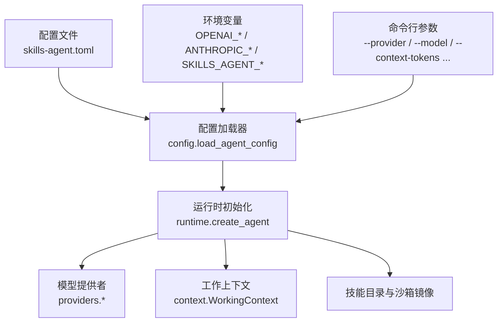
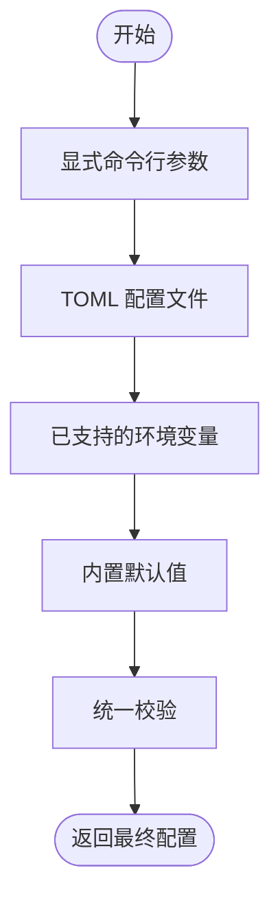
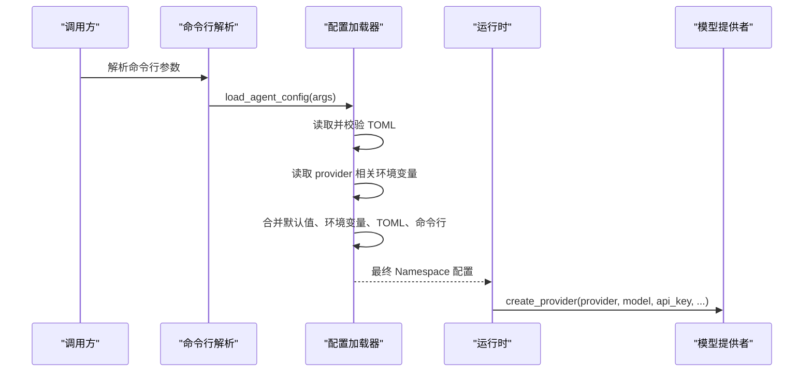
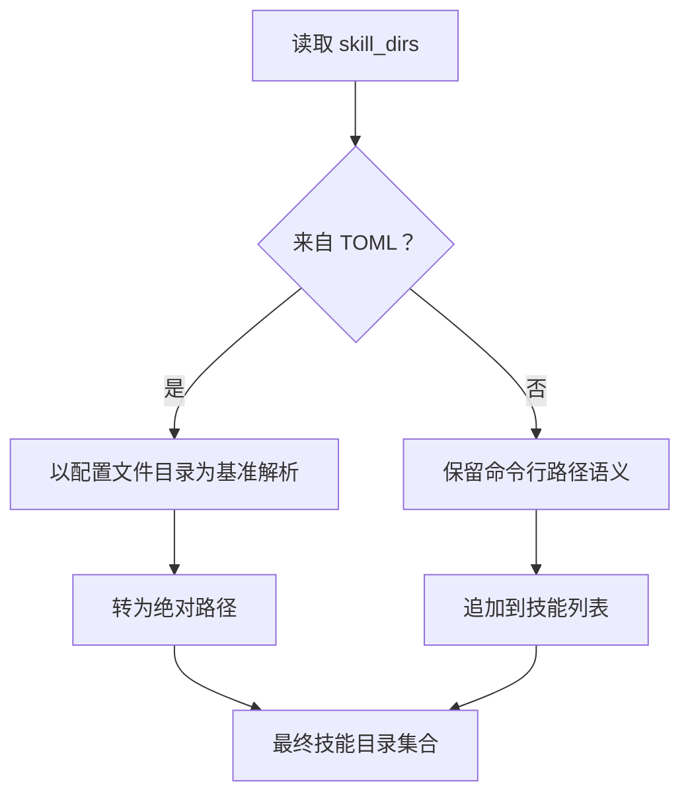
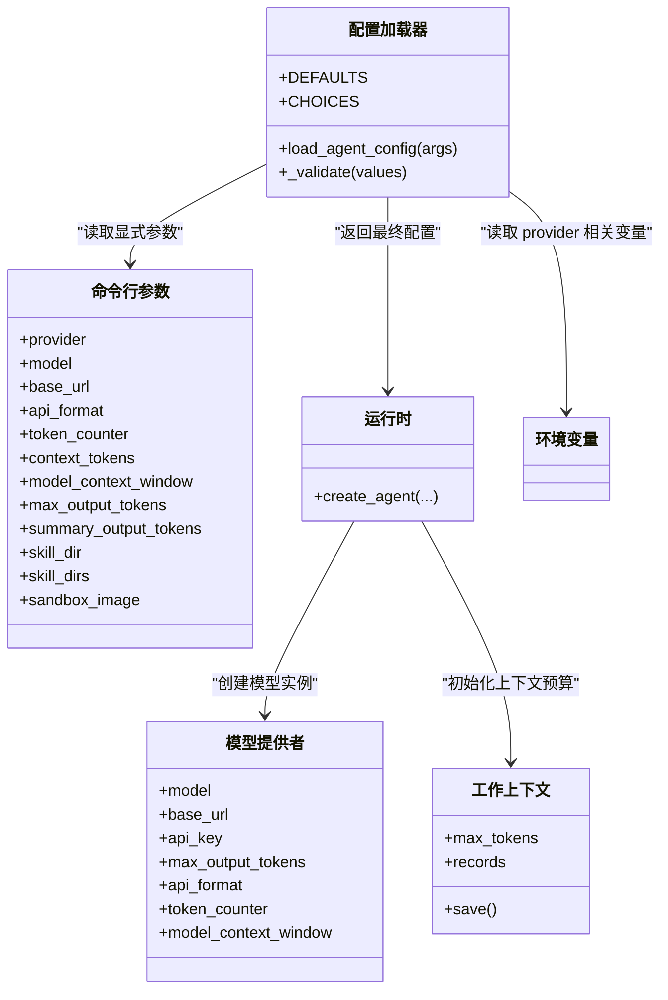

# 配置与环境变量

<cite>
**本文引用的文件**   
- [skills-agent.toml](file://skills-agent.toml)
- [config.py](file://skills_agent/config.py)
- [cli.py](file://skills_agent/cli.py)
- [runtime.py](file://skills_agent/runtime.py)
- [base.py](file://skills_agent/providers/base.py)
- [__init__.py（上下文）](file://skills_agent/context/__init__.py)
- [usage.md](file://docs/usage.md)
- [test_config.py](file://tests/test_config.py)
</cite>

## 目录
1. [简介](#简介)
2. [项目结构与配置入口](#项目结构与配置入口)
3. [配置文件字段参考](#配置文件字段参考)
4. [配置加载优先级与解析规则](#配置加载优先级与解析规则)
5. [典型配置示例](#典型配置示例)
6. [相对路径与技能目录解析](#相对路径与技能目录解析)
7. [安全与生产环境建议](#安全与生产环境建议)
8. [常见问题排查](#常见问题排查)
9. [架构总览图](#架构总览图)

## 简介
本文档面向使用 `skills-agent` 的用户，系统性说明如何通过 `skills-agent.toml`、命令行参数和环境变量配置模型连接、上下文窗口、输出额度、API 协议、Token 计数方式以及技能目录和沙箱镜像。文档还覆盖配置验证规则、路径解析行为、OpenAI / Anthropic / DeepSeek 类接入的典型写法，以及生产部署时的安全注意事项和常见错误定位方法。

## 项目结构与配置入口
配置系统由以下部分协作完成：
- `skills-agent.toml`：可选的 TOML 配置文件，提供默认或可被覆盖的配置项。
- `skills_agent/config.py`：实现配置文件的读取、校验、环境变量合并与最终配置对象生成。
- `skills_agent/cli.py`：定义 CLI 参数；当未显式设置时，会检查对应 provider 的环境变量。
- `skills_agent/runtime.py`：将最终配置传入模型创建、技能加载和 Agent 初始化流程。
- `skills_agent/providers/base.py`：提供默认最大输出 Token 等常量。
- `skills_agent/context/__init__.py`：提供工作上下文默认 Token 预算。
- `docs/usage.md`：用户级使用说明，包含优先级、环境变量命名和部分示例。
- `tests/test_config.py`：覆盖配置优先级、路径解析、非法配置及缺失配置的测试用例。

**图表来源**
- [config.py:1-74](file://skills_agent/config.py#L1-L74)
- [cli.py:1-200](file://skills_agent/cli.py#L1-L200)
- [runtime.py:6-56](file://skills_agent/runtime.py#L6-L56)
- [base.py:1-200](file://skills_agent/providers/base.py#L1-L200)
- [__init__.py（上下文）:1-200](file://skills_agent/context/__init__.py#L1-L200)

**章节来源**
- [skills-agent.toml:1-18](file://skills-agent.toml#L1-L18)
- [config.py:1-74](file://skills_agent/config.py#L1-L74)
- [cli.py:1-200](file://skills_agent/cli.py#L1-L200)
- [runtime.py:6-56](file://skills_agent/runtime.py#L6-L56)
- [usage.md:1-161](file://docs/usage.md#L1-L161)

## 配置文件字段参考
`skills-agent.toml` 是可选文件；如果不存在，程序仍可从环境变量和内置默认值启动。当前支持的顶层字段如下表所示。

| 字段 | 类型 | 是否必填 | 默认值 | 说明 |
|---|---|---:|---|---|
| `context_tokens` | 正整数 | 否 | `1000000` | 工作上下文预算。非 `usage` 模式下的有效输入预算通常受 `min(context_tokens, model_context_window - max_output_tokens)` 影响。 |
| `model_context_window` | 正整数或空 | 否 | 空 | 模型实际上下文窗口大小。用于限制工作上下文预算上限。 |
| `max_output_tokens` | 正整数 | 否 | `32768` | 单次模型输出额度，包括思考内容。 |
| `summary_output_tokens` | 正整数 | 否 | `8192` | 辅助生成任务使用的输出额度。 |
| `provider` | 字符串 | 否 | `"openai"` | 模型提供方，仅允许 `"openai"` 或 `"anthropic"`。 |
| `model` | 非空字符串 | 否 | 空 | 模型名称；若未通过命令行或环境变量提供，会在运行时报错。 |
| `base_url` | 非空字符串 | 否 | 空 | API 根地址，例如兼容服务的 `/v1` 前缀地址。 |
| `api_format` | 字符串 | 否 | `"auto"` | API 协议格式，允许 `"auto"`、`"responses"` 或 `"chat"`。 |
| `token_counter` | 字符串 | 否 | `"auto"` | Token 计数方式，允许 `"auto"`、`"official"` 或 `"usage"`。 |
| `skill_dirs` | 字符串数组 | 否 | 空列表 | 额外技能目录；TOML 中的路径相对于配置文件所在目录解析。 |
| `sandbox_image` | 非空字符串 | 否 | 空 | 可选的沙箱镜像名称；为空表示不使用隔离沙箱镜像。 |

### 字段取值约束
- 所有以 `_tokens` 结尾的字段以及 `model_context_window` 必须是正整数。
- `skill_dirs` 必须是非空字符串组成的列表。
- `provider` 仅允许 `openai`、`anthropic`。
- `api_format` 仅允许 `auto`、`responses`、`chat`。
- `token_counter` 仅允许 `auto`、`official`、`usage`。
- 其他字符串字段不能为空字符串。
- 未知字段会直接拒绝，避免静默忽略。

上述规则在配置加载阶段执行，并在最终合并后的值上再次校验。

**章节来源**
- [config.py:1-74](file://skills_agent/config.py#L1-L74)
- [base.py:1-200](file://skills_agent/providers/base.py#L1-L200)
- [__init__.py（上下文）:1-200](file://skills_agent/context/__init__.py#L1-L200)
- [test_config.py:1-143](file://tests/test_config.py#L1-L143)

## 配置加载优先级与解析规则
配置加载顺序为：

具体规则如下：

1. **显式命令行参数最高优先**  
   例如 `--provider openai`、`--model gpt-6-luna`、`--context-tokens 1000000`、`--max-output-tokens 32768`、`--api-format chat`、`--token-counter usage`、`--skill-dir extra-skills` 等都会覆盖后续来源的值。

2. **配置文件次之**  
   `skills-agent.toml` 位于工作目录下；也可以通过 `--config /path/to/agent.toml` 指定另一份文件。只读取这一份文件，不会合并多份 TOML。

3. **环境变量再次之**  
   支持的变量包括：
   - `OPENAI_MODEL`、`ANTHROPIC_MODEL`：根据当前 `provider` 选择对应变量。
   - `OPENAI_BASE_URL`、`ANTHROPIC_BASE_URL`：同上，按 provider 区分。
   - `SKILLS_AGENT_API_FORMAT`
   - `SKILLS_AGENT_TOKEN_COUNTER`
   - `OPENAI_API_KEY`、`ANTHROPIC_API_KEY`：密钥只从环境变量读取，不写入 TOML。

4. **内置默认值保底**  
   默认 provider 为 `openai`，默认上下文预算为 `1000000`，默认最大输出为 `32768`，默认摘要输出为 `8192`，默认 API 格式和 Token 计数器均为 `auto`。

5. **环境变量对模型和基础地址的选择依赖当前 provider**  
   即使配置文件或命令行将 provider 改为 `anthropic`，也不会自动把 `OPENAI_MODEL` 当作 Anthropic 模型；应使用 `ANTHROPIC_MODEL`。

6. **缺少 model 时会报错**  
   运行时要求必须存在 model，否则抛出需要配置 `model` 或 `--model` 或对应 provider 的 `_MODEL` 环境变量的错误。

**图表来源**
- [config.py:1-74](file://skills_agent/config.py#L1-L74)
- [cli.py:1-200](file://skills_agent/cli.py#L1-L200)
- [runtime.py:6-56](file://skills_agent/runtime.py#L6-L56)

**章节来源**
- [config.py:1-74](file://skills_agent/config.py#L1-L74)
- [cli.py:1-200](file://skills_agent/cli.py#L1-L200)
- [runtime.py:6-56](file://skills_agent/runtime.py#L6-L56)
- [usage.md:1-161](file://docs/usage.md#L1-L161)
- [test_config.py:1-143](file://tests/test_config.py#L1-L143)

## 典型配置示例
下面给出三类典型场景的配置要点。为避免泄露密钥，示例中不展示真实密钥值，密钥应通过环境变量注入。

### OpenAI 兼容服务
适用场景：官方 OpenAI 接口、兼容 `/v1/chat/completions` 或 `/v1/responses` 的网关、本地代理。

- 环境变量：
  - `OPENAI_API_KEY`：必需。
  - `OPENAI_MODEL`：可选；若未在命令行或 TOML 提供，则必须设置。
  - `OPENAI_BASE_URL`：可选；兼容服务根地址。
- TOML 可选字段：
  - `provider = "openai"`
  - `model`
  - `base_url`
  - `api_format = "auto"` 或 `"responses"` 或 `"chat"`
  - `token_counter = "auto"` 或 `"usage"`
  - `context_tokens`
  - `model_context_window`
  - `max_output_tokens`
  - `summary_output_tokens`

注意：
- 使用 Responses 协议时，可通过 `api_format = "responses"` 显式启用。
- 使用 `token_counter = "usage"` 时，依赖模型响应中的用量字段判断上下文预算，而不是独立计数接口。

### Anthropic
适用场景：Claude 系列模型。

- 环境变量：
  - `ANTHROPIC_API_KEY`：必需。
  - `ANTHROPIC_MODEL`：可选；若未通过其他方式提供，则必须设置。
- TOML 可选字段：
  - `provider = "anthropic"`
  - `model`
  - `base_url`
  - `api_format`
  - `token_counter`
  - `context_tokens`
  - `model_context_window`
  - `max_output_tokens`
  - `summary_output_tokens`

注意：
- Anthropic 的 API 地址通常不同于 OpenAI 的 `/v1`；如使用兼容网关，请同时设置 `base_url`。
- 不要复制 `ANTHROPIC_API_KEY` 到 TOML。

### DeepSeek 类接入
DeepSeek 通常通过 OpenAI 兼容接口接入，因此多数情况下使用 `provider = "openai"`，并通过 `base_url` 指向其兼容端点。

推荐做法：
- `provider = "openai"`
- `model` 填写 DeepSeek 支持的模型名称。
- `base_url` 填写兼容服务地址。
- 如果使用支持 Responses 用量字段的网关，可配合 `api_format = "responses"` 与 `token_counter = "usage"`。
- 如果网关只暴露 Chat Completions，可选择 `api_format = "chat"` 与 `token_counter = "auto"`。

注意：
- 旧的 DeepSeek 本地 tokenizer 配置已不再支持；任何尝试配置类似旧版 token 计数器的行为会被校验拒绝。
- 如果使用的是非官方兼容服务，请确保该服务返回预期的用量结构，否则可能需要改用 `usage` 以外的计数策略。

**章节来源**
- [usage.md:1-161](file://docs/usage.md#L1-L161)
- [test_config.py:1-143](file://tests/test_config.py#L1-L143)
- [config.py:1-74](file://skills_agent/config.py#L1-L74)

## 相对路径与技能目录解析
`skill_dirs` 的行为取决于来源：

| 来源 | 相对基准 | 覆盖规则 |
|---|---|---|
| `skills-agent.toml` 中的 `skill_dirs` | 配置文件所在目录 | 被 `--skill-dir` 完全覆盖 |
| `--skill-dir` 命令行参数 | 启动工作目录 | 追加到内置技能目录和工作区技能目录之后 |
| 内置技能目录 | 固定包路径 | 始终加载 |
| 工作区技能目录 | 工作目录 | 始终加载 |

关键行为：
- TOML 中的 `skill_dirs` 在加载时会被展开为绝对路径，并以配置文件所在目录为基准。
- 使用 `--config` 指定另一个 TOML 文件时，该文件中 `skill_dirs` 的相对路径基于该文件所在目录解析，而不是当前工作目录。
- 命令行 `--skill-dir` 仍然保持为相对启动目录的路径形式，不会被转换成 TOML 那样的绝对路径语义。
- 如果某个技能目录不存在，配置本身可能通过静态校验，但后续加载技能或运行工具时可能出现路径相关错误。

**图表来源**
- [config.py:1-74](file://skills_agent/config.py#L1-L74)
- [runtime.py:6-56](file://skills_agent/runtime.py#L6-L56)

**章节来源**
- [config.py:1-74](file://skills_agent/config.py#L1-L74)
- [test_config.py:1-143](file://tests/test_config.py#L1-L143)

## 安全与生产环境建议
### 密钥管理原则
1. **不要把 API Key 写入 TOML 或代码仓库**  
   配置文件注释明确强调 API Key 应留在环境变量或 `.env` 中。
2. **使用 `.env` 或外部密钥管理服务**  
   可通过 `uv run --env-file .env` 等方式加载 `.env`，或通过容器编排平台、密钥管理服务注入 `OPENAI_API_KEY` / `ANTHROPIC_API_KEY`。
3. **最小权限原则**  
   为不同环境分配不同的密钥，避免生产密钥共享给开发环境。
4. **避免日志泄露**  
   虽然诊断模块会对部分敏感信息进行重处理，但仍应避免主动打印完整请求体、响应体和密钥。
5. **分离配置与数据**  
   将 `skills-agent.toml` 作为部署配置的一部分，但不包含密钥；密钥由运行环境注入。

### 生产部署建议
- 使用只读挂载的配置文件目录，避免运行进程修改配置。
- 通过容器镜像固化版本，通过环境变量注入模型、地址和密钥。
- 记录配置来源而非明文密钥；审计时应能确认使用了哪个 provider、哪个 model、哪个 base_url。
- 对 `base_url` 做白名单校验，防止指向不可信内部地址。
- 对 `model_context_window` 和 `max_output_tokens` 进行合理性检查，避免过大输出导致资源耗尽。
- 对 `skill_dirs` 使用绝对路径或严格校验相对路径目标，防止路径遍历。

[本节为通用安全建议，不直接分析具体代码文件]

## 常见问题排查

### 1. 配置验证失败
常见原因：
- 使用了不支持的 provider，例如非 `openai` 或非 `anthropic`。
- `api_format` 不是 `auto`、`responses` 或 `chat`。
- `token_counter` 不是 `auto`、`official` 或 `usage`。
- `context_tokens`、`model_context_window`、`max_output_tokens`、`summary_output_tokens` 不是正整数。
- `skill_dirs` 不是字符串数组，或包含空字符串。
- 字符串字段为空字符串。
- 出现了未知字段名。
- TOML 语法错误，例如数组或键值不完整。

处理方法：
- 先检查字段类型是否为 TOML 期望的类型。
- 再检查枚举值是否在允许范围内。
- 删除拼写错误的字段名，因为未知字段会直接报错。
- 查看测试用例中列出的非法配置样例，对照修复。

**章节来源**
- [config.py:1-74](file://skills_agent/config.py#L1-L74)
- [test_config.py:1-143](file://tests/test_config.py#L1-L143)

### 2. 缺少 model 报错
现象：
- 启动时报错提示需要配置 `model`，或需要设置 `--model` 或对应 provider 的 `_MODEL` 环境变量。

原因：
- 命令行没有传 `--model`。
- TOML 中没有 `model`。
- 当前 provider 对应的 `_MODEL` 环境变量也没有设置。

处理方法：
- 如果是 OpenAI，设置 `OPENAI_MODEL`。
- 如果是 Anthropic，设置 `ANTHROPIC_MODEL`。
- 或在命令行添加 `--model`。
- 或在 `skills-agent.toml` 中添加 `model`。

**章节来源**
- [cli.py:1-200](file://skills_agent/cli.py#L1-L200)
- [runtime.py:6-56](file://skills_agent/runtime.py#L6-L56)

### 3. 环境变量没有生效
现象：
- TOML 中设置了 `provider = "anthropic"`，但程序仍读取了 `OPENAI_MODEL`。
- 设置了 `OPENAI_BASE_URL`，但 Anthropic 配置下没有生效。

原因：
- 环境变量是按 provider 分前缀的。Anthropic 应使用 `ANTHROPIC_MODEL` 和 `ANTHROPIC_BASE_URL`。
- 如果 TOML 覆盖了 `model` 或 `base_url`，则环境变量会被覆盖。
- 如果命令行覆盖了这些字段，则 TOML 和环境变量都会被覆盖。

处理方法：
- 确认 provider 与对应环境变量前缀一致。
- 确认没有更高优先级的命令行参数覆盖。
- 使用测试用例中的覆盖逻辑帮助理解优先级。

**章节来源**
- [config.py:1-74](file://skills_agent/config.py#L1-L74)
- [test_config.py:1-143](file://tests/test_config.py#L1-L143)

### 4. 路径不存在或技能目录异常
现象：
- 启动成功，但运行技能时报找不到文件或路径无效。

原因：
- TOML 中的 `skill_dirs` 是相对配置文件目录解析的，可能与预期目录不一致。
- 命令行 `--skill-dir` 是相对启动目录的，与 TOML 的解析基准不同。
- 某些目录不存在时，静态配置校验不一定立即发现。

处理方法：
- 检查 `--config` 指向的 TOML 所在目录。
- 将 TOML 中的 `skill_dirs` 改为绝对路径，或确保相对路径正确。
- 对命令行 `--skill-dir` 使用启动目录下的真实路径。
- 在部署脚本中预先校验目录是否存在。

**章节来源**
- [config.py:1-74](file://skills_agent/config.py#L1-L74)
- [test_config.py:1-143](file://tests/test_config.py#L1-L143)

### 5. 模型不兼容或上下文超限
现象：
- 模型返回输出长度限制、上下文超限、内容过滤等错误。
- 压缩提前触发或迟迟不触发。

原因：
- `max_output_tokens` 大于模型实际支持输出。
- `model_context_window` 与实际模型能力不符。
- `context_tokens` 设置过大，超出模型上下文窗口。
- `token_counter = "usage"` 依赖最近一次有效主模型返回用量；如果没有有效返回，本地阈值判断可能无法准确触发压缩。
- 非 `usage` 模式下，有效输入预算还会减去 `max_output_tokens`。

处理方法：
- 根据模型厂商文档调整 `model_context_window` 和 `max_output_tokens`。
- 将 `context_tokens` 设置为不超过模型窗口的合理值。
- 对于支持 Responses 用量的网关，优先使用 `api_format = "responses"` 和 `token_counter = "usage"`。
- 观察上下文压缩日志，确认是否按预期触发。
- 关注错误分类中的 `output_limit`、`content_filter` 等类别，以区分输出限制和内容策略问题。

**章节来源**
- [usage.md:1-161](file://docs/usage.md#L1-L161)
- [base.py:1-200](file://skills_agent/providers/base.py#L1-L200)
- [__init__.py（上下文）:1-200](file://skills_agent/context/__init__.py#L1-L200)

### 6. 指定的配置文件不存在
现象：
- 使用 `--config /path/to/missing.toml` 时报文件未找到。

原因：
- 显式 `--config` 路径不存在。

处理方法：
- 确认文件路径正确。
- 如果希望回退到工作目录下的 `skills-agent.toml`，不要传递不存在的 `--config`。

**章节来源**
- [test_config.py:1-143](file://tests/test_config.py#L1-L143)

## 架构总览图
下图展示配置从加载到运行时使用的主要关系。

**图表来源**
- [config.py:1-74](file://skills_agent/config.py#L1-L74)
- [cli.py:1-200](file://skills_agent/cli.py#L1-L200)
- [runtime.py:6-56](file://skills_agent/runtime.py#L6-L56)
- [base.py:1-200](file://skills_agent/providers/base.py#L1-L200)
- [__init__.py（上下文）:1-200](file://skills_agent/context/__init__.py#L1-L200)

## 结论
`skills-agent` 的配置系统以“命令行 > 配置文件 > 环境变量 > 默认值”为明确优先级，并通过严格校验保证配置安全可用。核心实践是：
- 将 API Key 放在环境变量或 `.env` 中，绝不提交到版本库。
- 将 provider、model、base_url、api_format、token_counter 等连接信息放在 TOML 或环境变量中。
- 将 `context_tokens`、`model_context_window`、`max_output_tokens`、`summary_output_tokens` 与所用模型的实际能力对齐。
- 对 `skill_dirs` 使用正确的相对路径基准，或显式使用 `--skill-dir`。
- 在出现配置错误、路径错误或模型超限时，优先对照本指南的错误分类和校验规则定位问题。

[本节为总结性内容，不直接分析具体代码文件]